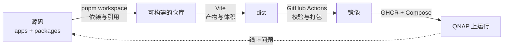

# 00 学习地图与使用方法

> **目标层级**：L1（先知道自己在学什么）
> **前置**：无 ｜ **预计**：1.5h（读 + 填自评）
> **本章产物**：一份自己的起点自评表，放在 `fe-lab/docs/self-check.md`

## 0. 先看终点

12 周后，用三个问题检验自己：

1. 扔给你一个 6 包仓库，你能在 10 分钟内说清每个依赖从哪来、为什么有的包会出现两份，并只构建改动涉及的部分。
2. 扔给你一个 2MB 的 Vite 产物，你能说出体积前三分别是谁、为什么进来、先动哪一个、预期收益多少。
3. 线上白屏，你能在 10 分钟内判断问题出在构建、缓存还是部署，并完成回滚。

这三个问题不是面试题，是日常。答不上来，说明对应的那一层还没打通。

## 1. 三块能力怎么咬合



很多人把工程化当成三个独立技能，实际上一半的问题都跨层：

- 线上白屏，可能是 tree shaking 删掉了有副作用的模块，CI 只跑了 lint 没跑真实构建，部署又没校验版本号——三层各漏了一点。
- 「本地能跑 CI 不能跑」，可能是 pnpm 版本不一致，也可能是某个依赖靠提升才可见，还可能是构建期变量没传进去。

所以顺序不能乱：**先能组织代码，再能产出可分析的结果，最后才是自动化。** 这也是为什么 CI 放在第 8 周，而不是第 3 周。

## 2. 能力三级

| 级别 | 定义 | 怎么检验 | 本教程的分布 |
|---|---|---|---|
| L1 会用 | 照文档能跑通，能改配置 | 复现出结果 | 每章起点 |
| L2 懂原理 | 能解释为什么、什么时候失效、报错怎么查 | 通过故障演练与自测 | 大部分章节的目标 |
| L3 能决策 | 能选型、定规范、做取舍、说服别人 | 完成闭卷练习 + 写出决策文档 | M1、M5、C1、C3、C6 |

只到 L1 的人，换个项目就废；只背 L2 结论不做 L3 的人，方案落不了地。教程每章开头都会标目标层级，避免在「会用」的章节里钻牛角尖。

## 3. 六步学习法

每章都按这个循环走，别跳步：

1. **先看终点**：不看正文，先跑一遍章末的验收命令，知道自己要做成什么样。
2. **读机制**：只看「为什么」，不背配置项。每个概念问四句：解决什么问题、怎么实现、什么时候失效、有什么替代。
3. **跟做**：命令自己敲。每步对照预期输出，不一致就先停下来查。
4. **闭卷**：合上教程，只按验收标准做。卡住 20 分钟再看提示。
5. **制造故障**：按演练步骤把东西弄坏，观察现象，修回来，写一条规范。
6. **复述**：用 3 句话讲给一个不做前端的人听。讲不清就是没懂。

## 4. 每章的结构

- `0` 先看终点：本章结束时的命令与输出
- `1` 知识讲解：问题场景 → 机制 → 概念表 → 失败模式 → 对比与边界 → 常见误解
- `2` 跟做实操：目标 → 起点检查 → 步骤 → 数据
- `3` 排障：本章高频错误，现象 → 原因 → 修复
- `4` 故障演练：故意弄坏、观察、修回、沉淀一条规范
- `5` 闭卷练习：只给目标和验收，合上教程重做
- `6` 验收清单：逐条可勾选，每条有命令或可观察结果
- `7` 自测：5 题，答案折叠
- `8` 延伸：2~3 个链接，标注读哪一节；公司落地的最小改动

## 5. 闭卷规则

每个 Part 结束有一次闭卷考核：

- 允许：官方文档、`--help`、搜索引擎
- 不允许：本教程、之前保存的配置、直接问 AI 要答案
- 时间：30~40 分钟
- 标准：做出来且能解释每一步；做不出来就重做该 Part 的实操，不往下走

闭卷不是考试，是暴露「看懂了」和「会做」之间的差距。

## 6. 五种常见失败模式

| 失败模式 | 表现 | 对策 |
|---|---|---|
| 收藏式学习 | 一路读过去，一个命令没敲 | 每章至少一个 commit，仓库就是进度条 |
| 配置搬运 | 能跑就行，问为什么就卡住 | 每行关键配置旁写一句「它防止了什么」 |
| 跳过排障 | 一路顺风，遇到报错就换教程 | 故障演练必须做，报错是主要内容 |
| 追新工具 | 说不清 workspace，先上 Turbo | 范围已收：只学当前规模用得上的 |
| 没有数据 | 「感觉快了不少」 | 所有优化必须有同机、同命令、三次中位数 |

## 7. 数据与产物

- `reports/` 存每次测量的 JSON，命名带时间戳
- 每章结束在 `docs/` 写三行：改了什么、数据变化、下次注意什么
- 第 12 周的仓库就是作品集：README、架构图、部署说明、故障手册齐全

报告模板（复制到 `docs/`）：

```md
## M3 依赖模型
- 改了什么：
- 数据：install 12.4s → 8.1s（3 次中位数，Windows 11 / Node 24.14）
- 结论与下次注意：
```

## 8. 本书约定

- 命令以 **PowerShell 7** 为主；与 bash 差异大的地方给折叠块
- 所有版本以 README 的环境基线为准，版本敏感处单独标注
- 代码块第一行写文件路径，关键配置不用 `...` 省略
- 每个命令都给「预期输出」，对不上就先排查，不要继续
- 报错信息保留原文，不翻译，方便搜索

## 9. 起点自评

新建 `fe-lab/docs/self-check.md`（第 1 周建仓库后补上），按 1~5 分打分，第 12 周再打一次：

| 能力 | 现在 | 12 周后 |
|---|---|---|
| 能解释 pnpm 为什么不会产生幽灵依赖 | | |
| 能写出「只构建某包及其依赖」的命令 | | |
| 能读懂构建分析报告并定位前三 | | |
| 能判断一个体积优化值不值得做 | | |
| 能从零写一条 PR 流水线 | | |
| 能解释缓存为什么该失效没失效 | | |
| 能完成一次部署与回滚 | | |
| 能把方案用 3 句话讲给非前端听 | | |

> 下一章：搭好环境与实验仓库。不要跳过——后面所有数字都来自这一章建立的测量方法。
