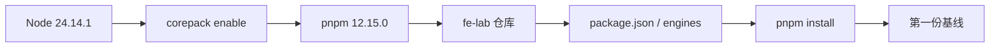

# 01 环境与实验仓库

> **目标层级**：L1 ｜ **前置**：无 ｜ **预计**：2h
> **验证环境**：Windows 11 / Node 24.14.1 / pnpm 12.15.0 / 2026-10
> **本章产物**：`fe-lab` 仓库 + 版本锁定 + 测量脚本 + 第一次提交

## 0. 先看终点

本章结束时，四条命令的输出应该是这样：

```powershell
PS> node -v
v24.14.1

PS> pnpm -v
12.15.0

PS> pnpm run bench -- --runs 1 -- node -v
第 1/1 次 ... v24.14.1

中位数: 0.08s
报告: reports/bench-1750000000000.json

PS> git log --oneline
a1b2c3d chore: init fe-lab
```

`fe-lab` 是接下来 11 周唯一的实验仓库。它不是演示项目，而是你要按章制造问题、观察、修好、再测量的工作台；教程不提供预埋脏数据的种子仓库。



## 1. 知识讲解

### 1.1 版本不锁，后面全是玄学

「我这能跑，CI 不能跑」的第一大来源是版本不一致：Node 20 和 24 对 ESM 的处理不同，pnpm 10 和 12 的设置位置与锁文件内容不同，Vite 7 和 8 的分包配置写法不同。

两道锁：

| 字段 | 约束什么 | 写在哪 | 谁执行 |
|---|---|---|---|
| `engines.node` | Node 版本范围 | `package.json` | pnpm（配合 `pnpm-workspace.yaml` 的 `engineStrict: true`）在安装时检查 |
| `packageManager` | 包管理器与精确版本 | `package.json` | Corepack 在运行 `pnpm` 时自动切换 |

`packageManager` 的价值：新人 clone 后不需要问「用哪个 pnpm」，Corepack 读到 `pnpm@12.15.0` 就下载并执行这个版本；CI 里也一样。这比 README 里写一句「建议使用 pnpm 12」可靠得多。

> 为什么锁 12.15.0？它是当前稳定线，你机器上 Corepack 拉到的就是这个版本；pnpm 11 起把项目设置统一到 `pnpm-workspace.yaml`，锁文件格式仍是 9.0。锁精确版本是为了让三个人、CI、Docker 构建用同一份实现。

### 1.2 pnpm 到底装了什么（够用版）

pnpm 不在每个项目里复制一份依赖，而是：

1. 全局 **store** 按内容寻址存一份包（同一版本、同样内容只存一次）
2. 项目的 `node_modules` 里放**符号链接**，指向 store
3. 每个包自己的 `node_modules` 只包含它声明的依赖，不能越级访问别人的依赖

第 3 点是「pnpm 为什么没有幽灵依赖」的全部答案，M3 会展开。现在只需要记住：`node_modules` 看起来正常，实际是一张链接网。

```powershell
pnpm store path
# 预期：一个全局目录，比如 C:\Users\<你>\AppData\Local\pnpm\store\v11
```

### 1.3 Windows 上必须先处理的四件事

| 问题 | 现象 | 处理 |
|---|---|---|
| 脚本执行策略 | `pnpm.ps1 无法加载，因为在此系统上禁止运行脚本` | `Set-ExecutionPolicy -Scope CurrentUser RemoteSigned` |
| 符号链接权限 | `EPERM: operation not permitted, symlink` | 开启「开发者模式」，pnpm 会优先用 junction，多数情况无需管理员 |
| 长路径 | `Filename too long` | `git config --global core.longpaths true` |
| CRLF | 只改了一行，`git status` 显示整个文件都变了 | `.gitattributes` 锁 LF，必要时 `git add --renormalize .` |

另外两条命令差异，后面会反复遇到：

```powershell
# bash: mkdir -p apps/admin
New-Item -ItemType Directory -Force -Path apps/admin | Out-Null

# bash: NODE_ENV=production pnpm build
$env:NODE_ENV = "production"; pnpm build
```

不要用 `&&` 连接命令：PowerShell 5.1 不支持，7 才支持。教程统一一行一条。

### 1.4 仓库骨架

```
fe-lab/
├─ apps/                 # 应用（M2 开始建）
├─ packages/             # 内部包（M2 开始建）
├─ tooling/bench/        # 测量脚本
├─ reports/              # 每次测量的 JSON
├─ docs/                 # 决策记录、自评、复盘
├─ package.json
├─ pnpm-workspace.yaml   # 项目级设置；M2 再加 packages 字段
├─ .nvmrc
├─ .gitattributes
├─ .editorconfig
├─ .gitignore
└─ README.md
```

这一章只装工具和骨架，不装框架。M2 才建第一个包。

## 2. 实操

### 2.1 安装 Node 与 pnpm

1. 安装 Node 24 LTS（[nodejs.org](https://nodejs.org/)），安装时勾选「Add to PATH」。
2. 以**管理员身份**打开一次 PowerShell，启用 Corepack 的 shim（只需要一次）：

```powershell
corepack enable
```

3. 普通 PowerShell 里验证：

```powershell
node -v
# 预期：v24.x.x

corepack --version
# 预期：有版本号输出；如果提示找不到命令，执行 npm install -g corepack
```

> `corepack enable` 会在 Node 安装目录写 shim，所以需要管理员权限。失败时先看 3.1 的排障。

### 2.2 初始化仓库

```powershell
New-Item -ItemType Directory -Force -Path E:\1code\study\fe-lab | Out-Null
Set-Location E:\1code\study\fe-lab

git init -b main
New-Item -ItemType Directory -Force -Path tooling/bench, reports, docs | Out-Null
```

### 2.3 创建基础文件

用编辑器创建下面 7 个文件。不要用 `echo` 写 JSON，Windows 的编码和引号会把内容弄坏。

`package.json`

```json
{
  "name": "fe-lab",
  "private": true,
  "packageManager": "pnpm@12.15.0",
  "engines": {
    "node": ">=24.0.0"
  },
  "scripts": {
    "bench": "node tooling/bench/bench.mjs"
  }
}
```

`pnpm-workspace.yaml`

```yaml
engineStrict: true
```

pnpm 11 起，项目级设置统一写在 `pnpm-workspace.yaml`，`.npmrc` 只保留 registry 与认证。把 `engineStrict` 写在 `.npmrc` 里不会再生效。

`.nvmrc`

```
24
```

`.gitattributes`

```gitattributes
* text=auto eol=lf

*.png binary
*.jpg binary
*.jpeg binary
*.woff2 binary
```

`.editorconfig`

```ini
root = true

[*]
charset = utf-8
end_of_line = lf
insert_final_newline = true
indent_style = space
indent_size = 2
```

`.gitignore`

```gitignore
node_modules/
dist/
coverage/
.env
.env.*
!.env.example
*.log
.DS_Store
Thumbs.db
```

`README.md`

```md
# fe-lab

前端工程化实验仓库。按 `fe-engineering` 教程逐章搭建。

## 命令

- `pnpm install`
- `pnpm run bench -- --runs 3 --dir <dir> -- <command>`
```

### 2.4 让 Corepack 接管 pnpm

在仓库根目录执行：

```powershell
Set-ExecutionPolicy -Scope CurrentUser RemoteSigned
pnpm -v
```

预期输出 `12.15.0`。第一次运行可能停留几秒下载，这是 Corepack 按 `packageManager` 拉取对应版本。

```powershell
pnpm install
# 预期：Already up to date，生成 pnpm-lock.yaml
```

> 如果 `pnpm -v` 显示的不是 12.15.0，先执行 `corepack install -g pnpm@12.15.0`，再重试。

> **已经按 pnpm 10 建过 `fe-lab`？** 做三件事：把 `packageManager` 改成 `pnpm@12.15.0`；把 `.npmrc` 里的 `engine-strict=true` 删掉，在 `pnpm-workspace.yaml` 写 `engineStrict: true`；执行 `pnpm install`。锁文件格式兼容，pnpm 会把 store 重建为 v11。旧配置里如果还有 `onlyBuiltDependencies`，换成 `allowBuilds` 映射。

### 2.5 写测量脚本

后面所有「快了」「小了」都要靠它，禁止拍脑袋。

`tooling/bench/bench.mjs`

```js
#!/usr/bin/env node
import { spawnSync } from 'node:child_process'
import { performance } from 'node:perf_hooks'
import { existsSync, mkdirSync, readdirSync, statSync, writeFileSync } from 'node:fs'
import { join, resolve } from 'node:path'

function parseArgs(argv) {
  const opts = { runs: 3, dir: null, label: null, command: '' }
  let i = 0
  for (; i < argv.length; i += 1) {
    const arg = argv[i]
    if (arg === '--') {
      i += 1
      break
    }
    if (arg === '--runs') opts.runs = Number(argv[(i += 1)])
    else if (arg === '--dir') opts.dir = argv[(i += 1)]
    else if (arg === '--label') opts.label = argv[(i += 1)]
    else throw new Error(`未知参数: ${arg}`)
  }
  opts.command = argv.slice(i).join(' ')
  if (!opts.command) {
    throw new Error('缺少命令。用法: pnpm run bench -- --runs 3 --dir dist -- pnpm build')
  }
  if (!Number.isInteger(opts.runs) || opts.runs < 1) {
    throw new Error('--runs 必须是正整数')
  }
  return opts
}

function dirSize(dir) {
  return readdirSync(dir, { withFileTypes: true }).reduce((total, entry) => {
    const full = join(dir, entry.name)
    if (entry.isDirectory()) return total + dirSize(full)
    if (entry.isFile()) return total + statSync(full).size
    return total
  }, 0)
}

const opts = parseArgs(process.argv.slice(2))
const times = []

for (let run = 1; run <= opts.runs; run += 1) {
  process.stderr.write(`第 ${run}/${opts.runs} 次 ... `)
  const start = performance.now()
  const result = spawnSync(opts.command, { shell: true, stdio: 'inherit' })
  const ms = performance.now() - start

  if (result.status !== 0) {
    process.stderr.write(`失败，退出码 ${result.status}\n`)
    process.exit(result.status ?? 1)
  }

  times.push(ms)
  process.stderr.write(`${(ms / 1000).toFixed(2)}s\n`)
}

const sorted = [...times].sort((a, b) => a - b)
const median = sorted[Math.floor(sorted.length / 2)]
const target = opts.dir ? resolve(opts.dir) : null
const bytes = target && existsSync(target) ? dirSize(target) : null

const report = {
  label: opts.label ?? opts.command,
  command: opts.command,
  runs: opts.runs,
  timesMs: times.map((n) => Math.round(n)),
  medianMs: Math.round(median),
  dir: opts.dir,
  bytes,
  at: new Date().toISOString(),
  node: process.version,
  platform: `${process.platform}-${process.arch}`,
}

mkdirSync('reports', { recursive: true })
const file = join('reports', `bench-${Date.now()}.json`)
writeFileSync(file, `${JSON.stringify(report, null, 2)}\n`)

console.log(`\n中位数: ${(median / 1000).toFixed(2)}s`)
if (bytes !== null) console.log(`产物: ${(bytes / 1024 / 1024).toFixed(2)} MiB`)
console.log(`报告: ${file}`)
```

验证：

```powershell
pnpm run bench -- --runs 1 -- node -v
```

预期：

```
第 1/1 次 ... v24.14.1

中位数: 0.08s
报告: reports/bench-<时间戳>.json
```

打开生成的 JSON，确认 `node`、`platform`、`medianMs` 三项都有值。从下一章起，构建和产物体积都用它记录。

### 2.6 提交并推到 GitHub

```powershell
git add -A
git commit -m "chore: init fe-lab"

gh auth login
gh repo create fe-lab --private --source=. --remote=origin --push
```

`gh auth login` 选 GitHub.com → HTTPS → 浏览器登录。最后一步如果提示仓库已存在，换一个名字或加 `--force` 前先确认。

验证：

```powershell
git remote -v
# 预期：origin 指向你的 GitHub 仓库

gh repo view --web
# 预期：浏览器打开 fe-lab 仓库，能看到一次提交
```

先把仓库设为 private：第 8 周的 GHCR 镜像默认也是私有，正好练习带鉴权的拉取；第 12 周做作品集时再决定是否公开。

## 3. 排障

**3.1 `pnpm.ps1 无法加载，因为在此系统上禁止运行脚本`**

```powershell
Set-ExecutionPolicy -Scope CurrentUser RemoteSigned
```

只影响当前用户，不需要改组策略。

**3.2 `corepack enable` 报 EPERM / 拒绝访问**

用管理员身份打开 PowerShell 再执行一次。若公司电脑无权限，改用 `corepack pnpm -v` 临时验证，并在 CI 里用 `pnpm/action-setup`。

**3.3 `ERR_PNPM_UNSUPPORTED_ENGINE`**

当前 Node 低于 24。`node -v` 确认；用 nvm-windows 或 fnm 切到 24 后重开终端。

**3.4 `EPERM: operation not permitted, symlink`**

设置 → 系统 → 开发者选项 → 打开「开发人员模式」，然后删除 `node_modules` 重装：

```powershell
Remove-Item -Recurse -Force node_modules
pnpm install
```

**3.5 `git status` 显示所有文件都被修改**

`.gitattributes` 加晚了。执行：

```powershell
git add --renormalize .
git status
```

**3.6 `Filename too long`**

```powershell
git config --global core.longpaths true
```

## 4. 故障演练：把版本锁拆掉

**制造**：把 `package.json` 里的 `"packageManager": "pnpm@12.15.0"` 改成 `"pnpm@8.15.9"`。

**观察**：

```powershell
pnpm -v
```

Corepack 会下载并切换到 8.15.9。执行 `pnpm install`，会直接失败：

```
ERR_PNPM_INVALID_WORKSPACE_CONFIGURATION  packages field missing or empty
```

pnpm 8 不认识「只有设置、没有 packages」的 `pnpm-workspace.yaml`，也读不懂 `engineStrict`。如果你给它补一个 `packages` 字段，它还会把 `lockfileVersion` 从 9.0 改回 6.0。想象一下：同事用 8、CI 用 12、锁文件来回变，会是什么局面。

**修复**：改回 `12.15.0`，重新 `pnpm install`，确认 `pnpm-lock.yaml` 恢复到 9.0。

**沉淀**：在 `docs/` 记一条——「包管理器版本只由 `packageManager` 决定，不在 README 写建议版本」。

## 5. 闭卷练习

合上教程，从一个空目录开始，只按下面的验收标准重建：

1. 创建 `fe-lab` 私有仓库，初始化 `package.json`；
2. 用 `packageManager` 锁定 pnpm 12.15.0，并说明 Corepack 如何生效；
3. 写 `pnpm-workspace.yaml`，至少包含 `engineStrict: true`；
4. 写 `tooling/bench/bench.mjs`，能跑三次、取中位数、输出 JSON；
5. 跑一次 `pnpm run bench -- --runs 1 -- node -v`；
6. 提交并推到 GitHub，确认 `.gitattributes` 的换行策略。

验收标准：

- `node -v` / `pnpm -v` 符合基线；
- `pnpm install` 不需要手动选版本；
- bench 报告含 `timesMs`、`medianMs`、`node`、`platform`；
- 仓库只有一次有意义的初始提交；
- 你说得出「为什么锁版本」和「store 与 node_modules 的区别」。

## 6. 验收清单

- [ ] `node -v` 输出 v24.x
- [ ] `pnpm -v` 输出 12.15.0
- [ ] `pnpm store path` 有输出
- [ ] `pnpm run bench -- --runs 1 -- node -v` 生成 JSON，含 `medianMs`
- [ ] `git log --oneline` 只有一次提交
- [ ] `git remote -v` 指向你的 GitHub 仓库
- [ ] 仓库是 private
- [ ] `docs/self-check.md` 已按 00 章的表格填好

## 7. 自测

1. `packageManager` 和 `engines.node` 分别约束什么？谁在什么时候执行？
2. 为什么 clone 后不需要手动问「用哪个 pnpm」？
3. 用一句话说清 pnpm store 和项目 `node_modules` 的关系。
4. `.gitattributes` 里的 `eol=lf` 解决了什么问题？不写会怎样？
5. 用 3 句话向同事解释「为什么要锁版本」，不许用「规范」「最佳实践」这种词。

<details><summary>参考答案</summary>

1. `packageManager` 锁包管理器及精确版本，由 Corepack 在运行 pnpm 时读取并切换；`engines.node` 限 Node 范围，由 pnpm 在安装时检查（需 `pnpm-workspace.yaml` 的 `engineStrict: true`）。
2. Corepack 读 `package.json` 的 `packageManager`，自动下载并执行对应版本。
3. store 是全机器共享的内容仓库，项目的 `node_modules` 只是指向 store 的链接，不复制包内容。
4. 统一换行符为 LF，避免 Windows 的 CRLF 与仓库里的 LF 互相转换导致整文件 diff。
5. 示例：三个人三个 pnpm 版本，锁文件格式不同，装出来的依赖树也不同，最后 CI 报错却没人能复现。把版本写进 `packageManager`，谁 clone 都用同一个版本，问题只剩代码本身。

</details>

## 8. 延伸

- [Corepack 官方文档](https://nodejs.org/api/corepack.html) —— 读开头「What is Corepack」和 `packageManager` 两节即可
- [pnpm 安装](https://pnpm.io/installation) —— 看「Using Corepack」，别的安装方式先跳过
- [gitattributes](https://git-scm.com/docs/gitattributes) —— 只读 `text` 与 `eol` 两节
- 公司落地最小改动：在现有项目加 `packageManager` 与 `pnpm-workspace.yaml` 的 `engineStrict`，不改任何构建配置，先消掉「版本不一致」这一类问题

> 下一章 M1：先判断你到底该不该上 Monorepo，再动手。仓库已经能提交了，别急着建包。
