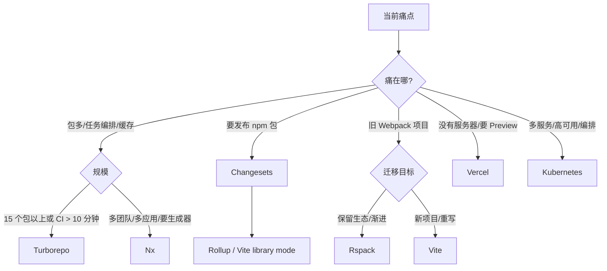

# 附录 C · 工具地图

> 这里只回答四个问题：解决什么、什么信号才值得学、和已学内容怎么替换、大概多久。
> 不写安装步骤，不写配置示例。Docker 已进正文，不在这里。

## 1. 一张图



## 2. 八个工具

| 工具 | 解决什么问题 | 出现什么信号才值得学 | 和本教程的关系 | 大概时间 |
|---|---|---|---|---|
| **Turborepo** | 多包任务图、增量构建、远程缓存 | 仓库 > 15 个包；CI 经常 > 10 分钟；重复构建多 | 替换根部的 `pnpm -r` 脚本与手写缓存；pnpm workspace 仍然是底座 | 1～2 天 |
| **Nx** | 一体化 monorepo：生成器、依赖图、边界规则、缓存 | 多团队/多应用；需要强制包边界；新人靠生成器保持结构 | 替换“模板 + 小生成器 + pnpm workspace”；学习成本明显更高 | 1～2 周 |
| **Changesets** | 版本号、CHANGELOG、发布 npm 包 | 有多个可发布包；有外部消费者；需要语义化版本 | 补在 M4“产物入口”之后；内部源码直连包不需要 | 半天～1 天 |
| **Rollup** | 库打包（ESM/CJS、类型、tree shaking） | 要发布 npm 库；需要精细的 `exports`/多格式产物 | 替换“tsc 产物”或“Vite library mode”；应用构建仍用 Vite | 3～5 天 |
| **Webpack** | 老牌打包器、loader/plugin 生态、Module Federation | 现有项目深度绑定 webpack；需要其插件/ federation | 与本教程的 Vite 8 是替代关系；不要为新项目默认选它 | 1～2 周 |
| **Rspack** | Webpack 兼容的 Rust 打包器，提升构建速度 | 已有 Webpack 项目且构建是瓶颈；插件兼容性可接受 | 渐进替换 Webpack；不是 Vite 的替代品 | 3～7 天 |
| **Vercel** | 前端托管、Preview Deployment、边缘网络 | 没有自有服务器/NAS；每个 PR 要预览；接受平台绑定 | 替换“Docker + NAS”这一段；CI 仍可保留 | 半天～1 天 |
| **Kubernetes** | 容器编排、滚动发布、扩缩容、服务发现 | 多服务、多副本、高可用、专职平台团队 | 替换单机 Docker Compose；个人 NAS 不需要 | 数周 |

## 3. 什么时候“不学”

| 情况 | 建议 |
|---|---|
| 只有 2～4 个包，构建 1 分钟内 | 不学 Turborepo/Nx；`pnpm -r` 足够 |
| 包不发布，只在本仓库用 | 不学 Changesets/Rollup；源码直连 |
| 没有外部消费者 | 不做 npm 发布流程 |
| 只有一台 NAS、一个静态站点 | 不学 K8s；Compose 足够 |
| 公司项目仍是 Webpack，但你没权限迁移 | 先学“如何度量/加门禁”，不要先学 Rspack |
| 只是想让简历好看 | 先把本教程的 12 周做完 |

## 4. 替换关系要讲清

### Turborepo 不是 pnpm 的替代品

它接在 pnpm workspace 之上，负责“任务怎么排、什么能缓存”。如果你连 workspace 协议、依赖边界、根脚本都没理顺，上 Turborepo 只会把混乱加速。

### Nx 不是“更高级的 pnpm”

Nx 带来的是一整套项目模型、生成器、插件和边界规则。它适合组织问题，不适合“4 个包想少写几个脚本”。先用本教程的模板；当生成器/边界规则成为主要痛点，再评估。

### Changesets 只解决“发布”

如果包不发布，版本号没有消费者，Changesets 只是额外流程。等你有第一个外部包，再引入。

### Rollup 与 Vite 不是二选一

应用用 Vite；要发布库时，可以用 Vite library mode 或 Rollup。先把 `exports`、类型、产物格式搞清楚，再选工具。

### Rspack 与 Vite 不是同一路线

Rspack 的主要价值是“Webpack 兼容 + 更快”；Vite 是开发服务器/构建一体的新路线。已有 Webpack 投资选 Rspack；新项目通常选 Vite。

### Vercel 与 NAS 是部署目标不同

Vercel 省运维，但有平台绑定/成本/合规问题；NAS 可控，但要自己管镜像、回滚、证书。不要把两者混成“都要”。

### Kubernetes 不是“Docker 的下一步”

单机 Compose 能解决的问题，不要用 K8s。出现多服务、多副本、滚动发布、专职运维时再考虑。

## 5. 建议的学习顺序

```text
本教程（pnpm workspace + Vite + Actions + Docker/NAS）
  ├─ 要发 npm 包 → Changesets → Rollup / Vite library mode
  ├─ CI 真的慢了 → 先度量 → Turborepo（不是先 Nx）
  ├─ 旧 Webpack 项目 → 先加门禁/基线 → Rspack 试点
  ├─ 没有服务器 → Vercel（接受绑定）
  └─ 多服务/高可用 → Kubernetes（有平台团队再上）
```

## 6. 一句话判断

> 当“当前工具的维护成本”大于“新工具的学习成本”，才值得换；否则先把现有链路做对。
