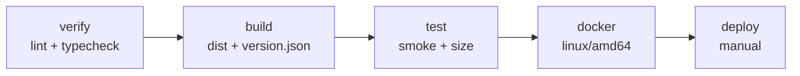

# 附录 F · GitLab CI 对照与迁移

> **目标层级**：L3 ｜ **前置**：C1～C6 ｜ **预计**：半天到 1 天
> **本章产物**：可运行的 `.gitlab-ci.yml`、`deploy/Dockerfile.gitlab`、runner/registry 配置、迁移检查表

## 0. 先看终点

把 C2～C5 的 GitHub Actions 流水线翻译成 GitLab CI，并跑通：

```text
verify（lint + typecheck）
  → build（Vite 产物 + version.json，上传 artifact）
  → test（smoke + size budget）
  → docker（用 artifact 打镜像，推 GitLab Container Registry）
  → deploy（manual；SSH 到 NAS 执行 deploy.sh；可选）
```

目标不是“把 YAML 换个写法”，而是保持同样的工程约束：

- 依赖只安装一次（pnpm store 缓存）；
- 构建一次，Docker 阶段直接打包产物；
- 只在默认分支推镜像；
- 部署是人工触发，不是每次合并自动上线；
- 镜像 tag 是 commit sha，可回滚；
- MR 与分支不重复跑两条流水线。

> 公司环境不一定允许 runner 访问 NAS。`deploy` job 是**可选**的：没有 LAN runner 就删掉，继续用 NAS 手动 `./deploy.sh <sha>`。两种方式都符合“持续交付，不自动部署”。



## 1. 概念映射

| GitHub Actions | GitLab CI | 备注 |
|---|---|---|
| workflow | pipeline | 由 `.gitlab-ci.yml` 定义 |
| `on:` | `workflow:rules` / job `rules` | GitLab 用规则决定是否创建流水线 |
| job | job |  stage 决定顺序 |
| `needs` | `needs` | 可做 DAG；也会下载上游 artifacts |
| `strategy.matrix` | `parallel:matrix` | 多维矩阵语法不同 |
| `actions/cache` | `cache` | GitLab 需要 `policy: pull/push` |
| `actions/upload-artifact` | `artifacts` | 默认在 stage/needs 间自动传递 |
| `environment` | `environment` | 支持手动部署记录 |
| `concurrency` | `resource_group` + `interruptible` | 防止并发部署/自动取消旧流水线 |
| secrets | CI/CD variables | masked/protected/file 三种 |
| `permissions` | 变量权限 + job token | GitLab 没有 GitHub 的 `permissions:` 块 |
| GHCR | GitLab Container Registry | `$CI_REGISTRY_IMAGE` |
| `if:` / `paths:` | `rules:` / `changes:` | `changes` 语义不同，见 §5 |
| required check | “Pipelines must succeed” + 审批规则 | GitLab 以整条 pipeline 为单位 |
| manual deployment | `when: manual` | 通常配 `environment` |

## 2. 设计决策

### 2.1 构建一次

GitHub 版是 Docker 多阶段里再 `pnpm build` 一次；GitLab 版改成：

```text
build job：pnpm build → apps/admin/dist + version.json → artifact
docker job：下载 artifact → docker-context/dist → nginx 镜像
```

好处：

- 不在 Docker 里重复安装依赖/构建；
- smoke 和 docker 用的是同一份产物；
- Dockerfile 更小，构建更快。

代价：Dockerfile 不再负责构建，必须保证 artifact 完整。

### 2.2 Registry 用 GitLab 自带的

公司用 GitLab，就不要再绕到 GHCR：

```text
$CI_REGISTRY           registry.example.com
$CI_REGISTRY_IMAGE     registry.example.com/group/fe-lab
$CI_REGISTRY_USER      由 GitLab 注入
$CI_REGISTRY_PASSWORD  由 GitLab 注入
```

NAS 只需要一个 `read_registry` 的 deploy token。

### 2.3 部署仍然人工

```yaml
when: manual
```

`main` 合并只产出镜像，不会自动上 NAS。NAS 上仍然：

```bash
./deploy.sh <sha>
```

如果公司 runner 在 LAN 内，可以加 `deploy` job 通过 SSH 触发同一条命令；如果不在，删掉 job。

### 2.4 架构

和 C4 一样，构建 `linux/amd64`。GitLab runner 可能是 ARM，必须显式指定：

```bash
docker build --platform linux/amd64 ...
```

## 3. 完整 `.gitlab-ci.yml`

```yaml
stages:
  - verify
  - build
  - test
  - docker
  - deploy

variables:
  NODE_VERSION: "24.14.1"
  PNPM_VERSION: "12.15.0"
  PNPM_STORE_DIR: "$CI_PROJECT_DIR/.pnpm-store"
  IMAGE_NAME: "$CI_REGISTRY_IMAGE/admin"

default:
  image: node:24.14.1-bookworm
  timeout: 20 minutes
  interruptible: true
  before_script:
    - corepack enable
    - corepack prepare "pnpm@$PNPM_VERSION" --activate
    - pnpm config set store-dir "$PNPM_STORE_DIR"
  cache:
    key:
      files:
        - pnpm-lock.yaml
    paths:
      - .pnpm-store/
    policy: pull

workflow:
  rules:
    - if: '$CI_PIPELINE_SOURCE == "merge_request_event"'
    - if: '$CI_COMMIT_BRANCH == $CI_DEFAULT_BRANCH'
    - if: '$CI_PIPELINE_SOURCE == "web"'

warm-cache:
  stage: .pre
  cache:
    key:
      files:
        - pnpm-lock.yaml
    paths:
      - .pnpm-store/
    policy: push
  script:
    - pnpm fetch

lint:
  stage: verify
  script:
    - pnpm install --frozen-lockfile --prefer-offline
    - pnpm lint

typecheck:
  stage: verify
  script:
    - pnpm install --frozen-lockfile --prefer-offline
    - pnpm typecheck

build:
  stage: build
  script:
    - pnpm install --frozen-lockfile --prefer-offline
    - pnpm --filter "@lab/admin" build
    - |
      printf '{"sha":"%s","builtAt":"%s"}\n' \
        "$CI_COMMIT_SHA" "$(date -u +%Y-%m-%dT%H:%M:%SZ)" \
        > apps/admin/dist/version.json
  artifacts:
    name: "web-dist-$CI_COMMIT_SHORT_SHA"
    paths:
      - apps/admin/dist/
    expire_in: 1 week

smoke:
  stage: test
  image: node:24.14.1-bookworm
  needs:
    - build
  before_script: []
  script:
    - node --test tooling/checks/smoke.test.mjs
    - node tooling/checks/size-budget.mjs apps/admin/dist

docker:
  stage: docker
  image: docker:27
  services:
    - name: docker:27-dind
      alias: docker
  variables:
    DOCKER_HOST: tcp://docker:2375
    DOCKER_TLS_CERTDIR: ""
  needs:
    - build
    - smoke
  before_script:
    - echo "$CI_REGISTRY_PASSWORD" | docker login -u "$CI_REGISTRY_USER" --password-stdin "$CI_REGISTRY"
  script:
    - mkdir -p docker-context
    - cp -r apps/admin/dist docker-context/dist
    - cp deploy/nginx/nginx.conf docker-context/nginx.conf
    - cp deploy/Dockerfile.gitlab docker-context/Dockerfile
    - docker build --platform linux/amd64 -t "$IMAGE_NAME:$CI_COMMIT_SHA" docker-context
    - docker tag "$IMAGE_NAME:$CI_COMMIT_SHA" "$IMAGE_NAME:latest"
    - docker push "$IMAGE_NAME:$CI_COMMIT_SHA"
    - docker push "$IMAGE_NAME:latest"
  rules:
    - if: '$CI_COMMIT_BRANCH == $CI_DEFAULT_BRANCH'

deploy:
  stage: deploy
  image: alpine:3.20
  needs:
    - docker
  before_script:
    - apk add --no-cache openssh-client
    - mkdir -p ~/.ssh
    - cp "$NAS_SSH_KEY" ~/.ssh/id_ed25519
    - chmod 600 ~/.ssh/id_ed25519
    - ssh-keyscan -p "$NAS_PORT" "$NAS_HOST" >> ~/.ssh/known_hosts
  script:
    - ssh -p "$NAS_PORT" "$NAS_USER@$NAS_HOST" "cd /share/Container/fe-lab-admin && ./deploy.sh $CI_COMMIT_SHA"
  environment:
    name: production
    url: "http://$NAS_HOST:8088"
  resource_group: production
  interruptible: false
  rules:
    - if: '$CI_COMMIT_BRANCH == $CI_DEFAULT_BRANCH'
      when: manual
      allow_failure: false
  tags:
    - nas
```

### 3.1 变量说明

| 变量 | 类型 | 说明 |
|---|---|---|
| `NAS_HOST` | masked/protected | NAS 局域网地址 |
| `NAS_PORT` | protected | SSH 端口，例如 33456 |
| `NAS_USER` | protected | 部署用户 |
| `NAS_SSH_KEY` | **File** | 私钥文件；`cp` 到 `~/.ssh/id_ed25519` |
| `CI_REGISTRY_*` | 自动 | GitLab 注入，不要手写 |
| `CI_COMMIT_SHA` | 自动 | 完整 sha，镜像 tag |
| `CI_DEFAULT_BRANCH` | 自动 | 默认分支，通常是 `main` |

`NAS_SSH_KEY` 必须是 File 类型，不是把私钥内容直接塞进普通变量；File 变量在 job 里是一个路径。

## 4. `deploy/Dockerfile.gitlab`

```dockerfile
FROM nginx:1.27-alpine-slim

COPY nginx.conf /etc/nginx/conf.d/default.conf
COPY dist /usr/share/nginx/html

EXPOSE 8080

HEALTHCHECK --interval=10s --timeout=3s --start-period=5s --retries=6 \
  CMD wget -q -O - http://127.0.0.1:8080/healthz | grep -q '^ok$' || exit 1
```

对应 `deploy/nginx/nginx.conf` 必须：

- 监听 8080；
- `root /usr/share/nginx/html;`；
- `location = /healthz` 精确返回 `ok`；
- `index.html` 使用 `no-cache`；
- `/assets/` 使用 `immutable`；
- `/version.json` 使用 `no-cache`（或更强的 `no-store`）。

这个 Dockerfile 只负责“把已有产物放进 nginx”，不安装 Node、不跑 pnpm。构建上下文是临时目录 `docker-context/`，不是仓库根目录。

## 5. Runner

### 5.1 shared vs self-managed

| 类型 | 适合 | 注意 |
|---|---|---|
| shared runner | 公开/小团队，快速开始 | 可能没有 Docker、不能访问公司内网 |
| self-managed runner | 公司内网、私有 registry、NAS | 要自己升级/清理/限制权限 |

C 章的 Docker 任务需要 Docker daemon。GitLab 的 docker executor 通常有两种：

1. **dind**：`docker:27-dind` service，需要 runner `privileged = true`；
2. **socket 挂载**：把宿主 `/var/run/docker.sock` 挂进容器，安全风险更高，但不需要 privileged。

学习环境用 dind；公司环境按平台规范选。

### 5.2 注册一个 docker runner

在 GitLab：Settings → CI/CD → Runners → New project runner，拿到 token，然后：

```bash
gitlab-runner register \
  --url "https://gitlab.example.com" \
  --token "<runner-token>" \
  --executor "docker" \
  --docker-image "node:24.14.1-bookworm" \
  --tag-list "docker"
```

`/etc/gitlab-runner/config.toml` 的关键部分：

```toml
[[runners]]
  name = "docker-runner"
  url = "https://gitlab.example.com"
  token = "<runner-token>"
  executor = "docker"

  [runners.docker]
    image = "node:24.14.1-bookworm"
    privileged = true
    volumes = ["/cache"]
```

> `privileged = true` 只用于 dind；它会扩大 runner 的权限。公司环境应使用专用 runner、限制项目、定期清理，或改用平台推荐的 BuildKit/Kaniko 方案。

### 5.3 NAS runner（可选）

如果想让 `deploy` job 自动 SSH 到 NAS，注册一个在局域网内的 runner：

```bash
gitlab-runner register \
  --url "https://gitlab.example.com" \
  --token "<nas-runner-token>" \
  --executor "docker" \
  --docker-image "alpine:3.20" \
  --tag-list "nas"
```

这个 runner 必须能访问 `NAS_HOST:NAS_PORT`。如果没有这样的 runner，删除 `deploy` job，继续在 NAS 上手动执行 `deploy.sh`。

## 6. Registry

### 6.1 CI 推镜像

`docker` job 使用 GitLab 自动注入的：

```text
$CI_REGISTRY
$CI_REGISTRY_USER
$CI_REGISTRY_PASSWORD
```

无需在项目里存 registry 密码。镜像地址：

```text
$CI_REGISTRY_IMAGE/admin:<sha>
$CI_REGISTRY_IMAGE/admin:latest
```

### 6.2 NAS 拉镜像

在 GitLab 项目 → Settings → Repository → Deploy tokens 创建：

- name: `nas-pull`
- scopes: `read_registry`
- 可选：限制到项目

NAS 上：

```bash
echo "$GITLAB_DEPLOY_TOKEN" | docker login registry.example.com \
  -u "$GITLAB_DEPLOY_USER" --password-stdin
```

然后 C5 的 `.env` 改成 GitLab registry 地址：

```dotenv
IMAGE_NAME=registry.example.com/group/fe-lab/admin
IMAGE_TAG=<sha>
```

`deploy.sh` 不变；它只认 `IMAGE_NAME` / `IMAGE_TAG`，不关心 registry 是 GHCR 还是 GitLab。

### 6.3 自签证书

如果 registry 用内部 CA，把 CA 放到 NAS 的：

```text
/etc/docker/certs.d/registry.example.com/ca.crt
```

然后重启 Docker。不要用 `insecure-registries` 长期绕过 TLS。

## 7. 四个会咬人的差异

### 7.1 `cache` 需要 `policy`

GitLab 的 cache 是“每个 job 上传/下载”，不是 GitHub Actions 的单一缓存 action。并行 job 都 `pull-push` 时，后完成的可能覆盖先完成的缓存。

本文件的做法：

```text
warm-cache：policy: push（只负责填充）
lint/typecheck/build：policy: pull（只读）
```

`cache.key.files: [pnpm-lock.yaml]` 保证 lockfile 变化时换 key。`pnpm fetch` 只负责把锁文件里的包放进 store；lockfile 是否同步，由后续 `pnpm install --frozen-lockfile` 判定。

### 7.2 `artifacts` 会自动传递

GitLab 的 artifacts 默认在后续 stage / `needs` 中自动下载。好处是 `smoke` 和 `docker` 不用再写下载步骤；坏处是：

- 大产物会被传一圈，浪费时间和存储；
- 不需要 artifact 的 job 也会下载；
- `expire_in` 不设会长期堆积。

本文件只在 `build` 上传 `apps/admin/dist/`，`expire_in: 1 week`；`smoke`/`docker` 通过 `needs` 获取。不要把 `node_modules` 当 artifact。

### 7.3 `rules:changes` 与 `paths` 不同

GitHub 的 `paths` 是“本次变更是否命中”；GitLab 的 `changes` 在不同 pipeline 类型（MR/分支/定时）下比较基准不同，monorepo 里很容易漏跑。

建议：

- required 的 build/test **不要**用 `changes` 过滤；
- 如果非要用，至少把 `pnpm-lock.yaml`、`pnpm-workspace.yaml`、根配置、`tooling/**` 纳入；
- 对 `changes` 的 job 保留一个“全量手动触发”入口。

漏跑比多跑更危险。

### 7.4 MR 与 branch 双跑

如果同时有 MR pipeline 和 branch pipeline，同一个 commit 会跑两次，浪费一半额度。

本文件用 `workflow:rules`：

```yaml
workflow:
  rules:
    - if: '$CI_PIPELINE_SOURCE == "merge_request_event"'
    - if: '$CI_COMMIT_BRANCH == $CI_DEFAULT_BRANCH'
    - if: '$CI_PIPELINE_SOURCE == "web"'
```

效果：

- 功能分支 push：不创建 branch pipeline；有 MR 时创建 MR pipeline；
- 默认分支 push：创建 branch pipeline；
- 手动 web：允许。

如果公司要求“分支 push 也跑”，把第一条改成 `push` 规则，并关闭 “Merge request pipelines” 或使用 `CI_OPEN_MERGE_REQUESTS` 去重；不要两条都留着。

### 7.5 `needs` 与 stage 的关系

`needs` 可以让 job 提前跑，但也会下载上游 artifacts。`deploy` 的 `needs: [docker]` 表示只等 docker，不等其他 stage 的所有 job；这在 DAG 里是有意的。

如果不确定，先用 stage 顺序，稳定后再加 `needs`。

## 8. 迁移检查表

| GitHub | GitLab | 检查 |
|---|---|---|
| `actions/checkout` | GitLab 自动 clone | 子模块/LFS 要额外配置 |
| `setup-node` | `image: node:24.14.1-bookworm` | 版本与本地一致 |
| `pnpm/action-setup` | `corepack enable` + `corepack prepare` | pnpm 12.15 |
| `actions/cache` | `cache` + `policy` | 只缓存 store，不缓存 node_modules |
| `upload-artifact` | `artifacts` | 路径、过期时间 |
| `download-artifact` | `needs` 自动下载 | 不需要的 job 用 `dependencies: []` |
| `docker/login-action` | `docker login` | 用 `CI_REGISTRY_*` |
| `build-push-action` | `docker build/push` | `--platform linux/amd64` |
| `concurrency` | `resource_group` | 部署串行 |
| `permissions` | protected variables / job token | 没有同款块 |
| `if:` | `rules:` | 不要混用 `only/except` |
| `paths:` | `changes:` | 语义不同，required 不要过滤 |
| GHCR | GitLab Container Registry | NAS 换 registry 地址 |
| required checks | Pipelines must succeed / 审批 | 整条 pipeline 为单位 |
| environment | `environment` | 手动部署记录 |
| manual deploy | `when: manual` | 配 `resource_group` |
| secrets | masked/protected/file variables | 私钥用 File |
| `needs` | `needs` | 注意 artifacts 自动下载 |

### 8.1 半天迁移顺序

1. 先只迁 `verify`（lint + typecheck），用 MR 跑通；
2. 加 `build` + artifact，确认 `dist` 和 `version.json`；
3. 加 `smoke` + size，确认 artifact 自动下载；
4. 加 `docker`，先推测试 tag；
5. 加 `deploy`（可选），先在测试 NAS 手动触发；
6. 最后设 “Pipelines must succeed”/审批规则。

不要一天内把 GitHub 和 GitLab 两套都改成 required；先让 GitLab 旁路跑一周。

## 9. 排障

| 现象 | 原因 | 修复 |
|---|---|---|
| job 一直 pending | 没有匹配 tag 的 runner | 检查 `tags: [nas]` / runner tag |
| `Cannot connect to the Docker daemon` | dind 未启动/privileged 关闭 | 检查 service、`DOCKER_HOST`、runner 配置 |
| `docker: not found` | job image 不是 docker | docker job 用 `docker:27` |
| cache 不命中 | key/policy 不对 | 看 job log 的 cache 段；统一 key |
| artifact 找不到 | 路径写错/上游失败 | 看 build 日志；`needs` 是否正确 |
| smoke 拿到旧 dist | artifact 未下载/路径不同 | `needs: [build]`；确认解压路径 |
| 同一个 commit 跑两次 | MR + branch 双流水线 | `workflow:rules` 去重 |
| `changes` 漏跑 | 比较基准不同 | required 不过滤；纳入根文件 |
| `denied` 推 registry | 权限/registry 未启用 | 检查 Container Registry 与 job token |
| NAS `unauthorized` | deploy token 过期/scope 错 | 重新建 `read_registry` token |
| `exec format error` | 架构不对 | `--platform linux/amd64` |
| SSH 失败 | runner 不在 LAN/key 不对 | 用 `nas` runner；检查 File 变量 |
| 手动 deploy 按钮不出现 | rules/branch 不匹配 | 只在默认分支；检查 `when: manual` |
| deploy 并发 | 没有 resource_group | 加 `resource_group: production` |

## 10. 验收清单

- [ ] MR 只创建一条流水线（没有 MR + branch 双跑）
- [ ] `verify` 的 lint/typecheck 通过
- [ ] `build` 产出 `apps/admin/dist/` 和 `version.json`
- [ ] artifact 能在 smoke/docker 中自动获得
- [ ] smoke 与 size 通过
- [ ] docker 只在默认分支推镜像
- [ ] 镜像 tag 是完整 `CI_COMMIT_SHA`
- [ ] 镜像架构是 `linux/amd64`
- [ ] GitLab Registry 能被 NAS 用只读 token 拉取
- [ ] `deploy` 是 manual，且 `resource_group` 生效
- [ ] 回滚仍使用 NAS 的 `deploy.sh --rollback`
- [ ] 没有把私钥写成普通变量
- [ ] 没有用 `only/except` 混搭 `rules`

## 11. 自测

**Q1：为什么 GitLab 版不在 Dockerfile 里再 build 一次？**

<details>
<summary>答案</summary>

build job 已经产出 dist，Docker 阶段只打包同一份产物，避免重复安装/构建，也保证 smoke 与镜像内容一致。

</details>

**Q2：`cache:policy` 为什么重要？**

<details>
<summary>答案</summary>

并行 job 都上传 cache 会互相覆盖；让一个 warm-cache 负责 push，其他 job 只 pull，减少竞争和无效上传。

</details>

**Q3：`rules:changes` 为什么容易在 monorepo 漏跑？**

<details>
<summary>答案</summary>

不同 pipeline 类型的比较基准不同，且根配置/lockfile/tooling 变化不一定命中应用的路径；required 检查不应依赖它做过滤。

</details>

**Q4：如何避免 MR 和 branch 双跑？**

<details>
<summary>答案</summary>

用 `workflow:rules` 只允许 MR pipeline 或默认分支 pipeline，二者不要同时保留；必要时用 `CI_OPEN_MERGE_REQUESTS` 去重。

</details>

**Q5：GitLab 没有 GitHub 的 required checks，怎么保证门禁？**

<details>
<summary>答案</summary>

用 “Pipelines must succeed”、合并请求审批规则、保护分支，以及稳定的 required job；整条 pipeline 成功才能合并。

</details>

## 12. 延伸

- 用 `parallel:matrix` 跑多 Node 版本
- 用 `include` 拆分大型 `.gitlab-ci.yml`
- 用 `rules:changes` 做非阻塞的路径提示，而不是 required 过滤
- 用 GitLab Environments 记录部署与回滚
- 用 Kaniko/BuildKit 替代 privileged dind
