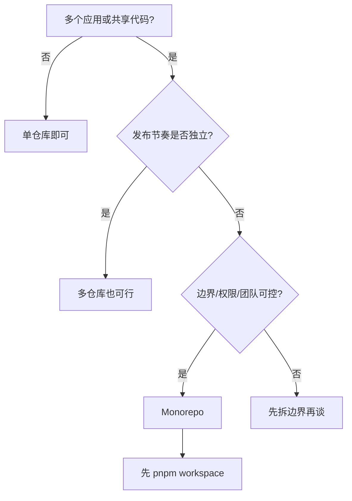

# M1 该不该上 Monorepo

> **目标层级**：L3（能做选型决策并写清楚理由）
> **前置**：01 完成 ｜ **预计**：2h
> **本章产物**：`docs/adr/0001-monorepo.md`，一页架构决策记录

## 0. 先看终点

本章结束时，你手里应该有一页文档，回答四个问题：

1. 我们现在的仓库形态是什么，痛在哪？
2. 要不要改成单仓？结论是什么？
3. 支撑结论的三个理由、两个反对意见及缓解措施。
4. 什么条件下应该退出这个决定。

判断标准：半年后新来的同事读完这页，能理解当时为什么这么选，而不是只看到一句「领导要求」。



## 1. 知识讲解

### 1.1 真正的问题不是「单仓还是多仓」

而是：**共享代码的成本，放在哪一层付。**

三个应用共用一个 Button 组件，多仓的付法是：

```
改 Button → 发 1.2.0 → 三个应用分别升级 → 有一个应用被别的依赖卡住 → 出现 1.2.0 / 1.1.3 两个版本
```

单仓的付法是：

```
改 Button → 一次提交 → 三个应用同时看到 → 但 CI 要判断该测谁、该建谁
```

没有免费方案。多仓把成本放在**版本协调**上，单仓把成本放在**工具链与 CI**上。选型就是判断哪边的成本你更付得起。

### 1.2 成本对照

| 维度 | 多仓（Polyrepo） | 单仓（Monorepo） |
|---|---|---|
| 跨包改动 | 要发版、升级、联调，可能跨几天 | 一次提交，原子生效 |
| 依赖关系 | 版本号即契约，组合爆炸 | 源码可见，依赖显式 |
| CI | 每个仓库独立，简单 | 必须做 affected 筛选，否则全量构建 |
| 权限 | 可按仓库细粒度控制 | 通常整仓统一，靠 CODEOWNERS 弥补 |
| 发布节奏 | 各包完全独立 | 需要统一策略，发版工具变复杂 |
| 技术栈 | 可异构（React / Vue / Node 各一套） | 统一工具链更划算，异构会很别扭 |
| 仓库体积 | 各自小 | 变大，clone 与搜索变慢 |

### 1.3 什么信号说明该上

同时满足 3 条以上，才值得认真考虑：

- 有 **3 个以上**应用或包，共享 **2 个以上**内部包
- 共享代码**每周都在改**，而不是半年一次
- 经常需要「改一个组件，三个应用一起验证」
- 团队规模在 **30 人以内**，沟通成本还压得住
- 技术栈相近（都是 React + Vite，或至少同一套构建体系）
- CI 已经有基本的 lint / test / build，不是一片空白

最后一条经常被忽略：**Monorepo 会放大 CI 的问题**。多仓时每个仓库各跑各的，单仓后一次提交可能触发十几个包，没有筛选就是灾难。

### 1.4 什么信号说明不该上

- **强权限隔离**：外包团队、被收购的业务线，代码不能互相可见
- **技术栈异构**：React 应用 + Vue 应用 + Java 服务，硬塞进一个仓库只会让工具链打架
- **包少且稳定**：3 个包、半年不动，多仓的版本协调成本几乎为零，单仓纯属增加复杂度
- **发布完全独立且有外部消费者**：每个包都要独立 semver、独立维护 CHANGELOG、独立授权
- **没有 CI 纪律**：连 lint 都不跑，上单仓后只会更慢、更乱

### 1.5 工具边界（只定位，不展开）

| 工具 | 解决什么 | 你现在的规模需要吗 |
|---|---|---|
| **pnpm workspace** | 依赖安装、包间链接、`workspace:` 协议、按包执行命令 | **需要**，本教程主线 |
| Turborepo / Nx | 任务图、构建缓存、affected、代码生成器 | 6 包以内不需要，`pnpm -r` 够用；包多了再看 |
| Changesets | 多包版本号与 CHANGELOG、npm 发布 | 内部包不发 npm 时不需要 |
| Lerna | 早期的多包发布工具 | 历史方案，新项目不建议 |

一句话：**pnpm workspace 管「包怎么连」，Turborepo 管「任务怎么跑」，Changesets 管「版本怎么发」。** 三者不是替代关系，也不需要一起上。

### 1.6 三个常见误解

**「Monorepo 就是把所有代码放一个仓库。」**
不是。单仓的前提是统一的依赖策略、统一的规范、能筛选的 CI。只是把目录挪到一起，叫「一个大仓库」，不叫 Monorepo。

**「上了 Monorepo 就一定要上 Turborepo。」**
Turborepo 解决的是「任务多、构建慢」的规模问题。4 个包、构建 40 秒，用 `pnpm -r build` 就够；引入 Turbo 只会多一层需要维护的缓存配置。

**「pnpm workspace 是构建工具。」**
它只负责依赖与链接。`pnpm -r build` 是「按拓扑序依次执行脚本」，不是构建系统，没有缓存、没有任务图。

### 1.7 退出条件要提前写

单仓最难的不是合，是拆。合的时候一天，拆的时候可能要几个月：历史记录、CI、依赖关系、发布流程都要重做。

所以 ADR 里必须写退出条件，例如：

- 包数量超过 15 个，且 CI 已经优化过仍然超过 15 分钟
- 出现必须做权限隔离的业务（外包、收购）
- 技术栈分裂到无法共用一套工具链

写下来不是为了真的退出，而是为了在争论时有依据。

## 2. 实操：写一页 ADR

### 2.1 先盘点现状

不用工具，拿张纸或新建 `docs/inventory.md`，填四行：

| 项 | 你的情况 |
|---|---|
| 应用/包数量 | 例如：2 个应用 + 2 个内部包 |
| 共享代码及改动频率 | 例如：UI 组件、工具函数，每周 2~3 次 |
| 团队与权限 | 例如：2 人，无隔离要求 |
| 当前 CI | 例如：只有 lint，没有构建门禁 |

### 2.2 打个分（只用于讨论，不是公式）

每项 0~2 分：

| 维度 | 0 分 | 2 分 |
|---|---|---|
| 共享代码数量 | 没有 | 3 个以上包被复用 |
| 改动频率 | 半年一次 | 每周都有 |
| 跨包原子改动 | 从不需要 | 经常 |
| 团队规模 | > 50 人或强隔离 | < 15 人、一个目标 |
| 工具链一致性 | 多技术栈 | 同一套 |

- 0~3 分：倾向多仓
- 4~6 分：混合，共享包走私有 registry
- 7~10 分：单仓值得做

分数只用来逼自己把理由说清楚，不要拿它当审批依据。

### 2.3 写 ADR

新建 `docs/adr/0001-monorepo.md`：

```md
# ADR-001 采用 pnpm workspace 单仓

- 状态：已接受
- 日期：2026-10-23
- 决策人：<你>

## 背景
（现状：几个应用、几个包、共享什么、痛在哪。三句话内。）

## 决策
采用 pnpm workspace 管理单仓；本期不引入 Turborepo 与 Changesets。

## 理由
1.
2.
3.

## 反对意见与缓解
1. 反对：…… → 缓解：……
2. 反对：…… → 缓解：……

## 迁移计划
1. 建空仓库与 workspace 配置（M2）
2. 迁入 utils，再迁 ui，最后迁应用（M2~M4）
3. 加规范与门禁（M5）
4. 观察两周，记录 CI 时长与依赖问题

## 退出条件
- 包数量 > 15 且 CI 优化后仍 > 15 分钟
- 出现必须权限隔离的业务
- 技术栈分裂到无法共用工具链
```

### 2.4 按你的真实情况填一版

以本教程的 `fe-lab` 为例（你可以照抄结构，不要照抄结论）：

```md
# ADR-001 采用 pnpm workspace 单仓

- 状态：已接受
- 日期：2026-10-23

## 背景
2 个应用（admin、h5）共用 UI 与工具函数。当前是复制粘贴，修一个 bug 要改两处，
已经出现过 h5 修了、admin 忘了的情况。

## 决策
采用 pnpm workspace 单仓。本期不引入 Turborepo、Changesets。

## 理由
1. 共享代码每周都在改，原子提交能消掉「两边不一致」
2. 只有 4 个包，`pnpm -r` 足够，任务编排的复杂度不值得
3. 内部包不发 npm，版本号与 CHANGELOG 暂时没有消费者

## 反对意见与缓解
1. 反对：单仓 CI 会变慢 → 缓解：先用 `--filter` 只构建相关包，超过 10 分钟再考虑缓存
2. 反对：权限变粗 → 缓解：私有仓库 + CODEOWNERS，本期只有我一个人

## 迁移计划
见 M2~M6。

## 退出条件
包 > 15 且 CI > 15 分钟；或出现权限隔离需求。
```

### 2.5 找一个人反驳你

把 ADR 发给一个同事或朋友，只问一句：「如果你要反对，最有力的一条是什么？」

把对方的反对写进「反对意见与缓解」。写不出来，说明你的决策还没有经过压力测试。

### 2.6 验收

- [ ] `docs/adr/0001-monorepo.md` 存在，六个小节齐全
- [ ] 三个理由都是具体事实，不是「便于管理」这类空话
- [ ] 至少两条反对意见，且都有可执行的缓解
- [ ] 退出条件可判断（有数字或明确事件）
- [ ] 能用 60 秒讲完这页文档

## 3. 闭卷练习

**场景**：三个外包团队，各自负责一个应用，独立发布；共用一个 UI 组件库；技术栈是 React 与 Vue 混合；代码不能互相可见。

**目标**：给出「是否合仓」的结论，并写一页 ADR。

**验收**：

- 结论明确，且引用了至少三个具体约束
- 给出替代方案（不合仓时，共享库怎么管）
- 指出一个「如果条件变化，结论会反转」的具体条件

<details><summary>提示 1（卡住 20 分钟再看）</summary>

回到 1.2 的成本表，先看「权限」和「技术栈」两行。

</details>

<details><summary>提示 2</summary>

三个团队独立发布 + 代码不可见，已经同时踩中两条「不该上」的信号。

</details>

<details><summary>提示 3</summary>

替代方案通常是：共享库独立仓库 + 私有 registry + semver + 变更日志，而不是单仓。

</details>

## 4. 自测

1. 单仓和多仓各自把成本放在哪一层？各举一个具体例子。
2. 说出三个「不该上 Monorepo」的信号，并解释其中一个为什么致命。
3. pnpm workspace、Turborepo、Changesets 各自解决什么问题？哪一个是本教程的主线？
4. 为什么「包少且稳定」的项目不适合单仓？
5. 用 3 句话向你的上级解释这次选型，要求包含一个数字。

<details><summary>参考答案</summary>

1. 多仓把成本放在版本协调（改一个组件要发版、升级、联调）；单仓把成本放在工具链与 CI（要筛选构建、统一规范、处理权限）。
2. 强权限隔离、技术栈异构、包少且稳定、发布完全独立、没有 CI 纪律。强权限隔离最致命：它不是技术问题，单仓在组织上就不可行。
3. pnpm workspace 管依赖与包间链接（主线）；Turborepo 管任务图与缓存；Changesets 管版本与发布。
4. 因为多仓的主要成本是版本协调，而包少且稳定时这个成本接近零；单仓反而要付出统一工具链与 CI 筛选的成本。
5. 示例：「我们有 4 个包，UI 和 utils 每周都要改，现在复制粘贴已经出现过两次不一致。改成单仓后一次提交能同时改完，CI 用 `--filter` 只跑相关包，预计不会超过现在的 6 分钟。」

</details>

## 5. 延伸

- [monorepo.tools](https://monorepo.tools/) —— 只看工具对比表，理解各工具的能力边界，不看安装
- [pnpm Workspaces](https://pnpm.io/workspaces) —— 读开头的 Workspace 协议部分，M2 会逐条用到
- 公司落地最小改动：不迁移仓库，先在现有项目写一页 ADR，把「为什么现在不合仓」记下来。半年后条件变了，这页纸就是依据

> 下一章 M2：动手搭 workspace。先建最小的 4 个包，把依赖关系跑通，再谈规范。
