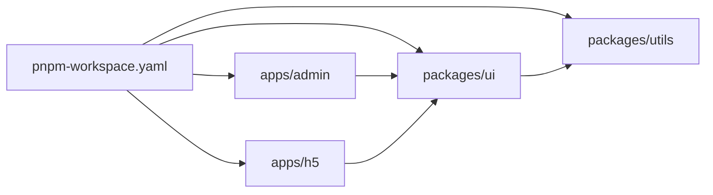

# M2 pnpm workspace 从零

> **目标层级**：L2 ｜ **前置**：M1、01 完成 ｜ **预计**：5h
> **本章产物**：4 个包跑通，两个应用能启动、能构建，内部依赖用 `workspace:*` 连接

## 0. 先看终点

```powershell
PS> pnpm -r list --depth -1
fe-lab C:\...\fe-lab (PRIVATE)

@lab/admin@0.0.0 C:\...\fe-lab\apps\admin (PRIVATE)
@lab/h5@0.0.0 C:\...\fe-lab\apps\h5 (PRIVATE)
@lab/ui@0.0.0 C:\...\fe-lab\packages\ui (PRIVATE)
@lab/utils@0.0.0 C:\...\fe-lab\packages\utils (PRIVATE)

PS> pnpm dev:admin
  VITE v8.x  ready in 320 ms
  ➜  Local: http://localhost:5173/

PS> pnpm build
@lab/admin build: ✓ built in 2.1s
@lab/h5 build: ✓ built in 1.9s
```

注意 `build` 没有加 `--parallel`。原因本章会讲。



## 1. 知识讲解

### 1.1 workspace 到底做了什么

`pnpm-workspace.yaml` 只做一件事：告诉 pnpm「这些目录里的 package 属于同一个工作区」。

之后：

- 一次 `pnpm install` 装完所有包的依赖，共用一份锁文件
- 包之间可以用 `workspace:*` 互相引用，pnpm 直接建链接，不经过 npm registry
- `pnpm --filter` 可以只对某个包执行命令
- `pnpm -r` 可以按依赖顺序递归执行

它**不负责**构建、缓存、发版。这三件事分别属于 Vite、Turborepo、Changesets，本教程只用第一件。

### 1.2 为什么必须写 `workspace:*`

包之间引用有三种写法：

| 写法 | 含义 | 风险 |
|---|---|---|
| `"@lab/ui": "workspace:*"` | 永远用工作区里的版本，发布时自动替换成真实版本 | 无 |
| `"@lab/ui": "^0.0.0"` | 去 registry 找 `0.0.0` 及以上 | 本地可能装到同名公开包，或直接 404 |
| `"@lab/ui": "file:../ui"` | 相对路径 | 换目录、发布、CI 都会出问题 |

只有一个答案：**内部包一律用 `workspace:*`**。如果 pnpm 报 `ERR_PNPM_WORKSPACE_PKG_NOT_FOUND`，说明版本对不上或包名写错，不要改成 `^0.0.0` 绕过。

### 1.3 `catalog:`：版本只写一次

4 个包各自写 `"react": "^19.2.0"`，升级时要改 4 处，漏一处就出现两份 React。

pnpm 12 支持 catalog：在 `pnpm-workspace.yaml` 里定义一次，包里写 `"react": "catalog:"`。

```yaml
catalog:
  react: ^19.2.0
  typescript: ^6.0.0
```

升级时只改 workspace 文件，所有包一起变。这是「单仓版本一致性」最便宜的实现，不需要 Changesets。

`packageManager` 是另一层锁定：01 章已在根 `package.json` 写了 `"packageManager": "pnpm@12.15.0"`。Corepack 读它决定用哪个 pnpm，和 catalog 管依赖版本是两件事，别混。本章不再改这个字段；如果 `pnpm -v` 不是 12.15.0，先回 01 的排障。

### 1.4 `allowBuilds`：pnpm 12 的构建脚本白名单

pnpm 10 起，依赖的 `postinstall` 脚本**默认不执行**，防止供应链攻击。pnpm 11 把相关设置合并成 `allowBuilds`，12 延续这一套；默认 `strictDepBuilds: true`，被拦下不是警告，而是**直接报错**：

```
ERR_PNPM_IGNORED_BUILDS

× Ignored build scripts: esbuild@0.25.12
help: Run "pnpm approve-builds" to pick which dependencies should be allowed to run scripts.
```

处理方式二选一：

- 交互式：`pnpm approve-builds`，勾选信任的包；`pnpm approve-builds --all` 表示全部批准
- 声明式：在 `pnpm-workspace.yaml` 写 `allowBuilds`

```yaml
allowBuilds:
  esbuild: true
```

`true` 允许执行，`false` 明确拒绝。声明式更好：配置进仓库，CI 与本地行为一致。**不要**图省事关掉整个保护。

### 1.5 递归执行与拓扑序

- `pnpm -r build`：按依赖拓扑排序，先 utils，再 ui，最后 apps
- `pnpm -r --parallel build`：所有包同时开始，**不管依赖顺序**

构建必须用前者。`--parallel` 只适合 `dev` 这种互不依赖、需要同时常驻的任务。

### 1.6 两种跑应用的方式

| 命令 | 范围 | 用途 |
|---|---|---|
| `pnpm dev:admin` | 单个应用 | 日常开发 |
| `pnpm dev` | 所有应用并行 | 联调、验收 |

单仓最容易犯的错是「每次开发都启动全部应用」，机器风扇起飞。默认用单包命令。

## 2. 实操

### 2.1 建工作区

在 `fe-lab` 根目录：

```powershell
New-Item -ItemType Directory -Force -Path apps, packages | Out-Null
```

`pnpm-workspace.yaml`

```yaml
packages:
  - 'apps/*'
  - 'packages/*'

catalog:
  react: ^19.2.0
  react-dom: ^19.2.0
  '@types/react': ^19.2.0
  '@types/react-dom': ^19.2.0
  typescript: ^6.0.0
  vite: ^8.0.0

# 01 章已有，别覆盖掉
engineStrict: true

allowBuilds:
  # 示例：当前技术栈没有需要批准的包；出现 ERR_PNPM_IGNORED_BUILDS 时换成实际包名
  esbuild: true
```

根 `package.json` 加脚本：

```json
{
  "scripts": {
    "bench": "node tooling/bench/bench.mjs",
    "dev": "pnpm -r --parallel dev",
    "dev:admin": "pnpm --filter \"@lab/admin\" dev",
    "dev:h5": "pnpm --filter \"@lab/h5\" dev",
    "build": "pnpm -r build",
    "build:admin": "pnpm --filter \"@lab/admin\" build",
    "typecheck": "pnpm -r typecheck"
  }
}
```

> PowerShell 里 `@lab/...` 必须加引号，否则 `@` 会被当成 splatting 语法。bash 可以不加。

### 2.2 建工具包 `@lab/utils`

`packages/utils/package.json`

```json
{
  "name": "@lab/utils",
  "version": "0.0.0",
  "private": true,
  "type": "module",
  "main": "./src/index.ts",
  "types": "./src/index.ts",
  "exports": {
    ".": "./src/index.ts"
  }
}
```

`packages/utils/tsconfig.json`

```json
{
  "compilerOptions": {
    "target": "ES2022",
    "module": "ESNext",
    "moduleResolution": "Bundler",
    "strict": true,
    "skipLibCheck": true,
    "noEmit": true
  },
  "include": ["src"]
}
```

`packages/utils/src/index.ts`

```ts
export function cx(...parts: Array<string | false | null | undefined>): string {
  return parts.filter(Boolean).join(' ')
}

export function debounce<A extends unknown[]>(
  fn: (...args: A) => void,
  wait = 300,
): (...args: A) => void {
  let timer: ReturnType<typeof setTimeout> | undefined
  return (...args: A) => {
    if (timer) clearTimeout(timer)
    timer = setTimeout(() => fn(...args), wait)
  }
}

export function formatBytes(bytes: number): string {
  if (bytes < 1024) return `${bytes} B`
  const units = ['KiB', 'MiB', 'GiB']
  let value = bytes / 1024
  let unit = 0
  while (value >= 1024 && unit < units.length - 1) {
    value /= 1024
    unit += 1
  }
  return `${value.toFixed(1)} ${units[unit]}`
}
```

这一章故意让 `main`/`exports` 指向源码，好处是改完立刻生效，不需要先构建。缺点与生产做法在 M4 讲。

### 2.3 建组件包 `@lab/ui`

`packages/ui/package.json`

```json
{
  "name": "@lab/ui",
  "version": "0.0.0",
  "private": true,
  "type": "module",
  "main": "./src/index.tsx",
  "types": "./src/index.tsx",
  "exports": {
    ".": "./src/index.tsx"
  },
  "peerDependencies": {
    "react": "^19.0.0"
  },
  "devDependencies": {
    "@types/react": "catalog:",
    "react": "catalog:",
    "typescript": "catalog:"
  },
  "dependencies": {
    "@lab/utils": "workspace:*"
  }
}
```

React 放 `peerDependencies`：组件库不拥有 React，宿主应用提供。放 `devDependencies` 是为了本地能类型检查。装成普通 `dependencies` 会在单仓里造出第二份 React，最终表现为 hooks 报错。

`packages/ui/tsconfig.json`

```json
{
  "compilerOptions": {
    "target": "ES2022",
    "module": "ESNext",
    "moduleResolution": "Bundler",
    "jsx": "react-jsx",
    "lib": ["ES2022", "DOM", "DOM.Iterable"],
    "strict": true,
    "skipLibCheck": true,
    "noEmit": true
  },
  "include": ["src"]
}
```

`packages/ui/src/Button.tsx`

```tsx
import type { ButtonHTMLAttributes } from 'react'
import { cx } from '@lab/utils'

export type ButtonProps = ButtonHTMLAttributes<HTMLButtonElement> & {
  variant?: 'primary' | 'ghost'
}

export function Button({ variant = 'primary', className, ...rest }: ButtonProps) {
  return <button className={cx('btn', `btn--${variant}`, className)} {...rest} />
}
```

`packages/ui/src/index.tsx`

```tsx
export { Button } from './Button'
export type { ButtonProps } from './Button'
```

### 2.4 建两个应用

在 `apps` 目录下生成，避免覆盖已写好的 `package.json`：

```powershell
Set-Location apps
pnpm create vite admin --template react-ts
pnpm create vite h5 --template react-ts
Set-Location ..
```

生成后立刻改两个 `package.json` 的 `name`：

- `apps/admin/package.json` → `"name": "@lab/admin"`
- `apps/h5/package.json` → `"name": "@lab/h5"`

再把 React、Vite、TS 的版本改成 `catalog:`（两个应用的 `package.json` 各改这几行，其余保持模板原样）：

```json
"dependencies": {
  "react": "catalog:",
  "react-dom": "catalog:"
},
"devDependencies": {
  "@types/react": "catalog:",
  "@types/react-dom": "catalog:",
  "typescript": "catalog:",
  "vite": "catalog:"
}
```

`@vitejs/plugin-react` 保留模板生成的版本，不要额外装 SWC 插件——Vite 8 的转换已经走 Oxc，装 SWC 只会多一层。

给两个应用加类型检查脚本：

```json
"scripts": {
  "typecheck": "tsc -b"
}
```

Vite 模板的 `tsconfig.json` 是「解决方案」结构：`files` 为空，只引用 `tsconfig.app.json` 与 `tsconfig.node.json`。`tsc --noEmit` 在这种结构下什么都不检查，必须用 `tsc -b` 构建引用链。

### 2.5 连接内部包

```powershell
pnpm --filter "@lab/ui" add "@lab/utils@workspace:*"
pnpm --filter "@lab/admin" add "@lab/ui@workspace:*" "@lab/utils@workspace:*"
pnpm --filter "@lab/h5" add "@lab/ui@workspace:*" "@lab/utils@workspace:*"
```

> `@lab/ui` 里已经声明过 utils，第一条会提示已存在，属正常。

然后替换 `apps/admin/src/App.tsx`：

```tsx
import { Button } from '@lab/ui'
import { formatBytes } from '@lab/utils'

export default function App() {
  return (
    <main style={{ padding: 24 }}>
      <h1>Admin</h1>
      <p>首屏产物：{formatBytes(0)}（构建后填真实数字）</p>
      <Button onClick={() => alert('workspace 链接成功')}>点我</Button>
    </main>
  )
}
```

`apps/h5/src/App.tsx` 做同样的替换，标题改成 `H5`。删掉模板里用不到的 `App.css` 引用与 logo，减少后面测量时的噪音。

### 2.6 安装与验证

```powershell
pnpm install
```

预期：更新 `pnpm-lock.yaml`（多出各 workspace 包的 importer），`node_modules` 里出现 `@lab/*` 的链接。

```powershell
pnpm -r list --depth -1
```

预期看到四个包。如果只看到根，检查 `pnpm-workspace.yaml` 的引号与路径。

```powershell
pnpm dev:admin
```

浏览器打开 `http://localhost:5173`，按钮能点，说明跨包源码引用通了。

```powershell
pnpm build
```

预期两个应用都构建成功。**注意顺序**：`@lab/utils` 没有 build 脚本会被跳过，ui 也没有；只有两个 app 执行。这正是当前的设计——内部包用源码直连。

记录第一份构建数据：

```powershell
pnpm run bench -- --runs 3 --dir apps/admin/dist -- pnpm --filter "@lab/admin" build
```

把 `reports/` 里的 JSON 留在仓库里。从 B2 开始，所有对比都以它为基线。

## 3. 排障

**3.1 `ERR_PNPM_WORKSPACE_PKG_NOT_FOUND`**

`@lab/ui` 的依赖写成了 `^0.0.0`，但 workspace 里的版本是 `0.0.0` 且没加 `workspace:`。改成 `workspace:*`，或检查包名拼写。

**3.2 `Failed to resolve entry for package "@lab/ui"`**

`exports` 指向的文件不存在。确认 `packages/ui/src/index.tsx` 存在，且 `exports` 的路径以 `./` 开头。

**3.3 `ERR_PNPM_IGNORED_BUILDS`**

pnpm 拦下了某个依赖的安装脚本。执行 `pnpm approve-builds`，或把该包写进 `allowBuilds` 后重新 `pnpm install`。不要用 `--ignore-scripts` 全局关掉。

**3.4 页面报 `Invalid hook call` 或两个 React**

某个包把 React 装成了 `dependencies`。检查 `pnpm why react`，把组件库里的 React 移到 `peerDependencies` + `devDependencies`，删掉 `node_modules` 重装。

**3.5 `pnpm dev` 启动后一个应用抢了另一个的端口**

Vite 会自动 +1 端口，但更推荐用 `dev:admin` / `dev:h5` 单独启动。只有联调时才用 `dev`。

## 4. 故障演练：把 workspace 协议拆掉

**制造**：把 `apps/admin/package.json` 里的 `"@lab/ui": "workspace:*"` 改成 `"@lab/ui": "^0.0.0"`。

```powershell
pnpm install
```

**观察**：pnpm 会去 registry 找 `@lab/ui`，报 404 或装到一个同名的公开包。无论哪种，你都会失去本地联动。

**修复**：改回 `workspace:*`，重新安装。

**沉淀**：在 `docs/runbook.md` 写一条——「内部依赖只允许 `workspace:*`，代码评审看到 `^` 或 `file:` 直接打回」。

## 5. 闭卷练习：重建

合上教程，从空目录重建一遍。限时 40 分钟，只允许看下面的验收标准。

1. 新建 `fe-lab-2`，`pnpm-workspace.yaml` 匹配 `apps/*` 与 `packages/*`
2. 建 `@lab/utils` 与 `@lab/ui`，React 放 peer + dev
3. 用 create-vite 建 `admin`、`h5`，改名，React/Vite/TS 走 catalog
4. 用 `workspace:*` 连接，页面里用上 Button 与一个 utils 函数
5. `pnpm install`、`pnpm dev:admin`、`pnpm build` 全部跑通

卡住时按这个顺序查：workspace 文件 → 包名拼写 → `exports` 路径 → 是否执行过 install。

**过关标准**：`pnpm -r list --depth -1` 四个包；`pnpm build` 成功；`pnpm why react` 只有一份。

## 6. 验收清单

- [ ] `pnpm-workspace.yaml` 同时匹配 `apps/*` 与 `packages/*`
- [ ] 四个包的 `name` 都是 `@lab/*`
- [ ] 两个应用的 React 版本来自 `catalog:`
- [ ] `pnpm-workspace.yaml` 保留 `engineStrict: true`，并能写出 `allowBuilds` 的正确格式
- [ ] `pnpm -r list --depth -1` 能看到 4 个包
- [ ] `pnpm dev:admin` 能启动，Button 可用
- [ ] `pnpm build` 成功，且没有加 `--parallel`
- [ ] `reports/` 里有一份 admin 的构建数据
- [ ] working tree 干净，已提交

## 7. 自测

1. `pnpm-workspace.yaml` 除了列目录，还能配置什么？举两个本章用到的。
2. 为什么内部包必须用 `workspace:*`？用 `^0.0.0` 会发生什么？
3. `pnpm -r build` 和 `pnpm -r --parallel build` 的区别？为什么构建不能用后者？
4. 组件库的 React 应该放在哪种依赖里？放错会有什么现象？
5. 用 3 句话解释「catalog 解决了什么问题」，要求提到「升级时」。

<details><summary>参考答案</summary>

1. `catalog`（统一版本）、`allowBuilds`（允许执行安装脚本的依赖白名单）、`engineStrict`（Node 版本检查）。任举两个即可。
2. 它让 pnpm 直接链接工作区包，不走 registry，发布时自动替换版本；`^0.0.0` 会去 registry 解析，可能 404 或装到同名公开包。
3. 前者按依赖拓扑排序依次执行，后者同时开始。构建有先后依赖（app 依赖 ui），并行会拿到未就绪的产物。
4. `peerDependencies`（声明宿主提供）+ `devDependencies`（本地开发用）；放进 `dependencies` 会出现两份 React，表现为 hooks 报错。
5. 以前 React 版本写在 4 个 package.json 里，升级要改 4 处，漏一处就出现两份；现在只写在工作区配置里，升级时改一行，所有包同时生效。

</details>

## 8. 延伸

- [pnpm Workspaces](https://pnpm.io/workspaces) —— 读 workspace 协议与 catalog 两节
- [pnpm settings · allowBuilds](https://pnpm.io/settings#allowbuilds) —— 读 `allowBuilds` 与 `strictDepBuilds` 两节
- 公司落地最小改动：先只把 `catalog` 用起来，不动仓库结构，解决「同一种依赖三个版本」的问题

> 下一章 M3：链接是怎么建的、幽灵依赖为什么在 pnpm 里不成立、`--filter` 到底怎么用。
