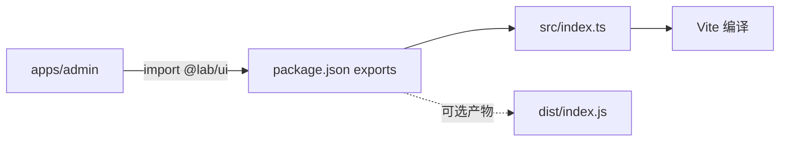

# M4 跨包引用与类型

> **目标层级**：L2 ｜ **前置**：M3 ｜ **预计**：5h
> **本章产物**：两种引用方案各跑一遍，`@lab/ui` 能产出 dist，循环依赖被检测并拆掉

## 0. 先看终点

```powershell
PS> pnpm --filter "@lab/ui" build
> tsc -p tsconfig.build.json
# dist/index.js、dist/index.d.ts 生成

PS> pnpm build
# 两个应用仍然构建成功，引用方式没变

PS> pnpm exec madge --circular --extensions ts,tsx packages apps
✔ No circular dependency found!
```

以及一条失败的命令：

```powershell
PS> pnpm --filter "@lab/admin" exec node -e "import('@lab/ui/src/Button')"
# 报 ERR_PACKAGE_PATH_NOT_EXPORTED
```

最后这条是好事：它说明包的边界真的生效了。



## 1. 知识讲解

### 1.1 源码直连还是构建产物

| 方案 | 做法 | 优点 | 代价 | 适用 |
|---|---|---|---|---|
| 源码直连 | `exports` 指向 `src/index.tsx` | 改完立即热更新，零构建 | 消费方必须能编译 TS/TSX；发布到 npm 不可用 | 单仓内部包 |
| 构建产物 | `exports` 指向 `dist/index.js` + `.d.ts` | 消费方不需要编译源码；可发布 | 每次改动要重建；产物与源码可能不同步 | 要发 npm、要给外部用 |

本教程的单仓内部包用**源码直连**；`dist` 只用来理解边界与发布场景。这条规则能砍掉大量「每次改组件都要 watch 构建」的痛苦。

判断标准一句话：**这个包会不会离开这个仓库？** 不会，就源码直连。

### 1.2 `exports` 是边界，不是路径别名

```json
{
  "exports": {
    ".": {
      "types": "./dist/index.d.ts",
      "import": "./dist/index.js"
    },
    "./styles.css": "./src/styles.css",
    "./package.json": "./package.json"
  }
}
```

三件事：

1. `.` 是包入口，`@lab/ui` 只能解析到它
2. 只有列出来的子路径可访问；`@lab/ui/src/Button`、`@lab/ui/dist/Button` 一律拒绝
3. `"types"` 必须放在条件对象的**第一位**，TypeScript 按顺序匹配

常见错误：只写 `"main"` 不写 `"exports"`。老工具能跑，但边界形同虚设，谁都能深层引用内部文件，改目录就全线崩。

### 1.3 类型从哪来

TypeScript 解析 `@lab/ui` 的顺序：

1. 找到 `node_modules/@lab/ui`（pnpm 的链接）
2. 读 `package.json` 的 `exports`
3. 在条件里找 `types`（配合 `moduleResolution: "Bundler"` 或 `"NodeNext"`）

如果应用用的是 `"moduleResolution": "Node"`，它不认 `exports`，只认 `types`/`main` 字段。Vite 模板默认是 `Bundler`，不要改回去。

**不要用 tsconfig `paths` 把 `@lab/ui` 映射到 `../ui/src`。** 那会绕过依赖声明：包没装也能通过类型检查，CI 一装就崩。让类型走真实的包边界。

### 1.4 双格式的坑，先知道结论

- 只发 ESM：现代工具（Vite、Node 20+）没问题，老 CJS 工具会 `ERR_REQUIRE_ESM`
- 同时发 ESM + CJS：要处理「双包危害」——同一份代码被加载两次，单例状态分裂
- 单仓内部包：不发布，所以不用纠结

本章用 `tsc` 产出 ESM + d.ts，只为了看清 `dist` 长什么样；不引入 Rollup / tsup 之类的库构建工具。真要发布时，再决定 ESM-only 还是双格式。

### 1.5 循环依赖为什么必须治

`ui → utils` 是正常方向；`utils → ui` 就形成环。TypeScript 有时能容忍类型层的环，但会带来：

- 构建顺序失去意义（谁先谁后都错）
- 类型推断退化成 `any` 或报奇怪错误
- 运行时出现 `undefined`（模块初始化顺序问题）

检测比修复便宜：`madge --circular` 放进 CI，出现环就失败。

## 2. 实操

### 2.1 先看边界有没有生效

```powershell
pnpm --filter "@lab/admin" exec node -e "import('@lab/ui/src/Button').catch(e => { console.error(e.code); process.exit(1) })"
```

预期：`ERR_PACKAGE_PATH_NOT_EXPORTED`。如果居然成功了，说明 `exports` 没生效，回去检查 M2 的 `package.json`。

### 2.2 加一个受控子路径

`packages/ui/src/styles.css`

```css
.btn {
  border: 1px solid #d0d5dd;
  border-radius: 6px;
  padding: 6px 12px;
  background: #fff;
  cursor: pointer;
  font: inherit;
}

.btn--primary {
  background: #1d4ed8;
  border-color: #1d4ed8;
  color: #fff;
}

.btn--ghost {
  background: transparent;
}
```

`packages/ui/package.json` 的 `exports` 增加一行：

```json
"./styles.css": "./src/styles.css"
```

两个应用的 `src/main.tsx` 顶部加：

```tsx
import '@lab/ui/styles.css'
```

```powershell
pnpm dev:admin
```

按钮有样式了，说明子路径导出生效；而 `src/Button` 仍然被拒绝。**导出什么由包作者决定**，这就是边界。

### 2.3 产出 dist，对比两种方案

`packages/ui/tsconfig.build.json`

```json
{
  "extends": "./tsconfig.json",
  "compilerOptions": {
    "noEmit": false,
    "allowImportingTsExtensions": false,
    "declaration": true,
    "declarationMap": true,
    "sourceMap": true,
    "outDir": "dist",
    "rootDir": "src"
  },
  "include": ["src"]
}
```

`packages/ui/package.json` 增加脚本：

```json
"scripts": {
  "build": "tsc -p tsconfig.build.json",
  "typecheck": "tsc --noEmit"
}
```

```powershell
pnpm --filter "@lab/ui" build
Get-ChildItem packages/ui/dist
# 预期：index.js、index.d.ts、Button.js、Button.d.ts
```

把 `exports` 切换成 dist：

```json
"main": "./dist/index.js",
"types": "./dist/index.d.ts",
"exports": {
  ".": {
    "types": "./dist/index.d.ts",
    "import": "./dist/index.js"
  },
  "./styles.css": "./src/styles.css",
  "./package.json": "./package.json"
}
```

```powershell
pnpm build
pnpm dev:admin
```

能跑，但改 `Button.tsx` 后页面不会更新，必须重新 `build`。这就是产物方案的日常成本。

现在把 `exports` 改回源码，并保留 build 脚本备用：

```json
"main": "./src/index.tsx",
"types": "./src/index.tsx",
"exports": {
  ".": "./src/index.tsx",
  "./styles.css": "./src/styles.css",
  "./package.json": "./package.json"
}
```

记录一组数据：`tsc` 构建耗时、dist 体积、改一次 Button 到页面更新的时间（源码方案约 1 秒，产物方案要等构建）。用 `bench` 记得下来的就记。

### 2.4 类型检查要覆盖所有包

给 utils 也加 `"typecheck": "tsc --noEmit"`，然后：

```powershell
pnpm typecheck
```

预期：四个包都检查通过。如果 admin 报找不到 `@lab/ui` 的类型，先确认 `exports` 的 `types` 条件在第一位。

### 2.5 制造并拆掉一个循环依赖

给 utils 加一条不该有的引用：

```ts
// packages/utils/src/index.ts 顶部
import type { ButtonProps } from '@lab/ui'
export type UiButtonProps = ButtonProps
```

并让 utils 声明 ui：

```powershell
pnpm --filter "@lab/utils" add -D "@lab/ui@workspace:*"
```

安装检测工具：

```powershell
pnpm add -Dw madge
pnpm exec madge --circular --extensions ts,tsx packages apps
```

预期：安装时 pnpm 打印 `There are cyclic workspace dependencies`，madge 输出一条环，`utils → ui → utils`。

顺带观察：此时 `pnpm typecheck` 会报 `ERR_PNPM_TASK_CYCLE`，递归任务无法排序。这是环的第二个信号。

修复：删掉那段 import 与导出，移除 utils 的 ui 依赖。

```powershell
pnpm --filter "@lab/utils" remove "@lab/ui"
pnpm exec madge --circular --extensions ts,tsx packages apps
# ✔ No circular dependency found!
```

结论写进 runbook：**下层包永远不引用上层包；两边都需要的类型放最下层，或单独建 types 包。**

## 3. 排障

**3.1 `ERR_PACKAGE_PATH_NOT_EXPORTED`**

正常现象，说明边界生效。要用子路径就在 `exports` 里显式加，不要改成 `"./*": "./*"` 图省事。

**3.2 `Cannot find module '@lab/ui' or its corresponding type declarations`**

三种可能：包没装（`workspace:*` 丢失）、`exports` 没写 `types`、TS 的 `moduleResolution` 不是 `Bundler`/`NodeNext`。

**3.3 改了源码，类型没更新**

VS Code 的 TS server 缓存。`Ctrl+Shift+P` → `TypeScript: Restart TS Server`；仍不行就删 `node_modules/.tmp` 与 `*.tsbuildinfo`。

**3.4 `tsc` 没有输出文件**

继承了 `noEmit: true`。确认 `tsconfig.build.json` 里显式写了 `"noEmit": false`。

**3.5 CSS 导入报错**

`@lab/ui/styles.css` 没在 `exports` 里声明；或 Vite 缓存了旧的包元数据，重启 dev server。

## 4. 故障演练：把 `types` 条件放错位置

**制造**：把 `exports["."]` 改成：

```json
{
  "import": "./src/index.tsx",
  "types": "./src/index.tsx"
}
```

**观察**：重启 TS server，admin 里 `@lab/ui` 的类型变成 `any` 或直接报错。TypeScript 按条件顺序匹配，`import` 在前面时会先命中运行时的解析分支。

**修复**：`types` 放回第一位。

**沉淀**：所有 `exports` 的条件对象，第一行永远是 `types`。可以写一条 ESLint 规则或评审清单，但先靠人记住。

## 5. 闭卷练习：加一个 `@lab/hooks`

不看教程，完成下面四步：

1. 新建 `packages/hooks`，复制 utils 的 tsconfig，`exports` 只开放 `"."` 与 `"./package.json"`
2. 写 `useDebouncedValue`，内部使用 `@lab/utils` 的 `debounce`
3. `apps/admin` 引用它；再试 `@lab/hooks/src/useDebouncedValue`，必须被拒绝
4. `madge --circular` 无环，`pnpm typecheck` 通过

**过关标准**：把 admin 的 `@lab/hooks` 依赖删掉、重新 `pnpm install` 后，构建必须失败。如果还能构建，说明依赖没有被真实声明，或者 `paths` 在偷偷兜底。

## 6. 验收清单

- [ ] `@lab/ui/src/Button` 无法被外部导入
- [ ] `@lab/ui/styles.css` 可以导入，按钮有样式
- [ ] `@lab/ui` 能产出 `dist`（js + d.ts）
- [ ] 切换两种 `exports` 后，应用都能构建，并能说出差异
- [ ] `pnpm typecheck` 四个包全部通过
- [ ] `madge --circular` 无输出
- [ ] runbook 里记了「下层不引用上层」

## 7. 自测

1. 什么情况下内部包应该引源码，什么情况下必须引产物？
2. `exports` 的 `types` 条件为什么必须放第一位？
3. 用 `tsconfig` 的 `paths` 代替包引用，会带来什么问题？
4. 双包危害（dual package hazard）是什么？什么场景下才会遇到？
5. 用 3 句话解释「循环依赖为什么让构建顺序失去意义」。

<details><summary>参考答案</summary>

1. 包不离开仓库、消费方是 Vite/TS → 源码；要发布 npm、消费方不能编译 TS → 产物。
2. TypeScript 按条件对象顺序匹配，`types` 在后面时可能先命中 `import`，导致类型解析失败或退化为 any。
3. 绕过依赖声明：包没装也能通过类型检查，CI 或换机器后崩；同时 `paths` 与真实解析不一致，容易掩盖 `exports` 配置错误。
4. 同一份代码同时以 ESM 和 CJS 被加载，产生两份模块实例，单例（React、状态库）分裂。只有同时发布两种格式且消费方混用时才会遇到。
5. 环意味着 A 需要 B 先初始化、B 又需要 A 先初始化，无论谁先构建都有一方拿到未完成的状态；结果取决于打包器的处理顺序，表现为时好时坏。

</details>

## 8. 延伸

- [Node.js · Package entry points](https://nodejs.org/api/packages.html#package-entry-points) —— 读 `exports` 与条件导出两节
- [TypeScript · Module resolution](https://www.typescriptlang.org/docs/handbook/modules/reference.html) —— 只看 `exports` 与 `types` 相关部分
- 公司落地最小改动：给现有内部包补上 `exports`，先禁止深层引用，再谈构建产物

> 下一章 M5：把 ESLint、Prettier、提交信息统一起来，让新包零配置接入。
