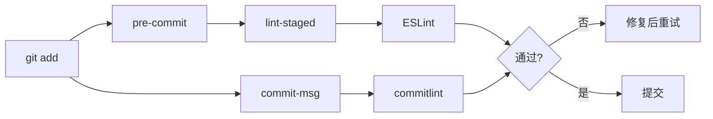

# M5 统一规范与提交门禁

> **目标层级**：L3 ｜ **前置**：M4 ｜ **预计**：5h
> **本章产物**：一个共享 ESLint 配置包、一份 TS base、提交前自动检查、提交信息规范

## 0. 先看终点

新包接入规范只需要两步：

```powershell
pnpm --filter "@lab/newpkg" add -D "@lab/config-ts@workspace:*"
```

`packages/newpkg/tsconfig.json`

```json
{
  "extends": "@lab/config-ts/base.json",
  "include": ["src"]
}
```

然后这两条命令必须能拦住坏代码和坏提交信息：

```powershell
PS> git commit -m "改了点东西"
✖ subject may not be empty [subject-empty]
✖ type may not be empty [type-empty]

PS> git commit -m "feat: add button"
✖ eslint found problems in apps/admin/src/App.tsx
# 提交被拒绝
```

注意：门禁只防手滑，不防故意。`--no-verify` 永远能绕过，真正的守门员是 CI（C3）。



## 1. 知识讲解

### 1.1 为什么配置要变成包

M2 里每个包各写一份 tsconfig，已经开始重复。到 ESLint 更明显：4 个包 × 十几个插件和规则，改一条规则要改 4 处，新包还要复制粘贴。

共享配置包解决三件事：

- **版本只装一次**：插件是配置包的 `dependencies`，业务包不用管
- **规则只改一处**：升级、加规则、关规则都在一个仓库位置
- **接入成本固定**：一个 devDependency + 一个 `extends`

ESLint 配置放在仓库根目录，只此一份。原因是 ESLint 9 的 flat config 从**执行命令的目录**找配置，不按文件所在目录级联；lint-staged 在仓库根跑，配置就必须在根。放在根还有一个好处：新包什么都不用配，自动被覆盖。

代价是配置包本身也要维护。包少于 3 个时没必要，超过 3 个就该做。

### 1.2 ESLint 9 的 flat config

ESLint 9 默认只认 `eslint.config.js`（以及 `.mjs`/`.cjs` 变体，flat config），`.eslintrc` 系列进入维护模式。两者不是写法不同，是模型不同：

| 旧（eslintrc） | 新（flat） |
|---|---|
| 配置按目录级联，隐式合并 | 一个数组，显式组合 |
| `extends` 字符串解析 | 直接 import 配置对象 |
| `env` 声明全局变量 | `languageOptions.globals` |
| 插件用字符串名 | 插件是对象本身 |
| `.eslintignore` | `{ ignores: [...] }` |

flat config 最大的好处是**它就是 JavaScript**：能 import、能判断环境、能复用。共享配置因此变得非常自然。

### 1.3 ESLint 与 Prettier 的分工

- ESLint：找**可能出错**的代码（未使用变量、hooks 依赖、浮空 Promise）
- Prettier：只管**格式**（换行、引号、缩进）

不要装 `eslint-plugin-prettier`。它把 Prettier 当成 ESLint 规则跑，结果是：

- 慢：每个文件都要跑一遍格式化
- 吵：格式问题混在代码问题里，红色波浪线铺满屏幕
- 冲突：两套规则互相覆盖，最后靠 `eslint-config-prettier` 关规则

正确做法：两个工具各跑各的，编辑器保存时各执行各的。

### 1.4 提交门禁的三段

```
git commit
  ├─ pre-commit   → lint-staged：只检查暂存的文件
  └─ commit-msg   → commitlint：检查提交信息格式
CI
  └─ 全量 lint + typecheck + build（C3）
```

`lint-staged` 的关键是「只检查暂存文件」。全量 lint 在提交时可能跑几十秒，人会开始用 `--no-verify`；只查改动的几个文件，通常 2 秒内结束。

### 1.5 提交信息为什么要管

Conventional Commits 不是审美问题，它让机器能读懂提交：

```
feat(admin): add user table
fix(ui): correct button disabled style
chore(deps): bump vite to 8.3.4
```

用途：自动生成 changelog、判断语义化版本、按类型过滤提交。单仓里还有额外好处：`feat(admin)` 一眼看出影响了哪个包。

### 1.6 门禁的边界

| 能拦住 | 拦不住 |
|---|---|
| 未使用变量、hooks 依赖漏写 | 逻辑错误 |
| 提交信息格式 | 写错的提交信息内容（`feat: asdf`） |
| 明显的类型错误 | 运行时才暴露的问题 |
| 格式不一致 | 架构问题 |

门禁的价值是**降低评审噪音**，不是替代评审。

## 2. 实操

### 2.1 建 TS 配置包

```powershell
New-Item -ItemType Directory -Force -Path packages/config-ts | Out-Null
```

`packages/config-ts/package.json`

```json
{
  "name": "@lab/config-ts",
  "version": "0.0.0",
  "private": true,
  "files": ["base.json"]
}
```

`packages/config-ts/base.json`

```json
{
  "$schema": "https://json.schemastore.org/tsconfig",
  "compilerOptions": {
    "target": "ES2023",
    "lib": ["ES2023", "DOM", "DOM.Iterable"],
    "module": "ESNext",
    "moduleResolution": "Bundler",
    "jsx": "react-jsx",
    "strict": true,
    "noUncheckedIndexedAccess": true,
    "noUnusedLocals": true,
    "noUnusedParameters": true,
    "noFallthroughCasesInSwitch": true,
    "isolatedModules": true,
    "verbatimModuleSyntax": true,
    "allowImportingTsExtensions": true,
    "skipLibCheck": true,
    "noEmit": true
  }
}
```

这里刻意**不写** `exports`。TypeScript 的 `extends` 按文件路径解析，写了 `exports` 反而要额外声明 `"./base.json"`，没必要。

先让四个包声明它：

```powershell
pnpm --filter "@lab/admin" add -D "@lab/config-ts@workspace:*"
pnpm --filter "@lab/h5" add -D "@lab/config-ts@workspace:*"
pnpm --filter "@lab/ui" add -D "@lab/config-ts@workspace:*"
pnpm --filter "@lab/utils" add -D "@lab/config-ts@workspace:*"
```

把四个包的 tsconfig 改成继承：

`packages/utils/tsconfig.json`

```json
{
  "extends": "@lab/config-ts/base.json",
  "compilerOptions": {
    "lib": ["ES2023"]
  },
  "include": ["src"]
}
```

utils 不需要 DOM，覆盖 `lib`。ui 直接继承（需要 DOM 与 jsx）。

两个应用的 `tsconfig.app.json` 改成：

```json
{
  "extends": "@lab/config-ts/base.json",
  "compilerOptions": {
    "tsBuildInfoFile": "./node_modules/.tmp/tsconfig.app.tsbuildinfo",
    "types": ["vite/client"]
  },
  "include": ["src"]
}
```

`tsconfig.node.json` 也继承，但要加 Node 的类型与 `lib`：

```json
{
  "extends": "@lab/config-ts/base.json",
  "compilerOptions": {
    "lib": ["ES2023"],
    "types": ["node"],
    "noEmit": true
  },
  "include": ["vite.config.ts"]
}
```

`@types/node` 模板里已经装了；没装就 `pnpm --filter "@lab/admin" add -D @types/node`。

给每个包加类型检查脚本（应用已有，utils/ui 在 M4 已加），确认：

```powershell
pnpm typecheck
```

如果 `noUncheckedIndexedAccess` 让某处报错，**修代码**，不要关规则。典型修法是加空值判断，而不是 `!`。

### 2.2 建 ESLint 配置包

```powershell
New-Item -ItemType Directory -Force -Path packages/config-eslint | Out-Null
```

`packages/config-eslint/package.json`

```json
{
  "name": "@lab/config-eslint",
  "version": "0.0.0",
  "private": true,
  "type": "module",
  "exports": {
    ".": "./index.js"
  },
  "dependencies": {
    "@eslint/js": "^9.0.0",
    "eslint-plugin-react-hooks": "^5.0.0",
    "eslint-plugin-react-refresh": "^0.4.0",
    "globals": "^15.0.0",
    "typescript-eslint": "^8.0.0"
  },
  "peerDependencies": {
    "eslint": "^9.0.0"
  }
}
```

版本以你执行 `pnpm add` 时写入的为准。如果上面的范围装不上，用带主版本约束的命令重装，不要不带版本号（那会装到 ESLint 10 时代的插件，和 `peerDependencies` 的 `eslint@^9` 打架）：

```powershell
pnpm --filter "@lab/config-eslint" add "@eslint/js@^9" "typescript-eslint@^8" "eslint-plugin-react-hooks@^5" "eslint-plugin-react-refresh@^0.4" "globals@^15"
```

> ESLint 10 在 2026 年已发布，但本教程锁 ESLint 9：flat config 写法完全一致，公司现有项目也大多还在 9。升级到 10 时先重跑本章的验收，再改 `peerDependencies`。

`packages/config-eslint/index.js`

```js
import js from '@eslint/js'
import tseslint from 'typescript-eslint'
import reactHooks from 'eslint-plugin-react-hooks'
import reactRefresh from 'eslint-plugin-react-refresh'
import globals from 'globals'

export default tseslint.config(
  {
    ignores: [
      '**/dist/**',
      '**/node_modules/**',
      '**/coverage/**',
      '**/*.d.ts',
      '**/reports/**',
    ],
  },
  js.configs.recommended,
  ...tseslint.configs.recommended,
  {
    files: ['**/*.{ts,tsx}'],
    languageOptions: {
      ecmaVersion: 2023,
      globals: {
        ...globals.browser,
        ...globals.node,
      },
    },
    plugins: {
      'react-hooks': reactHooks,
      'react-refresh': reactRefresh,
    },
    rules: {
      ...reactHooks.configs.recommended.rules,
      'react-refresh/only-export-components': [
        'warn',
        { allowConstantExport: true },
      ],
      '@typescript-eslint/no-unused-vars': [
        'error',
        { argsIgnorePattern: '^_', varsIgnorePattern: '^_' },
      ],
      '@typescript-eslint/consistent-type-imports': [
        'error',
        { prefer: 'type-imports' },
      ],
    },
  },
  {
    files: ['**/*.config.{js,ts,mjs}', '**/vite.config.ts'],
    rules: {
      'react-refresh/only-export-components': 'off',
    },
  },
)
```

几点解释：

- `tseslint.config()` 是 typescript-eslint 提供的组合函数，等价于手写数组，但会做类型检查
- `globals.browser` 与 `globals.node` 同时给：单仓里同一个配置文件要覆盖应用与 Node 脚本，宁可宽一点
- `consistent-type-imports` 强制 `import type`，配合 `verbatimModuleSyntax`，避免运行时多出无用 import

在仓库根接入。ESLint 本身装在根，配置包也放根：

```powershell
pnpm add -Dw "eslint@^9" "@lab/config-eslint@workspace:*"
```

根 `eslint.config.mjs`：

```js
import config from '@lab/config-eslint'

export default config
```

> 这份配置用的是 `recommended`，不做类型感知，所以不需要 `projectService`。如果以后开启类型感知规则，必须在根配置补 `parserOptions: { projectService: true, tsconfigRootDir: import.meta.dirname }`；否则 monorepo 里会出现 `No tsconfigRootDir was set, and multiple candidate TSConfigRootDirs are present`。

根 `package.json` 加：

```json
"scripts": {
  "lint": "eslint ."
}
```

create-vite 模板版本不同：有的带 `oxlint`，有的带一份 app 级 `eslint.config.js` 和 `"lint": "eslint ."`。本教程统一用仓库根的 ESLint，先把 app 级的 linter 依赖、配置和 `lint` 脚本清掉，避免两套配置并存：

```powershell
pnpm --filter "@lab/admin" remove oxlint
pnpm --filter "@lab/h5" remove oxlint
Remove-Item apps/admin/.oxlintrc.json, apps/h5/.oxlintrc.json, apps/admin/eslint.config.js, apps/h5/eslint.config.js -ErrorAction SilentlyContinue
```

然后从 `apps/admin/package.json` 与 `apps/h5/package.json` 的 `scripts` 里删掉 `lint` 脚本（不管是 `oxlint` 还是 `eslint .`）。app 里如果还留着 `eslint`、`@eslint/js`、`typescript-eslint` 等 devDependencies，也可以一起卸掉；它们统一由根和 `@lab/config-eslint` 提供。

> 编辑器与命令行找配置的方式不同：命令行在仓库根执行时只看根配置，编辑器却可能按文件所在目录加载 `apps/*/eslint.config.js`。这就是为什么 app 里那份必须删，而不是只靠根配置覆盖。开着两份配置时，monorepo 很容易报 `No tsconfigRootDir was set, and multiple candidate TSConfigRootDirs are present`。

```powershell
pnpm lint
```

预期：全仓通过。大概率会有几条 `no-unused-vars` 或 `consistent-type-imports`，按提示修。

为什么不在每个包各放一份配置：ESLint 9 从**当前工作目录**找 `eslint.config.*`，而 lint-staged 与 CI 都在仓库根执行。包内配置在根执行时不会被读取，反而制造「我明明配了」的错觉。一份根配置 + 共享包，已经能做到「规则只改一处」。

### 2.3 Prettier

```powershell
pnpm add -Dw prettier
```

`.prettierrc`

```json
{
  "semi": false,
  "singleQuote": true,
  "printWidth": 100,
  "trailingComma": "all"
}
```

`.prettierignore`

```
node_modules
dist
coverage
reports
pnpm-lock.yaml
*.md
```

先不格式化 Markdown，避免教程文档被整篇重排。

根 `package.json`：

```json
"scripts": {
  "format": "prettier --write .",
  "format:check": "prettier --check ."
}
```

```powershell
pnpm format
pnpm format:check
```

预期：第二次输出 `All matched files use Prettier code style!`。

### 2.4 commitlint

```powershell
pnpm add -Dw "@commitlint/cli" "@commitlint/config-conventional"
```

`commitlint.config.mjs`

```js
export default {
  extends: ['@commitlint/config-conventional'],
}
```

用 `.mjs` 而不是 `.js`，避免根 `package.json` 没有 `"type": "module"` 时 import 语法报错。

### 2.5 husky + lint-staged

```powershell
pnpm add -Dw husky lint-staged
pnpm exec husky init
```

`husky init` 会做两件事：在根 `package.json` 加 `"prepare": "husky"`，创建 `.husky/pre-commit`（内容是 `npm test`）。改成：

`.husky/pre-commit`

```sh
pnpm exec lint-staged
```

`.husky/commit-msg`

```sh
pnpm exec commitlint --edit "$1"
```

根 `package.json` 加 lint-staged 配置：

```json
"lint-staged": {
  "*.{ts,tsx}": [
    "eslint --fix",
    "prettier --write"
  ],
  "*.{json,css,html,yaml,yml}": [
    "prettier --write"
  ]
}
```

注意：**不要**在 lint-staged 里写 `pnpm -r lint`。它会对整个仓库跑，提交一次等半分钟，人就会开始绕过门禁。

> CI 或 Docker 构建里没有 `.git` 时，`prepare` 可能失败。用 `HUSKY=0 pnpm install` 跳过钩子安装，C4 会用到这条。

### 2.6 验证门禁

**验证一：坏提交信息**

```powershell
git add -A
git commit -m "改了点东西"
```

预期：commitlint 报 `subject-empty` 与 `type-empty`，提交失败。

```powershell
git commit -m "chore: add lint gate"
```

预期：通过。

**验证二：坏代码**

在 `apps/admin/src/App.tsx` 里加一行：

```tsx
const unused = 1
```

```powershell
git add apps/admin/src/App.tsx
git commit -m "feat: test gate"
```

预期：lint-staged 报 `unused is assigned a value but never used`，提交失败。

删掉这行，再提交。

**验证三：绕过**

```powershell
git commit -m "asdf" --no-verify
```

预期：成功。记住这个结果——门禁不是安全边界，CI 才是。

## 3. 排障

**3.1 `ESLint couldn't find an eslint.config.js`**

不在仓库根执行。ESLint 9 只从当前工作目录找配置，`pnpm lint` 要在根目录跑；不要 `cd` 进 `apps/admin` 再执行 `eslint .`。

**3.2 `TypeError: Key "rules": Key "react-hooks/rules-of-hooks"`**

插件版本与配置对象不匹配。确认 `eslint-plugin-react-hooks` 是 5.x，且用的是 `reactHooks.configs.recommended.rules`，不是旧版的 `extends`。

**3.3 提交时 husky 没反应**

```powershell
git config core.hooksPath
# 预期：.husky/_
```

如果不是，执行 `pnpm exec husky` 重新安装。新克隆仓库后必须先 `pnpm install`，`prepare` 才会跑。

**3.4 `lint-staged` 报 `git stash` 相关错误**

Windows 上文件被编辑器占用时会出现。关掉正在写文件的进程，或 `git stash drop` 后重试。不要用 `--no-verify` 掩盖。

**3.5 Prettier 与编辑器打架**

编辑器用了自己的默认格式（比如 4 空格）。在项目根加 `.editorconfig`，并让编辑器读取项目 Prettier 配置，不要用全局配置。

## 4. 故障演练：拆掉 `prepare`

**制造**：删掉根 `package.json` 的 `"prepare": "husky"`，然后模拟新克隆：

```powershell
Remove-Item -Recurse -Force .husky
pnpm install
git commit --allow-empty -m "bad message"
```

**观察**：提交成功，commitlint 没有运行。原因是 husky 的钩子目录没有被安装。

**修复**：恢复 `"prepare": "husky"`，`pnpm install`，再试一次坏提交信息，确认被拦住。

**沉淀**：任何「本地才生效」的检查都不可靠。把 `pnpm lint`、`pnpm typecheck`、`commitlint` 全部放进 CI，本地门禁只负责快速反馈。

## 5. 闭卷练习：新包零配置接入

限时 5 分钟，从建目录到 lint 通过：

1. 新建 `@lab/icons`，只声明 `@lab/config-ts`，tsconfig 只写 `extends` 与 `include`
2. 不写 `eslint.config.js`、不加 lint 脚本
3. 在根目录 `pnpm lint`，确认新包已被覆盖
4. 故意写一个未使用变量和一个显式 `any`，确认两条都被拦住
5. 修好，用 `feat(icons): add check icon` 提交

**过关标准**：全程没有复制粘贴 ESLint 配置；坏代码被拦；`git log -1` 的提交信息符合规范。

## 6. 验收清单

- [ ] `packages/config-ts` 与 `packages/config-eslint` 存在；前者被四个包声明，后者被根声明
- [ ] 四个包的 `tsconfig` 没有重复的 `strict`/`target` 等字段
- [ ] 新包接入规范只需 1 个依赖 + 一个 `extends`，lint 无需配置
- [ ] `pnpm lint`、`pnpm typecheck`、`pnpm format:check` 全部通过
- [ ] 坏提交信息被 commitlint 拦住
- [ ] 未使用变量被 lint-staged 拦住
- [ ] 知道 `--no-verify` 能绕过，并已把 CI 作为最终门禁
- [ ] 已提交，且提交信息本身符合规范

## 7. 自测

1. ESLint 9 flat config 与 `.eslintrc` 的三个主要差异是什么？
2. 为什么不用 `eslint-plugin-prettier`？
3. `lint-staged` 为什么只检查暂存文件？全量检查的代价是什么？
4. 共享 ESLint 配置包里，插件应该放 `dependencies` 还是 `peerDependencies`？为什么？
5. 用 3 句话向同事解释「本地门禁与 CI 门禁的分工」。

<details><summary>参考答案</summary>

1. 单一 `eslint.config.js` 数组而非目录级联；用 import 组合配置而非 `extends` 字符串；插件是对象、全局变量在 `languageOptions.globals`，忽略用配置对象而非 `.eslintignore`。
2. 它把格式化当 lint 规则跑，慢且把格式问题与代码问题混在一起，还要额外关规则解决冲突；分开跑更快、报错更清晰。
3. 提交时只关心本次改动，2 秒内能结束，人才不会绕过；全量 lint 在大仓库要几十秒，频率一高就会被 `--no-verify` 跳过。
4. `dependencies`。业务包只装配置包，插件由配置包带进来，版本统一；放 peer 会让每个业务包都要自己装一遍插件，回到版本分裂。
5. 本地门禁用 lint-staged + commitlint 做快速反馈，2 秒内拦住明显问题；CI 跑全量 lint、typecheck、build，防止 `--no-verify` 和漏装钩子；两者职责不同，不能互相替代。

</details>

## 8. 延伸

- [ESLint · Flat Config](https://eslint.org/docs/latest/use/configure/configuration-files) —— 只看「Configuration Objects」与「Ignoring Files」
- [typescript-eslint · Shared Configs](https://typescript-eslint.io/users/configs/) —— 理解 `recommended` 与 `strict` 的差别
- 公司落地最小改动：先抽出 ESLint 共享配置，不动 Prettier 和提交门禁；一周后再加 commitlint

> 下一章 M6：增删包、升级、锁文件冲突、CI 与本地不一致——把前五章变成一份能天天查的手册。
