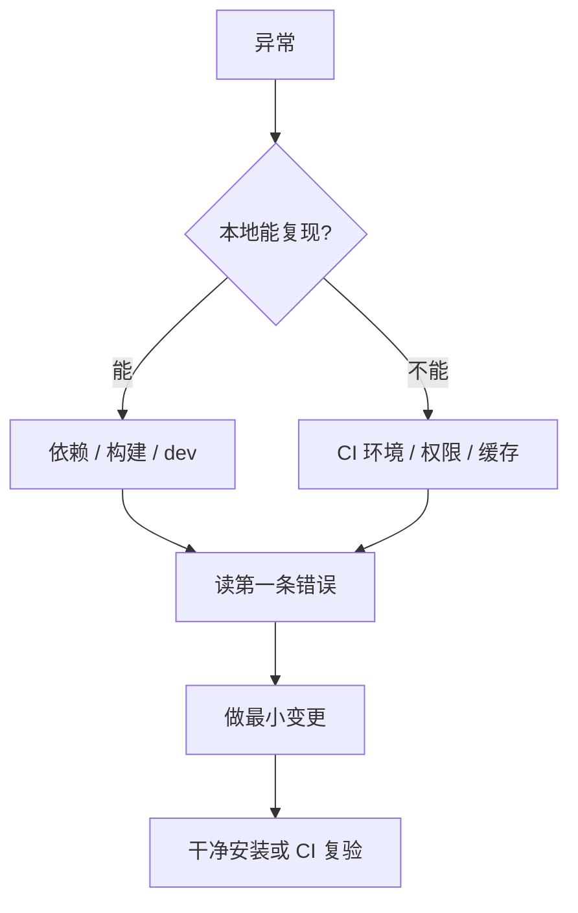

# M6 日常操作与排障

> **目标层级**：L3 ｜ **前置**：M5 ｜ **预计**：4h
> **本章产物**：`docs/runbook.md`，覆盖增删包、升级、锁文件冲突、CI 与本地不一致

## 0. 先看终点

本章不引入新工具，只把前五章变成一套肌肉记忆。结束时你应该能不看教程完成：

```powershell
# 加一个包
New-Item -ItemType Directory packages/icons
# 写 package.json → pnpm install → 在 admin 里 workspace:* 引用 → pnpm build

# 升级一个依赖
pnpm outdated -r
pnpm --filter "@lab/admin" add "vite@^8.3.0"

# 处理锁文件冲突
git checkout --theirs pnpm-lock.yaml
pnpm install
git add pnpm-lock.yaml
```

以及在一分钟内判断：这个报错是包名错、版本错、锁文件错，还是环境错。



## 1. 知识讲解

### 1.1 `node_modules` 是缓存，不是事实

单仓里最常见的误判：改了 `package.json`，没跑 `pnpm install`，开发服务器照样能跑，于是以为配置生效了。

实际上 `node_modules` 里还是上一次安装的结果。直到：

- 别人克隆仓库后安装
- CI 用 `--frozen-lockfile` 安装
- 你删掉 `node_modules` 重装

问题才暴露。**规则：只要改了任何 `package.json`，立刻 `pnpm install`，并提交锁文件。**

### 1.2 锁文件冲突为什么不能手改

`pnpm-lock.yaml` 是生成物，记录了每个包的精确版本、完整性哈希、peer 解析结果。手改一个版本号，哈希对不上，安装直接失败；改对了版本但漏了依赖关系，CI 会装出一棵不同的树。

正确流程：

```powershell
# 冲突时先选一边，让文件回到「可解析」状态
git checkout --theirs pnpm-lock.yaml
pnpm install
git add pnpm-lock.yaml
```

`pnpm install` 会以当前所有 `package.json` 为准重算锁文件。选哪一边不重要，重要的是**重算**。

如果冲突反复出现，说明分支生命周期太长。缩短分支、提高合并频率，比任何合并技巧都有效。

### 1.3 `--frozen-lockfile` 是 CI 的底线

| 命令 | 行为 |
|---|---|
| `pnpm install` | 锁文件与 `package.json` 不一致时，更新锁文件 |
| `pnpm install --frozen-lockfile` | 不一致时直接失败，不修改任何文件 |

CI 必须用后者。否则流水线会「顺手」改锁文件，装出一套和仓库记录不同的依赖，构建结果不可复现。

pnpm 在检测到 CI 环境时默认启用 frozen 行为，但显式写出来更清楚。

### 1.4 升级的三种粒度

| 目标 | 命令 | 风险 |
|---|---|---|
| 范围内最新 | `pnpm update -r` | 低，遵守 `^` 范围 |
| 交互式挑 | `pnpm update -r --interactive` | 低，逐个确认 |
| 跨大版本 | `pnpm update -r --latest` | 高，忽略范围，可能全崩 |

`--latest` 不是日常命令。正确做法是一个包一个包升，升完跑 `pnpm typecheck && pnpm build && pnpm lint`，通过再提交。

用 catalog 的项目，升级共享依赖改 `pnpm-workspace.yaml` 一处，然后 `pnpm install`。这是 catalog 最大的日常收益。

### 1.5 CI 与本地不一致的六个来源

| 来源 | 本地 | CI | 处理 |
|---|---|---|---|
| Node 版本 | 24.14 | 默认 20/22 | `.nvmrc` + `actions/setup-node` 读同一版本 |
| pnpm 版本 | 12.15 | 未锁则是最新 | `packageManager` + `corepack enable` |
| 锁文件 | 可能未提交 | 严格按仓库 | 提交锁文件，CI 用 frozen |
| 安装结构 | 可能改过 `nodeLinker` | 干净安装 | 禁止 `nodeLinker: hoisted` 进仓库 |
| 路径大小写 | Windows 不敏感 | Linux 敏感 | import 路径必须与文件名完全一致 |
| 安装脚本 | 手动 approve 过 | 未 approve | `allowBuilds` 写进配置 |

排查顺序：**先比版本，再比锁文件，最后比路径大小写。** 这三步能解决八成「本地能跑 CI 不能」。

### 1.6 路径大小写：Windows 开发者的专属坑

```ts
import { Button } from './button'   // 文件叫 Button.tsx
```

Windows 能找到，Linux 报 `Cannot find module './button'`。CI 第一次跑就会炸。

预防：ESLint 加 `import/no-unresolved` 之类的规则，或至少在 CI 里跑一次 Linux 构建。本教程的 C2 会自然覆盖这一点。

## 2. 实操

### 2.1 加一个包：`@lab/icons`

```powershell
New-Item -ItemType Directory -Force -Path packages/icons/src | Out-Null
```

`packages/icons/package.json`

```json
{
  "name": "@lab/icons",
  "version": "0.0.0",
  "private": true,
  "type": "module",
  "main": "./src/index.tsx",
  "types": "./src/index.tsx",
  "exports": {
    ".": "./src/index.tsx",
    "./package.json": "./package.json"
  },
  "peerDependencies": {
    "react": "^19.0.0"
  },
  "devDependencies": {
    "@lab/config-ts": "workspace:*",
    "@types/react": "catalog:",
    "react": "catalog:",
    "typescript": "catalog:"
  },
  "scripts": {
    "typecheck": "tsc --noEmit"
  }
}
```

`packages/icons/tsconfig.json`

```json
{
  "extends": "@lab/config-ts/base.json",
  "include": ["src"]
}
```

不需要 `eslint.config.js`：ESLint 配置在仓库根，新包自动被覆盖。

`packages/icons/src/index.tsx`

```tsx
import type { SVGProps } from 'react'

export function CheckIcon(props: SVGProps<SVGSVGElement>) {
  return (
    <svg viewBox="0 0 24 24" width="1em" height="1em" aria-hidden="true" {...props}>
      <path d="M20 6 9 17l-5-5" fill="none" stroke="currentColor" strokeWidth="2" />
    </svg>
  )
}
```

```powershell
pnpm install
pnpm --filter "@lab/admin" add "@lab/icons@workspace:*"
pnpm lint
pnpm typecheck
```

在 admin 里用一次：

```tsx
import { CheckIcon } from '@lab/icons'

<Button><CheckIcon /> 已完成</Button>
```

**观察点**：你没有改 `pnpm-workspace.yaml`，`packages/*` 自动匹配了新目录。这是 glob 的意义。

### 2.2 删一个包

```powershell
pnpm --filter "@lab/admin" remove "@lab/icons"
Remove-Item -Recurse -Force packages/icons
pnpm install
```

检查三处：

```powershell
Select-String -Path "apps/*/package.json","packages/*/package.json" -Pattern "@lab/icons"
pnpm -r list --depth -1
git status
```

预期：没有残留引用，锁文件里也没有 `@lab/icons`。

### 2.3 改名

把 `@lab/icons` 改成 `@lab/icon` 的完整步骤：

1. 改 `packages/icons/package.json` 的 `name`
2. `pnpm install`（重建链接）
3. 全局搜索旧名：`git grep "@lab/icons"`，逐个改引用
4. `pnpm install` 一次，提交

漏掉第 3 步会留下「安装成功但 import 失败」的悬空引用。`pnpm install` 不会替你检查源码里的字符串。

### 2.4 升级

```powershell
pnpm outdated -r
```

输出会按包分组，列出当前、期望、最新三列。挑选一个低风险包：

```powershell
pnpm --filter "@lab/admin" add "vite@^8.3.0"
pnpm typecheck
pnpm build
pnpm lint
```

通过后提交，提交信息写清范围：

```
chore(deps): bump vite to 8.3.x in admin
```

失败就 `git checkout -- package.json pnpm-lock.yaml`，不要在一个提交里混多个升级。

### 2.5 模拟一次锁文件冲突

```powershell
git switch -c conflict-a
pnpm --filter "@lab/admin" add -D "clsx@2.1.0"
git commit -am "chore: add clsx 2.1.0"

git switch main
pnpm --filter "@lab/admin" add -D "clsx@2.1.1"
git commit -am "chore: add clsx 2.1.1"

git merge conflict-a
# 冲突：apps/admin/package.json 与 pnpm-lock.yaml
```

解决：

```powershell
# 1. 先把 apps/admin/package.json 的冲突解决掉，保留 clsx 2.1.1
# 2. 锁文件选一边，交给 pnpm 重算
git checkout --theirs pnpm-lock.yaml
pnpm install
git add apps/admin/package.json pnpm-lock.yaml
git commit -m "chore: resolve lockfile conflict"
```

验证：

```powershell
pnpm install --frozen-lockfile
```

预期：成功。如果失败，说明锁文件没有真正重算，回到 `pnpm install` 再来一次。

### 2.6 写 runbook

`docs/runbook.md` 至少包含：

```md
# fe-lab Runbook

## 每日
- 拉代码后：pnpm install
- 改 package.json 或 pnpm-workspace.yaml 后：pnpm install，提交锁文件
- 提交前：pnpm lint && pnpm typecheck

## 加包
1. 建目录与 package.json
2. pnpm install
3. 消费方 pnpm --filter "<pkg>" add "<new>@workspace:*"
4. pnpm build

## 升级
1. pnpm outdated -r
2. 单包升级，禁止 --latest 批量
3. typecheck + build + lint
4. 单独提交

## 锁文件冲突
1. 选一边 checkout
2. pnpm install 重算
3. pnpm install --frozen-lockfile 验证

## CI 失败排查顺序
1. Node / pnpm 版本
2. 锁文件是否提交、是否 frozen
3. 路径大小写
4. allowBuilds
```

## 3. 十条高频报错

| 报错 | 原因 | 处理 |
|---|---|---|
| `ERR_PNPM_WORKSPACE_PKG_NOT_FOUND` | 内部包名错，或版本与 workspace 不符 | 改 `workspace:*`，核对包名 |
| `ERR_PNPM_NO_MATCHING_VERSION` | 版本范围在 registry 不存在 | `pnpm view <pkg> versions` 查真实版本 |
| `ERR_PNPM_PEER_DEP_ISSUES` | peer 范围不满足 | `pnpm why <pkg>` 找引入者，升版本 |
| `ERR_PNPM_OUTDATED_LOCKFILE` | 锁文件与 package.json 不一致 | 本地 `pnpm install` 后提交锁文件 |
| `--filter` 无匹配却退出 0 | pnpm 12 默认静默成功 | 加 `--fail-if-no-match`，先 `pnpm -r list` 核对包名 |
| `Cannot find module './Button'` | 路径大小写不一致 | 改为与文件名完全一致 |
| `Cannot find module '@lab/ui'` | 未声明依赖，或 `exports` 缺入口 | 补 `workspace:*`，检查 `exports` |
| `EPERM: operation not permitted` | Windows 文件被占用/权限不足 | 关编辑器/杀进程，必要时管理员终端 |
| `ELIFECYCLE Command failed with exit code 1` | 脚本内部失败，这是外壳 | 往上翻真正的错误行 |
| `Invalid hook call` | 两份 React | `pnpm why react`，组件库改 peer |

把这张表抄进 runbook 的「报错」一节，遇到新错误就追加。

## 4. 故障演练：让 `node_modules` 骗你一次

**制造**：

1. 从 `apps/admin/package.json` 删掉 `"@lab/utils": "workspace:*"`
2. 不要跑 `pnpm install`
3. `pnpm dev:admin`

**观察**：页面正常，`formatBytes` 还能用。因为 `node_modules` 里上次装的链接还在。

**暴露**：现在跑 `pnpm install`，再启动。

```powershell
pnpm install
pnpm dev:admin
```

预期：`Failed to resolve import "@lab/utils"`。

**修复**：把依赖加回去，`pnpm install`。

**沉淀**：`node_modules` 是缓存。任何「我明明改了配置」的疑问，第一步都是 `pnpm install`。CI 之所以能发现，是因为它从零安装。

## 5. 闭卷练习：30 分钟排障

从本章的十条报错里挑 5 条，在 `fe-lab` 里逐个制造、观察、修复。每条的记录格式固定：

```
现象：
第一反应：
真正原因：
修复命令：
如何提前发现：
```

**过关标准**：5 条都能在 3 分钟内定位；`docs/runbook.md` 新增 5 条记录；至少有 1 条是你第一次见到的错误。

## 6. 验收清单

- [ ] 能不看教程加一个包，并让 admin 引用成功
- [ ] 能干净地删掉一个包，锁文件无残留
- [ ] 做过一次真实的两分支锁文件冲突并解决
- [ ] `pnpm install --frozen-lockfile` 在当前仓库通过
- [ ] `docs/runbook.md` 包含每日流程、加包、升级、冲突、CI 排查
- [ ] 十条报错表能说出至少 6 条的原因
- [ ] 已提交，工作区干净

## 7. 自测

1. 为什么改了 `package.json` 必须立刻 `pnpm install`？不装会怎样？
2. 锁文件冲突为什么不能手工合并？正确流程是什么？
3. `pnpm install` 与 `pnpm install --frozen-lockfile` 的区别？CI 该用哪个？
4. 列出 CI 与本地不一致的四个来源，并给出对应处理。
5. 用 3 句话解释「为什么 `pnpm outdated -r --latest` 不该日常使用」。

<details><summary>参考答案</summary>

1. `node_modules` 是上一次安装的缓存，不装的话本地仍能解析旧依赖，造成「配置已生效」的错觉；换机器或 CI 从零安装时立刻失败。
2. 锁文件是生成物，含完整性哈希与 peer 解析，手改容易不一致；正确做法是选一边、`pnpm install` 重算、再用 frozen 验证。
3. 前者会更新锁文件以匹配 `package.json`；后者发现不一致直接失败，不修改文件。CI 用 frozen，保证可复现。
4. Node 版本（`.nvmrc` + setup-node）、pnpm 版本（`packageManager` + corepack）、锁文件（提交 + frozen）、路径大小写（CI 跑 Linux 构建）；另外还有 `pnpm-workspace.yaml` 的 `nodeLinker` 与 `allowBuilds`。
5. 它忽略 `^` 范围，一次把所有包推到最新大版本，失败时无法定位是哪一个；日常应单包升级并跑完整检查，`--latest` 只在专门的大版本迁移里用。

</details>

## 8. 延伸

- [pnpm · Continuous Integration](https://pnpm.io/continuous-integration) —— 看 frozen lockfile 与缓存配置
- [pnpm · Updating packages](https://pnpm.io/updating-packages) —— 区分 `update` 与 `update --latest`
- 公司落地最小改动：先把「改 package.json 必须 install + 提交锁文件」写进评审清单，一周内能消掉一半「本地能跑」问题

> Part 1 到此结束。下一步进入 B1：Vite 8 到底在你的项目里做了什么，以及为什么它的默认值值得信任。
