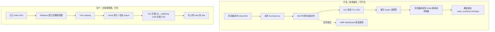

# B1 Vite 心智模型

> **目标层级**：L2 ｜ **前置**：M6 ｜ **预计**：4h
> **本章产物**：`docs/vite-pipeline.md`（两条链路图 + 一次对照记录）

## 0. 先看终点

在 `fe-lab` 根目录：

```powershell
PS> pnpm dev:admin
  VITE v8.x  ready in 320 ms
  ➜  Local:   http://localhost:5173/

PS> pnpm build:admin
@lab/admin build: tsc -b && vite build
vite v8.x building client environment for production...
✓ 42 modules transformed.
dist/index.html                   0.46 kB │ gzip:  0.30 kB
dist/assets/index-xxxxxxx.js    180.22 kB │ gzip: 58.10 kB
✓ built in 1.20s
```

本章结束时，你要能回答五个问题：

1. 开发时浏览器到底请求了什么？为什么 Network 里会有几百个 JS 请求？
2. `node_modules/.vite/deps` 是什么？删掉它会发生什么？
3. 为什么 Vite 开发模式能秒开，生产构建却要全量打包？
4. 为什么有些错误只在 `vite build` 后出现，开发时完全正常？
5. Vite 8 里的 Rolldown 和 Oxc 各自负责哪一段？

不要背名词。先把两条链路画出来，后面所有体积、缓存、tree shaking 的技巧都挂在这张图上。

## 1. 知识讲解

### 1.1 两条链路，不是一条

Vite 最容易被误解的地方：**开发服务器和生产构建不是同一套流程**。



开发链路的关键词是**按需**：浏览器要哪个模块，Vite 才转译哪个模块。生产链路的关键词是**全量**：从入口出发，把所有能静态分析到的模块收进来，做删除、合并、压缩、命名。

这两条链路共享配置文件和插件，但**不共享产物**。所以“开发能跑”不能证明“构建能跑”，反过来也一样。

### 1.2 开发链路：浏览器是打包器

打开 DevTools 的 Network，筛选 JS，你会看到类似：

```text
/@vite/client
/src/main.tsx
/src/App.tsx
/src/index.css
/node_modules/.vite/deps/react.js?v=4f2c1a9e
/node_modules/.vite/deps/react-dom_client.js?v=4f2c1a9e
```

逐条解释：

| 请求 | 谁生成的 | 作用 |
|---|---|---|
| `/@vite/client` | Vite | HMR 客户端、错误遮罩、WebSocket |
| `/src/main.tsx` | 你的源码 | Vite 现场把 TS/JSX 转成浏览器能执行的 JS |
| `/src/App.tsx` | 你的源码 | 同上，按需请求 |
| `/node_modules/.vite/deps/react.js?v=...` | 预构建 | 把 React 这类裸依赖变成单文件 ESM |
| `/src/index.css` | 你的源码 | 开发时以 JS 模块形式注入样式 |

注意最后一项：开发模式下 CSS 通常是通过 JS 注入的，构建后才会被抽成独立 `.css` 文件。这也是“开发时样式顺序正常，构建后顺序变了”的常见来源。

#### 裸依赖为什么要预构建

浏览器不认识：

```js
import React from 'react'
```

它只认识相对路径、绝对路径和完整 URL。Vite 在第一次启动时，会把 `react`、`react-dom`、`antd` 这类依赖预先打成一束 ESM，放到：

```text
node_modules/.vite/deps/
```

然后把源码里的 `'react'` 改写成：

```js
import React from '/node_modules/.vite/deps/react.js?v=4f2c1a9e'
```

预构建解决三件事：

1. **裸导入**：浏览器不认包名，预构建后变成 URL。
2. **CJS 兼容**：很多包仍是 CommonJS，预构建时转成 ESM，并处理 `default` 互操作。
3. **请求数量**：一个 `lodash-es` 可能有几百个内部模块，预构建合成少数几个文件，避免开发时请求爆炸。

Vite 8 的预构建由 **Rolldown** 完成，不再走 esbuild。你会在调试日志里看到 `vite:optimized-deps`、`vite:dep-scan` 之类的名字。

预构建缓存放在 `node_modules/.vite`。以下情况会失效并重新构建：

- `pnpm-lock.yaml` 变了
- `vite.config.ts` 里影响预构建的配置变了
- `optimizeDeps.include/exclude` 变了
- 你手动执行了 `vite --force`

强制重建：

```powershell
pnpm dev:admin -- --force
```

不要提交 `node_modules/.vite`。它不是源码，也不是构建产物。

#### 开发模式不做的事

- **不 tree shake**：没被用到的导出仍然可能被请求。
- **不压缩**：变量名、空格、注释都还在。
- **不合并 chunk**：每个模块一个请求，几百个请求是正常的。
- **不做完整类型检查**：Oxc 只删类型，不验证类型。类型检查是 `tsc -b` 的事。

最后一条尤其重要。Vite 的职责是“把 TS 转成 JS”，不是“证明 TS 类型正确”。所以 `pnpm build:admin` 里通常是：

```json
"build": "tsc -b && vite build"
```

`tsc -b` 失败，`vite build` 根本不会开始；只跑 `vite build` 可以绕过类型错误，这也是一个必须亲手做一次的演练。

#### HMR 不是刷新页面

HMR 的流程大致是：

1. 文件变化，Vite 的 watcher 收到事件。
2. Vite 找出受影响的模块，沿着 import 图向上找“接受更新”的边界。
3. 通过 WebSocket 把更新后的模块发给浏览器。
4. 浏览器替换模块；如果边界是 React 组件，`@vitejs/plugin-react` 会用 Fast Refresh 保留组件状态。
5. 找不到边界，才整页刷新。

所以 HMR 失效通常不是“Vite 坏了”，而是**边界断了**：文件导出的不是一个可接受的组件，或者更新链路上有非组件模块。

### 1.3 生产链路：Rolldown 做完整模块图

`vite build` 的流程：

1. 读 `index.html`，把 `<script type="module" src="/src/main.tsx">` 当入口。
2. Rolldown 从入口出发，解析所有静态 `import` 和动态 `import()`。
3. 做 tree shaking：删掉没有被使用的导出和模块。
4. 做 chunk 拆分：入口、动态 import、手动分组。
5. Oxc 压缩 JS；Lightning CSS 压缩 CSS。
6. 给文件名加内容 hash，写入 `dist`。

Vite 8 把这套生产打包统一到 **Rolldown**，不再使用 Rollup。Rolldown 的插件 API 与 Rollup 兼容，所以大多数 Vite 插件还能用；但配置项的名字变了：

```ts
// Vite 8 推荐
export default defineConfig({
  build: {
    rolldownOptions: {
      output: {
        codeSplitting: {
          groups: [{ name: 'react-vendor', test: /node_modules[\\/]react/ }],
        },
      },
    },
  },
})
```

旧的 `build.rollupOptions` 仍然可能被接受，但已经是兼容层。新代码统一写 `rolldownOptions`。分包的旧写法 `manualChunks` 对象形式在 Rolldown 里不再适用，B3 会专门讲 `codeSplitting.groups`。

生产构建的默认行为：

| 项 | 默认 | 说明 |
|---|---|---|
| 压缩 | Oxc | JS 压缩器，Vite 8 默认 |
| CSS 压缩 | Lightning CSS | 构建时抽离并压缩 |
| 目标 | `baseline-widely-available` | 面向现代浏览器，不再向下兼容 IE |
| 文件名 | `assets/[name]-[hash].js` | 内容变，hash 变 |
| 代码分割 | 自动 + 动态 import | 静态依赖通常并进入口 chunk |
| modulepreload | 自动注入 | 预加载入口的静态依赖 |

`vite preview` 只是本地静态服务器，用来检查 `dist` 是否能被正常访问。它不是生产服务器，不做 gzip、缓存头、反向代理，也不能代表线上性能。

### 1.4 为什么 dev 和 build 会表现不同

| 行为 | 开发 | 生产 | 典型问题 |
|---|---|---|---|
| 模块加载 | 浏览器原生 ESM，按需 | Rolldown 全量图 | 开发能跑，构建才报“模块不存在” |
| Tree shaking | 基本不做 | 做 | 构建后某个副作用消失 |
| 压缩 | 不做 | Oxc | 依赖 `Function.name` 的代码被改坏 |
| 环境变量 | `development` | `production` | `import.meta.env.PROD` 分支走错 |
| CSS | JS 注入 | 抽成文件 | 样式顺序变化 |
| 动态 import | 每个请求单独加载 | 变成 chunk | 变量路径在构建时无法分析 |
| CJS | 预构建转换 | 构建时转换 | 默认导入互操作不一致 |
| 类型 | 不检查 | 不检查（除非 `tsc`） | 构建成功但类型是错的 |

两类典型故障：

**只在开发出现的故障**

- 预构建缓存过期，依赖还是旧版本：`--force` 或删 `node_modules/.vite`。
- 工作区包被当成普通依赖预构建，源码改了不热更新：确认 `exports` 指向源码，必要时 `optimizeDeps.exclude`。
- CJS 包的默认导入在预构建后多了一层 `default`。

**只在构建出现的故障**

- tree shaking 删掉了“看起来没用、其实有副作用”的模块。
- 压缩后类名/函数名变化，字符串反射失效。
- `import.meta.env.PROD` 分支把调试代码删了。
- 动态 import 的路径是变量，构建时无法生成 chunk。
- `base` 配错，资源 404。

### 1.5 Vite 8 与 Vite 5/6 的差异

你不需要学旧版，但要知道旧教程为什么不适用：

| 主题 | Vite 5/6 | Vite 8 |
|---|---|---|
| 开发转译 | esbuild | Oxc |
| 依赖预构建 | esbuild | Rolldown |
| 生产打包 | Rollup | Rolldown |
| JS 压缩 | esbuild | Oxc |
| 分包配置 | `manualChunks` | `codeSplitting.groups` |
| 构建配置键 | `build.rollupOptions` | `build.rolldownOptions` |
| 默认浏览器目标 | 较宽 | `baseline-widely-available` |

这也是本教程要求 Node 24、pnpm 12、Vite 8 的原因：版本不一致时，你会在“配置明明一样”的地方卡半天。

### 1.6 预构建缓存和 monorepo

工作区包（`@lab/ui`、`@lab/utils`）通过 `workspace:*` 链接进来，Vite 默认把它们当**源码**，不预构建。这是好事：改 `@lab/ui` 的源码，`@lab/admin` 能直接热更新。

但有两种例外：

- 工作区包本身是 CJS，或者依赖了 CJS 包，可能需要 `optimizeDeps.include`。
- 工作区包的 `exports` 指向 `dist`，而 `dist` 没重建，开发时看到的还是旧代码。

检查预构建结果：

```powershell
Get-Content node_modules/.vite/deps/_metadata.json -TotalCount 30
```

你会看到 `configHash`、`lockfileHash`、`browserHash` 和已优化的依赖列表。文件在，不代表是最新的；`--force` 是最快的排除法。

## 2. Guided 实操

### 2.1 记录开发链路的真实请求

1. 启动开发服务器：

```powershell
pnpm dev:admin -- --force
```

2. 浏览器打开 `http://localhost:5173/`，DevTools → Network → 勾选 `JS`，刷新页面。
3. 把下面五类请求各找一条，记到 `docs/vite-pipeline.md`：

```text
/@vite/client
/src/main.tsx
/src/App.tsx
/node_modules/.vite/deps/react.js?v=...
/node_modules/.vite/deps/react-dom_client.js?v=...
```

4. 观察 `.vite/deps` 目录：

```powershell
Get-ChildItem node_modules/.vite/deps | Select-Object Name, Length
Get-Content node_modules/.vite/deps/_metadata.json -TotalCount 20
```

预期：`react.js`、`react-dom_client.js`、`_metadata.json` 都在；`_metadata.json` 里有 `optimized` 字段。

5. 在 `src/App.tsx` 里改一行文字，保存。观察浏览器：

- 页面没有整页刷新；
- Network 里只多了一个带 `?t=...` 的模块请求；
- React 组件的本地 state 如果存在，应该被保留。

### 2.2 记录生产链路的产物

先停止开发服务器，然后：

```powershell
pnpm build:admin
Get-ChildItem apps/admin/dist -Recurse -File |
  Select-Object FullName, Length |
  Sort-Object Length -Descending |
  Select-Object -First 10
Get-Content apps/admin/dist/index.html
```

预期：

- `dist/index.html` 里引用的是 `assets/index-<hash>.js`，不是 `/src/main.tsx`；
- 有 `<link rel="modulepreload">`，指向入口依赖的 chunk；
- Network 里只有少量 JS/CSS 文件，不再是几百个模块。

再启动本地预览：

```powershell
pnpm --filter "@lab/admin" preview
```

打开 `http://localhost:4173/`，确认页面正常。预览服务器只负责把 `dist` 当静态目录，不要拿它测 gzip 或缓存头。

### 2.3 对照 `import.meta.env`

临时在 `apps/admin/src/main.tsx` 顶部加：

```ts
console.log('MODE', import.meta.env.MODE)
console.log('DEV', import.meta.env.DEV)
console.log('PROD', import.meta.env.PROD)
```

开发时控制台应看到：

```text
MODE development
DEV true
PROD false
```

构建并预览后应看到：

```text
MODE production
DEV false
PROD true
```

看完删掉这三行。不要在业务代码里长期打印环境变量。

### 2.4 做一次“Vite 不检查类型”的演练

在 `apps/admin/src/App.tsx` 里临时加一行：

```ts
const wrong: number = 'not a number'
```

先只跑 Vite：

```powershell
pnpm --filter "@lab/admin" exec vite build
```

预期：**构建成功**。Oxc 只删类型，不做类型检查。

再跑类型检查：

```powershell
pnpm --filter "@lab/admin" typecheck
```

预期：`TS2322: Type 'string' is not assignable to type 'number'`，非 0 退出。

删掉这行错误代码，再跑一次 `pnpm build:admin`，恢复正常。

### 2.5 写 `docs/vite-pipeline.md`

```md
# Vite 两条链路

## 开发
- 入口：index.html
- 浏览器请求：/src/main.tsx → /src/App.tsx → ...
- 裸依赖：node_modules/.vite/deps/react.js?v=...
- HMR：改 App.tsx 后只更新 App 模块，无整页刷新
- 预构建缓存失效条件：lockfile / config / --force

## 生产
- 入口：index.html
- 打包器：Rolldown
- 转译/压缩：Oxc
- 产物：dist/index.html + assets/index-<hash>.js
- 静态依赖：modulepreload
- 预览：vite preview（不是生产服务器）

## 五个观察
1. ...
2. ...
3. ...
4. ...
5. ...
```

“五个观察”必须是你自己看到的，不要抄本章的表格。

## 3. 排障

| 现象 | 最可能的原因 | 验证 | 修复 |
|---|---|---|---|
| `Failed to resolve import "xxx"` | 依赖没装或包名写错 | `pnpm why xxx` | 安装或改导入 |
| 改了源码，页面不动 | 预构建缓存 / 工作区包被当依赖 | 删 `.vite` 后重启 | `--force`，检查 `exports` |
| `process is not defined` | 浏览器代码用了 Node 全局 | 搜索 `process.` | 换成 `import.meta.env` |
| `import.meta.env.XXX` 是 `undefined` | 变量没有 `VITE_` 前缀 | 看 `.env` | 改名或改用 `define` |
| 构建后资源 404 | `base` 配错 | 看 `dist/index.html` 的路径 | 改 `base` 或部署路径 |
| 动态 import 报错 | 路径是变量，构建时无法分析 | 搜索 `import(` | 改成静态字符串或 `import.meta.glob` |
| 浏览器报 CJS 相关错误 | 依赖没有正确转 ESM | `--force`，看预构建日志 | `optimizeDeps.include` |

**排障顺序**：先确认是 dev 还是 build；再看是解析、转译、打包还是运行时；最后才怀疑框架。不要一上来删 `node_modules`，那会把证据一起删掉。

## 4. 故障演练

### 4.1 删掉预构建缓存

```powershell
Remove-Item -Recurse -Force node_modules/.vite
pnpm dev:admin
```

观察启动日志和 Network：第一次启动会重新预构建，通常会比第二次慢。记录两次的 `ready in` 时间，不要写“快很多”，写具体毫秒。

### 4.2 制造一个只在构建时出现的错误

在 `apps/admin/src/App.tsx` 里临时写：

```ts
const name = 'lab'
// @ts-expect-error 故意制造运行时错误
console.log(window.notExist.deep)
```

开发时打开页面，控制台会报错，但 Vite 仍能提供页面；构建时 Rolldown 不会执行这段代码，所以构建可能成功。这个演练说明：**构建成功不等于运行正确**。构建后必须用 `vite preview` 或真实静态服务器打开一次。

看完删掉这段代码。

## 5. 闭卷练习

合上教程，在 `fe-lab` 里完成：

1. 不看本章，画出 dev 和 build 两条链路，每条至少 5 个节点。
2. 用命令证明 `node_modules/.vite/deps` 里的 React 是预构建产物。
3. 用命令证明 `vite build` 不做类型检查。
4. 用 `vite preview` 打开构建产物，指出 Network 里至少三个与开发模式不同的地方。
5. 写出“开发正常、构建后 404”的三种可能原因，并给出验证命令。

验收标准：

- 链路图里有 Oxc、Rolldown、预构建、HMR、tree shaking、chunk 这些节点；
- 每条结论都有命令或截图，不是凭印象；
- 第 5 题至少包含 `base`、资源路径、动态 import 三类原因。

## 6. 验收清单

- [ ] `docs/vite-pipeline.md` 已提交，包含 Mermaid 图
- [ ] 能指出 `/@vite/client`、`/src/main.tsx`、`.vite/deps/react.js` 各自的来源
- [ ] 能解释 `--force` 解决什么问题
- [ ] 能解释 `tsc -b` 和 `vite build` 的分工
- [ ] 做过一次“Vite 构建成功但类型检查失败”的演练
- [ ] 没有把 `node_modules/.vite` 或 `dist` 提交进 Git
- [ ] 能说出至少三个 dev-only 和三个 build-only 的故障

## 7. 自测

**Q1：为什么开发模式 Network 里有几百个 JS 请求，而生产只有几个？**

<details>
<summary>答案</summary>

开发模式走浏览器原生 ESM，按模块请求，不合并、不 tree shake；生产模式由 Rolldown 建立完整模块图，合并 chunk、删除未使用代码，所以请求数少。
</details>

**Q2：`node_modules/.vite/deps` 可以提交到 Git 吗？**

<details>
<summary>答案</summary>

不可以。它是根据 lockfile 和配置生成的缓存，换机器、换版本会失效，提交只会制造冲突。
</details>

**Q3：Vite 会检查 TypeScript 类型吗？**

<details>
<summary>答案</summary>

不会。Oxc 只做转译，类型检查要靠 `tsc -b`。所以 `build` 脚本通常是 `tsc -b && vite build`。
</details>

**Q4：为什么 `vite preview` 不能代表线上性能？**

<details>
<summary>答案</summary>

它只是本地静态文件服务器，不做 gzip/brotli、缓存头、反向代理、CDN，也不能代表真实网络。它只适合验证产物能否被访问。
</details>

**Q5：Vite 8 里的 Rolldown 和 Oxc 分别做什么？**

<details>
<summary>答案</summary>

Rolldown 负责开发依赖预构建和生产打包（模块图、tree shaking、chunk）；Oxc 负责 TS/JSX 转译和 JS 压缩。
</details>

## 8. 延伸

- Vite 官方文档：Why Vite、Dependency Pre-Bundling、Build Options
- Rolldown 文档：`output.codeSplitting`
- Oxc 文档：transform 与 minify
- 附录 A：Webpack/Rspack 的定位，等真正需要迁移时再看

下一章先把“感觉慢”变成可复现的数字。没有基线，后面的优化都只是猜。
