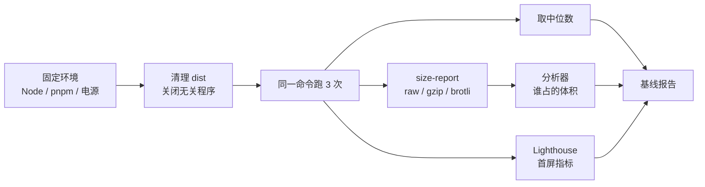

# B2 度量与基线

> **目标层级**：L2 ｜ **前置**：B1 ｜ **预计**：5h
> **本章产物**：`reports/b2-baseline.md`、`tooling/bench/size-report.mjs`、一份可复现的构建数据

## 0. 先看终点

```powershell
PS> pnpm run bench -- --runs 3 --label b2-baseline --dir apps/admin/dist -- pnpm --filter "@lab/admin" exec vite build
第 1/3 次 ... 2.41s
第 2/3 次 ... 2.18s
第 3/3 次 ... 2.22s

中位数: 2.22s
产物: 2.84 MiB
报告: reports/bench-1750000000000.json

PS> node tooling/bench/size-report.mjs apps/admin/dist
| 文件 | 原始 KB | gzip KB | brotli KB |
...
```

本章结束时，你手里应该有三样东西：

1. 同一台机器、同一条命令、三次运行的中位数；
2. 产物的 raw / gzip / brotli 体积表；
3. 一张能指出“最大的一块是什么、为什么在首屏”的分析器截图或 HTML。

没有这三样，后面任何“优化了”都不算数。

## 1. 知识讲解

### 1.1 先有基线，再谈优化

优化最常见的骗局是拿两个不同条件的结果比较：

- 在 SSD 上构建一次，在杀毒软件全盘扫描时再构建一次；
- 开着 dev server 测 build；
- 用 raw 体积和别人的 gzip 体积比；
- 把懒加载 chunk 算进首屏，然后说“首屏变小了”。

本章的规则很简单：**同机、同命令、同依赖、三次中位数**。任何一项变了，就重新测，不引用旧数字。



### 1.2 指标定义

先把词定死，否则团队里每个人说的“首屏”都不是一个东西。

| 指标 | 定义 | 怎么测 | 注意 |
|---|---|---|---|
| dev 冷启动 | 进程启动到 Vite 打印 `ready in` | `dev-start.mjs` 或秒表 | 受预构建缓存影响 |
| 首屏加载 | 浏览器从请求 HTML 到主要模块执行完 | DevTools Network / Lighthouse | 不是 `ready in` |
| HMR 延迟 | 保存文件到页面更新完成 | `--debug hmr` 时间戳 / 录屏 | 受组件边界影响 |
| build 墙钟 | 进程启动到退出 | `bench.mjs` | 包含 pnpm / tsc |
| Vite 内部构建 | `vite build` 自己打印的 `built in` | 构建日志 | 不含 pnpm 启动 |
| 产物 raw | 文件字节数 | `size-report` | 不能直接代表传输量 |
| gzip / brotli | 压缩后字节数 | `size-report` | 服务器必须真的开启压缩 |
| 首屏 JS | 入口及静态依赖的 JS | manifest + `index.html` | 不含动态 import |
| 总 JS | 所有 JS chunk | `size-report` | 含懒加载，不能当首屏 |
| LCP | 最大内容绘制 | Lighthouse | 实验室数据，不是真实用户 |
| TBT | 主线程阻塞时间 | Lighthouse | 受机器性能影响大 |
| CLS | 布局偏移 | Lighthouse | 图片没写尺寸时常见 |

本章只做实验室基线，不引入 RUM（真实用户监控）。RUM 是上线后的事，别在本地假装自己有线上数据。

### 1.3 `bench.mjs` 怎么用

`01` 章已经写过 `tooling/bench/bench.mjs`，它做三件事：

1. 用 `spawnSync` 跑你给的命令；
2. 用 `performance.now()` 记录墙钟；
3. 把每次时间、中位数、产物字节数写进 `reports/bench-*.json`。

构建基线：

```powershell
pnpm run bench -- --runs 3 --label b2-baseline --dir apps/admin/dist -- pnpm --filter "@lab/admin" exec vite build
```

注意：

- `--` 后面的整段才是被测量的命令；
- `exec vite build` 只测 Vite，不测 `tsc -b`；
- 完整流水线另测一次 `pnpm --filter "@lab/admin" build`，不要把两者混在一起；
- `--dir` 只统计原始字节，不区分 JS/CSS/图片，细表用 `size-report`。

如果命令失败，`bench` 会以非 0 退出，不会把失败时间算进中位数。这是它比手掐秒表可靠的地方。

### 1.4 为什么是三次中位数

一次测量无法区分“真实变化”和“系统抖动”；两次也无法判断哪次更典型。三次取中位数，能过滤掉一次异常（比如杀毒软件刚好扫描、Windows 更新在后台）。

要求：

- 三次之间不修改代码、不切换分支、不装依赖；
- 不在构建时开 dev server、浏览器分析器、视频会议；
- 记录 `node -v`、`pnpm -v`、Vite 版本、机器名；
- 第 1 次通常受文件缓存影响，仍然保留，不要偷偷删掉。

三次差异超过 20%，先别下结论，查后台进程和电源模式，重新测。

### 1.5 raw、gzip、brotli 不是一回事

Vite 构建日志里的 `gzip` 是它对产物做的估算，方便你快速看大小；真正传到浏览器多少，取决于服务器有没有开启压缩、压缩算法、以及响应头。

| 指标 | 用途 | 常见错误 |
|---|---|---|
| raw | 磁盘占用、镜像大小 | 拿 raw 和别人的 gzip 比 |
| gzip | 大多数服务器的默认压缩 | 以为 Vite 会自动生成 `.gz` |
| brotli | 现代浏览器更优 | 服务器没装 brotli 模块却按 brotli 做预算 |
| 首屏 JS | 首次访问必须下载的 JS | 把 lazy chunk 算进去 |
| 总 JS | 所有路由/功能的 JS | 拿总 JS 当首屏 |

Vite 默认只**报告** gzip 大小，不会替你生成 `.gz` / `.br` 文件。真正的压缩在 B5 和 C4 处理。

### 1.6 分析器：只看体积最大的前几块

用 `rollup-plugin-visualizer`。v7.1.1 起支持 Vite 8 / Rolldown，安装：

```powershell
pnpm --filter "@lab/admin" add -D "rollup-plugin-visualizer@^7.1.1"
```

`apps/admin/vite.config.ts`：

```ts
import react from '@vitejs/plugin-react'
import { visualizer } from 'rollup-plugin-visualizer'
import { defineConfig } from 'vite'

const analyze = process.env.ANALYZE === '1'

export default defineConfig({
  plugins: [
    react(),
    analyze &&
      visualizer({
        filename: 'reports/bundle.html',
        template: 'treemap',
        gzipSize: true,
        brotliSize: true,
        open: false,
      }),
  ],
  build: {
    manifest: true,
  },
})
```

生成报告：

```powershell
$env:ANALYZE = '1'
pnpm --filter "@lab/admin" exec vite build
Remove-Item Env:ANALYZE
```

输出在 `apps/admin/reports/bundle.html`。用浏览器打开，先看三件事：

1. 最大的矩形是谁（antd、echarts、moment、lodash、react-dom）；
2. 它属于入口 chunk 还是懒加载 chunk；
3. 它是不是被 barrel（`index.ts` 全量 re-export）带进来的。

分析器本身会拖慢构建，也会让产物多一个 HTML。**只在需要看构成时打开**，不要把它写进日常 `build` 脚本。B6 会量化这个开销。

### 1.7 首屏 JS 怎么从 manifest 算

先构建，再读：

```powershell
$m = Get-Content apps/admin/dist/.vite/manifest.json -Raw | ConvertFrom-Json
$m.'index.html' | Format-List
```

重点字段：

- `file`：入口 JS；
- `imports`：入口的静态依赖；
- `dynamicImports`：懒加载 chunk，**不算首屏**；
- `css`：入口需要的 CSS；
- `assets`：图片、字体等。

首屏 JS = 入口 `file` + `imports` 里的 JS。不要把所有 `assets/*.js` 加起来，那会把懒加载路由也算进去。

### 1.8 运行时指标：Lighthouse 只做参考

`vite preview` 只能本地看静态产物，不能代表线上压缩和缓存。Lighthouse 也只能给实验室数据，但作为同一台机器上的前后对比仍然有用。

先启动预览：

```powershell
pnpm --filter "@lab/admin" preview
```

另开一个终端：

```powershell
pnpm dlx lighthouse http://localhost:4173 `
  --only-categories=performance `
  --preset=desktop `
  --chrome-flags="--headless=new" `
  --output=json `
  --output-path=reports/lighthouse-admin.json
```

跑三次，取 LCP、TBT、CLS 的中位数。不要只报总分：总分会被单项权重和版本变化影响，LCP/TBT 更稳定。

如果 Lighthouse 找不到 Chrome，用 `--chrome-path` 指向本机 Chrome；不要为了跑分去装一个陌生浏览器。

## 2. Guided 实操

### 2.1 先把「脏」基线搭出来

本章需要一个有明显体积问题的项目，否则后面没有东西可优化。以下依赖是**故意制造的基线**，不是推荐配置。

```powershell
pnpm --filter "@lab/ui" add echarts
pnpm --filter "@lab/admin" add antd moment dayjs lodash
pnpm --filter "@lab/admin" add -D @types/lodash
```

`packages/ui/src/Chart.tsx`：

```tsx
import { useEffect, useRef } from 'react'
import * as echarts from 'echarts'

export function Chart() {
  const ref = useRef<HTMLDivElement>(null)

  useEffect(() => {
    if (!ref.current) return
    const chart = echarts.init(ref.current)
    chart.setOption({
      xAxis: { type: 'category', data: ['A', 'B', 'C'] },
      yAxis: { type: 'value' },
      series: [{ type: 'bar', data: [1, 3, 2] }],
    })
    return () => chart.dispose()
  }, [])

  return <div ref={ref} style={{ height: 240 }} />
}
```

`packages/ui/src/index.tsx` 追加：

```tsx
export { Chart } from './Chart'
```

`apps/admin/src/DirtyPanel.tsx`：

```tsx
import { Button as AntButton } from 'antd'
import dayjs from 'dayjs'
import { debounce } from 'lodash'
import moment from 'moment'
import { Button } from '@lab/ui'

export default function DirtyPanel() {
  const now = moment().format('YYYY-MM-DD')
  const today = dayjs().format('YYYY-MM-DD')
  const onClick = debounce(() => {}, 200)

  return (
    <section>
      <h2>Dirty baseline</h2>
      <AntButton onClick={onClick}>antd {now}</AntButton>
      <p>dayjs {today}</p>
      <Button>lab ui</Button>
    </section>
  )
}
```

`apps/admin/src/App.tsx` 暂时改成：

```tsx
import DirtyPanel from './DirtyPanel'
import './App.css'

export default function App() {
  return (
    <main>
      <DirtyPanel />
    </main>
  )
}
```

注意：`DirtyPanel` 没有用 `Chart`，但 `@lab/ui` 的 barrel 导出了它，而包还没有 `sideEffects` 声明。构建时 ECharts 会被带进来，这就是 B4 要修的坑。先别急着修。

### 2.2 跑三次构建

```powershell
pnpm run bench -- --runs 3 --label b2-dirty-vite --dir apps/admin/dist -- pnpm --filter "@lab/admin" exec vite build
```

再跑一次完整脚本，把 `tsc -b` 的成本单独看出来：

```powershell
pnpm run bench -- --runs 3 --label b2-dirty-full --dir apps/admin/dist -- pnpm --filter "@lab/admin" build
```

预期：

- `vite build` 的中位数小于完整 `build`；
- 产物在 1 MiB 以上是正常的；
- 两次的 `dist` 字节数应该接近，命令不同但产物相同。

把 `reports/bench-*.json` 的 `timesMs`、`medianMs`、`bytes` 填进报告，不要只抄终端里的两位小数。

### 2.3 写体积报告脚本

`tooling/bench/size-report.mjs`：

```js
import { readdirSync, readFileSync, statSync } from 'node:fs'
import { extname, join, relative } from 'node:path'
import { brotliCompressSync, constants, gzipSync } from 'node:zlib'

const root = process.argv[2] ?? 'dist'
const textExt = new Set(['.js', '.mjs', '.css', '.html', '.json', '.svg'])
const rows = []

function walk(dir) {
  for (const entry of readdirSync(dir, { withFileTypes: true })) {
    const full = join(dir, entry.name)
    if (entry.isDirectory()) {
      walk(full)
    } else if (entry.isFile()) {
      const buf = readFileSync(full)
      const ext = extname(entry.name)
      const isText = textExt.has(ext)
      rows.push({
        file: relative(root, full).replaceAll('\\', '/'),
        raw: buf.length,
        gzip: isText ? gzipSync(buf, { level: 9 }).length : null,
        brotli: isText
          ? brotliCompressSync(buf, {
              params: { [constants.BROTLI_PARAM_QUALITY]: 11 },
            }).length
          : null,
      })
    }
  }
}

walk(root)
rows.sort((a, b) => b.raw - a.raw)

const kb = (n) => (n / 1024).toFixed(2)
const fmt = (n) => (n === null ? '-' : kb(n))

console.log('| 文件 | 原始 KB | gzip KB | brotli KB |')
console.log('|---|---:|---:|---:|')
for (const row of rows) {
  console.log(`| ${row.file} | ${kb(row.raw)} | ${fmt(row.gzip)} | ${fmt(row.brotli)} |`)
}

const sum = (key) => rows.reduce((n, row) => n + (row[key] ?? 0), 0)
console.log(`| **合计** | **${kb(sum('raw'))}** | **${kb(sum('gzip'))}** | **${kb(sum('brotli'))}** |`)
```

运行：

```powershell
node tooling/bench/size-report.mjs apps/admin/dist
```

脚本只压缩文本类文件，图片保留 raw。这是故意的：对已经压缩过的 JPEG/PNG 再 gzip 没有意义。

### 2.4 生成分析器报告

```powershell
$env:ANALYZE = '1'
pnpm --filter "@lab/admin" exec vite build
Remove-Item Env:ANALYZE
```

打开 `apps/admin/reports/bundle.html`，回答：

1. 最大的三个模块是什么？
2. 它们分别在入口 chunk 还是懒加载 chunk？
3. ECharts 是怎么进来的？谁 import 了它？
4. antd、moment、lodash 各自占多少？
5. 有没有同一个依赖出现两份？

把截图放到 `reports/b2-bundle.png`，或在报告里写清文件路径。分析器 HTML 可以本地保留，不建议提交到 Git（体积大且含本机路径）。

### 2.5 跑三次 Lighthouse

终端 A：

```powershell
pnpm --filter "@lab/admin" preview
```

终端 B：

```powershell
1..3 | ForEach-Object {
  pnpm dlx lighthouse http://localhost:4173 `
    --only-categories=performance `
    --preset=desktop `
    --chrome-flags="--headless=new" `
    --output=json `
    --output-path="reports/lighthouse-admin-$_.json" `
    --quiet
}
```

从三个 JSON 里读 `audits.largest-contentful-paint.numericValue`、`audits.total-blocking-time.numericValue`、`audits.cumulative-layout-shift.numericValue`，取中位数。

记录时写清：

- `vite preview` 的端口；
- 是否 headless；
- 视口（desktop）；
- 是否开了其他浏览器标签；
- 机器是否插电。

### 2.6 写 `reports/b2-baseline.md`

```md
# B2 基线

## 环境
- 机器：...
- Node：v24.14.1
- pnpm：12.15.0
- Vite：8.x
- 系统：Windows 11
- 命令：`pnpm --filter "@lab/admin" exec vite build`

## 构建
| 场景 | 第 1 次 | 第 2 次 | 第 3 次 | 中位数 | 产物 |
|---|---:|---:|---:|---:|---:|
| Vite only | | | | | |
| 完整 build | | | | | |

## 体积
| 类别 | raw KB | gzip KB | brotli KB |
|---|---:|---:|---:|
| 入口 JS | | | |
| 首屏静态 JS | | | |
| 懒加载 JS | | | |
| CSS | | | |
| 图片 | | | |
| **合计** | | | |

## 运行时
| 指标 | 第 1 次 | 第 2 次 | 第 3 次 | 中位数 |
|---|---:|---:|---:|---:|
| LCP / ms | | | | |
| TBT / ms | | | | |
| CLS | | | | |

## 分析器结论
- 最大单项：...
- 首屏最大依赖：...
- 可疑的 barrel / 重复依赖：...

## 暂不优化
- 本章只记录，不改配置。
- 预算在第 9 周写进 CI；现在拍一个 200 KB 的硬指标没有依据。
```

## 3. 排障

| 现象 | 原因 | 验证 | 修复 |
|---|---|---|---|
| 三次时间差超过 20% | 后台进程、杀毒、电源模式 | 看任务管理器，重跑 | 关程序，插电，重测 |
| `bench` 报命令失败 | 命令字符串写错 | 手动跑同一命令 | 修正 `--` 后的命令 |
| 产物字节数不变 | 构建输出目录不是 `apps/admin/dist` | 看 Vite 日志 | 改 `--dir` |
| 分析器 HTML 没生成 | 插件被 `analyze` 条件挡住 | 检查 `ANALYZE` | 设 `$env:ANALYZE='1'` |
| Lighthouse 连不上 | preview 没启动或端口错 | 浏览器打开 4173 | 启动 preview |
| 首屏 JS 算大了 | 把 `dynamicImports` 算进去 | 看 manifest | 只算 `file` + `imports` |
| gzip 数字对不上服务器 | Vite 只是报告，不生成 `.gz` | 看响应头 | B5/C4 配压缩 |

**测量错误的优先级高于优化**。先确认数字可信，再谈改动。

## 4. 故障演练

### 4.1 证明分析器不是免费的

先测正常构建：

```powershell
pnpm run bench -- --runs 3 --label b2-no-analyzer --dir apps/admin/dist -- pnpm --filter "@lab/admin" exec vite build
```

再测带分析器：

```powershell
$env:ANALYZE = '1'
pnpm run bench -- --runs 3 --label b2-with-analyzer --dir apps/admin/dist -- pnpm --filter "@lab/admin" exec vite build
Remove-Item Env:ANALYZE
```

比较两个中位数。预期带分析器更慢。把差值写进报告，并得出规则：分析器只在需要看构成时开。

### 4.2 证明 raw 会骗人

打开 `apps/admin/dist`，找一个最大的 JS 文件：

```powershell
Get-ChildItem apps/admin/dist/assets -Filter *.js |
  Sort-Object Length -Descending |
  Select-Object -First 3 Name, Length
```

再对它单独做 gzip：

```powershell
$f = Get-ChildItem apps/admin/dist/assets -Filter *.js |
  Sort-Object Length -Descending |
  Select-Object -First 1
$bytes = [IO.File]::ReadAllBytes($f.FullName)
$ms = New-Object IO.MemoryStream
$gzip = New-Object IO.Compression.GZipStream($ms, [IO.Compression.CompressionLevel]::Optimal)
$gzip.Write($bytes, 0, $bytes.Length)
$gzip.Close()
"raw=$($bytes.Length) gzip=$($ms.Length)"
```

你会发现 gzip 通常远小于 raw。以后比较体积，必须说清楚是哪一个。

## 5. 闭卷练习

合上教程，在一个干净克隆里完成：

1. 用 `bench.mjs` 跑三次 Vite 构建，给出中位数和三次原始值。
2. 写一个脚本，列出 `dist` 里最大的 5 个文件，并给出 gzip 后大小。
3. 用分析器找出首屏最大的依赖，说明它在入口还是懒加载 chunk。
4. 用 manifest 算出首屏 JS，不得把 `dynamicImports` 算进去。
5. 写一份一页纸基线报告，明确写出“本章不优化”。

验收标准：

- 报告里每个数字都能追溯到 `reports/bench-*.json` 或 `size-report` 输出；
- 没有“感觉”“明显”“大概”；
- 至少指出一个“看起来大但不该优化”的项（例如懒加载的 ECharts）。

## 6. 验收清单

- [ ] `reports/b2-baseline.md` 已提交
- [ ] 三次构建的原始 JSON 都在 `reports/`
- [ ] `size-report` 能跑，且区分 raw / gzip / brotli
- [ ] 分析器报告能打开，能指出最大三项
- [ ] 首屏 JS 与总 JS 分开统计
- [ ] Lighthouse 三次结果都在，且记录了环境
- [ ] 没有在本章修改分包或 tree shaking 配置

## 7. 自测

**Q1：为什么不能只跑一次构建就下结论？**

<details>
<summary>答案</summary>

系统抖动、文件缓存、杀毒扫描都会影响单次结果；三次取中位数能过滤一次异常，但仍要记录环境和原始值。
</details>

**Q2：Vite 日志里的 gzip 等于浏览器实际下载大小吗？**

<details>
<summary>答案</summary>

不等于。Vite 只是估算；实际取决于服务器是否开启 gzip/brotli、压缩级别、响应头和 CDN。
</details>

**Q3：为什么首屏 JS 不能把所有 `assets/*.js` 加起来？**

<details>
<summary>答案</summary>

那会把动态 import 的懒加载 chunk 也算进去。首屏只算入口 `file` 和 `imports` 里的静态依赖。
</details>

**Q4：分析器为什么不能常开？**

<details>
<summary>答案</summary>

它会增加构建时间、生成额外 HTML，并可能改变产物分析条件；只应在需要定位体积构成时开启。
</details>

**Q5：Lighthouse 分数能直接当性能预算吗？**

<details>
<summary>答案</summary>

不建议。分数受版本、设备和权重影响；预算更适合用首屏 JS gzip、LCP、TBT 等具体指标，并固定测量条件。
</details>

## 8. 延伸

- Vite Build Options：`build.manifest`、`build.reportCompressedSize`
- `rollup-plugin-visualizer` 的 treemap / raw-data 模板
- Lighthouse 的 performance audits
- 第 9 周的质量门禁：把本章的基线变成预算

下一章开始动刀：先让业务改动只改变业务 chunk 的 hash，再谈删除依赖。
