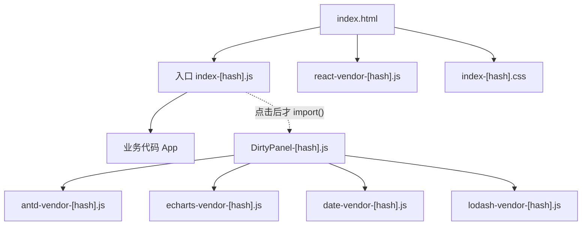

# B3 分包与长效缓存

> **目标层级**：L2 ｜ **前置**：B2 ｜ **预计**：5h
> **本章产物**：`apps/admin/vite.config.ts` 的分包配置 + 一份 hash 对比记录

## 0. 先看终点

```powershell
PS> pnpm --filter "@lab/admin" exec vite build
dist/assets/react-vendor-<hash>.js
dist/assets/antd-vendor-<hash>.js
dist/assets/echarts-vendor-<hash>.js
dist/assets/index-<hash>.js

PS> # 改一行业务文字，再构建
dist/assets/react-vendor-<同一个 hash>.js
dist/assets/antd-vendor-<同一个 hash>.js
dist/assets/index-<新的 hash>.js
```

本章要做到的不是“chunk 越多越好”，而是：

- 首屏只加载首屏需要的东西；
- 业务代码变化时，稳定的依赖不重新下载；
- 不把懒加载依赖塞进入口 vendor；
- 每个 hash 的变化都有原因，不能每次构建都抖。

## 1. 知识讲解

### 1.1 浏览器缓存靠的是文件名

生产环境的静态资源通常这样缓存：

```http
Cache-Control: public, max-age=31536000, immutable
```

`immutable` 的意思是：这个 URL 的内容永远不会变，浏览器不用再问服务器。前提是**内容变了，文件名必须变**。Vite 用内容 hash 做到这一点：

```text
assets/index-BEOpZNej.js
assets/index-CrEC9Sms.js
```

如果业务代码和 React 被打在同一个文件里，改一行文案，整个文件 hash 变化，用户要重新下载 React。分包的目的之一，就是把“变化频率不同”的代码分开。

### 1.2 一张图看清 chunk 关系



关键点：

- 入口只静态依赖 React，不依赖 antd/echarts；
- `DirtyPanel` 是动态 import，只有用户触发时才下载；
- vendor 分组按“变化频率”和“使用范围”切，不是按包名一个个切；
- CSS 也会被拆分，异步 chunk 的 CSS 在 chunk 加载时注入。

### 1.3 Vite 8 的分包配置

Vite 8 使用 Rolldown，分包写在：

```ts
build.rolldownOptions.output.codeSplitting.groups
```

不要再用：

```ts
// 旧写法，不要照抄
build.rollupOptions.output.manualChunks = {
  react: ['react', 'react-dom'],
}
```

Rolldown 里 `manualChunks` 已标记为 deprecated，对象写法不再适用。新配置：

```ts
import react from '@vitejs/plugin-react'
import { defineConfig } from 'vite'

export default defineConfig({
  plugins: [react()],
  build: {
    manifest: true,
    rolldownOptions: {
      output: {
        codeSplitting: {
          groups: [
            {
              name: 'react-vendor',
              test: /node_modules[\\/](react|react-dom|scheduler)[\\/]/,
              priority: 50,
            },
            {
              name: 'antd-vendor',
              test: /node_modules[\\/](antd|@ant-design|rc-[^\\/]+)[\\/]/,
              priority: 40,
            },
            {
              name: 'echarts-vendor',
              test: /node_modules[\\/](echarts|zrender)[\\/]/,
              priority: 30,
            },
            {
              name: 'date-vendor',
              test: /node_modules[\\/](moment|dayjs)[\\/]/,
              priority: 20,
            },
            {
              name: 'lodash-vendor',
              test: /node_modules[\\/]lodash[\\/]/,
              priority: 10,
            },
          ],
        },
      },
    },
  },
})
```

三个细节：

1. **路径分隔符**：Windows 上模块 id 可能带 `\`，正则统一写 `[\\/]`，不要只写 `/`。
2. **优先级**：一个模块同时匹配多个组时，`priority` 高的先拿走；把 React 放最高，避免被 UI 组吞掉。
3. **`test` 不要写太宽**：`/node_modules/` 会把所有依赖塞进一个 vendor，等于没分。

### 1.4 分组策略：按变化频率，不按包名

一个实用的四层：

| 组 | 放什么 | 为什么 |
|---|---|---|
| `react-vendor` | react、react-dom、scheduler | 几乎不变，所有页面都要 |
| `ui-vendor` | antd、组件库、图标 | 变化频率中等，首屏可能要用 |
| `chart-vendor` | echarts、zrender | 体积大，通常只在报表页用 |
| 业务 chunk | 页面、组件、路由 | 变化最频繁，hash 应该只影响自己 |

不要给每个包建一个 chunk。请求数、缓存碎片、构建复杂度都会上升。通常 3～5 个 vendor 组足够；剩下的交给动态 import。

还要看**使用范围**：

- 只有报表页用的 ECharts，不应该进入口 vendor；
- 首屏就要用的 React，应该进入口；
- 只有某个弹窗用的编辑器，应该跟着弹窗的懒加载 chunk 走，不必单独 vendor。

### 1.5 懒加载不是“写了 `lazy` 就省流量”

错误示范：

```tsx
const DirtyPanel = lazy(() => import('./DirtyPanel'))

export default function App() {
  return (
    <Suspense fallback={<p>loading</p>}>
      <DirtyPanel />
    </Suspense>
  )
}
```

这确实拆出了 chunk，但组件在首屏立刻渲染，浏览器会马上请求它。首屏传输量几乎没变，只是多了一次请求。

正确做法是让它在用户动作后才渲染：

```tsx
import { lazy, Suspense, useState } from 'react'

const DirtyPanel = lazy(() => import('./DirtyPanel'))

export default function App() {
  const [show, setShow] = useState(false)

  return (
    <main>
      <button onClick={() => setShow(true)}>打开报表</button>
      {show && (
        <Suspense fallback={<p>loading...</p>}>
          <DirtyPanel />
        </Suspense>
      )}
    </main>
  )
}
```

这时首屏 Network 里不应出现 `DirtyPanel-*.js`；点击按钮后才出现。用这个标准验收，而不是看构建日志里“多了一个 chunk”。

路由级懒加载同理：路由表里用 `lazy(() => import('./pages/Report'))`，并且确保首页路由不 import 报表页。

### 1.6 hash 为什么会变

Vite 的文件名 hash 主要跟这些因素有关：

- 文件内容；
- 它依赖的 chunk 的文件名（依赖 hash 变了，引用它的 chunk 也会变）；
- chunk 的分组边界；
- CSS 顺序；
- 被插件注入的构建期常量。

常见“每次构建都变”的原因：

1. 配置里注入构建时间：

```ts
define: {
  __BUILD_TIME__: JSON.stringify(new Date().toISOString()),
}
```

这个值在**每次加载配置时**重新计算，进入产物，hash 必变。

2. 插件在 `transform` 里写入时间戳、随机数、绝对路径。
3. `.env` 里的版本号每次构建都改。
4. 分组规则不稳定，导致 chunk 边界变化。
5. 同一个模块被两个 chunk 以不同顺序引用，CSS 顺序变化。

特别纠正一个常见误解：**业务模块顶层写 `new Date()` 不会导致构建 hash 抖动**。它只是运行时代码，构建时不会被求值，产物文本不变。真正会抖的是 `define`、插件注入、环境变量这类构建期值。B3 的演练会用 `define` 复现。

### 1.7 `modulePreload` 与 `preload`

Vite 会为入口的静态依赖注入：

```html
<link rel="modulepreload" href="/assets/react-vendor-xxxx.js">
```

作用：浏览器在解析入口 JS 的同时，提前并行下载依赖，减少瀑布。

动态 import 的依赖不会全部写进 HTML，而是在运行时由 Vite 的 preload helper 加载。你不需要手写 `modulepreload`，除非有特殊资源。

`build.modulePreload.polyfill` 默认 `true`，会给不支持 `modulepreload` 的浏览器补一个 polyfill。目标浏览器足够新时可以关，但要在真实目标浏览器上验证，不要为了“少几百字节”盲目关。

### 1.8 manifest 是给机器读的

`build.manifest: true` 会生成：

```text
dist/.vite/manifest.json
```

里面有：

```json
{
  "index.html": {
    "file": "assets/index-xxxx.js",
    "imports": ["_react-vendor-xxxx.js"],
    "dynamicImports": ["src/DirtyPanel.tsx"],
    "css": ["assets/index-xxxx.css"]
  }
}
```

用途：

- CI 检查入口和 vendor 的 hash 是否稳定；
- 服务端渲染/后端模板找资源；
- 部署后核对 `index.html` 引用的文件是否真的存在。

manifest 不是给浏览器用的，不要把它当公共 API 暴露。

### 1.9 分包不是越多越好

| 做法 | 好处 | 代价 |
|---|---|---|
| 一个巨大 vendor | 请求少 | 改一个包，整个 vendor 失效；懒加载依赖被拖进首屏 |
| 每个包一个 chunk | 缓存粒度细 | 请求多、依赖图复杂、HTTP 开销 |
| 按变化频率分 3～5 组 | 平衡 | 需要维护规则 |
| 只按路由懒加载 | 首屏小 | 路由之间共享的依赖可能重复 |

验收看两个数：首屏 JS 是否下降，业务改动后 vendor hash 是否稳定。不要只看 chunk 数量。

## 2. Guided 实操

### 2.1 先记录改动前的 hash

```powershell
pnpm --filter "@lab/admin" exec vite build
Copy-Item apps/admin/dist/.vite/manifest.json reports/b3-before.json
$before = Get-Content reports/b3-before.json -Raw | ConvertFrom-Json
$before.'index.html'.file
$before.'index.html'.imports
```

把入口文件和 imports 记到 `reports/b3-hash.md`。

### 2.2 把 DirtyPanel 改成点击后加载

`apps/admin/src/App.tsx`：

```tsx
import { lazy, Suspense, useState } from 'react'
import './App.css'

const DirtyPanel = lazy(() => import('./DirtyPanel'))

export default function App() {
  const [show, setShow] = useState(false)

  return (
    <main>
      <h1>fe-lab admin</h1>
      <button onClick={() => setShow(true)}>打开报表</button>
      {show && (
        <Suspense fallback={<p>loading...</p>}>
          <DirtyPanel />
        </Suspense>
      )}
    </main>
  )
}
```

构建并检查 `dist/index.html`：

```powershell
pnpm --filter "@lab/admin" exec vite build
Get-Content apps/admin/dist/index.html
```

预期：入口只有 `index-*.js` 和 `react-vendor` 之类的静态依赖；`DirtyPanel-*.js` 不在 HTML 里。

启动预览，打开 Network：

```powershell
pnpm --filter "@lab/admin" preview
```

首屏不应请求 `DirtyPanel-*.js`；点击按钮后才出现。如果首屏就出现，说明某处还静态 import 了它。

### 2.3 加入分组配置

把 `apps/admin/vite.config.ts` 改成 1.3 里的版本。保留 B2 的 `manifest: true`，分析器仍然用 `ANALYZE` 门控。

构建：

```powershell
pnpm --filter "@lab/admin" exec vite build
Get-ChildItem apps/admin/dist/assets -Filter *.js |
  Select-Object Name, Length |
  Sort-Object Length -Descending
```

预期能看到类似：

```text
react-vendor-<hash>.js
antd-vendor-<hash>.js
echarts-vendor-<hash>.js
date-vendor-<hash>.js
lodash-vendor-<hash>.js
index-<hash>.js
DirtyPanel-<hash>.js
```

名字可能因版本和实际依赖略有差异，但至少应该看到 React、UI、图表被分开。如果没有 `echarts-vendor`，先确认 B2 的 `Chart` 还在 barrel 里，且 ECharts 真的被打包了。

### 2.4 用 manifest 看谁依赖谁

```powershell
$m = Get-Content apps/admin/dist/.vite/manifest.json -Raw | ConvertFrom-Json
$m.'index.html' | ConvertTo-Json -Depth 6
$m.'src/DirtyPanel.tsx' | ConvertTo-Json -Depth 6
```

重点看：

- `index.html` 的 `imports` 里有没有 ECharts；如果有，说明懒加载没隔离干净；
- `DirtyPanel.tsx` 的 `imports` 里有哪些 vendor；
- `dynamicImports` 是否指到 `DirtyPanel`。

### 2.5 做 hash 稳定性对比

先保存当前 manifest：

```powershell
Copy-Item apps/admin/dist/.vite/manifest.json reports/b3-stable-before.json
```

改一行业务文字，例如把 `fe-lab admin` 改成 `fe-lab admin v2`，然后：

```powershell
pnpm --filter "@lab/admin" exec vite build
Copy-Item apps/admin/dist/.vite/manifest.json reports/b3-stable-after.json
```

对比：

```powershell
$b = Get-Content reports/b3-stable-before.json -Raw | ConvertFrom-Json
$a = Get-Content reports/b3-stable-after.json -Raw | ConvertFrom-Json

"before entry: $($b.'index.html'.file)"
"after  entry: $($a.'index.html'.file)"
"before imports: $($b.'index.html'.imports -join ', ')"
"after  imports: $($a.'index.html'.imports -join ', ')"
```

预期：

- 入口文件 hash 变了；
- `react-vendor`、`antd-vendor` 等依赖的 hash 不变；
- 如果 vendor hash 也变了，进入 3.1 排查。

写作机小样本（Vite 8.3.5、React 19、只装 React）的结果：

| 构建 | 入口 | React vendor |
|---|---|---|
| 改文字前 | `index-BEOpZNej.js` | `react-vendor-Db-_YT-E.js` |
| 改文字后 | `index-CrEC9Sms.js` | `react-vendor-Db-_YT-E.js` |

这只说明行为，不要求你的 hash 相同。

### 2.6 故意制造 hash 抖动并修掉

在 `apps/admin/vite.config.ts` 里临时加：

```ts
define: {
  __BUILD_TIME__: JSON.stringify(new Date().toISOString()),
},
```

在 `apps/admin/src/vite-env.d.ts` 里加：

```ts
declare const __BUILD_TIME__: string
```

在 `App.tsx` 里使用：

```tsx
const buildTime = __BUILD_TIME__
// 渲染出来，确保它没被 tree shaking 掉
<p>{buildTime}</p>
```

连续构建两次：

```powershell
pnpm --filter "@lab/admin" exec vite build
(Get-Content apps/admin/dist/.vite/manifest.json -Raw | ConvertFrom-Json).'index.html'.file
pnpm --filter "@lab/admin" exec vite build
(Get-Content apps/admin/dist/.vite/manifest.json -Raw | ConvertFrom-Json).'index.html'.file
```

预期：两次入口 hash 不同，即使源码没改。

修掉：删除 `define`、`__BUILD_TIME__` 声明和渲染，再构建两次，确认 hash 恢复稳定。

同时验证一次误解：把 `new Date().toISOString()` 直接写在 App 顶层，构建两次，hash **不会**因为这个变化。它只是运行时求值。

### 2.7 记录首屏请求

在预览页面打开 DevTools → Network，清空后刷新：

- 首屏 JS 请求数；
- 首屏总传输（gzip）；
- 点击“打开报表”后新增的请求；
- 哪些是 `modulepreload`，哪些是动态 import。

把结果写进 `reports/b3-cache.md`：

```md
## 首屏
- 请求：index.html + index-*.js + react-vendor-*.js + index-*.css
- 未请求：DirtyPanel-*.js、antd-vendor、echarts-vendor
- 点击后新增：DirtyPanel-*.js、antd-vendor、echarts-vendor、date-vendor、lodash-vendor
- 业务改动后：入口 hash 变，react-vendor hash 不变
```

## 3. 排障

| 现象 | 原因 | 验证 | 修复 |
|---|---|---|---|
| 配置不生效 | 同时有 `vite.config.js` 和 `vite.config.ts` | `vite build --debug` 看 config file | 只留一个 |
| 分组没匹配 | Windows 路径分隔符 | 在 `test` 里打印 id | 用 `[\\/]` |
| 所有依赖进一个 chunk | `test: /node_modules/` 太宽 | 看 chunk 列表 | 按包/范围拆组 |
| 首屏仍有 ECharts | `Chart` 被静态 import，或分组把所有 node_modules 拖进入口 | manifest 的 `imports` | 改成动态 import，收窄分组 |
| hash 每次变 | `define` 构建时间、插件注入 | 连续构建两次 | 移除构建期随机值 |
| vendor hash 也变 | 分组边界变化、依赖升级、CSS 顺序变 | 对比 manifest | 固定分组，检查插件 |
| 点击后 404 | `base` 或部署路径错 | 看 Network 的 URL | 改 `base` |
| 点击后重复下载 React | 两份 React 或 resolve 不一致 | `pnpm why react` | 统一版本，`resolve.dedupe` |

如果配置看起来没生效，先跑：

```powershell
pnpm --filter "@lab/admin" exec vite build --debug
```

搜索 `config file loaded` 和 `using resolved config`，确认 Vite 读的是你改的那个文件。Windows 上同时存在 `vite.config.js` 和 `vite.config.ts` 时，只有一个会被选中，这是实际踩过的坑。

## 4. 故障演练

### 4.1 把所有 node_modules 塞进一个 vendor

临时把分组改成：

```ts
codeSplitting: {
  groups: [{ name: 'vendor', test: /node_modules/, priority: 100 }],
}
```

构建，记录：

- 首屏 JS 大小；
- 点击报表后是否还要下载新的 vendor；
- 改一行业务代码后 vendor hash 是否变化。

预期：入口被一个巨大 vendor 拖累，懒加载依赖也被提前加载。恢复 1.3 的分组，再测一次，比较首屏 JS 和请求数。

### 4.2 让懒加载“假省流量”

把 `App.tsx` 改回：

```tsx
<Suspense fallback={<p>loading</p>}>
  <DirtyPanel />
</Suspense>
```

构建并刷新首屏，观察 Network：`DirtyPanel-*.js` 仍然会被请求。恢复点击后加载，确认差异。

这个演练说明：**代码分割**和**延迟加载**是两件事。`import()` 只负责拆，什么时候执行由你决定。

## 5. 闭卷练习

合上教程，在 `fe-lab` 里完成：

1. 配置 3 个 vendor 组：React、UI、图表；业务代码单独。
2. 把报表组件改成点击后加载，证明首屏不请求它的 chunk。
3. 改一行业务文字，证明入口 hash 变、React vendor hash 不变。
4. 用 `define` 注入构建时间，证明 hash 会抖；再移除并恢复稳定。
5. 解释为什么“每个包一个 chunk”不是好策略，并给出你的分组依据。

验收标准：

- 首屏 Network 没有报表 chunk；
- manifest 能证明入口 `imports` 不含 ECharts；
- 业务改动前后有 manifest 对比；
- 没有使用旧的 `manualChunks` 对象写法；
- 能说出至少两种 hash 抖动来源。

## 6. 验收清单

- [ ] `codeSplitting.groups` 写在 `build.rolldownOptions.output` 下
- [ ] 正则使用 `[\\/]`，Windows 上能匹配
- [ ] 首屏不加载报表依赖
- [ ] 业务改动只改业务 hash
- [ ] `modulePreload` 正常，没有 404
- [ ] 没有把 `dist`、manifest 临时文件提交进 Git
- [ ] `reports/b3-cache.md` 记录了首屏请求和 hash 对比

## 7. 自测

**Q1：为什么 `react-vendor` 的 hash 在业务改动后不变？**

<details>
<summary>答案</summary>

React 和 react-dom 的内容没有变，分组边界也没有变，所以它的内容 hash 不变；入口引用了新的业务代码，入口 hash 才变。
</details>

**Q2：`lazy(() => import(...))` 一定减少首屏传输吗？**

<details>
<summary>答案</summary>

不一定。如果组件在首屏立刻渲染，浏览器仍会马上请求 chunk；只有延迟到用户动作或路由切换后才渲染，才真正减少首屏传输。
</details>

**Q3：为什么不能把所有 node_modules 放进一个 vendor？**

<details>
<summary>答案</summary>

入口会加载整个 vendor，包括只有懒加载页面才用的依赖；任意依赖升级都会让整个 vendor 失效，缓存粒度太粗。
</details>

**Q4：`manualChunks` 对象写法为什么不能用？**

<details>
<summary>答案</summary>

Vite 8 使用 Rolldown，`manualChunks` 已 deprecated，对象形式不再适用；应使用 `output.codeSplitting.groups`。
</details>

**Q5：顶层 `new Date()` 会让构建 hash 抖动吗？**

<details>
<summary>答案</summary>

不会。它是运行时求值，构建产物文本不变；会让 hash 抖动的是 `define`、插件注入、环境变量等构建期值。
</details>

## 8. 延伸

- Rolldown `output.codeSplitting` 的 `minSize`、`maxSize`、`entriesAware`
- Vite `build.modulePreload` 与 `build.manifest`
- HTTP 缓存：`Cache-Control`、`ETag`、CDN 失效
- 下一章：为什么 `@lab/ui` 的 barrel 会把 ECharts 拖进来，以及怎么让 tree shaking 真正生效
