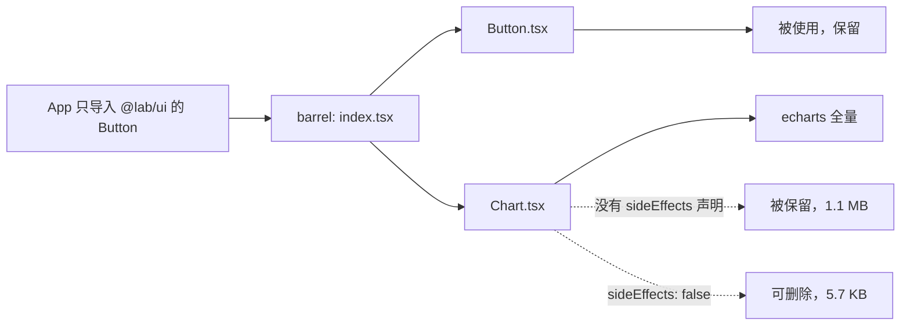

# B4 Tree shaking 与依赖治理

> **目标层级**：L2 ｜ **前置**：B3 ｜ **预计**：5h
> **本章产物**：修掉 3 个 tree shaking 失效点，留下前后体积对比

## 0. 先看终点

修之前，`@lab/ui` 的 barrel 导出了 `Chart`，`Chart` 又 import 了完整的 ECharts；`@lab/admin` 只用了 `Button`，但构建结果里仍然有 ECharts。

修之后：

```powershell
PS> pnpm --filter "@lab/admin" exec vite build
dist/assets/DirtyPanel-<hash>.js   5.73 kB │ gzip: 2.08 kB
# ECharts 不再出现，因为没有任何页面真正使用 Chart
```

本章要修的不是“某个包太大”，而是三个具体的失效点：

1. `@lab/ui` 没有 `sideEffects`，未使用的 `Chart` 仍然被执行；
2. `moment` 和 `dayjs` 同时存在，`moment` 被完整打包；
3. `lodash` 被整包导入，实际只用了 `debounce`。

## 1. 知识讲解

### 1.1 Tree shaking 的前提

Tree shaking 不是“打包器自动帮你删代码”，它依赖三个前提：

1. **ESM 静态结构**：`import` / `export` 是顶层静态语法，打包器能在构建时分析。
2. **没有副作用**：删除一个模块或导出，不会改变程序行为。
3. **真的没被使用**：从入口出发，没有任何可达路径引用它。

只要有一个不满足，代码就可能被保留。



### 1.2 `sideEffects` 到底在说什么

`package.json` 里的：

```json
{
  "sideEffects": false
}
```

意思是：**这个包里的任何模块，如果没有被使用，都可以安全删除，删除不会改变程序行为。**

它不是说“这个包没有副作用”，而是包作者向打包器做出的承诺。承诺错了，后果很严重：初始化代码、样式注入、全局注册都可能被删掉。

常见写法：

```json
{
  "sideEffects": false
}
```

```json
{
  "sideEffects": ["**/*.css", "./src/polyfill.ts"]
}
```

第二种表示：除了列出来的文件，其他模块都可删。CSS 经常需要保留，因为样式注入本身就是副作用。

对组件库来说，最稳的做法是：

- 组件 JS 没有顶层副作用，声明 `sideEffects: false`；
- 样式由应用显式 import，或把样式文件列进数组；
- 加一条构建后的冒烟测试，确认按钮样式还在。

### 1.3 Barrel 为什么会把整包拖进来

`packages/ui/src/index.tsx`：

```tsx
export { Button } from './Button'
export { Chart } from './Chart'
```

应用：

```tsx
import { Button } from '@lab/ui'
```

打包器看到的是：应用依赖 barrel，barrel re-export 了 `Button` 和 `Chart`。如果包没有声明 `sideEffects: false`，打包器必须假设 `Chart` 模块可能在被导入时执行副作用，因此不能随便删。

于是 `Chart.tsx` 里的：

```tsx
import * as echarts from 'echarts'
```

把整个 ECharts 拖进来。你只用了 Button，却下载了图表库。

这不是 barrel 的错，也不是 ECharts 的错，而是**包没有告诉打包器“未使用的模块可以删”**。

修复有两种：

1. 包声明 `sideEffects: false`，让打包器敢删；
2. 应用改成子路径导入，例如 `@lab/ui/button`，完全绕过 barrel。

子路径导入需要在 `exports` 里显式开放：

```json
{
  "exports": {
    ".": "./src/index.tsx",
    "./button": "./src/Button.tsx",
    "./chart": "./src/Chart.tsx",
    "./styles.css": "./src/styles.css"
  }
}
```

代价是使用方要知道内部结构，包的 API 面变大。对内部组件库，`sideEffects: false` 通常更划算；对外发布时再考虑子路径。

### 1.4 顶层副作用与 `/*#__PURE__*/`

即使一个导出没有被使用，只要模块顶层有副作用，打包器也可能保留：

```ts
// 顶层执行，打包器不敢删
window.__APP_BOOT__ = true
export const version = '1.0.0'
```

如果调用本身是纯的，可以用注释告诉压缩器：

```ts
export const client = /*#__PURE__*/ createClient()
```

`/*#__PURE__*/` 表示“这个调用的返回值没被使用时，可以删掉调用”。它不会让有副作用的函数变纯；乱标会把必要逻辑删掉。

### 1.5 CJS 与 ESM 的差别

ESM 的导出是静态的，打包器能精确知道哪个导出被使用；CJS 的 `module.exports` 是运行时对象，分析难度大得多。

| 包 | 形态 | 结果 |
|---|---|---|
| `lodash` | CJS 整包 | `import { debounce } from 'lodash'` 容易把整包拖进来 |
| `lodash/debounce` | CJS 子模块 | 只加载 debounce 及其依赖 |
| `lodash-es` | ESM | 可以按导出 tree shake |
| `moment` | CJS + locale | 体积大，locale 处理麻烦 |
| `dayjs` | 更轻的 ESM 友好替代 | 同样 API 场景下体积更小 |

结论不是“CJS 一律不能用”，而是：**能选 ESM 就选 ESM；不能选时，用子路径导入，别从整包入口拿一个函数。**

### 1.6 Vite 的预构建不影响生产 tree shaking

开发时 Vite 会把 CJS 依赖预构建成 ESM，这是为了启动速度；生产构建仍然按真实模块图打包。不要因为“开发时看起来只加载了 debounce”就认为生产也一定只包含 debounce。以 `dist` 和分析器为准。

`optimizeDeps.include` / `exclude` 只影响开发预构建，不会直接改变生产 tree shaking 的结果。

### 1.7 重复依赖也是体积问题

同一个包装了两份，打包器可能保留两份，尤其是 peer 依赖版本不一致时：

```powershell
pnpm why react
pnpm why dayjs
pnpm list -r --depth 0
```

`resolve.dedupe` 可以让 Vite 在解析时优先用根部的版本：

```ts
resolve: {
  dedupe: ['react', 'react-dom'],
}
```

但它只解决“解析到哪一份”，不解决“为什么装了两份”。根因通常是某个包把 React 写进了 `dependencies`，或者版本范围不兼容。先用 `pnpm why` 找到引入者，再决定升级、放宽 peer 或使用 `pnpm.overrides`。

## 2. Guided 实操

### 2.1 记录修之前的体积

```powershell
pnpm --filter "@lab/admin" exec vite build
node tooling/bench/size-report.mjs apps/admin/dist > reports/b4-before.txt
Get-Content reports/b4-before.txt -TotalCount 25
```

再看 `DirtyPanel` 的 chunk：

```powershell
Get-ChildItem apps/admin/dist/assets -Filter "DirtyPanel-*.js" |
  Select-Object Name, Length
```

如果 ECharts 被带进来，这个文件会明显偏大。打开 B2 的分析器，确认最大矩形是 `echarts`。

写作机小样本（Vite 8.3.5、ECharts 6.1、只保留 React 作为其余依赖）：

| 版本 | `DirtyPanel` raw | gzip | 构建时间 |
|---|---:|---:|---:|
| 修之前 | 1,121.85 KB | 372.30 KB | 612 ms |
| 加 `sideEffects: false` | 5.73 KB | 2.08 KB | 153 ms |

你的数字会不同，但“修之前有一个 1 MB 级别的 chunk，修之后消失”这个形态应该能复现。如果修之前没有 ECharts，先检查 B2 的 `Chart` 是否真的从 barrel 导出。

### 2.2 修失效点一：给 `@lab/ui` 加 `sideEffects`

`packages/ui/package.json` 顶层加：

```json
"sideEffects": false
```

注意位置：和 `name`、`version`、`type` 同级，不要塞进 `dependencies`。

重新构建：

```powershell
pnpm --filter "@lab/admin" exec vite build
Get-ChildItem apps/admin/dist/assets -Filter "*.js" |
  Select-Object Name, Length |
  Sort-Object Length -Descending
```

预期：

- `echarts` 相关的 chunk 消失，或 `DirtyPanel` 明显变小；
- 按钮仍能正常渲染；
- 如果 `@lab/ui` 内部有 CSS import，样式可能丢失，进入 3.1 检查。

如果没有任何变化，先确认：

```powershell
Get-Content packages/ui/package.json
pnpm --filter "@lab/admin" why "@lab/ui"
```

确认应用用的是这个包，且 Vite 没有读到旧的 `dist` 或缓存。

### 2.3 修失效点二：移除 `moment`

`DirtyPanel.tsx` 里删掉：

```tsx
import moment from 'moment'
const now = moment().format('YYYY-MM-DD')
```

只保留 `dayjs`：

```tsx
import dayjs from 'dayjs'

const today = dayjs().format('YYYY-MM-DD')
```

卸载：

```powershell
pnpm --filter "@lab/admin" remove moment
```

构建并比较：

```powershell
pnpm --filter "@lab/admin" exec vite build
node tooling/bench/size-report.mjs apps/admin/dist > reports/b4-no-moment.txt
Select-String -Path reports/b4-no-moment.txt -Pattern "moment|dayjs"
```

预期：`moment` 不再出现在产物中，`dayjs` 还在。`date-vendor` 分组可能只剩很小的一块，甚至因为没有达到分组条件而不单独生成，这都正常。

### 2.4 修失效点三：按需引入 `lodash`

把：

```tsx
import { debounce } from 'lodash'
```

改成：

```tsx
import debounce from 'lodash/debounce'
```

构建：

```powershell
pnpm --filter "@lab/admin" exec vite build
node tooling/bench/size-report.mjs apps/admin/dist > reports/b4-lodash-subpath.txt
Get-ChildItem apps/admin/dist/assets -Filter "lodash-*.js" |
  Select-Object Name, Length
```

预期：`lodash-vendor` 明显变小，或不再单独成 chunk。不要为了“看起来干净”把 `lodash` 依赖卸载：`lodash/debounce` 仍然需要这个包。

如果项目里大量使用 lodash，评估迁移到 `lodash-es` 并按导出导入；如果只用一个函数，子路径导入更直接。

### 2.5 如果页面真的需要图表

不要把 ECharts 重新塞回首屏。做一个懒加载的图表组件：

`apps/admin/src/ChartPanel.tsx`：

```tsx
import { Chart } from '@lab/ui'

export default function ChartPanel() {
  return <Chart />
}
```

`App.tsx` 增加一个按钮：

```tsx
const ChartPanel = lazy(() => import('./ChartPanel'))

const [showChart, setShowChart] = useState(false)

<button onClick={() => setShowChart(true)}>打开图表</button>
{showChart && (
  <Suspense fallback={<p>loading chart...</p>}>
    <ChartPanel />
  </Suspense>
)}
```

构建并检查：

- 首屏不请求 ECharts；
- 点击“打开图表”后才请求 `ChartPanel` 和 `echarts-vendor`；
- `sideEffects: false` 不会删掉真正被使用的 `Chart`。

### 2.6 写 `reports/b4-tree-shaking.md`

```md
# B4 Tree shaking 修复

## 三个失效点
| 失效点 | 证据 | 修复 | 结果 |
|---|---|---|---|
| @lab/ui barrel 带出 ECharts | DirtyPanel 1.1 MB | sideEffects: false | 5.7 KB |
| moment 与 dayjs 重复 | 分析器出现 moment | 移除 moment | date chunk 缩小 |
| lodash 整包 | lodash vendor 很大 | lodash/debounce | 只保留 debounce |

## 验证
- 首屏不请求 ECharts
- 按钮样式仍在
- pnpm why react 只有一个版本
- 构建后没有 undefined / hooks 报错

## 没做的事
- 没有手动改 node_modules
- 没有用 treeshake.moduleSideEffects 强行删依赖
```

## 3. 排障

### 3.1 加了 `sideEffects: false`，样式没了

原因：样式 import 被当作可删除的副作用。

处理：

```json
"sideEffects": ["**/*.css"]
```

或者更稳：由应用显式 import 样式，不要让组件模块隐式注入。

改完必须重新构建并在浏览器里看按钮，不要只看 TypeScript 通过。

### 3.2 加了 `sideEffects: false`，体积没变

检查：

```powershell
pnpm --filter "@lab/admin" why "@lab/ui"
Get-Content packages/ui/package.json
pnpm --filter "@lab/admin" exec vite build --debug
```

常见原因：

- 改的不是应用实际引用的包（版本/路径不对）；
- `Chart` 仍被某个静态 import 使用；
- 分析器看的是旧 `dist`；
- Vite 读的是另一个配置文件（`vite.config.js` 与 `.ts` 同时存在）。

### 3.3 `import { debounce } from 'lodash'` 仍然很大

CJS 整包的静态分析能力有限。改用：

```ts
import debounce from 'lodash/debounce'
```

或者迁移到 `lodash-es`：

```ts
import { debounce } from 'lodash-es'
```

迁移后检查 `pnpm why lodash`，把重复的整包依赖清掉。

### 3.4 两份 React

现象：`Invalid hook call`、`useState` 为 null、Context 读到两个值。

```powershell
pnpm why react
pnpm why react-dom
pnpm list -r --depth 0
```

修复顺序：

1. 让组件库把 React 放 `peerDependencies`；
2. 统一版本；
3. 必要时 `resolve.dedupe`；
4. 最后才考虑 `pnpm.overrides`。

不要用 `resolve.alias` 硬指到某个路径来“解决”两份 React，那会掩盖依赖声明问题。

### 3.5 Tree shaking 删掉了必要代码

如果某个模块依赖顶层副作用（注册全局组件、注入 polyfill），不要给它标 `sideEffects: false`。把它列进数组：

```json
"sideEffects": ["./src/polyfill.ts", "**/*.css"]
```

或者把副作用移到应用入口显式执行。

## 4. 故障演练

### 4.1 把 `sideEffects` 删掉，观察 ECharts 回来

```powershell
# 临时删掉 packages/ui/package.json 里的 sideEffects
pnpm --filter "@lab/admin" exec vite build
Get-ChildItem apps/admin/dist/assets -Filter "*.js" |
  Sort-Object Length -Descending |
  Select-Object -First 5 Name, Length
```

预期：ECharts 重新出现，`DirtyPanel` 变大。加回 `sideEffects: false`，再构建，确认它消失。

这个来回比只看文档更能说明：tree shaking 不是“构建器自动优化”，而是包作者和打包器之间的契约。

### 4.2 制造一个假的“纯调用”

临时新建 `packages/ui/src/telemetry.ts`：

```ts
export const telemetry = /*#__PURE__*/ (() => {
  console.log('telemetry init')
  return { track: () => {} }
})()
```

从 `index.tsx` 导出它，但应用不使用。构建后搜索 `telemetry init`：

- 有 `/*#__PURE__*/` 时，应该被删；
- 去掉注释后，顶层 IIFE 可能被保留。

看完删除这个文件，避免把实验代码留在包里。

## 5. 闭卷练习

合上教程，在一个陌生包里完成：

1. 找一个 barrel 入口，判断它是否会导致未使用组件被打包。
2. 用 `sideEffects` 或子路径导入修复，给出前后分析器截图。
3. 找出一个 CJS 整包导入，改成子路径或 ESM 版本。
4. 用 `pnpm why` 检查 React 是否有两份。
5. 写一段 200 字以内的说明：为什么“加了 `sideEffects: false` 但体积没变”不一定是打包器坏了。

验收标准：

- 能指出具体哪个模块、哪条 import 导致体积；
- 修复后首屏或目标 chunk 有可量化下降；
- 没有破坏样式或运行时行为；
- 没有改 `node_modules` 里的文件。

## 6. 验收清单

- [ ] `@lab/ui/package.json` 有 `sideEffects`，且样式验证通过
- [ ] `DirtyPanel` 不再包含未使用的 ECharts
- [ ] `moment` 已移除，`dayjs` 正常
- [ ] `lodash` 使用子路径或 ESM
- [ ] `pnpm why react` 只有一个版本
- [ ] 真有图表需求时，ECharts 在懒加载 chunk 里
- [ ] `reports/b4-tree-shaking.md` 有前后对比

## 7. 自测

**Q1：`sideEffects: false` 是“这个包没有副作用”的意思吗？**

<details>
<summary>答案</summary>

更准确地说，是包作者承诺：未被使用的模块可以安全删除。若承诺错误，初始化、样式注入等必要副作用会被删掉。
</details>

**Q2：为什么只 import 了 `Button`，ECharts 还是被打包？**

<details>
<summary>答案</summary>

因为应用通过 barrel 入口导入，barrel re-export 了 `Chart`；包没有声明 `sideEffects: false`，打包器不敢删除 `Chart` 及其 ECharts 依赖。
</details>

**Q3：`lodash` 和 `lodash-es` 的核心区别是什么？**

<details>
<summary>答案</summary>

`lodash` 是 CJS 整包，静态分析困难；`lodash-es` 是 ESM，便于按导出 tree shake。只用一个函数时，`lodash/debounce` 这种子路径也很直接。
</details>

**Q4：`optimizeDeps.exclude` 能减小生产包吗？**

<details>
<summary>答案</summary>

通常不能。它主要影响开发时的依赖预构建，生产包仍按真实模块图打包。
</details>

**Q5：`resolve.dedupe` 能解决所有重复依赖吗？**

<details>
<summary>答案</summary>

不能。它只影响解析优先级，不改变安装结构；根因要靠 `pnpm why` 找到并统一版本或 peer 声明。
</details>

## 8. 延伸

- Webpack/Rolldown 的 `sideEffects` 规则差异
- `treeshake.moduleSideEffects` 高级配置（不推荐一开始就用）
- `pnpm why`、`pnpm list -r`、`pnpm.overrides`
- 下一章：图片、字体、CSS、压缩和 sourcemap，把“体积”从 JS 扩展到整个传输链路
