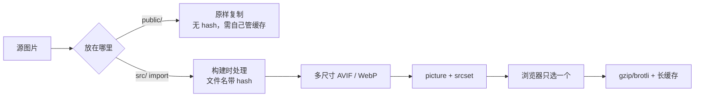

# B5 资源与传输

> **目标层级**：L2 ｜ **前置**：B4 ｜ **预计**：5h
> **本章产物**：图片对比表、`docs/asset-policy.md`、一份压缩与 sourcemap 验证记录

## 0. 先看终点

```powershell
PS> node tooling/assets/make-fixture.mjs
hero-2400.jpg        2428.5 KB
hero-640.webp        19.2 KB
hero-640.avif        13.0 KB
hero-1280.webp      227.2 KB
hero-1280.avif      111.0 KB
hero-1920.webp      709.1 KB
hero-1920.avif      335.2 KB

PS> pnpm --filter "@lab/admin" build
dist/assets/hero-1280-<hash>.avif
dist/assets/hero-1280-<hash>.webp
dist/assets/hero-2400-<hash>.jpg
```

本章要把“优化体积”从 JS 扩展到整条传输链：

- 图片：格式、尺寸、`srcset`、懒加载；
- 字体：woff2、子集、`font-display`、preload；
- CSS：拆分、压缩、顺序；
- 传输：gzip/brotli、缓存头、sourcemap 是否公开。

## 1. 知识讲解

### 1.1 一张图决定资源怎么处理



最常见的错误不是“图片太大”，而是**大图没有经过构建**：放在 `public/` 里，名字不变，浏览器缓存永远命中旧图；或者直接用 2400px 原图，在 375px 手机上浪费流量。

### 1.2 Vite 的资源规则

| 写法 | 结果 | 适用 |
|---|---|---|
| `import img from './a.png'` | 生成带 hash 的 URL | 需要缓存、需要构建处理 |
| `` 且文件在 `public/` | 原样复制到 `dist/a.png` | favicon、robots.txt、不参与构建的文件 |
| `new URL('./a.png', import.meta.url)` | 运行时解析为构建后的 URL | 动态路径、Worker |
| `import text from './a.txt?raw'` | 文件内容作为字符串 | 配置、模板 |
| `import url from './a.svg?url'` | 只取 URL | SVG 当图片 |
| `import css from './a.css?inline'` | CSS 字符串 | 需要运行时注入 |

`build.assetsInlineLimit` 默认 4096 字节：小于它的资源会被转成 base64，直接内联进 JS/CSS。小图标内联可以减少请求；大文件内联会增加 JS 体积，还会破坏缓存。不要为了让“请求数少”把整张图 base64 进去。

### 1.3 图片：先选尺寸，再选格式

一张图有三个独立维度：

1. **显示尺寸**：CSS 里实际占多大；
2. **像素密度**：DPR 1/2/3 需要不同宽度的文件；
3. **编码格式**：JPEG / WebP / AVIF。

正确顺序是：先按显示尺寸生成 640/1280/1920 等宽度，再为每个宽度生成 WebP/AVIF，最后用 `<picture>` + `srcset` 让浏览器选。

```tsx
import heroAvif640 from './assets/raw/hero-640.avif'
import heroAvif1280 from './assets/raw/hero-1280.avif'
import heroAvif1920 from './assets/raw/hero-1920.avif'
import heroWebp640 from './assets/raw/hero-640.webp'
import heroWebp1280 from './assets/raw/hero-1280.webp'
import heroWebp1920 from './assets/raw/hero-1920.webp'
import heroJpg from './assets/raw/hero-2400.jpg'

export function Hero() {
  return (
    <picture>
      <source
        type="image/avif"
        srcSet={`${heroAvif640} 640w, ${heroAvif1280} 1280w, ${heroAvif1920} 1920w`}
        sizes="(max-width: 700px) 100vw, 640px"
      />
      <source
        type="image/webp"
        srcSet={`${heroWebp640} 640w, ${heroWebp1280} 1280w, ${heroWebp1920} 1920w`}
        sizes="(max-width: 700px) 100vw, 640px"
      />
      
    </picture>
  )
}
```

几个容易忽略的点：

- **首屏大图不要 `loading="lazy"`**，否则会推迟 LCP；首屏以下的图才懒加载。
- `width` / `height` 必须写，避免 CLS；CSS 再用 `max-width: 100%; height: auto` 控制布局。
- `sizes` 要和真实布局一致；写错会让浏览器选错文件。
- `fetchPriority="high"` 只给真正的 LCP 图，不要每张图都加。
- AVIF 编码慢、兼容性略差，所以保留 WebP 和 JPEG fallback。

### 1.4 字体：woff2、子集、swap

字体的原则：

1. 只用 `woff2`，不要同时提供 eot/ttf/otf；
2. 只保留用到的字符子集；中文全量字体动辄几 MB；
3. `font-display: swap`，避免文字长时间不可见；
4. 首屏关键字体可以 `preload`，但要带 `crossorigin`；
5. 自托管，不要依赖第三方 CDN 的运行时可用性。

```css
@font-face {
  font-family: 'Lab Sans';
  src: url('./fonts/lab-sans.woff2') format('woff2');
  font-weight: 400;
  font-style: normal;
  font-display: swap;
  unicode-range: U+0000-00FF;
}
```

如果字体文件很小，Vite 可能把它 base64 内联。字体通常应该走长缓存，不建议内联：

```ts
build: {
  assetsInlineLimit: (filePath) => {
    if (/\.(woff2?|ttf|otf)$/i.test(filePath)) return false
    return undefined
  },
},
```

中文子集化需要额外工具（如 `fonttools` / `glyphhanger`），本教程不展开；先做到“只加载一个 woff2、开启 swap、不要全量中文字体同步阻塞”。

### 1.5 CSS：拆分与顺序

Vite 默认 `cssCodeSplit: true`：每个异步 chunk 的 CSS 会单独抽出，在 chunk 加载时注入。好处是首屏不下载报表页的样式；代价是异步路由切换时可能有一瞬间样式未到。

常见问题：

- **开发时样式正常，构建后顺序变了**：CSS 注入顺序和 chunk 顺序有关，不要依赖“后 import 的一定覆盖前面的”这种隐式规则。
- **异步 chunk 的 CSS 没加载**：检查该 chunk 是否真的被 import，以及 `cssCodeSplit` 是否被关掉。
- **全局 CSS 太大**：把路由级样式放到路由 chunk，不要所有页面都 import 同一个 `global.css`。
- **`@import` 阻塞**：CSS 里的 `@import` 会串行请求，能合并就合并。

Vite 8 默认用 Lightning CSS 压缩 CSS。不要同时再挂一个 CSS 压缩插件，重复压缩不会更好，只会更慢。

### 1.6 gzip / brotli：Vite 只报告，不替你开启

构建日志里的 `gzip` 是估算；真正传输要看服务器响应头：

```http
Content-Encoding: gzip
Vary: Accept-Encoding
```

Nginx 的最小配置：

```nginx
gzip on;
gzip_comp_level 6;
gzip_min_length 1024;
gzip_vary on;
gzip_types
  text/plain
  text/css
  application/javascript
  application/json
  image/svg+xml;
```

Brotli 需要模块支持，不是所有 Nginx 都自带：

```nginx
brotli on;
brotli_comp_level 6;
brotli_types text/plain text/css application/javascript application/json image/svg+xml;
```

如果服务器不能动态压缩，可以在构建时生成 `.gz` / `.br`，再开 `gzip_static on`。这属于部署细节，C4 会落到容器里；本章只要求你能验证响应头。

`vite preview` 不能代表生产压缩和缓存。不要用它证明“已经开了 gzip”。

### 1.7 sourcemap：能调试，但不能公开

| 配置 | 产物 | 适用 |
|---|---|---|
| `sourcemap: false` | 无 `.map` | 默认生产 |
| `sourcemap: true` | `.map` + JS 末尾 `sourceMappingURL` | 本地/预发调试 |
| `sourcemap: 'hidden'` | `.map`，但 JS 不写引用 | 生产上传到 Sentry 等平台 |
| `sourcemap: 'inline'` | base64 写进 JS | 不推荐，体积大 |

生产推荐 `hidden`：构建出 map，上传到错误监控平台，但不让浏览器自动请求。部署时把 `*.map` 排除在镜像外，或在 Nginx 里拒绝：

```nginx
location ~* \.map$ {
  deny all;
}
```

### 1.8 缓存头：hash 资源与 HTML 分开

| 路径 | 缓存策略 | 原因 |
|---|---|---|
| `/assets/*` | `public, max-age=31536000, immutable` | 文件名带 hash，内容变则 URL 变 |
| `/index.html` | `no-cache` | 必须每次拿到新的资源引用 |
| `sw.js` | `no-cache` | Service Worker 更新 |
| `.map` | 不公开 | 源码泄露 |

如果 `index.html` 被长缓存，用户会一直拿旧 HTML，引用旧的 hash 文件；即使新文件已经部署，也看不到。反过来，如果 hash 资源被 `no-cache`，长缓存就白做了。

## 2. Guided 实操

### 2.1 生成一张“脏”大图

在根目录安装 `sharp`：

```powershell
pnpm add -Dw sharp
```

如果 pnpm 12 报 `ERR_PNPM_IGNORED_BUILDS`，说明 `sharp` 的安装脚本被拦截。把 `sharp` 加进 `pnpm-workspace.yaml`：

```yaml
allowBuilds:
  sharp: true
```

再执行一次 `pnpm install`。不要用 `--ignore-scripts` 绕过，否则原生二进制可能不完整。

`tooling/assets/make-fixture.mjs`：

```js
import { mkdir, stat } from 'node:fs/promises'
import { join } from 'node:path'
import sharp from 'sharp'

const outDir = 'apps/admin/src/assets/raw'
const width = 2400
const height = 1600

await mkdir(outDir, { recursive: true })

let seed = 42
const rand = () => {
  seed = (seed * 1664525 + 1013904223) >>> 0
  return seed / 0xffffffff
}

const pixels = Buffer.alloc(width * height * 3)
for (let i = 0; i < pixels.length; i += 3) {
  const x = (i / 3) % width
  const y = Math.floor(i / 3 / width)
  const base = 40 + 80 * (x / width) + 40 * (y / height)
  pixels[i] = Math.min(255, base + rand() * 80)
  pixels[i + 1] = Math.min(255, 60 + rand() * 120)
  pixels[i + 2] = Math.min(255, 100 + rand() * 100)
}

const source = join(outDir, 'hero-2400.jpg')
await sharp(pixels, { raw: { width, height, channels: 3 } })
  .jpeg({ quality: 92 })
  .toFile(source)

for (const targetWidth of [640, 1280, 1920]) {
  const base = sharp(source).resize({ width: targetWidth })
  await base.clone().webp({ quality: 72 }).toFile(join(outDir, `hero-${targetWidth}.webp`))
  await base.clone().avif({ quality: 50 }).toFile(join(outDir, `hero-${targetWidth}.avif`))
}

for (const file of [
  'hero-2400.jpg',
  'hero-640.webp',
  'hero-640.avif',
  'hero-1280.webp',
  'hero-1280.avif',
  'hero-1920.webp',
  'hero-1920.avif',
]) {
  const info = await stat(join(outDir, file))
  console.log(`${file.padEnd(20)} ${(info.size / 1024).toFixed(1)} KB`)
}
```

运行：

```powershell
node tooling/assets/make-fixture.mjs
```

写作机输出：

| 文件 | 大小 | 相对 2428.5 KB 减少 |
|---|---:|---:|
| `hero-2400.jpg` | 2428.5 KB | 基准 |
| `hero-640.webp` | 19.2 KB | 99.2% |
| `hero-640.avif` | 13.0 KB | 99.5% |
| `hero-1280.webp` | 227.2 KB | 90.6% |
| `hero-1280.avif` | 111.0 KB | 95.4% |
| `hero-1920.webp` | 709.1 KB | 70.8% |
| `hero-1920.avif` | 335.2 KB | 86.2% |

这不是“图片优化插件”的效果，只是**按实际尺寸生成 + 更高效的编码**。你的图片内容不同，数字会不同；不要抄这张表当验收值。

### 2.2 用 `<picture>` 接入

`apps/admin/src/Hero.tsx` 使用 1.3 的代码。把 `Hero` 加进现有 `App`，不要删掉 B3 的报表按钮：

```tsx
import { lazy, Suspense, useState } from 'react'
import Hero from './Hero'
import './App.css'

const DirtyPanel = lazy(() => import('./DirtyPanel'))

export default function App() {
  const [show, setShow] = useState(false)

  return (
    <main>
      <Hero />
      <button onClick={() => setShow(true)}>打开报表</button>
      {show && (
        <Suspense fallback={<p>loading...</p>}>
          <DirtyPanel />
        </Suspense>
      )}
    </main>
  )
}
```

如果 TypeScript 报找不到 `*.avif` 模块，在 `apps/admin/src/vite-env.d.ts` 补：

```ts
declare module '*.avif' {
  const src: string
  export default src
}
```

构建：

```powershell
pnpm --filter "@lab/admin" build
node tooling/bench/size-report.mjs apps/admin/dist > reports/b5-assets.txt
Get-Content reports/b5-assets.txt -TotalCount 30
```

预期：`dist/assets` 里有多种尺寸和格式，文件名都带 hash。`dist` 总大小会包含所有变体，这不等于浏览器实际下载量；实际只会选一个。

### 2.3 在 Network 里确认浏览器选了什么

```powershell
pnpm --filter "@lab/admin" preview
```

打开 DevTools → Network → Img，刷新：

- 桌面宽屏通常选 1920 或 1280 的 AVIF；
- 手机模拟器（窄屏、DPR 2）通常选 640 或 1280 的 AVIF；
- 不支持 AVIF 的浏览器回退到 WebP/JPEG。

记录：

- 请求的文件名；
- `Content-Type`；
- `Content-Encoding`（preview 可能没有）；
- 传输大小。

### 2.4 开启 sourcemap hidden

`apps/admin/vite.config.ts`：

```ts
build: {
  sourcemap: 'hidden',
  manifest: true,
  // ... 其余配置
}
```

构建后验证：

```powershell
pnpm --filter "@lab/admin" exec vite build
Get-ChildItem apps/admin/dist/assets -Filter *.map |
  Select-Object Name, Length |
  Select-Object -First 5

Get-ChildItem apps/admin/dist/assets -Filter *.js |
  Select-String -Pattern "sourceMappingURL" -SimpleMatch |
  Select-Object -First 3
```

预期：`.map` 文件存在；JS 里没有 `sourceMappingURL`。如果第二段有输出，说明你用的是 `sourcemap: true`，不是 `hidden`。

生产部署时不要把 `.map` 放进公开目录；C4 会在 Docker 构建和 Nginx 配置里处理。

### 2.5 验证压缩（本地先看响应头）

`vite preview` 不代表生产，但可以先确认请求和响应头：

```powershell
curl.exe -I -H "Accept-Encoding: gzip" http://localhost:4173/assets/index-xxxx.js
```

看有没有：

```http
Content-Encoding: gzip
Vary: Accept-Encoding
```

如果没有，不要惊讶：preview 没开压缩。真正的验证在 C4 的 Nginx 容器里做，命令相同。

### 2.6 写 `docs/asset-policy.md`

```md
# 资源策略

## 图片
- 源图放 `src/assets/raw/`，由 `tooling/assets/make-fixture.mjs` 生成多尺寸
- 页面用 `<picture>` + `srcset`，首屏 LCP 图不加 lazy
- 所有 img 写 width/height
- 生成物提交到仓库；CI 不重复跑 sharp

## 字体
- 只提供 woff2
- 中文子集化在发布前做
- font-display: swap
- 字体不内联

## CSS
- 路由级样式跟路由 chunk
- 不使用远程 @import
- 构建后检查异步路由的 CSS 是否加载

## 传输
- 生产由 Nginx 开 gzip；brotli 视模块支持
- /assets/* 长缓存 immutable
- index.html no-cache
- .map 不公开

## sourcemap
- 生产 hidden
- 上传到错误监控平台
- 部署时排除或 deny
```

## 3. 排障

| 现象 | 原因 | 验证 | 修复 |
|---|---|---|---|
| 图片 URL 没 hash | 放在 `public/` | 看 `dist` 路径 | 移到 `src` 并 import |
| JS 里出现巨大 base64 | 资源小于 inline limit 或阈值调太大 | 分析器看 data URI | 调小 `assetsInlineLimit` |
| 字体 404 | 路径写死或用 `public` 但 base 不对 | Network URL | 用 import 或正确的 `base` |
| 异步路由没样式 | CSS 没跟 chunk 加载 | Network 看 `.css` | 检查 import 和 `cssCodeSplit` |
| 样式顺序变了 | 依赖隐式 import 顺序 | 对比 chunk CSS | 显式顺序，避免全局覆盖 |
| sourcemap 能被公网访问 | 部署了 `.map` | 直接请求 `.map` | 排除/deny |
| gzip 不生效 | 服务器没开或 MIME 不在列表 | `curl -I` 看响应头 | 配 Nginx |
| HTML 被长缓存 | 缓存头配错 | 看 `Cache-Control` | HTML 用 no-cache |

## 4. 故障演练

### 4.1 把图片放回 `public/`

把 `hero-1280.avif` 复制到 `apps/admin/public/`，用 `/hero-1280.avif` 引用，构建两次：

- 文件名不变；
- 改图后 URL 不变；
- 浏览器可能继续用旧缓存。

恢复成 `src` import，确认文件名带 hash。这个演练说明：**不是所有资源都该放 public**。

### 4.2 把 inline limit 调到 10 MB

```ts
build: {
  assetsInlineLimit: 10_000_000,
}
```

构建，观察 JS 体积暴涨、图片变成 base64。恢复默认，重新构建。结论：内联只适合小图标，不适合照片和字体。

### 4.3 用 `sourcemap: true` 暴露源码

临时改成 `true`，构建后搜索 `sourceMappingURL`，浏览器 DevTools 能直接看到源码。恢复 `hidden`，确认 JS 里没有引用。这个演练只在本机做，不要把公开 map 部署到生产。

## 5. 闭卷练习

合上教程，完成：

1. 为一张 2400px 图片生成 640/1280/1920 三种宽度，至少两种格式。
2. 用 `<picture>` 接入，证明手机模拟器选的不是 1920 原图。
3. 给首屏 LCP 图加正确的 `width`/`height` 和 `fetchPriority`。
4. 配置 `sourcemap: 'hidden'`，证明 JS 没有 `sourceMappingURL` 但 `.map` 存在。
5. 写一段 Nginx 配置：gzip、`/assets/*` 长缓存、`index.html` no-cache、`.map` deny。

验收标准：

- Network 里实际下载的图片明显小于原图；
- 没有把大图 base64 进 JS；
- 异步路由 CSS 正常；
- `.map` 不被公开访问；
- 能解释 `public/` 和 `src/` 的缓存差异。

## 6. 验收清单

- [ ] 大图有多尺寸/多格式，`srcset` 正确
- [ ] 首屏图没有 `loading="lazy"`
- [ ] 图片有 `width` / `height`
- [ ] 字体只加载 woff2，`font-display: swap`
- [ ] `sourcemap: 'hidden'`，部署不公开 map
- [ ] 有 gzip 验证命令和预期响应头
- [ ] `docs/asset-policy.md` 已提交
- [ ] `reports/b5-assets.txt` 有前后对比

## 7. 自测

**Q1：为什么放在 `public/` 的图片没有 hash？**

<details>
<summary>答案</summary>

Vite 对 `public/` 只做原样复制，不参与构建和内容 hash；适合 favicon 等稳定文件，不适合需要长期缓存的业务图片。
</details>

**Q2：`srcset` 和 `sizes` 分别解决什么？**

<details>
<summary>答案</summary>

`srcset` 提供不同宽度的候选文件；`sizes` 告诉浏览器图片在布局中占多宽，浏览器据此结合 DPR 选择文件。
</details>

**Q3：为什么首屏 LCP 图不能 `loading="lazy"`？**

<details>
<summary>答案</summary>

懒加载会推迟图片请求，导致 LCP 变差；首屏主图应尽早加载，首屏以下的图才懒加载。
</details>

**Q4：`sourcemap: 'hidden'` 和 `true` 的区别？**

<details>
<summary>答案</summary>

两者都生成 `.map`；`true` 会在 JS 末尾写 `sourceMappingURL`，浏览器会自动请求；`hidden` 不写引用，适合上传到监控平台但不公开。
</details>

**Q5：Vite 构建日志有 gzip，为什么线上还是没压缩？**

<details>
<summary>答案</summary>

Vite 只是估算，不会生成 `.gz` 或替服务器开启压缩；需要 Nginx/网关配置 `gzip on` 或使用预压缩文件。
</details>

## 8. 延伸

- `vite-imagetools`、`sharp` 的响应式图片流水线
- 字体子集化：`fonttools`、`glyphhanger`
- Nginx `gzip_static`、Brotli 模块
- 下一章：把启动、HMR、构建的耗时拆开，找出真正慢在哪
