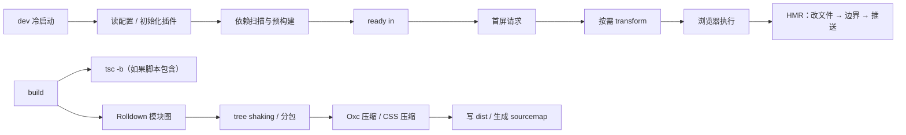

# B6 启动与构建速度

> **目标层级**：L2 ｜ **前置**：B5 ｜ **预计**：5h
> **本章产物**：`reports/b6-speed.md`（启动 / HMR / 构建三张表 + 一个可验证的修复）

## 0. 先看终点

```powershell
PS> node tooling/bench/dev-start.mjs 3 apps/admin
第 1/3 次: 0.40s
第 2/3 次: 0.37s
第 3/3 次: 0.35s
中位数: 0.37s

PS> pnpm run bench -- --runs 3 --label b6-build --dir apps/admin/dist -- pnpm --filter "@lab/admin" exec vite build
中位数: 0.42s
产物: 0.31 MiB

PS> pnpm --filter "@lab/admin" exec vite build --profile
# 生成 vite-profile-0.cpuprofile
```

本章要区分四种“慢”：

1. **dev 冷启动慢**：进程起来到 `ready in`；
2. **首屏慢**：浏览器请求到可用，不等于 `ready in`；
3. **HMR 慢**：保存到页面更新；
4. **build 慢**：`tsc`、模块图、压缩、写盘各自占多少。

不拆开这四件事，就会把“构建慢”误判成“Vite 慢”，然后乱删插件。

## 1. 知识讲解

### 1.1 时间花在哪里



`ready in` 只覆盖左边到 `D`；首屏慢可能是 `E` 之后；HMR 慢在 `H`；构建慢可能在 `J` 到 `N` 的任何一段。

### 1.2 dev 冷启动：预构建是最大变量

Vite 第一次启动会扫描依赖，把裸导入预构建到 `node_modules/.vite/deps`。依赖越多、CJS 越多，冷启动越慢；第二次启动会复用缓存，快很多。

影响冷启动的因素：

- 依赖数量、CJS 比例；
- `optimizeDeps.include` 是否把大依赖提前拉进来；
- 插件初始化成本；
- 工作区包是否被错误地当成依赖预构建；
- Windows 文件系统和杀毒软件。

`ready in` 快不代表首屏快。预构建可以只做一部分，首屏请求到某个依赖时才触发后续优化，表现为“启动很快，打开页面卡一下”。

### 1.3 首屏：请求瀑布和 transform

开发模式首屏的瓶颈通常不是“打包”，而是：

- 模块请求太多，浏览器串行发现依赖；
- 某个模块 transform 很慢（大文件、复杂插件、SVG 转换）；
- barrel 让一个入口拉进几十个模块；
- 预构建没命中，首屏才现构建。

Vite 提供 `server.warmup.clientFiles`，可以在启动时预转换指定文件：

```ts
server: {
  warmup: {
    clientFiles: ['./src/main.tsx', './src/App.tsx'],
  },
},
```

它会把 `ready in` 推高，但可能降低首屏等待。必须两个指标一起测，不能只看启动时间。

### 1.4 HMR：慢在边界，不一定慢在编译

HMR 的耗时由三部分组成：

1. 文件监听；
2. 受影响模块的重新 transform；
3. 浏览器应用更新 / React Fast Refresh。

如果修改的是一个巨大的 barrel，或者更新链路上有非组件模块，Vite 可能找不到边界，退化成整页刷新；看起来就是“HMR 很慢”。

测量方法：

- 开 `pnpm --filter "@lab/admin" dev -- --debug hmr`，观察日志时间戳；
- 或录屏，从保存到页面更新，手动记三次；
- 修改不同文件（组件、工具函数、CSS）分别测，不要只测一个。

### 1.5 build：先分清 `tsc` 和 Vite

`pnpm build:admin` 通常是：

```json
"build": "tsc -b && vite build"
```

`tsc -b` 可能占掉一半时间，尤其是刚改过类型、没有增量缓存时。要分别测：

```powershell
# 只测 Vite
pnpm --filter "@lab/admin" exec vite build

# 测完整脚本
pnpm --filter "@lab/admin" build
```

如果完整脚本慢、Vite 本身不慢，先优化类型检查（减少不必要的项目引用、避免全量 `tsc`），不要乱改 Vite 配置。

### 1.6 用 CPU profile 定位，而不是猜

Vite 8 支持：

```powershell
pnpm --filter "@lab/admin" exec vite build --profile
```

它会在当前目录生成 `vite-profile-0.cpuprofile`。用 Chrome DevTools：

1. 打开 DevTools → Performance；
2. 点 Load profile；
3. 选择 `vite-profile-0.cpuprofile`；
4. 看最上面的函数和调用栈。

重点找：

- `rolldown` / `oxc` 相关调用；
- 你自己的插件 `transform`；
- `vite:build-import-analysis`；
- 文件系统读写；
- `tsc`（如果 profile 覆盖了完整脚本）。

`--profile` 本身有开销，**不要用它测时间**，只用它看“谁在占 CPU”。

### 1.7 插件开销要单独测

一个插件“看起来很小”，但如果在 `transform` 里对每个模块做正则、AST、序列化，成本会随模块数线性增长。

测量方法：用环境变量门控插件，跑同一命令三次，对比开/关的中位数。

```ts
const slow = process.env.SLOW === '1'
plugins: [react(), slow && slowPlugin()]
```

如果差异小于 10%，先当作噪声；大于 10% 再排查。不要因为“感觉插件多”就删掉必要的 React 插件。

### 1.8 Windows 上的常见干扰

- **Defender 实时扫描**：`node_modules` 和 `dist` 文件多，扫描会显著拖慢构建。可以把仓库和 pnpm store 加入排除项，但不要关闭整个 Defender。
- **OneDrive / 网络盘**：文件监听和读写都慢，仓库放本地 SSD。
- **WSL 与 Windows 混用**：跨文件系统访问 `node_modules` 很慢，固定一边。
- **电源模式**：省电模式会降频，三次测量要在同一电源状态。
- **后台浏览器/会议软件**：占 CPU 和内存，测量时关掉。

### 1.9 不要用“优化”掩盖问题

| 做法 | 可能的效果 | 风险 |
|---|---|---|
| `build.sourcemap: false` | 构建变快、产物变小 | 线上无法定位错误 |
| `build.reportCompressedSize: false` | 省一点构建时间 | 看不到 gzip 估算 |
| `build.minify: false` | 构建变快 | 产物体积暴涨，不能上生产 |
| 删掉 ESLint/tsc | 构建变快 | 把类型错误带到线上 |
| 加大内存/换机器 | 变快 | 没有解决代码结构问题 |

优化报告必须写清楚“牺牲了什么”。只写“构建从 10s 降到 5s”而不写关闭了 sourcemap，是不完整的。

## 2. Guided 实操

### 2.1 写 dev 启动测量脚本

`tooling/bench/dev-start.mjs`：

```js
import { spawn } from 'node:child_process'

const runs = Number(process.argv[2] ?? 3)
const target = process.argv[3] ?? 'apps/admin'
const port = 5199
const times = []

function stripAnsi(text) {
  return text.replace(/\u001b\[[0-9;]*m/g, '')
}

function once() {
  return new Promise((resolve, reject) => {
    const started = performance.now()
    const command = `pnpm --dir "${target}" exec vite --port ${port} --strictPort`
    const child = spawn(command, {
      shell: true,
      stdio: ['ignore', 'pipe', 'pipe'],
    })

    let output = ''
    let settled = false
    let timer
    const onData = (chunk) => {
      output += stripAnsi(chunk.toString())
      if (/ready in \d+ ms/.test(output)) {
        finish(performance.now() - started)
      }
    }

    const finish = (ms) => {
      if (settled) return
      settled = true
      clearTimeout(timer)
      child.stdout.off('data', onData)
      child.stderr.off('data', onData)
      if (process.platform === 'win32') {
        spawn('taskkill', ['/pid', String(child.pid), '/T', '/F'], { stdio: 'ignore' })
      } else {
        child.kill('SIGTERM')
      }
      resolve(ms)
    }

    child.stdout.on('data', onData)
    child.stderr.on('data', onData)
    child.on('error', reject)
    timer = setTimeout(() => {
      if (!settled) finish(performance.now() - started)
    }, 15000)
  })
}

for (let i = 1; i <= runs; i += 1) {
  const ms = await once()
  times.push(ms)
  console.log(`第 ${i}/${runs} 次: ${(ms / 1000).toFixed(2)}s`)
  await new Promise((resolve) => setTimeout(resolve, 500))
}

const sorted = [...times].sort((a, b) => a - b)
const median = sorted[Math.floor(sorted.length / 2)]
console.log(`中位数: ${(median / 1000).toFixed(2)}s`)
```

运行：

```powershell
node tooling/bench/dev-start.mjs 3 apps/admin
```

写作机小样本（空依赖的 Vite 模板）：

| 次数 | 时间 |
|---|---:|
| 1 | 0.40s |
| 2 | 0.37s |
| 3 | 0.35s |
| 中位数 | 0.37s |

这个时间包含 pnpm 启动和 Vite 初始化，不是纯 Vite 内部耗时。你的项目依赖更多，绝对值会更大；只和同项目、同命令的结果比。

### 2.2 测构建

```powershell
pnpm run bench -- --runs 3 --label b6-build --dir apps/admin/dist -- pnpm --filter "@lab/admin" exec vite build
```

写作机小样本（空依赖 Vite 模板，不是你的 Dirty 项目）：

| 指标 | 数值 |
|---|---:|
| 三次墙钟 | 473 / 419 / 422 ms |
| 中位数 | 422 ms |
| Vite 日志 `built in` | 约 108 ms |

墙钟包含 pnpm 启动，所以比 Vite 内部时间大。报告里两个都写，并注明口径。

完整脚本也测一次：

```powershell
pnpm run bench -- --runs 3 --label b6-full --dir apps/admin/dist -- pnpm --filter "@lab/admin" build
```

如果完整脚本明显更慢，先看 `tsc -b`；不要把它算到 Rolldown 头上。

### 2.3 测 HMR

终端 A：

```powershell
pnpm --filter "@lab/admin" dev -- --debug hmr
```

终端 B 或编辑器：修改 `App.tsx` 的一行文字，连续做三次，记录从保存到页面更新的时间。

再分别修改：

- 一个 React 组件；
- 一个纯 TS 工具函数；
- 一个 CSS 文件。

记录哪种最慢。如果修改工具函数触发整页刷新，说明 HMR 边界断了；这是代码结构问题，不是 Vite 慢。

### 2.4 用 profile 找 CPU 热点

```powershell
pnpm --filter "@lab/admin" exec vite build --profile
Get-ChildItem apps/admin -Filter "vite-profile-*.cpuprofile"
```

打开 Chrome DevTools → Performance → Load profile，记录前三个热点：

```md
1. rolldown 模块图构建：...
2. 某个 plugin transform：...
3. 文件系统写盘：...
```

不要只写“Vite 慢”。要写到函数或插件名。

### 2.5 量化插件开销

在 `apps/admin/vite.config.ts` 临时加：

```ts
import { performance } from 'node:perf_hooks'
import type { Plugin } from 'vite'

function slowPlugin(): Plugin {
  return {
    name: 'slow-demo',
    transform(_code, id) {
      if (!/[\\/]src[\\/]/.test(id)) return
      const end = performance.now() + 5
      while (performance.now() < end) {
        // 故意空转 5ms
      }
    },
  }
}
```

在 `plugins` 里门控：

```ts
plugins: [react(), process.env.SLOW === '1' && slowPlugin()],
```

测两次：

```powershell
pnpm run bench -- --runs 3 --label b6-no-slow --dir apps/admin/dist -- pnpm --filter "@lab/admin" exec vite build

$env:SLOW = '1'
pnpm run bench -- --runs 3 --label b6-slow --dir apps/admin/dist -- pnpm --filter "@lab/admin" exec vite build
Remove-Item Env:SLOW
```

每个源码模块多 5ms，模块越多差异越大。把差值写进报告，然后删掉这个临时插件。

### 2.6 试一次 `optimizeDeps` / `warmup` 的取舍

在 `apps/admin/vite.config.ts` 加：

```ts
optimizeDeps: {
  include: ['antd', 'dayjs'],
},
server: {
  warmup: {
    clientFiles: ['./src/main.tsx', './src/App.tsx'],
  },
},
```

先清缓存再测冷启动：

```powershell
Remove-Item -Recurse -Force apps/admin/node_modules/.vite -ErrorAction SilentlyContinue
node tooling/bench/dev-start.mjs 3 apps/admin
```

再打开页面，用 DevTools 记录首屏完成时间。对比不加配置时的 `ready in` 和首屏时间。

结论可能是：

- `ready in` 变慢（预构建/预转换提前做）；
- 首屏变快（少了现场等待）。

这就是取舍，不是“越早越好”。如果首屏没有明显改善，删掉配置，别留下无用的复杂度。

### 2.7 写 `reports/b6-speed.md`

```md
# B6 速度报告

## 环境
- 机器 / 电源 / Node / pnpm / Vite
- 命令与工作目录

## dev 启动
| 次数 | 时间 |
|---|---:|
| 1 | |
| 2 | |
| 3 | |
| 中位数 | |

## 首屏
| 指标 | 数值 | 测量方式 |
|---|---:|---|
| 首屏完成 | | DevTools |
| 请求数 | | Network |
| 最大单请求 | | Network |

## build
| 场景 | 1 | 2 | 3 | 中位数 |
|---|---:|---:|---:|---:|
| Vite only | | | | |
| 完整 build | | | | |

## HMR
| 修改文件 | 1 | 2 | 3 | 中位数 |
|---|---:|---:|---:|---:|
| App.tsx | | | | |
| utils.ts | | | | |
| App.css | | | | |

## profile 前三
1. ...
2. ...
3. ...

## 一个修复
- 改了什么：...
- 改前中位数：...
- 改后中位数：...
- 代价：...
- 是否采纳：...
```

“一个修复”必须是可验证的，例如移除常开的分析器、把 ECharts 改成懒加载、把 `moment` 换成 `dayjs`。如果差异小于 10%，就写“未采纳，视为噪声”。

## 3. 排障

| 现象 | 可能原因 | 验证 | 修复 |
|---|---|---|---|
| `ready in` 快，首屏慢 | 预构建没命中、请求瀑布 | Network 看依赖请求 | `optimizeDeps.include` / `warmup` |
| 冷启动特别慢 | 依赖多、CJS、杀毒扫描 | 删 `.vite` 再启动 | 预构建、排除杀毒 |
| HMR 慢或整页刷新 | 边界断了、模块太大 | `--debug hmr` | 拆组件、避免 barrel |
| 构建慢 | `tsc`、sourcemap、插件 | 分开测 | 分别优化 |
| 只有 CI 慢 | CI 机器/缓存/安装 | 看 CI 日志 | 缓存 pnpm store，减少全量构建 |
| 内存爆 | 模块图太大、sourcemap | 看进程内存 | 拆分、关 sourcemap |
| Windows 特别慢 | Defender/OneDrive | 换本地目录对比 | 排除项、迁移仓库 |

**先测量，再改。** 如果连 `tsc` 和 Vite 的时间都没分开，就不要动 `build.target`。

## 4. 故障演练

### 4.1 让插件空转，观察线性成本

用 2.5 的 `slowPlugin`，分别跑 0ms、5ms、10ms 三个版本（改循环时间），记录中位数。预期：模块数越多，差异越接近“模块数 × 单次空转”。这个演练说明插件成本不是固定值。

### 4.2 打开 sourcemap，测构建代价

```ts
build: {
  sourcemap: true,
}
```

跑三次构建，记录中位数和 `dist` 大小；改回 `'hidden'` 再测。报告里写清楚“构建时间换调试能力”，不要只写变快。

### 4.3 只测 `ready in` 的陷阱

在 `optimizeDeps.include` 里加入一个大依赖，测 `ready in` 和首屏：

- `ready in` 可能变慢；
- 首屏可能变快；
- 如果只看启动时间，会误删有效配置。

把两个数都写进报告。

## 5. 闭卷练习

合上教程，拿到一个陌生 Vite 项目，30 分钟内完成：

1. 测三次 dev 冷启动、三次 build，给出中位数。
2. 用 `--profile` 找出构建的前三个热点。
3. 分别测一次 HMR：组件、工具函数、CSS。
4. 找出一个“看起来慢但其实不是 Vite”的环节（例如 `tsc`、插件、杀毒）。
5. 做一个改动，给出改前/改后中位数；如果差异小于 10%，明确写“不采纳”。

验收标准：

- 报告里有命令、环境、原始三次数据；
- 没有“感觉快了”“明显提升”；
- 能区分 `ready in`、首屏、HMR、build；
- 至少一个结论是“不改”，并说明理由。

## 6. 验收清单

- [ ] `tooling/bench/dev-start.mjs` 可重复运行
- [ ] dev 启动、build、HMR 各有三次数据
- [ ] `vite-profile-*.cpuprofile` 已分析，写出前三热点
- [ ] 插件开销有开/关对比
- [ ] 一个修复有改前/改后中位数和代价
- [ ] 没有把 `--profile` 的时间当正式构建时间
- [ ] `reports/b6-speed.md` 已提交

## 7. 自测

**Q1：`ready in` 快就代表首屏快吗？**

<details>
<summary>答案</summary>

不代表。`ready in` 只表示开发服务器准备好；首屏还要请求模块、transform、浏览器执行，可能受预构建和请求瀑布影响。
</details>

**Q2：`pnpm build` 慢，应该先怪 Vite 吗？**

<details>
<summary>答案</summary>

不应该。先分开测 `tsc -b` 和 `vite build`；类型检查和构建是两段成本。
</details>

**Q3：`--profile` 的作用是什么？**

<details>
<summary>答案</summary>

生成 CPU profile，定位哪段代码/插件在占 CPU；它会增加开销，不适合用来测墙钟时间。
</details>

**Q4：为什么 `optimizeDeps.include` 可能让启动更慢？**

<details>
<summary>答案</summary>

它把依赖提前预构建，`ready in` 可能变高；但可能减少首屏现场等待。要同时看启动和首屏。
</details>

**Q5：构建优化报告里必须写什么？**

<details>
<summary>答案</summary>

环境、命令、三次原始值、中位数、改了什么、代价是什么、是否采纳；只写“变快”不算报告。
</details>

## 8. 延伸

- Vite `server.warmup`、`optimizeDeps` 的完整选项
- Rolldown 构建性能与并行
- CI 缓存：pnpm store、Vite 依赖缓存
- 第 9 周：把速度/体积基线写进 GitHub Actions 门禁
