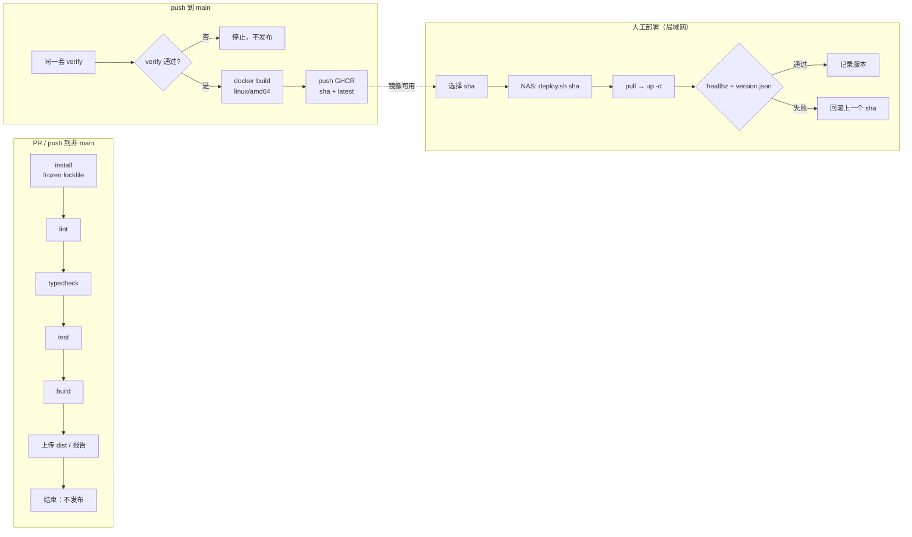
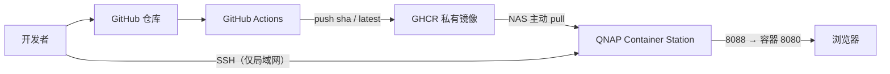

# C1 流水线设计

> **目标层级**：L2 ｜ **前置**：B6、M6 ｜ **预计**：3h
> **本章产物**：`docs/pipeline.md`（阶段图、触发条件、工件、失败策略）

## 0. 先看终点

这一章不写 YAML。先把下面这条链路定死：

```text
PR:
  install → lint → typecheck → test → build → 上传产物 → 结束，不发布

main 合并:
  同一套检查 → docker build（linux/amd64）→ push GHCR（tag = commit sha + latest）

上线:
  人在 NAS 上执行 ./deploy.sh <sha>
  → docker compose pull → up -d
  → /healthz 200 且 /version.json 的 sha 匹配
  → 失败则回到上一个 sha
```

最终你要能回答：

1. 哪些检查必须在 PR 上跑，哪些只在 main 跑？
2. 为什么构建产物只能构建一次，部署时不能再构建？
3. 为什么 `latest` 不能作为回滚依据？
4. 哪一步失败应该阻止发布，哪一步失败只影响本次部署？
5. GitHub Actions 和 GitLab CI 的概念怎么一一对应？

## 1. 知识讲解

### 1.1 CI、CD 和“自动部署”不是一回事

| 概念 | 在本教程里的含义 | 不是什么 |
|---|---|---|
| CI | 每次提交自动安装、检查、测试、构建 | 不是“自动上线” |
| CD（持续交付） | 每次合并都产出一个可部署的镜像 | 不是“每次合并都上线” |
| 部署 | 人在 NAS 上选择 sha 并执行脚本 | 不是 GitHub Actions 直接 SSH 进来 |
| 回滚 | 用上一个 sha 重新起容器 | 不是 `git revert` 后等自动部署 |

本教程选择**持续交付 + 人工部署**：

- GitHub Actions 只负责“产出可信的镜像”；
- 部署动作在 QNAP 上手动执行；
- 除局域网 SSH 管理外，NAS 不开放入站端口；不需要内网穿透，也不需要 self-hosted runner；
- 失败时由部署脚本回滚，而不是靠人临时 `docker run`。

这不是“落后”。对只有一台内网 NAS、没有公网入口的项目，这是风险最低的方案。

### 1.2 一条主线和三条支线



三条支线要分清：

- **PR 线**：只验证，不产生可发布镜像；
- **main 线**：验证通过后，构建并推送镜像；
- **部署线**：不在 Actions 里，人在 NAS 上执行。

### 1.3 阶段怎么分

| 阶段 | 目的 | 放什么 | 失败后 |
|---|---|---|---|
| 安装 | 还原确定性依赖 | `pnpm install --frozen-lockfile` | 直接失败，后面的都不跑 |
| 静态检查 | 尽早发现低风险问题 | ESLint、Prettier check | 阻止合并 |
| 类型检查 | 发现类型错误 | `pnpm typecheck` / `tsc -b` | 阻止合并 |
| 测试 | 发现行为回归 | 单元测试、构建后 smoke | 阻止合并 |
| 构建 | 产出可部署静态文件 | `pnpm build` | 阻止合并/发布 |
| 打包 | 产出镜像 | Docker build | 阻止推送 |
| 发布 | 推送 GHCR | `docker push` | 不产生新版本，旧版本不受影响 |
| 部署 | 在 NAS 上切换版本 | `deploy.sh` | 自动回滚 |

顺序原则：**越便宜、越确定、越早失败的检查放越前面**。不要先花 3 分钟构建 Docker，再跑 5 秒 ESLint。

### 1.4 构建一次，部署同一个东西

同一个 commit 只能构建一次可发布镜像，之后所有环境都用这个镜像。不要在 NAS 上重新 `pnpm build`，也不要在部署时重新打 tag。原因：

- 构建环境不同，产物可能不同；
- 依赖下载可能失败或版本漂移；
- 无法证明“线上跑的”就是“CI 验证过的”；
- 回滚时没有确定的镜像可回。

本教程用 **commit sha** 作为镜像 tag：

```text
ghcr.io/<owner>/fe-lab-admin:3f2a1c9...
ghcr.io/<owner>/fe-lab-admin:latest
```

`latest` 只是方便人看，不是部署依据。部署脚本只接受完整 sha，回滚也只回上一个 sha。

### 1.5 工件、缓存、镜像，不要混

| 类型 | 例子 | 生命周期 | 能不能当发布物 |
|---|---|---|---|
| 缓存 | pnpm store、Docker layer | 可能被清理 | 不能 |
| 工件 | `dist`、测试报告、分析器 HTML | 保留几天 | 可以作为证据，不是部署物 |
| 镜像 | GHCR 里的 sha tag | 长期保留 | 是部署物 |

常见错误：

- 把 `node_modules` 当 artifact 上传；
- 用缓存命中来证明构建成功；
- 只保留 `latest`，旧镜像被清理后无法回滚；
- PR 也推送镜像，污染 registry。

### 1.6 失败拦在哪一层

| 故障 | 应该在哪层被拦 | 拦不住会怎样 |
|---|---|---|
| 拼写错误、未使用变量 | lint | 合并后才发现 |
| 类型不匹配 | typecheck | 运行时崩 |
| 业务逻辑回归 | test | 线上行为错 |
| 构建失败 | build | 没有可部署产物 |
| 镜像过大/架构错 | docker build + 检查 | NAS 拉取慢或起不来 |
| 健康检查失败 | deploy.sh | 线上空白 |
| 版本不匹配 | version.json 校验 | 以为发的是 A，实际是 B |

注意：**CI 通过不等于线上正确**。CI 只能证明“在 CI 环境里通过了这些检查”；部署后的健康检查和版本校验不能省。

### 1.7 GitHub Actions 与 GitLab CI 的概念映射

公司用 GitLab 时，不要把 GitHub 的 YAML 逐行翻译；先对齐概念。

| GitHub Actions | GitLab CI/CD | 说明 |
|---|---|---|
| workflow | pipeline | 一次完整运行 |
| job | job | 一个 runner 上的执行单元 |
| step | script 里的一条命令 | 更细的执行步骤 |
| `runs-on` | `tags` / runner | 选择执行环境 |
| `actions/checkout` | GitLab 自动 clone | 取代码 |
| `actions/cache` | `cache:` | 缓存依赖 |
| `actions/upload-artifact` | `artifacts:` | 保存产物 |
| `secrets.GITHUB_TOKEN` | `CI_JOB_TOKEN` | 平台自动令牌 |
| environment / protection | environment / protected branch | 人工审批与环境 |
| rulesets / branch protection | protected branches / MR approvals | 合并门禁 |
| `workflow_dispatch` | manual pipeline | 手动触发 |
| GHCR | GitLab Container Registry | 镜像仓库 |

GitLab 的可运行对照放在附录 F，不在这里重复。C1 的设计图必须能同时映射到两边。

### 1.8 幂等与可重跑

流水线要允许“同一个 sha 重跑一次”，结果应该一致：

- `pnpm install --frozen-lockfile`，不更新 lockfile；
- 构建不依赖本机时间、随机数、未提交文件；
- Docker build 的 `GIT_SHA` 用参数传入，不在镜像里现算；
- 同一 sha 重复推送同一个 tag 是覆盖，不回滚旧 tag；
- 部署脚本可重复执行，结果一致。

如果重跑会生成不同的 `version.json`，或者 hash 每次变，先回到 B3 修构建期随机值。

### 1.9 并发与取消

PR 连续 push 三次，旧运行没有意义。用 `concurrency` 取消同一分支的旧运行：

```yaml
concurrency:
  group: ci-${{ github.workflow }}-${{ github.ref }}
  cancel-in-progress: true
```

但 main 的发布不要随意取消：如果镜像已经推送，取消可能留下“推送了一半”的状态。C2 会把 CI 和 publish 分开处理。

### 1.10 部署拓扑



关键约束：

- NAS 主动发起出站 HTTPS；除局域网 SSH 管理外，不开放其他入站；
- Actions 不持有 NAS 的 SSH 私钥；
- 部署由人触发，失败可回滚；
- 镜像架构必须是 `linux/amd64`（本教程的 QNAP 是 x86_64）。

## 2. Guided 实操

### 2.1 写 `docs/pipeline.md`

```md
# 流水线设计

## 触发
- PR → main：verify，不发布
- push main：verify → docker build → push GHCR
- 手动部署：NAS 上 `./deploy.sh <sha>`

## 阶段
| 阶段 | 命令 | 失败后 | 产物 |
|---|---|---|---|
| install | pnpm install --frozen-lockfile | 停止 | 无 |
| lint | pnpm lint | 阻止合并 | 无 |
| typecheck | pnpm typecheck | 阻止合并 | 无 |
| test | pnpm test | 阻止合并 | 测试报告 |
| build | pnpm build | 阻止合并/发布 | dist |
| docker | docker build --platform linux/amd64 | 阻止推送 | 镜像 |
| publish | docker push | 无新版本 | GHCR tag |
| deploy | ./deploy.sh sha | 自动回滚 | 运行容器 |

## 工件
- `web-dist`：保留 7 天，用于排查和 smoke
- GHCR：sha tag 长期保留，latest 只是别名
- 报告：`reports/`，保留 7 天

## 不做什么
- 不在 PR 发布镜像
- 不在 NAS 上重新构建
- 不用 latest 部署或回滚
- 不让 Actions 直接 SSH 到 NAS
```

### 2.2 画你自己的阶段图

用 Mermaid 画一张，至少包含：

- PR 和 main 两条触发；
- install、lint、typecheck、test、build；
- Docker build、GHCR；
- NAS 手动部署、健康检查、回滚。

不要只画“CI → CD”两个框；那张图不能指导排障。

### 2.3 定义发布身份

在 `docs/pipeline.md` 里写死：

```text
发布 ID = git commit 的完整 40 位 sha
镜像 tag = 同一个 sha
version.json = {"sha":"<同一个 sha>","builtAt":"<ISO 时间>"}
部署脚本只接受 40 位 sha
latest 不参与部署和回滚
```

`builtAt` 可以用于排查，但不能参与判断“是不是同一版本”；判断只看 `sha`。

### 2.4 列失败场景

填一张表：

| 场景 | 在哪层拦 | 期望行为 |
|---|---|---|
| lint 错 | PR verify | 阻止合并 |
| 类型错 | PR verify | 阻止合并 |
| build 失败 | PR verify | 阻止合并 |
| Docker 架构错 | main docker build | 不推送或部署时拒绝 |
| GHCR 登录失败 | publish | 旧版本不受影响 |
| NAS 拉取失败 | deploy.sh pull | 旧容器继续跑 |
| 新容器健康检查失败 | deploy.sh | 回滚到上一个 sha |
| version.json 不匹配 | deploy.sh | 回滚并退出非 0 |

### 2.5 配置分支保护

在 GitHub 仓库：

1. Settings → Rules → Rulesets（或 Branches → Branch protection rules）；
2. 保护 `main`；
3. 要求 PR 合并；
4. 要求状态检查通过（C2 完成后会出现 `CI / verify`）；
5. 禁止直接 push；
6. 至少 1 个 approval（个人项目可以只要求检查通过）。

注意：**required check 的名字必须和 workflow/job 对得上**。C2 的 workflow `name: CI`、job `verify`，检查名通常是 `CI / verify`。名字改了，保护规则会一直等一个不存在的检查。

### 2.6 把“不自动部署”写进文档

```md
## 为什么不在 Actions 里部署
- NAS 无公网入口，Actions 无法直接访问
- 不引入 self-hosted runner 和内网穿透
- 部署需要人工确认 sha
- 回滚在 NAS 本地执行，减少链路依赖
```

这不是临时妥协，而是本项目的明确边界。GitLab 版也一样，见附录 F。

## 3. 排障

| 现象 | 原因 | 验证 | 修复 |
|---|---|---|---|
| PR 一直等检查 | required check 名字不对 | 看 PR 的 Checks 列表 | 改成实际 job 名 |
| PR 也推了镜像 | publish 没加 main 条件 | 看 workflow `if` | 只允许 main |
| 回滚找不到旧镜像 | 只保留 latest | `docker images` / GHCR | 保留 sha tag |
| 部署版本不对 | 用了 latest 或缓存 | `/version.json` | 用 sha，禁用 HTML 长缓存 |
| 重跑结果不同 | lockfile 被更新/构建期随机值 | `git diff`、hash 对比 | `--frozen-lockfile`，移除随机值 |
| 检查顺序太慢 | 先 Docker 后 lint | 看 job 时间线 | 便宜检查前置 |
| main 被取消一半 | concurrency 取消了发布 | 看 run 状态 | CI 与 publish 分开 |

## 4. 故障演练

### 4.1 设计一次“发布失败但不影响线上”

在文档里写出：

1. 镜像推送失败：GHCR 里没有新 tag，NAS 仍跑旧 sha；
2. 拉取失败：`compose pull` 失败，旧容器不动；
3. 启动失败：`up -d` 后健康检查失败，脚本切回上一个 sha；
4. 版本不匹配：`version.json` 不是目标 sha，按失败处理。

这四种失败的行为必须不同，不能都写成“重新部署一次”。

### 4.2 找出一个“看起来该自动，其实不能自动”的步骤

例如：

- 自动合并 PR；
- 自动部署到 NAS；
- 自动删除旧镜像；
- 自动回滚数据库。

写出为什么不能自动，以及人工确认点在哪里。没有这一节，后面的自动化很容易越界。

## 5. 闭卷练习

合上教程，完成：

1. 画出 PR、main、部署三条链路。
2. 写出每个阶段的命令、失败行为和产物。
3. 解释为什么镜像 tag 用 sha，而不是 `v1`、`latest` 或日期。
4. 写出 GitHub Actions 与 GitLab CI 的 8 个概念映射。
5. 列出四种部署失败场景及各自行为。

验收标准：

- 图中能看到“PR 不发布”；
- 文档明确“NAS 手动部署、除局域网 SSH 外无入站端口”；
- 没有把缓存当工件；
- 没有把 `latest` 当回滚依据。

## 6. 验收清单

- [ ] `docs/pipeline.md` 已提交
- [ ] 有一条 Mermaid 阶段图
- [ ] 触发条件、阶段、工件、失败策略齐全
- [ ] 发布 ID 统一为完整 commit sha
- [ ] 明确 PR 不发布、NAS 不自动部署
- [ ] 分支保护规则已配置或写明配置步骤
- [ ] GH/GL 概念映射至少 8 项

## 7. 自测

**Q1：为什么 PR 不推送镜像？**

<details>
<summary>答案</summary>

PR 可能来自未合并、未审核的代码，推送会污染 registry，也可能让错误版本被误部署。PR 只验证，main 合并后才发布。
</details>

**Q2：为什么不能在 NAS 上重新构建？**

<details>
<summary>答案</summary>

NAS 环境与 CI 不同，重新构建可能得到不同产物；也无法证明线上就是 CI 验证过的版本。构建一次，部署同一个镜像。
</details>

**Q3：`latest` 为什么不能用于回滚？**

<details>
<summary>答案</summary>

`latest` 会被覆盖，无法指向“上一个版本”；回滚必须用不可变的 sha tag。
</details>

**Q4：缓存和工件的区别？**

<details>
<summary>答案</summary>

缓存用于加速，可能被清理，不能作为发布物；工件是本次运行的输出，有保留期，可用于检查和 smoke；镜像是长期发布物。
</details>

**Q5：CI 通过就能直接上线吗？**

<details>
<summary>答案</summary>

不能。CI 只证明检查通过；还要在目标环境做健康检查、版本校验，并准备回滚。
</details>

## 8. 延伸

- GitHub Rulesets 与 required status checks
- GitLab protected branches / environments
- 制品保留与 GHCR 清理策略
- 下一章：把设计落成可运行的 `ci.yml`
