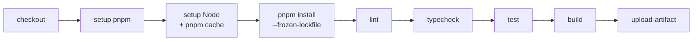

# C2 Actions 基础

> **目标层级**：L2 ｜ **前置**：C1、M5 ｜ **预计**：5h
> **本章产物**：`.github/workflows/ci.yml`，PR 上能跑通的安装、检查、构建和产物上传

## 0. 先看终点

提交一个 PR 后，Actions 里出现：

```text
CI / verify
  ✓ Checkout
  ✓ Setup pnpm
  ✓ Setup Node
  ✓ Install
  ✓ Lint
  ✓ Typecheck
  ✓ Test
  ✓ Build
  ✓ Upload dist
```

失败时，PR 上显示红叉，合并按钮被 required check 拦住；成功后，你可以在 run 页面下载 `web-dist`。

本章不发布镜像。GHCR 和 Docker 在 C4；这里只把“检查 + 构建 + 产物”跑通。

## 1. 知识讲解

### 1.1 一个 workflow 的骨架



对应 YAML 的层级：

```text
workflow
├─ on: 什么时候跑
├─ permissions: 给 GITHUB_TOKEN 什么权限
├─ concurrency: 同一分支的旧运行怎么办
└─ jobs
   └─ verify
      ├─ runs-on: 用什么机器
      └─ steps
         ├─ uses: 用现成 action
         └─ run: 执行命令
```

### 1.2 触发条件

```yaml
on:
  pull_request:
    branches: [main]
  push:
    branches: [main]
  workflow_dispatch:
```

- `pull_request`：PR 打开、更新、重新打开时跑；
- `push`：合并到 main 后跑；
- `workflow_dispatch`：手动点按钮跑，适合排障。

不要用 `pull_request_target` 来“方便拿 secrets”。它会在目标分支上下文运行，PR 里的代码可能拿到敏感权限；本教程不需要它。

### 1.3 pnpm 和 Node 的顺序

```yaml
- uses: pnpm/action-setup@v4
  with:
    version: 12.15.0
    run_install: false

- uses: actions/setup-node@v4
  with:
    node-version: 24.14.1
    cache: pnpm
    cache-dependency-path: pnpm-lock.yaml
```

顺序不能反：`setup-node` 的 `cache: pnpm` 需要先找到 pnpm 命令。`run_install: false` 让 action 只装 pnpm，不自动安装依赖；安装步骤由你显式控制，日志更清楚。

版本要和本地一致：

- `packageManager` 写 `pnpm@12.15.0`；
- CI 也写 `12.15.0`；
- Node 用 `24.14.1`；
- 不要用 `pnpm@latest`，否则某天自动升级会把流水线打挂。

### 1.4 `--frozen-lockfile` 不是可选项

```powershell
pnpm install --frozen-lockfile
```

含义：lockfile 必须和 `package.json` 完全一致；不一致就失败，不会偷偷更新 lockfile。

CI 里不要用：

```powershell
pnpm install          # 可能改 lockfile
pnpm install --no-frozen-lockfile
```

后者会让 CI 安装到和本地不同的版本，破坏可复现性。如果 CI 报 `ERR_PNPM_OUTDATED_LOCKFILE`，正确做法是本地跑 `pnpm install`，把更新后的 `pnpm-lock.yaml` 提交，而不是在 CI 里放宽。

pnpm 12 还有两个容易踩的点：

- 安装脚本被拦截会报 `ERR_PNPM_IGNORED_BUILDS`，需要在 `pnpm-workspace.yaml` 的 `allowBuilds` 里显式批准；
- `--filter` 没有匹配包时默认退出 0，脚本里需要 `--fail-if-no-match` 才能让 CI 失败。

### 1.5 缓存不是工件

`actions/setup-node` 的 `cache: pnpm` 缓存的是 pnpm store，不是 `node_modules`。下次安装时命中缓存，下载会快，但仍然会执行链接和脚本。

不要缓存：

```yaml
# 不要这样做
path: node_modules
```

原因：

- 不同 Node/平台/依赖组合可能不兼容；
- 缓存命中会掩盖 lockfile 问题；
- `node_modules` 体积大，上传下载可能比重新装还慢；
- workspace 的软链接在缓存解压后可能失效。

工件是另一回事：

```yaml
- uses: actions/upload-artifact@v4
  with:
    name: web-dist
    path: apps/*/dist
    if-no-files-found: error
    retention-days: 7
```

工件用于保存本次运行的 `dist`、报告、分析器 HTML，方便排查；它不能替代镜像，也不是部署物。

### 1.6 `concurrency`：取消过时的 PR 运行

```yaml
concurrency:
  group: ci-${{ github.workflow }}-${{ github.ref }}
  cancel-in-progress: true
```

同一分支连续 push 时，旧运行会被取消。对 PR 很合适：你只关心最新一次。

对 main 的发布要谨慎：如果 publish 已经开始推镜像，取消可能留下不完整状态。C4 会把 `verify` 和 `publish` 分成两个 job，并让 publish 只在 main 上跑。

### 1.7 `permissions`：默认最小

```yaml
permissions:
  contents: read
```

CI 只需要读代码，不需要写 issue、写 package、写 PR。默认给最小权限， publish job 再单独加：

```yaml
permissions:
  contents: read
  packages: write
```

`GITHUB_TOKEN` 是平台自动注入的，不需要手动建 secret。不要把它 `echo` 到日志，也不要把 `secrets.GITHUB_TOKEN` 传给不受信任的脚本。

### 1.8 matrix：什么时候值得用

matrix 是“同一套步骤，换参数跑多份”。例如两个应用：

```yaml
strategy:
  fail-fast: false
  matrix:
    app: [admin, h5]
steps:
  - run: pnpm --filter "@lab/${{ matrix.app }}" build
```

适合：

- 多 Node 版本兼容性；
- 多应用独立构建；
- 多操作系统。

不适合：

- 只有一份参数；
- 每个 matrix 都要重新安装依赖，反而更慢；
- 只是为了“看起来专业”。

本教程主线只支持 Node 24，所以默认不用 matrix。需要时再加，不要一开始就复制四份安装。

### 1.9 artifact 的命名

同一个 workflow run 里，artifact 名字必须唯一。`upload-artifact@v4` 不允许两个 step 往同名 artifact 追加（除非用 merge）。如果要分应用：

```yaml
- uses: actions/upload-artifact@v4
  with:
    name: dist-admin
    path: apps/admin/dist
- uses: actions/upload-artifact@v4
  with:
    name: dist-h5
    path: apps/h5/dist
```

本教程先用一个 `web-dist` 通配 `apps/*/dist`，简单够用。

### 1.10 `paths` 过滤的陷阱

```yaml
on:
  pull_request:
    paths:
      - 'apps/**'
      - 'packages/**'
```

文档改动不跑 CI 看似省钱，但如果 `CI / verify` 是 required check，PR 只改 README 时这个检查不会出现，PR 会一直等一个永远不会来的检查。

处理方式：

- 不用 `paths`，PR 都跑（本教程默认）；
- 或者用一个总是运行的轻量 job 作为 required check；
- 或者用 paths-filter 在 job 内部判断，但 required check 仍然要存在。

新手项目建议第一种：先稳定，再省时间。

## 2. Guided 实操

### 2.1 确认根脚本

根 `package.json` 至少要有：

```json
{
  "scripts": {
    "lint": "eslint .",
    "typecheck": "pnpm -r typecheck",
    "build": "pnpm -r build"
  }
}
```

`lint` 在 M5 已经加过；如果名字不同，改成 CI 里实际存在的脚本，不要写一个不存在的命令。

### 2.2 创建 workflow

```powershell
New-Item -ItemType Directory -Force -Path .github/workflows | Out-Null
```

`.github/workflows/ci.yml`：

```yaml
name: CI

on:
  pull_request:
    branches: [main]
  push:
    branches: [main]
  workflow_dispatch:

concurrency:
  group: ci-${{ github.workflow }}-${{ github.ref }}
  cancel-in-progress: true

permissions:
  contents: read

env:
  CI: "true"

jobs:
  verify:
    name: verify
    runs-on: ubuntu-latest
    timeout-minutes: 15

    steps:
      - name: Checkout
        uses: actions/checkout@v4
        with:
          persist-credentials: false

      - name: Setup pnpm
        uses: pnpm/action-setup@v4
        with:
          version: 12.15.0
          run_install: false

      - name: Setup Node
        uses: actions/setup-node@v4
        with:
          node-version: 24.14.1
          cache: pnpm
          cache-dependency-path: pnpm-lock.yaml

      - name: Install
        run: pnpm install --frozen-lockfile

      - name: Lint
        run: pnpm lint

      - name: Typecheck
        run: pnpm typecheck

      - name: Test
        run: pnpm -r --if-present run test

      - name: Build
        run: pnpm build

      - name: Upload dist
        uses: actions/upload-artifact@v4
        with:
          name: web-dist
          path: apps/*/dist
          if-no-files-found: error
          retention-days: 7
```

说明：

- `persist-credentials: false`：checkout 不把 token 留在 git 配置里；本流程不需要 push 回仓库；
- `CI: "true"`：Vite 等工具会据此调整行为（例如不打开浏览器）；
- `Test` 用 `--if-present`：目前没有测试脚本时不报错，C3 会补 smoke；
- `Upload dist` 在 build 之后，失败就不会上传。

### 2.3 本地先跑同一套命令

不要只让 CI 当第一个发现错误的人：

```powershell
pnpm install --frozen-lockfile
pnpm lint
pnpm typecheck
pnpm -r --if-present run test
pnpm build
```

如果本地通过、CI 失败，优先看 Node/pnpm 版本、lockfile、环境变量和大小写敏感的路径。

### 2.4 开 PR 观察

```powershell
git switch -c ci/basic
git add .github/workflows/ci.yml package.json pnpm-lock.yaml
git commit -m "ci: add basic verify workflow"
git push -u origin ci/basic
```

在 GitHub 开 PR，观察：

1. `CI / verify` 是否出现；
2. 每一步耗时；
3. Install 是否显示 cache 命中；
4. Artifact 是否能下载；
5. 失败时日志是否指向具体命令。

第一次运行通常没有缓存，Install 会慢；第二次同 lockfile 的运行应该明显更快。记录两次 install 时间，不要凭感觉。

### 2.5 验证并发取消

在 PR 分支连续做两次小提交：

```powershell
git commit --allow-empty -m "chore: ci concurrency 1"
git push
git commit --allow-empty -m "chore: ci concurrency 2"
git push
```

打开 Actions：第一次运行应该显示 `Cancelled`，第二次继续跑。这就是 `concurrency` 的效果。

### 2.6 验证失败会拦住

在某个 `.tsx` 文件里临时写一个未使用变量（如果 ESLint 规则开启）：

```ts
const unused = 1
```

提交后，Lint 应失败，后续步骤不执行，artifact 不上传。删掉这行，再 push，恢复绿色。

如果没有触发，检查：

- ESLint 规则是否真的启用；
- `pnpm lint` 本地是否失败；
- CI 是否跑了正确的脚本。

### 2.7 验证 artifact

在 run 页面底部下载 `web-dist`，解压后确认：

- `apps/admin/dist/index.html` 存在；
- `apps/h5/dist/index.html` 存在；
- 文件是带 hash 的构建产物，不是源码。

如果 artifact 为空，检查 `path` 和工作目录。`upload-artifact` 的相对路径是仓库根目录，不是某个 app。

### 2.8 配置 required check

在 C1 的分支保护里，把 `CI / verify` 设为 required。然后开一个故意失败的 PR，确认：

- 检查红色；
- 合并按钮不可用；
- 修复后变绿，可以合并。

这一步是 C3 的前置：没有 required check，质量门禁只是“建议”。

### 2.9 可选：加一个 matrix

如果想让两个应用独立构建：

```yaml
jobs:
  build-app:
    strategy:
      fail-fast: false
      matrix:
        app: [admin, h5]
    runs-on: ubuntu-latest
    steps:
      - uses: actions/checkout@v4
      - uses: pnpm/action-setup@v4
        with:
          version: 12.15.0
      - uses: actions/setup-node@v4
        with:
          node-version: 24.14.1
          cache: pnpm
      - run: pnpm install --frozen-lockfile
      - run: pnpm --filter "@lab/${{ matrix.app }}" build
```

代价：每个 matrix 都重复安装。除非两个应用构建差异很大，否则先用单 job 的 `pnpm build`。

## 3. 排障

| 现象 | 原因 | 验证 | 修复 |
|---|---|---|---|
| `pnpm: command not found` | setup-node 在 setup pnpm 之前 | 看 step 顺序 | 先 pnpm，再 node |
| 每次 cache 都 miss | lockfile 路径不对 | 看 Setup Node 日志 | `cache-dependency-path` |
| `ERR_PNPM_OUTDATED_LOCKFILE` | package.json 与 lockfile 不一致 | 本地 `pnpm install` | 提交更新后的 lockfile |
| `ERR_PNPM_IGNORED_BUILDS` | pnpm 12 拦截安装脚本 | 日志里的包名 | 加到 `allowBuilds` |
| artifact 为空 | path 错/构建没产出 | 本地看 `apps/*/dist` | 修正 path |
| required check 一直 pending | 检查名不匹配 | PR Checks 列表 | 改成 `CI / verify` |
| workflow 不触发 | 分支名/事件不对 | Actions 页面 | 检查 `on` |
| YAML 报错 | 缩进/冒号 | Actions 语法提示 | 用 2 空格缩进 |
| PR 来自 fork 拿不到 secret | GitHub 安全模型 | 日志 | 不要在 PR 用 secret |
| `--filter` 没匹配却成功 | pnpm 12 默认退出 0 | 本地跑同一命令 | 加 `--fail-if-no-match` |

### 3.1 先分清“安装失败”和“检查失败”

- Install 失败：lockfile、网络、registry、构建脚本、Node 版本；
- Lint/Typecheck 失败：代码问题；
- Build 失败：代码、Vite 配置、内存、环境变量；
- Upload 失败：路径、权限、artifact 名字冲突。

不要看到红叉就重跑。先看失败的是哪一步，再决定。

### 3.2 CI 与本地不一致

按这个顺序查：

1. `node -v` / `pnpm -v` 是否与 workflow 一致；
2. 是否用了 `--frozen-lockfile`；
3. 是否有未提交的本地文件被 import；
4. 路径大小写（Linux 区分大小写，Windows 不区分）；
5. 环境变量（`VITE_*`、`CI`）；
6. 是否依赖了全局安装的工具。

## 4. 故障演练

### 4.1 制造 lockfile 漂移

本地手动改一个 `package.json` 的依赖版本，但**不要**跑 `pnpm install`，直接提交。CI 的 Install 应报 `ERR_PNPM_OUTDATED_LOCKFILE`。

修复：

```powershell
pnpm install
git add pnpm-lock.yaml package.json
git commit -m "fix: sync lockfile"
```

这个演练说明：`--frozen-lockfile` 是在保护你，不是在刁难你。

### 4.2 把 Node 版本降到 20

临时把 workflow 的 `node-version` 改成 `20`。如果根 `package.json` 的 `engines` 要求 Node 24，pnpm 12 的 `engineStrict` 应该让安装失败。

看完恢复 `24.14.1`。这个演练说明：版本约束要写在仓库里，不能只写在教程里。

### 4.3 删除 cache 配置，比较安装时间

注释掉 `cache: pnpm` 和 `cache-dependency-path`，跑两次，记录 Install 时间；再加回来跑两次。用中位数比较，不要用一次。

如果差异很小，说明依赖不多，缓存不是当前瓶颈；不要为了“优化”增加复杂度。

## 5. 闭卷练习

合上教程，从空仓库完成：

1. 写一个在 PR 和 main 上触发的 workflow。
2. 顺序正确：pnpm → Node（带 pnpm cache）→ install → lint → typecheck → test → build。
3. 上传 `apps/*/dist`，保留 7 天。
4. 加 `concurrency`，证明连续 push 会取消旧运行。
5. 加最小 `permissions`，解释为什么 CI 不需要 `packages: write`。
6. 让一个 lint 错误真实拦住 PR。

验收标准：

- PR 上检查名是 `CI / verify`；
- Install 使用 `--frozen-lockfile`；
- artifact 能下载且是构建产物；
- 失败时后续步骤不执行；
- 能说出 cache 与 artifact 的区别。

## 6. 验收清单

- [ ] `.github/workflows/ci.yml` 已提交
- [ ] pnpm 在 Node 之前 setup
- [ ] 使用 `pnpm install --frozen-lockfile`
- [ ] lint、typecheck、test、build 都有独立 step
- [ ] `apps/*/dist` 上传为 artifact
- [ ] `concurrency` 生效
- [ ] `permissions` 为 `contents: read`
- [ ] required check 已配置并能拦住失败 PR
- [ ] 记录了一次 cache 命中前后的安装时间

## 7. 自测

**Q1：为什么 `pnpm/action-setup` 要放在 `setup-node` 前面？**

<details>
<summary>答案</summary>

`setup-node` 的 `cache: pnpm` 需要先能调用 pnpm；否则它不知道 pnpm store 在哪里。
</details>

**Q2：`--frozen-lockfile` 的作用？**

<details>
<summary>答案</summary>

要求 lockfile 与 package.json 一致，不允许 CI 偷偷更新依赖；不一致就失败，保证可复现。
</details>

**Q3：cache 和 artifact 的区别？**

<details>
<summary>答案</summary>

cache 用于加速后续运行，可能被清理；artifact 是本次运行的输出，有保留期，用于检查和下载。两者都不能替代发布镜像。
</details>

**Q4：什么时候该用 matrix？**

<details>
<summary>答案</summary>

需要多组参数（多 Node 版本、多应用、多系统）跑同一套步骤时。只有一组参数时用 matrix 只会重复安装，增加时间。
</details>

**Q5：为什么 CI 的 `permissions` 不直接给 `packages: write`？**

<details>
<summary>答案</summary>

最小权限原则。verify 只需要读代码；只有 publish job 需要写 GHCR。权限越小，令牌泄露后的影响越小。
</details>

## 8. 延伸

- GitHub Actions 的 `GITHUB_STEP_SUMMARY`
- `actions/cache` 与 setup-node 内置缓存的区别
- reusable workflow / composite action
- 下一章：把 lint/type/test/build 变成真正的门禁，并加入体积预算
