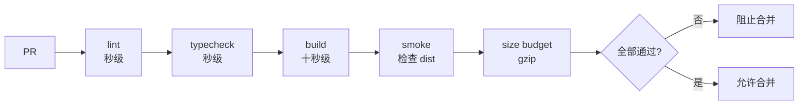

# C3 质量门禁与性能预算

> **目标层级**：L3 ｜ **前置**：C2、B2 ｜ **预计**：5h
> **本章产物**：可执行的 smoke test、体积预算脚本、一次真实的 PR 拦截

## 0. 先看终点

```powershell
PS> pnpm build
PS> pnpm test
✓ dist/index.html 存在
✓ index.html 引用了带 hash 的入口
✓ manifest 有 index.html

PS> pnpm check:size
| 指标 | 实际 | 预算 | 结果 |
|---|---:|---:|---|
| 入口 JS gzip | 64.2 KB | 250 KB | PASS |
| 总 JS gzip | 188.7 KB | 900 KB | PASS |
| 入口 CSS gzip | 8.1 KB | 30 KB | PASS |
```

然后在 PR 里制造一次超预算，CI 变红，合并被拦住；恢复后变绿。

本章不是“多跑几个命令”，而是把“什么算不合格”写死，并让平台强制执行。

## 1. 知识讲解

### 1.1 门禁的顺序



原则：

- lint/typecheck 最便宜，先跑；
- build 产出 `dist`，smoke 和 size 都依赖它；
- 任何一步失败都非 0 退出；
- 不用 `continue-on-error` 假装门禁；
- 不用“警告”代替失败。

C2 的 `Test` 在 `Build` 之前，是因为当时还没有 smoke。C3 要把它移到 `Build` 之后，因为 smoke 检查的是构建产物，不是源码。

### 1.2 “测试”到底测什么

本教程不引入大型测试框架。C3 的测试是**构建后 smoke**：

- `dist/index.html` 存在；
- HTML 引用了带 hash 的 JS；
- manifest 里有 `index.html` 入口；
- 入口文件不是 `/src/main.tsx`；
- 没有明显的空产物。

它不能证明业务逻辑正确。业务单测是另一个层次，有就加，没有不要假装有。门禁的价值在于“至少构建产物是完整可部署的”，而不是“覆盖所有分支”。

### 1.3 预算从基线来，不从愿望来

B2 已经测了基线。预算应该：

```text
预算 = 当前基线 × 1.1 ~ 1.2
```

留 10%～20% 余量，给正常功能增长；不是拍一个“200 KB 才专业”的数字。

| 指标 | 依据 | 失败意味着 |
|---|---|---|
| 入口 JS gzip | B2 manifest + size-report | 首屏传输回退 |
| 总 JS gzip | B2 全量 | 整体包体回退 |
| 入口 CSS gzip | B2 size-report | 首屏样式回退 |

预算文件要进 Git，变更要 review。不能 CI 一失败就把数字调大；那等于没有门禁。

### 1.4 为什么用 gzip，不用 raw

- raw 受注释、变量名、sourcemap 影响；
- 浏览器实际传输通常经过 gzip/brotli；
- gzip 更接近首屏成本，且 Node 标准库可直接算；
- 预算用 gzip，报告可以同时给 raw。

注意：不同 Node/zlib 版本的 gzip 字节可能有细微差异。CI 和本地都用 Node 24，预算留余量，不要卡到 1 KB。

### 1.5 入口 JS 与总 JS

```text
入口 JS = manifest['index.html'].file
        + manifest['index.html'].imports 对应的 file
总 JS   = dist 下所有 .js 的 gzip 之和
```

不要把 `dynamicImports` 算进入口。懒加载的报表页变大，不应该让首屏预算失败；但它应该被总预算或单独的 chunk 预算覆盖。

### 1.6 required check 才是门禁

本地脚本和 CI step 只是“会失败”；只有分支保护把 `CI / verify` 设为 required，失败才真正阻止合并。

检查清单：

- [ ] PR 必须通过 `CI / verify`
- [ ] 不允许直接 push main
- [ ] 不允许管理员绕过（个人项目可临时放开，但要写原因）
- [ ] 检查名和 workflow/job 一致
- [ ] 失败的 run 不会被“重新运行”掩盖代码问题

### 1.7 预算失败要可行动

差的输出：

```text
Error: size exceeded
```

好的输出：

```text
入口 JS gzip: 312.4 KB > 250.0 KB (+62.4 KB)
最大的入口文件: assets/index-xxxx.js (raw 980.1 KB, gzip 312.4 KB)
建议: 检查是否新增了静态 import 的图表/日期库；用 ANALYZE=1 看构成。
```

门禁不是给机器看的，是给下一个改动的人看的。

### 1.8 不要把所有东西都塞进 required check

- Lighthouse 分数在 CI 里噪声大，容易误伤；可以作为报告，不一定要 required；
- 网络请求、真实 LCP 需要真实环境，不适合每次 PR 卡死；
- 依赖漏洞扫描有价值，但误报多，先做报告和人工 review；
- 单元测试覆盖率阈值容易催生“为覆盖率而写”的测试，先保证关键路径。

本教程 required：lint、typecheck、build、smoke、size budget。其他先报告。

### 1.9 预算与性能预算不是一回事

| 类型 | 例子 | 特点 |
|---|---|---|
| 体积预算 | 入口 JS gzip ≤ 250 KB | 稳定、可在 CI 卡 |
| 运行时预算 | LCP ≤ 2.5s、TBT ≤ 200ms | 受机器/网络影响，实验室参考 |
| 业务预算 | 首屏请求数 ≤ 20 | 需要明确统计口径 |

C3 先卡体积；运行时指标在 B2/B6 的报告中人工对比。不要把 Lighthouse 分数当成唯一真理。

### 1.10 预算文件长什么样

`reports/size-budget.json`：

```json
{
  "entryJsGzipKb": 250,
  "totalJsGzipKb": 900,
  "entryCssGzipKb": 30
}
```

这些是示例值。你必须用 B2 的基线替换，并在报告里写清依据。直接抄会让门禁要么永远失败，要么永远不触发。

## 2. Guided 实操

### 2.1 写 smoke test

`tooling/checks/smoke.test.mjs`：

```js
import assert from 'node:assert/strict'
import { existsSync, readFileSync } from 'node:fs'
import { join } from 'node:path'
import { test } from 'node:test'

const dist = 'apps/admin/dist'

test('admin dist 存在', () => {
  assert.ok(existsSync(join(dist, 'index.html')), '缺少 dist/index.html')
})

test('index.html 引用带 hash 的入口', () => {
  const html = readFileSync(join(dist, 'index.html'), 'utf8')
  assert.match(html, /assets\/index-[^"]+\.js/)
  assert.doesNotMatch(html, /\/src\/main\.tsx/)
})

test('manifest 有 index.html 入口', () => {
  const manifest = JSON.parse(
    readFileSync(join(dist, '.vite/manifest.json'), 'utf8'),
  )
  assert.ok(manifest['index.html'], 'manifest 缺少 index.html')
  assert.ok(manifest['index.html'].file, '入口缺少 file')
})
```

运行：

```powershell
pnpm build
node --test tooling/checks/smoke.test.mjs
```

根 `package.json` 加：

```json
{
  "scripts": {
    "test": "node --test tooling/checks/smoke.test.mjs"
  }
}
```

如果你的应用不是 `@lab/admin`，改 `dist` 路径。不要同时保留一个永远不跑的 `test` 脚本。

### 2.2 写体积预算脚本

`tooling/checks/size-budget.mjs`：

```js
import { readFileSync, readdirSync, statSync } from 'node:fs'
import { join } from 'node:path'
import { gzipSync } from 'node:zlib'

const dist = process.argv[2] ?? 'apps/admin/dist'
const budget = JSON.parse(readFileSync('reports/size-budget.json', 'utf8'))
const manifest = JSON.parse(
  readFileSync(join(dist, '.vite/manifest.json'), 'utf8'),
)
const entry = manifest['index.html']

if (!entry) {
  throw new Error('manifest 缺少 index.html，确认 build.manifest=true')
}

const entryFiles = new Set([entry.file])
for (const key of entry.imports ?? []) {
  const chunk = manifest[key]
  if (chunk?.file) entryFiles.add(chunk.file)
}

const files = []
function walk(dir) {
  for (const item of readdirSync(dir, { withFileTypes: true })) {
    const full = join(dir, item.name)
    if (item.isDirectory()) walk(full)
    else if (item.isFile()) files.push(full)
  }
}
walk(dist)

const kb = (bytes) => Number((bytes / 1024).toFixed(1))
const gzipKb = (file) =>
  kb(gzipSync(readFileSync(file), { level: 9 }).length)

const js = files.filter((file) => file.endsWith('.js'))
const css = files.filter((file) => file.endsWith('.css'))

const entryJs = js
  .filter((file) => {
    const relative = file.slice(dist.length + 1).replaceAll('\\', '/')
    return entryFiles.has(relative)
  })
  .reduce((sum, file) => sum + gzipKb(file), 0)

const totalJs = js.reduce((sum, file) => sum + gzipKb(file), 0)
const entryCss = (entry.css ?? []).reduce((sum, file) => {
  const full = join(dist, file)
  return statSync(full).isFile() ? sum + gzipKb(full) : sum
}, 0)

const checks = [
  ['入口 JS gzip', entryJs, budget.entryJsGzipKb],
  ['总 JS gzip', totalJs, budget.totalJsGzipKb],
  ['入口 CSS gzip', entryCss, budget.entryCssGzipKb],
]

let failed = false
console.log('| 指标 | 实际 | 预算 | 结果 |')
console.log('|---|---:|---:|---|')
for (const [name, actual, limit] of checks) {
  const pass = actual <= limit
  if (!pass) failed = true
  console.log(`| ${name} | ${actual} KB | ${limit} KB | ${pass ? 'PASS' : 'FAIL'} |`)
}

if (failed) {
  console.error('\n体积预算失败：先看 ANALYZE=1 的构成，再决定是修代码还是调预算。')
  process.exitCode = 1
}
```

`reports/size-budget.json`：

```json
{
  "entryJsGzipKb": 250,
  "totalJsGzipKb": 900,
  "entryCssGzipKb": 30
}
```

根脚本：

```json
{
  "scripts": {
    "check:size": "node tooling/checks/size-budget.mjs apps/admin/dist"
  }
}
```

运行：

```powershell
pnpm build
pnpm check:size
```

如果 `entry.css` 的路径是相对 `dist` 的 `assets/...`，脚本能读到；如果 manifest 的 `css` 是数组，脚本会累加。

### 2.3 用基线改预算

从 B2 报告里取你的实际值，乘以 1.1～1.2，向上取整。例如：

```text
入口 JS gzip 基线 68 KB → 预算 80 KB
总 JS gzip 基线 210 KB → 预算 240 KB
入口 CSS gzip 基线 9 KB → 预算 12 KB
```

不要直接用本章示例的 250/900/30。把计算过程写进 `reports/b2-baseline.md` 或 `docs/quality-gates.md`。

### 2.4 更新 workflow 顺序

把 C2 的 `Test` 移到 `Build` 后面，并加体积检查：

```yaml
      - name: Lint
        run: pnpm lint

      - name: Typecheck
        run: pnpm typecheck

      - name: Build
        run: pnpm build

      - name: Test
        run: pnpm test

      - name: Size budget
        run: pnpm check:size

      - name: Upload dist
        uses: actions/upload-artifact@v4
        with:
          name: web-dist
          path: apps/*/dist
          if-no-files-found: error
          retention-days: 7
```

如果 `pnpm test` 里还有单元测试，它们也会在 build 后跑；可以接受。想更快就拆成 `test:unit`（build 前）和 `test:smoke`（build 后），但不要把 smoke 放回 build 前。

### 2.5 本地验证门禁

```powershell
pnpm lint
pnpm typecheck
pnpm build
pnpm test
pnpm check:size
```

预期全部通过。记录实际值，不要用本章示例值当结果。

### 2.6 制造一次真实拦截

在 `apps/admin/src/App.tsx` 顶部临时加：

```tsx
import { Chart } from '@lab/ui'

void Chart
```

这会让 `@lab/ui` 的 `Chart` 真正被使用，ECharts 重新进入入口依赖（如果 B4 已经把它 tree shake 掉）。构建：

```powershell
pnpm build
pnpm check:size
```

预期入口 JS gzip 超预算，脚本非 0 退出。如果没超，说明预算太宽或 Chart 被拆到异步 chunk；这时可以：

- 调低预算到当前基线附近，验证脚本会失败；
- 或把 Chart 改成静态 import 到入口组件，确保进入入口。

然后提交到 PR，确认：

- `CI / verify` 红；
- `Size budget` step 显示 `FAIL`；
- 合并按钮不可用。

删掉临时 import，重新构建，恢复绿色。

### 2.7 写门禁清单

`docs/quality-gates.md`：

```md
# 质量门禁

## required checks
- CI / verify
  - lint
  - typecheck
  - build
  - test（smoke）
  - size budget

## 预算
| 指标 | 基线 | 预算 | 依据 |
|---|---:|---:|---|
| 入口 JS gzip | | | B2 |
| 总 JS gzip | | | B2 |
| 入口 CSS gzip | | | B2 |

## 不设为 required
- Lighthouse 分数（噪声大，报告即可）
- 依赖漏洞扫描（先报告，人工判断）

## 变更规则
- 调高预算必须在 PR 描述里写原因和体积构成
- 不允许 `continue-on-error`
- 不允许删除失败 step 来“修复”CI
```

## 3. 排障

| 现象 | 原因 | 验证 | 修复 |
|---|---|---|---|
| `manifest` 找不到 | 没开 `build.manifest` | 看 `dist/.vite` | B2 配置 `manifest: true` |
| smoke 找不到 dist | Test 在 Build 前 | 看 step 顺序 | 移到 build 后 |
| 入口 JS 算成 0 | 路径分隔符不匹配 | 打印 `entryFiles` | 统一 `/` |
| 本地过、CI 失败 | Node/zlib 版本不同 | 看 CI Node | 统一 Node 24，留余量 |
| 预算永远 PASS | 预算太大 | 看实际值 | 用基线 ×1.1 |
| 预算永远 FAIL | 把 lazy chunk 算进入口 | 看 manifest | 只算 `file` + `imports` |
| required check 不出现 | 检查名不对 | PR Checks | 对齐 `CI / verify` |
| 预算文件没进 Git | `reports/` 被忽略 | `git status` | 加 `!reports/size-budget.json` |
| `pnpm test` 没脚本 | 根脚本缺失 | `pnpm test` | 加 `test` 脚本 |
| gzip 数值抖动 | 不同 zlib/级别 | 比较命令 | 固定 level、Node 和余量 |

### 3.1 不要用“调大预算”当修复

先看构成：

```powershell
$env:ANALYZE = '1'
pnpm --filter "@lab/admin" exec vite build
Remove-Item Env:ANALYZE
```

如果新增的是首屏不需要的图表库，应该懒加载；如果是业务真的需要，才调预算，并在 PR 里说明。

### 3.2 预算与缓存

CI 每次都是干净构建，`dist` 由 Vite 重新生成；不要从缓存恢复 `dist`，否则可能用旧产物通过预算。缓存只用于 pnpm store 和 Docker layer。

## 4. 故障演练

### 4.1 把预算改成 1 KB

临时把 `entryJsGzipKb` 改成 `1`，运行：

```powershell
pnpm check:size
```

应看到 `FAIL` 和非 0 退出码。恢复预算。这个演练证明脚本真的会失败，而不是只打印表格。

### 4.2 提交一个超预算 PR

用 2.6 的 Chart import 做一次真实 PR；确认 required check 拦住合并。然后删掉，确认恢复。

### 4.3 把 Test 放回 Build 前

临时把 `Test` 移到 `Build` 前，CI 应因找不到 `dist` 失败。恢复顺序。这个演练说明门禁步骤有依赖关系，不是随便排。

## 5. 闭卷练习

合上教程，完成：

1. 为一个 Vite 应用写 smoke test，检查入口、hash 和 manifest。
2. 写一个 gzip 体积预算脚本，区分入口和总 JS。
3. 用 B2 基线设置预算，并解释为什么留 10%～20%。
4. 在 PR 上制造一次超预算，证明 required check 会拦住。
5. 写出门禁清单，说明哪些检查不设为 required，以及原因。

验收标准：

- 失败时脚本退出码非 0；
- 输出包含实际值、预算和差额；
- 入口不把懒加载算进去；
- required check 真的阻止合并；
- 调预算有书面依据。

## 6. 验收清单

- [ ] `pnpm test` 可运行，检查 dist
- [ ] `pnpm check:size` 可运行，失败非 0
- [ ] `reports/size-budget.json` 已提交
- [ ] 预算来自 B2 基线，不是抄示例
- [ ] workflow 顺序为 lint → typecheck → build → test → size
- [ ] `CI / verify` 是 required check
- [ ] 做过一次真实的超预算拦截
- [ ] `docs/quality-gates.md` 已提交

## 7. 自测

**Q1：为什么 smoke test 要放在 build 后？**

<details>
<summary>答案</summary>

它检查的是 `dist` 里的构建产物；build 之前没有这些文件。
</details>

**Q2：入口 JS 和总 JS 为什么要分开？**

<details>
<summary>答案</summary>

入口 JS 影响首屏；总 JS 包含懒加载 chunk。混在一起会让报表页变大误伤首屏预算，也会掩盖首屏回退。
</details>

**Q3：预算为什么不能拍一个固定数字？**

<details>
<summary>答案</summary>

不同项目基线不同；预算应基于同机基线并留合理余量。拍数字会导致永远失败或永远不触发。
</details>

**Q4：required check 和 CI step 的区别？**

<details>
<summary>答案</summary>

CI step 会失败，但只有分支保护把检查设为 required，失败才真正阻止合并。
</details>

**Q5：为什么不用 Lighthouse 分数做唯一门禁？**

<details>
<summary>答案</summary>

分数受机器、网络、版本和权重影响，噪声大；体积预算稳定可复现，运行时指标更适合报告和人工对比。
</details>

## 8. 延伸

- `size-limit` / `@size-limit/file`
- GitHub Rulesets 的 bypass 列表
- bundlemon、bundlewatch 的 PR 评论
- 下一章：把 `dist` 做成可部署的镜像，推到 GHCR
