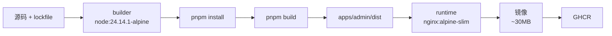

# C4 容器化

> **目标层级**：L3 ｜ **前置**：C3、B5 ｜ **预计**：6h
> **本章产物**：多阶段 Dockerfile、nginx 配置、`linux/amd64` 镜像、GHCR 上的 sha tag

## 0. 先看终点

```powershell
PS> docker build --platform linux/amd64 `
  --build-arg GIT_SHA=local `
  -t fe-lab-admin:local .
...
PS> docker images fe-lab-admin
REPOSITORY       TAG     IMAGE ID       CREATED         SIZE
fe-lab-admin     local   xxxx           10 seconds ago  ~30MB

PS> docker run --rm -p 8088:8080 fe-lab-admin:local
PS> curl.exe -i http://localhost:8088/healthz
HTTP/1.1 200 OK
ok
PS> curl.exe http://localhost:8088/version.json
{"sha":"local","builtAt":"..."}
```

本章只做静态站点容器：Node 构建 → Nginx 运行。不做数据库、不做后端、不做 Kubernetes。目标是把 `dist` 变成一个可拉取、可健康检查、可缓存的镜像。

## 1. 知识讲解

### 1.1 多阶段构建



两个阶段：

| 阶段 | 基础镜像 | 作用 | 最终是否保留 |
|---|---|---|---|
| builder | `node:24.14.1-alpine` | 装依赖、跑 `tsc`、Vite 构建 | 否 |
| runtime | `nginx:1.27-alpine-slim` | 提供静态文件、gzip、缓存头 | 是 |

单阶段 Dockerfile 会把 Node、pnpm、源码、`node_modules` 全带进最终镜像，轻松超过 1GB。多阶段只把 `dist` 和 Nginx 配置复制到运行镜像。

### 1.2 层缓存的关键顺序

Docker 层缓存按指令顺序失效。正确顺序：

```text
1. 复制 lockfile 和所有 workspace 的 package.json
2. pnpm install --frozen-lockfile
3. 复制源码
4. pnpm build
```

这样改业务代码时，第 2 步命中缓存，不重新装依赖；改 lockfile 时，第 2 步才失效。

错误顺序：

```dockerfile
COPY . .
RUN pnpm install
RUN pnpm build
```

任何源码改动都会让 install 层失效，CI 每次都全量安装。

### 1.3 为什么列出所有 workspace 的 package.json

pnpm 的 lockfile 按 importer 记录每个 workspace 包。构建镜像时只复制部分 `package.json`，`--frozen-lockfile` 可能报“lockfile 与 workspace 不一致”，或者 workspace 包缺失导致 filter 失败。

本仓库至少有：

```text
package.json
apps/admin/package.json
apps/h5/package.json
packages/ui/package.json
packages/utils/package.json
packages/config-ts/package.json
packages/config-eslint/package.json
```

如果后来又加了包，Dockerfile 也要补。漏一个的症状通常是 CI 本地能过、Docker 构建失败。

### 1.4 构建期变量和运行期变量

这是静态站点最容易错的地方。

**构建期**：Vite 在 `vite build` 时把 `import.meta.env.VITE_*` 替换成字符串。

```ts
const apiBase = import.meta.env.VITE_API_BASE
```

构建完成后，JS 里已经是字面量。此时再：

```powershell
docker run -e VITE_API_BASE=https://new.example.com ...
```

**不会生效**。容器运行时环境变量不会改写已经打包的 JS。

**运行期**：需要页面启动后去读的配置，例如：

```js
window.__APP_CONFIG__ = { apiBase: '/api' }
```

这个文件可以在容器启动时用 `envsubst` 生成，或者干脆使用相对路径 `/api`，由 Nginx/网关代理。不要为了“灵活”把 secret 塞进前端配置；前端没有秘密。

本教程的 admin 没有真实后端，使用：

```text
VITE_API_BASE=/api   # 构建期，默认值
```

如果以后要区分环境，正确做法是**每个环境构建一次镜像**，或者做运行期 `config.js`。不要假装 runtime env 能改 Vite 常量。

### 1.5 Nginx 缓存头

| 路径 | 头 | 原因 |
|---|---|---|
| `/assets/*` | `Cache-Control: public, max-age=31536000, immutable` | 文件名带 hash，内容变则 URL 变 |
| `/index.html` | `Cache-Control: no-cache` | 必须拿新 HTML，才能引用新 hash |
| `/version.json` | `Cache-Control: no-cache` | 部署校验要拿当前版本 |
| `/healthz` | 不缓存 | 健康检查 |
| `*.map` | `deny all` | 不公开源码 |

第 2 章预埋的坑就是：把 `index.html` 设成一年缓存。用户会一直拿旧 HTML，引用旧 hash 文件；即使新镜像已经部署，也看不到新页面。

### 1.6 健康检查端口

容器内 Nginx 监听 `8080`，QNAP 映射 `8088:8080`。健康检查必须探容器内端口：

```dockerfile
HEALTHCHECK CMD wget -qO- http://127.0.0.1:8080/healthz || exit 1
```

如果你写成 `80`，健康检查永远失败；如果写成宿主机的 `8088`，在容器内部也不一定通。健康检查是容器内部视角。

### 1.7 架构：`linux/amd64`

本教程的 QNAP 是 x86_64。CI 在 `ubuntu-latest` 上默认构建 `linux/amd64`，但显式写出来更安全：

```yaml
platforms: linux/amd64
```

如果构建的是 `linux/arm64`，在 x86 NAS 上启动会报：

```text
exec format error
```

检查：

```powershell
docker image inspect fe-lab-admin:local --format "{{.Os}}/{{.Architecture}}"
```

预期 `linux/amd64`。

### 1.8 GHCR 推送

GitHub Actions 用 `GITHUB_TOKEN` 登录 GHCR：

```yaml
permissions:
  contents: read
  packages: write
```

镜像名必须小写。仓库名可能有大写，所以先转小写：

```bash
echo "name=ghcr.io/${GITHUB_REPOSITORY_OWNER,,}/fe-lab-admin" >> "$GITHUB_OUTPUT"
```

`${VAR,,}` 是 bash 的小写展开，GitHub 的 `run` 默认用 bash，可用。

tag：

```text
ghcr.io/<owner>/fe-lab-admin:<full-sha>
ghcr.io/<owner>/fe-lab-admin:latest
```

`latest` 只是别名；部署只用 sha。

### 1.9 `.dockerignore`

至少排除：

```text
.git
.github
node_modules
**/node_modules
**/dist
reports
docs
.tmp
.env
.env.*
```

不排除的后果：

- 构建上下文巨大，上传慢；
- 本地 `node_modules` 覆盖容器内安装；
- `.env` 或测试文件进入镜像；
- `dist` 旧产物被复制，干扰构建。

### 1.10 镜像大小不是唯一指标

`~30MB` 是目标，不是信仰。更重要的是：

- 最终镜像不含 Node、源码、`node_modules`；
- 有健康检查；
- 缓存头正确；
- 架构正确；
- 能用 sha 回滚。

如果镜像 35MB 但可维护，比 25MB 但把源码和 secret 带进去更好。

## 2. Guided 实操

### 2.1 写 Nginx 配置

`deploy/nginx/nginx.conf`：

```nginx
server {
  listen 8080;
  server_name _;

  root /usr/share/nginx/html;
  index index.html;

  gzip on;
  gzip_comp_level 6;
  gzip_min_length 1024;
  gzip_vary on;
  gzip_types
    text/plain
    text/css
    application/javascript
    application/json
    image/svg+xml;

  location = /healthz {
    access_log off;
    add_header Content-Type text/plain;
    return 200 "ok\n";
  }

  location = /version.json {
    add_header Cache-Control "no-cache";
    try_files $uri =404;
  }

  location /assets/ {
    add_header Cache-Control "public, max-age=31536000, immutable";
    try_files $uri =404;
  }

  location = /index.html {
    add_header Cache-Control "no-cache";
  }

  location / {
    try_files $uri $uri/ /index.html;
  }

  location ~* \.map$ {
    deny all;
  }
}
```

要点：

- `location /assets/` 用 `try_files $uri =404`，避免缺失的 JS 被 SPA fallback 成 HTML；
- `location /` 才回退到 `index.html`；
- `version.json` 和 `index.html` 都不缓存；
- `.map` 拒绝访问。

### 2.2 写 Dockerfile

`Dockerfile`：

```dockerfile
# syntax=docker/dockerfile:1.7

FROM node:24.14.1-alpine AS build
WORKDIR /app

RUN npm install -g pnpm@12.15.0

COPY pnpm-lock.yaml pnpm-workspace.yaml package.json ./
COPY apps/admin/package.json apps/admin/package.json
COPY apps/h5/package.json apps/h5/package.json
COPY packages/ui/package.json packages/ui/package.json
COPY packages/utils/package.json packages/utils/package.json
COPY packages/config-ts/package.json packages/config-ts/package.json
COPY packages/config-eslint/package.json packages/config-eslint/package.json

RUN pnpm install --frozen-lockfile

COPY . .

ARG GIT_SHA=dev
ARG VITE_API_BASE=/api
ENV GIT_SHA=$GIT_SHA
ENV VITE_API_BASE=$VITE_API_BASE

RUN pnpm --filter "@lab/admin" build
RUN printf '{"sha":"%s","builtAt":"%s"}\n' \
  "$GIT_SHA" "$(date -u +%Y-%m-%dT%H:%M:%SZ)" \
  > apps/admin/dist/version.json

FROM nginx:1.27-alpine-slim

COPY deploy/nginx/nginx.conf /etc/nginx/conf.d/default.conf
COPY --from=build /app/apps/admin/dist /usr/share/nginx/html

EXPOSE 8080

HEALTHCHECK --interval=10s --timeout=3s --retries=6 \
  CMD wget -qO- http://127.0.0.1:8080/healthz || exit 1
```

说明：

- `npm install -g pnpm@12.15.0`：镜像里显式固定 pnpm 版本，避免 corepack 版本差异；
- 先复制 lockfile 和 package.json，再 install，保留层缓存；
- `COPY . .` 时必须配合 `.dockerignore`；
- `ARG GIT_SHA` 传入 commit sha；`version.json` 在 build 后写入；
- `VITE_API_BASE` 是构建期变量，不是运行期；
- 最终镜像只保留 `dist` 和 Nginx 配置。

### 2.3 写 `.dockerignore`

```text
.git
.github
node_modules
**/node_modules
**/dist
reports
docs
.tmp
.env
.env.*
*.log
```

不要忽略 `pnpm-lock.yaml`、`pnpm-workspace.yaml`、`deploy/nginx/nginx.conf`。

如果项目使用私有 npm registry，需要在 `pnpm install` 之前复制 `.npmrc`；token 只放在构建机的 secret 里，不要留在最终镜像。默认的公开 npm 源不需要这一步。

### 2.4 本地构建和运行

```powershell
docker build --platform linux/amd64 `
  --build-arg GIT_SHA=local `
  --build-arg VITE_API_BASE=/api `
  -t fe-lab-admin:local .
```

构建日志里应看到：

- install 命中缓存（第二次开始）；
- `tsc -b` 和 `vite build` 成功；
- 最终镜像导出。

运行：

```powershell
docker run --rm -d --name fe-lab-admin-test -p 8088:8080 fe-lab-admin:local
```

检查：

```powershell
curl.exe -i http://localhost:8088/healthz
curl.exe http://localhost:8088/version.json
curl.exe -I http://localhost:8088/
docker ps --filter name=fe-lab-admin-test
```

预期：

- `/healthz` 返回 200 和 `ok`；
- `/version.json` 的 `sha` 是 `local`；
- 首页返回 HTML；
- 容器状态是 `healthy`（等 10 秒左右）。

停止：

```powershell
docker stop fe-lab-admin-test
```

### 2.5 检查镜像大小和架构

```powershell
docker images fe-lab-admin
docker image inspect fe-lab-admin:local --format "{{.Os}}/{{.Architecture}}"
docker history fe-lab-admin:local
```

预期：

- 大小在几十 MB 级，不应是 1GB；
- 架构 `linux/amd64`；
- `docker history` 里没有 `node_modules`、源码目录的大层。

如果超过 100MB，检查：

- 最终阶段是不是用了 `node` 镜像；
- 是否 `COPY . .` 到了最终阶段；
- 是否把 `node_modules` 复制进去；
- 是否安装了不必要的调试工具。

### 2.6 验证缓存头

先拿到一个 assets 文件：

```powershell
$asset = (Get-ChildItem apps/admin/dist/assets -Filter *.js | Select-Object -First 1).Name
curl.exe -I "http://localhost:8088/assets/$asset"
curl.exe -I http://localhost:8088/index.html
```

预期：

```http
# assets
Cache-Control: public, max-age=31536000, immutable

# index.html
Cache-Control: no-cache
```

如果 `index.html` 也是长缓存，发版后用户会看到旧页面。这是必须修的红线。

### 2.7 验证构建期变量

先看当前镜像里烘焙的值：

```powershell
docker run --rm --entrypoint sh fe-lab-admin:local -c `
  "grep -R 'VITE_API_BASE' /usr/share/nginx/html/assets || true"
```

再启动一个带 runtime env 的容器：

```powershell
docker run --rm -d --name fe-lab-env-test -p 8089:8080 `
  -e VITE_API_BASE=https://runtime.example.com fe-lab-admin:local
```

打开 `http://localhost:8089/`，或在 assets 里搜索 `runtime.example.com`：**不会出现**。因为 `VITE_API_BASE` 在构建时已经写死。停掉容器。

如果要改 API base：

```powershell
docker build --platform linux/amd64 `
  --build-arg VITE_API_BASE=https://build.example.com `
  -t fe-lab-admin:build-arg .
```

重新构建后才会生效。这个演练是 C4 的核心概念之一。

### 2.8 加 publish job

在 `.github/workflows/ci.yml` 末尾加：

```yaml
  publish:
    name: publish
    if: github.event_name == 'push' && github.ref == 'refs/heads/main'
    needs: verify
    runs-on: ubuntu-latest
    timeout-minutes: 20
    permissions:
      contents: read
      packages: write

    steps:
      - name: Checkout
        uses: actions/checkout@v4

      - name: Prepare image name
        id: image
        run: echo "name=ghcr.io/${GITHUB_REPOSITORY_OWNER,,}/fe-lab-admin" >> "$GITHUB_OUTPUT"

      - name: Setup Buildx
        uses: docker/setup-buildx-action@v3

      - name: Login GHCR
        uses: docker/login-action@v3
        with:
          registry: ghcr.io
          username: ${{ github.actor }}
          password: ${{ secrets.GITHUB_TOKEN }}

      - name: Build and push
        uses: docker/build-push-action@v6
        with:
          context: .
          platforms: linux/amd64
          push: true
          tags: |
            ${{ steps.image.outputs.name }}:${{ github.sha }}
            ${{ steps.image.outputs.name }}:latest
          build-args: |
            GIT_SHA=${{ github.sha }}
            VITE_API_BASE=/api
          cache-from: type=gha
          cache-to: type=gha,mode=max
          provenance: true
          sbom: true
```

说明：

- `if` 确保 PR 不发布；
- `needs: verify` 确保检查通过才构建；
- `packages: write` 只给 publish job；
- `platforms: linux/amd64` 对应 QNAP；
- 两个 tag：完整 sha 和 latest；
- `cache-from/to` 用 GitHub Actions 缓存加速 Docker layer；
- `provenance` / `sbom` 生成供应链信息，C6 会讲。

合并到 main 后，在 Actions 日志里找到镜像名，在 GitHub 个人/组织 Packages 页面确认两个 tag。

### 2.9 从 GHCR 拉取验证

在本地登录：

```powershell
docker login ghcr.io -u <your-github-user>
docker pull ghcr.io/<owner>/fe-lab-admin:<sha>
```

如果包是私有的，PAT 至少要有 `read:packages`。不要在命令历史里留下 PAT；用 `docker login` 交互输入，或从安全存储读取。

## 3. 排障

| 现象 | 原因 | 验证 | 修复 |
|---|---|---|---|
| 镜像 1GB+ | 单阶段/把 node_modules 带进去 | `docker history` | 多阶段，只复制 dist |
| install 每次全量 | `COPY . .` 在 install 前 | 看 build 日志 | 先复制 lockfile/package.json |
| `ERR_PNPM_OUTDATED_LOCKFILE` | 漏复制 workspace package.json | 对比目录 | 补 COPY |
| `exec format error` | 架构不是 amd64 | `docker image inspect` | `--platform linux/amd64` |
| 健康检查一直 unhealthy | 探 80 端口/路径错 | `docker inspect` | 改 8080 和 `/healthz` |
| `index.html` 旧缓存 | Nginx 缓存头错 | `curl -I` | `no-cache` |
| assets 404 返回 HTML | SPA fallback 吞了资源 | 请求缺失 JS | assets 用 `try_files $uri =404` |
| 改 runtime env 不生效 | Vite 变量是构建期 | 搜索产物 | 重建或做 runtime config |
| GHCR 403 | 权限/包可见性 | Actions 日志 | `packages: write`，检查包设置 |
| 镜像名 invalid | 含大写 | 日志 | 转小写 |
| `latest` 被覆盖后无法回滚 | 只用 latest | `docker images` | 保留 sha tag |
| 构建上下文巨大 | `.dockerignore` 缺失 | build 输出 | 排除 node_modules/.git |

### 3.1 先看最终阶段

```powershell
docker history --no-trunc fe-lab-admin:local
```

如果看到 `COPY . .` 在最终阶段，或者 `node_modules` 很大，说明多阶段没写对。最终阶段只应该有：

- Nginx 基础层；
- `nginx.conf`；
- `dist`。

### 3.2 健康检查失败

```powershell
docker inspect --format "{{json .State.Health}}" fe-lab-admin-test
docker logs fe-lab-admin-test
docker exec fe-lab-admin-test wget -qO- http://127.0.0.1:8080/healthz
```

如果容器内 `wget` 不存在，换 `curl` 或安装对应工具；不要用宿主机端口做容器内健康检查。

## 4. 故障演练

### 4.1 做一次单阶段对比

临时写一个 `Dockerfile.single`：

```dockerfile
FROM node:24.14.1-alpine
WORKDIR /app
COPY . .
RUN npm install -g pnpm@12.15.0 && pnpm install --frozen-lockfile && pnpm --filter "@lab/admin" build
EXPOSE 8080
CMD ["node", "-e", "setInterval(()=>{}, 1000)"]
```

构建并比较大小：

```powershell
docker build -f Dockerfile.single -t fe-lab-admin:single .
docker images fe-lab-admin
```

预期单阶段大很多。看完删除 `Dockerfile.single`，不要提交。

### 4.2 把 index.html 设成长缓存

临时把 `location = /index.html` 的 `Cache-Control` 改成 `public, max-age=31536000`，重建、运行、`curl -I` 看头。然后恢复 `no-cache`。

这个演练说明：缓存头不是“优化项”，配错就是发版事故。

### 4.3 用错架构

如果本机是 ARM，构建时不写 `--platform`，可能得到 `linux/arm64`。在 x86 NAS 上运行会 `exec format error`。用 `docker image inspect` 检查并修正。

## 5. 闭卷练习

合上教程，完成：

1. 写一个多阶段 Dockerfile，最终镜像只含 Nginx 和 `dist`。
2. 配置 `/healthz`、`/version.json`、assets 长缓存、HTML no-cache。
3. 本地构建 `linux/amd64` 镜像，运行并通过健康检查。
4. 证明 runtime 的 `VITE_API_BASE` 不生效，build arg 生效。
5. 在 main 上推送镜像到 GHCR，确认 sha 和 latest 两个 tag。

验收标准：

- 镜像大小远小于单阶段；
- `docker image inspect` 架构为 `linux/amd64`；
- `/healthz` 200；
- `/version.json` 的 sha 等于构建参数；
- assets 和 HTML 的缓存头不同；
- PR 不推镜像。

## 6. 验收清单

- [ ] `Dockerfile` 是多阶段
- [ ] 最终镜像不含源码和 `node_modules`
- [ ] `.dockerignore` 已提交
- [ ] `nginx.conf` 有 healthz、version、缓存头、SPA fallback、map deny
- [ ] 健康检查探容器内 8080
- [ ] 镜像架构是 `linux/amd64`
- [ ] GHCR 有完整 sha tag 和 latest
- [ ] 构建期/运行期变量区别已记录
- [ ] 本地 `docker run` 通过

## 7. 自测

**Q1：为什么多阶段镜像更小？**

<details>
<summary>答案</summary>

最终阶段只复制 `dist` 和 Nginx 配置，不包含 Node、pnpm、源码、`node_modules` 和构建缓存。
</details>

**Q2：为什么 `COPY . .` 要放在 `pnpm install` 之后？**

<details>
<summary>答案</summary>

为了让依赖安装层只受 lockfile/package.json 影响；源码改动不会让 install 层失效，从而复用缓存。
</details>

**Q3：`docker run -e VITE_API_BASE=...` 为什么无效？**

<details>
<summary>答案</summary>

Vite 在构建时已经把 `import.meta.env.VITE_API_BASE` 替换成字面量；运行期环境变量不会改写已打包的 JS。
</details>

**Q4：为什么 `index.html` 不能长缓存？**

<details>
<summary>答案</summary>

它引用带 hash 的资源；长缓存会让用户一直拿旧 HTML，引用旧文件，看不到新版本。
</details>

**Q5：为什么镜像要显式 `linux/amd64`？**

<details>
<summary>答案</summary>

QNAP 是 x86_64；构建成 arm64 会在 NAS 上 `exec format error`。
</details>

## 8. 延伸

- Docker BuildKit cache mount
- `nginxinc/nginx-unprivileged` 非 root 运行
- `docker buildx imagetools inspect`
- 下一章：在 QNAP 上拉取、部署、健康校验和回滚
