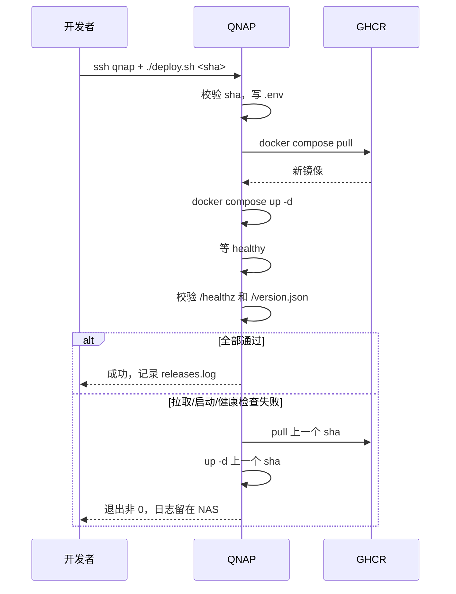

# C5 部署与回滚

> **目标层级**：L2 ｜ **前置**：C4、QNAP 环境 ｜ **预计**：6h
> **本章产物**：NAS 上的 `compose.yaml` + `deploy.sh`，完成一次部署和一次回滚

## 0. 先看终点

在 QNAP 上：

```text
[/share/Container/fe-lab-admin] # ./deploy.sh 3f2a1c9...
==> pull ghcr.io/owner/fe-lab-admin:3f2a1c9...
==> up -d
==> waiting for healthy...
==> healthz ok
==> version.json sha = 3f2a1c9...
==> deployed 3f2a1c9...
```

浏览器打开 `http://<NAS-IP>:8088/`，能看到新版本；`/version.json` 的 sha 和部署目标一致。

然后：

```text
[/share/Container/fe-lab-admin] # ./deploy.sh --rollback
==> rollback to 8b1d0e4...
==> up -d
==> rolled back to 8b1d0e4...
```

再访问 `/version.json`，sha 回到上一版。

本章的重点不是“把容器跑起来”，而是**失败时线上不空白，版本可追溯，回滚一条命令**。

## 1. 知识讲解

### 1.1 部署时序



四个原则：

1. **先 pull 再 up**：不要在拉取新镜像前停旧容器；
2. **只认 sha**：不用 `latest`，不用日期，不用 `v1`；
3. **健康检查 + 版本校验**：容器 `healthy` 还不够，`version.json` 必须匹配；
4. **失败自动回滚**：不能只打印错误然后等人处理。

### 1.2 QNAP 环境

本教程的基线：

| 项 | 值 |
|---|---|
| QTS | 5.2.10.3577 |
| Container Station | 3.1.2.1742 |
| CPU 架构 | x86_64 |
| SSH 端口 | 33456（仅局域网） |
| 部署端口 | 8088 |
| Compose | Docker Compose V2（`docker compose`） |

SSH 别名 `~/.ssh/config`：

```sshconfig
Host qnap
  HostName 192.168.1.50
  Port 33456
  User admin
  IdentityFile ~/.ssh/id_ed25519
```

先验证：

```powershell
ssh qnap "uname -m; docker --version; docker compose version"
```

预期：

```text
x86_64
Docker version 2x.x.x
Docker Compose version v2.x.x
```

如果 `docker compose` 不存在，先用 Container Station 3 的 CLI 环境；不要退回 `docker-compose`（带连字符），它在这套环境里通常找不到。

### 1.3 GHCR 认证

私有镜像需要登录：

```powershell
ssh qnap
docker login ghcr.io -u <github-user>
# 密码处粘贴 PAT，不要粘贴 GitHub 登录密码
```

PAT 只需要：

```text
read:packages
```

不要给 `write:packages`，更不要把 PAT 写进 `deploy.sh` 或 `.env`。登录信息保存在 QNAP 用户的 `~/.docker/config.json`，权限应是 600。

如果 `docker pull` 报 `denied`：

- PAT 没有 `read:packages`；
- PAT 过期；
- 包是私有的，但当前账号没有访问权限；
- 镜像名大小写不对；
- 组织开启了 SSO，PAT 未授权。

### 1.4 为什么不用 `docker-compose`，也不在 UI 里拉

Container Station 3 的 UI 对私有 GHCR 拉取可能超时或没有清晰的错误；命令行能直接看到认证和网络错误。Compose V2 的命令是：

```text
docker compose ...
```

不是：

```text
docker-compose ...
```

本教程统一用 V2。脚本里也只调用 `docker compose`，不写兼容分支；环境不对就早失败。

### 1.5 Compose 参数化

`compose.yaml`：

```yaml
services:
  admin:
    image: "${IMAGE_NAME:?IMAGE_NAME is required}:${IMAGE_TAG:?IMAGE_TAG is required}"
    container_name: fe-lab-admin
    ports:
      - "${HOST_PORT:-8088}:8080"
    restart: unless-stopped
    healthcheck:
      test:
        - CMD-SHELL
        - "wget -qO- http://127.0.0.1:8080/healthz || exit 1"
      interval: 10s
      timeout: 3s
      retries: 6
      start_period: 10s
```

`.env`：

```dotenv
IMAGE_NAME=ghcr.io/owner/fe-lab-admin
IMAGE_TAG=3f2a1c9...
HOST_PORT=8088
```

`${IMAGE_TAG:?...}` 表示变量为空时 Compose 直接报错，不会悄悄用空 tag 去拉镜像。

### 1.6 先 pull，再 up

正确顺序：

```bash
docker compose pull
docker compose up -d
```

`pull` 失败时，旧容器还在跑，线上不受影响；`up -d` 才会重建容器。

错误顺序：

```bash
docker compose down
docker compose pull
docker compose up -d
```

`down` 之后到新容器起来之前，线上是空白的；新镜像拉不下来时，连旧版本都没了。

### 1.7 健康检查与版本校验

容器 `healthy` 只说明容器内的 `/healthz` 通了；还要确认**运行的是目标 sha**：

```bash
curl -fsS http://127.0.0.1:8088/healthz
curl -fsS http://127.0.0.1:8088/version.json
```

如果只检查 `/healthz`，可能出现：

- 新容器没起来，旧容器还在，健康检查仍然 200；
- 镜像 tag 写错，跑的是旧版本；
- 部署脚本“成功”，但用户看到的还是旧页面。

所以部署脚本要同时校验：

```text
HTTP 200
且 version.json.sha == 目标 sha
```

### 1.8 回滚策略

| 失败点 | 行为 |
|---|---|
| `docker compose pull` 失败 | 恢复 `.env` 到上一个 tag，旧容器不动 |
| `up -d` 失败 | 回滚到上一个 tag |
| 容器 `unhealthy` | 回滚到上一个 tag |
| `/healthz` 失败 | 回滚到上一个 tag |
| `version.json` 不匹配 | 回滚到上一个 tag |

回滚也需要 pull 上一个镜像；如果 GHCR 里旧 tag 被删了，回滚会失败。所以：

- 不要只保留 `latest`；
- 不要自动清理还在保留期内的 sha tag；
- 回滚失败要留下明确日志，人工介入。

### 1.9 发布记录

每次部署追加一行：

```text
2026-10-23T10:00:00Z deploy 3f2a1c9... ok
2026-10-23T10:10:00Z deploy 8b1d0e4... failed
2026-10-23T10:10:30Z rollback 8b1d0e4... ok
```

`releases.log` 不替代 Git 历史，但能在 NAS 上快速回答“上一版是什么、什么时候部署的”。

### 1.10 首次部署没有上一版

第一次部署时 `.previous_tag` 为空，失败无法自动回滚。这是正常的：

- 首次部署前先在本地/测试端口验证镜像；
- 首次失败就修镜像，不要指望自动恢复；
- 脚本要明确打印“没有可回滚版本”，而不是假装回滚成功。

## 2. Guided 实操

### 2.1 建 NAS 目录

```powershell
ssh qnap "mkdir -p /share/Container/fe-lab-admin"
```

把仓库里的 `deploy/qnap/compose.yaml` 和 `deploy/qnap/deploy.sh` 传上去：

```powershell
scp deploy/qnap/compose.yaml deploy/qnap/deploy.sh qnap:/share/Container/fe-lab-admin/
ssh qnap "chmod +x /share/Container/fe-lab-admin/deploy.sh"
```

### 2.2 写 `.env`

在 NAS 上：

```bash
cd /share/Container/fe-lab-admin
cat > .env <<'EOF'
IMAGE_NAME=ghcr.io/owner/fe-lab-admin
IMAGE_TAG=
HOST_PORT=8088
EOF
chmod 600 .env
```

`IMAGE_TAG` 先留空；部署脚本会写入目标 sha。

### 2.3 登录 GHCR

```bash
docker login ghcr.io -u <github-user>
```

输入 PAT（`read:packages`）。验证：

```bash
docker pull ghcr.io/owner/fe-lab-admin:<sha>
```

如果这一步失败，先修认证，不要继续写部署脚本。

### 2.4 写 `deploy.sh`

`deploy/qnap/deploy.sh`：

```sh
#!/bin/sh
set -eu

cd "$(dirname "$0")"

if [ -f .env ]; then
  set -a
  . ./.env
  set +a
fi

IMAGE_NAME="${IMAGE_NAME:-ghcr.io/owner/fe-lab-admin}"
HOST_PORT="${HOST_PORT:-8088}"
HEALTH_PATH="${HEALTH_PATH:-/healthz}"
BASE_URL="http://127.0.0.1:${HOST_PORT}"
CURRENT_TAG="${IMAGE_TAG:-}"
TARGET_TAG="${1:-}"
PREVIOUS_TAG="$CURRENT_TAG"

if [ "$TARGET_TAG" = "--rollback" ]; then
  TARGET_TAG="$(cat .previous_tag 2>/dev/null || true)"
  PREVIOUS_TAG=""
fi

if [ -z "$TARGET_TAG" ]; then
  echo "用法: ./deploy.sh <40位sha> | ./deploy.sh --rollback" >&2
  exit 2
fi

case "$TARGET_TAG" in
  *[!0-9a-f]*)
    echo "非法 sha: $TARGET_TAG（只接受 40 位小写十六进制）" >&2
    exit 2
    ;;
esac

if [ "${#TARGET_TAG}" -ne 40 ]; then
  echo "非法 sha: $TARGET_TAG（只接受 40 位小写十六进制）" >&2
  exit 2
fi

compose() {
  docker compose -f compose.yaml "$@"
}

http_get() {
  if command -v curl >/dev/null 2>&1; then
    curl -fsS "$1"
  else
    wget -qO- "$1"
  fi
}

write_env() {
  umask 077
  cat > .env.tmp <<EOF
IMAGE_NAME=$IMAGE_NAME
IMAGE_TAG=$1
HOST_PORT=$HOST_PORT
EOF
  mv .env.tmp .env
  IMAGE_TAG="$1"
}

wait_healthy() {
  i=0
  while [ "$i" -lt 30 ]; do
    status="$(docker inspect --format '{{if .State.Health}}{{.State.Health.Status}}{{else}}{{.State.Status}}{{end}}' fe-lab-admin 2>/dev/null || true)"
    if [ "$status" = "healthy" ]; then
      return 0
    fi
    if [ "$status" = "unhealthy" ]; then
      return 1
    fi
    i=$((i + 1))
    sleep 2
  done
  return 1
}

check_version() {
  expected="$1"
  version="$(http_get "$BASE_URL/version.json" 2>/dev/null || true)"
  sha="$(printf '%s' "$version" | sed -n 's/.*"sha"[[:space:]]*:[[:space:]]*"\([^"]*\)".*/\1/p')"
  if [ "$sha" != "$expected" ]; then
    echo "版本不匹配: 期望 $expected，实际 $sha" >&2
    return 1
  fi
}

verify() {
  http_get "$BASE_URL$HEALTH_PATH" >/dev/null 2>&1 || return 1
  check_version "$TARGET_TAG"
}

rollback() {
  echo "部署失败，开始回滚..." >&2
  compose logs --tail=100 admin >&2 || true
  if [ -z "$PREVIOUS_TAG" ]; then
    echo "没有可回滚版本，需要人工处理" >&2
    printf '%s deploy %s failed\n' "$(date -u +%Y-%m-%dT%H:%M:%SZ)" "$TARGET_TAG" >> releases.log
    exit 1
  fi
  echo "回滚到 $PREVIOUS_TAG" >&2
  write_env "$PREVIOUS_TAG"
  compose pull || true
  compose up -d || true
  if wait_healthy && check_version "$PREVIOUS_TAG"; then
    printf '%s rollback %s ok\n' "$(date -u +%Y-%m-%dT%H:%M:%SZ)" "$PREVIOUS_TAG" >> releases.log
    echo "已回滚到 $PREVIOUS_TAG" >&2
  else
    printf '%s rollback %s failed\n' "$(date -u +%Y-%m-%dT%H:%M:%SZ)" "$PREVIOUS_TAG" >> releases.log
    echo "回滚后健康/版本校验失败，需要人工处理" >&2
  fi
  exit 1
}

write_env "$TARGET_TAG"

if ! compose config >/dev/null; then
  echo "compose 配置校验失败" >&2
  if [ -n "$PREVIOUS_TAG" ]; then write_env "$PREVIOUS_TAG"; fi
  exit 1
fi

if ! compose pull; then
  echo "拉取镜像失败，旧容器保持不变" >&2
  if [ -n "$PREVIOUS_TAG" ]; then write_env "$PREVIOUS_TAG"; fi
  exit 1
fi

if ! compose up -d; then
  rollback
fi

if ! wait_healthy; then
  rollback
fi

if ! verify; then
  rollback
fi

if [ -n "$CURRENT_TAG" ]; then
  printf '%s\n' "$CURRENT_TAG" > .previous_tag
fi

printf '%s deploy %s ok\n' "$(date -u +%Y-%m-%dT%H:%M:%SZ)" "$TARGET_TAG" >> releases.log || true
echo "部署成功: $TARGET_TAG"
```

说明：

- 用 `#!/bin/sh`，避免 QNAP 没有 bash；
- 只接受 40 位小写 sha，防止误传 `latest`；
- `compose config` 先校验变量；
- `pull` 失败不动旧容器；
- `up`、健康检查、版本校验任一失败都回滚；
- `.env` 用临时文件原子替换，权限 600；`write_env` 同时更新当前 shell 的 `IMAGE_TAG`，否则 Compose 会优先读环境变量，仍然使用旧 tag；
- 回滚失败也会留日志并退出非 0。

### 2.5 首次部署

在 NAS 上：

```bash
cd /share/Container/fe-lab-admin
./deploy.sh <40位sha>
```

预期：

```text
==> pull ...
==> up -d
==> 部署成功: <sha>
```

检查：

```bash
docker compose ps
curl -i http://127.0.0.1:8088/healthz
curl -s http://127.0.0.1:8088/version.json
docker inspect --format '{{.State.Health.Status}}' fe-lab-admin
```

浏览器打开：

```text
http://<NAS-IP>:8088/
```

如果 8088 被占用：

```bash
netstat -tlnp | grep 8088
```

改 `.env` 的 `HOST_PORT`，再部署；不要改容器内的 8080。

### 2.6 部署第二版并回滚

先记下第一版 sha：

```bash
cat .previous_tag
```

部署第二版：

```bash
./deploy.sh <第二版sha>
curl -s http://127.0.0.1:8088/version.json
```

回滚：

```bash
./deploy.sh --rollback
curl -s http://127.0.0.1:8088/version.json
cat releases.log
```

预期：`version.json` 回到第一版 sha，`releases.log` 有两条记录。

### 2.7 模拟健康检查失败

用第二版 sha，但把健康路径故意写错：

```bash
HEALTH_PATH=/missing ./deploy.sh <第二版sha>
```

流程：

1. pull 成功；
2. up 成功；
3. 容器本身 healthy；
4. `verify` 请求 `/missing` 得到 404；
5. 脚本回滚到上一个 sha；
6. 退出码非 0。

检查：

```bash
echo $?
curl -s http://127.0.0.1:8088/version.json
tail -n 5 releases.log
```

这个演练证明：**只看容器 healthy 不够**，业务健康路径和版本校验必须一起做。

### 2.8 模拟拉取失败

用一个不存在的 sha：

```bash
./deploy.sh 0000000000000000000000000000000000000000
```

预期：

- `docker compose pull` 失败；
- 旧容器不变；
- `.env` 恢复为旧 tag；
- 退出码非 0。

检查：

```bash
docker compose ps
curl -s http://127.0.0.1:8088/version.json
```

### 2.9 写 NAS 运行手册

`docs/qnap-runbook.md`：

```md
# QNAP 部署手册

## 前置
- SSH 别名 qnap
- docker compose V2
- GHCR 已登录，PAT read:packages

## 日常部署
1. Actions 里确认目标 sha
2. ssh qnap
3. cd /share/Container/fe-lab-admin
4. ./deploy.sh <sha>
5. 检查 /healthz 和 /version.json

## 回滚
./deploy.sh --rollback
检查 version.json 和 releases.log

## 排障
- pull 失败：docker login / PAT / 镜像名
- 起不来：docker compose logs --tail=100 admin
- unhealthy：docker inspect / 容器内 wget
- 端口冲突：netstat -tlnp | grep 8088
```

## 3. 排障

| 现象 | 原因 | 验证 | 修复 |
|---|---|---|---|
| `docker compose` 不存在 | 用了 V1/旧系统 | `docker compose version` | 用 Container Station 3 的 V2 |
| `pull` denied | PAT 权限/包权限 | `docker login` 输出 | `read:packages`，检查包可见性 |
| `exec format error` | 镜像不是 amd64 | `docker image inspect` | CI 用 `linux/amd64` |
| 8088 被占用 | QTS/其他容器 | `netstat` | 改 `HOST_PORT` |
| 容器 unhealthy | 健康检查端口/路径错 | `docker inspect` | 探容器内 8080 `/healthz` |
| 部署“成功”但页面旧 | `index.html` 缓存 | `curl -I` | C4 的 `no-cache` |
| version 不匹配 | tag/version.json 不一致 | `curl version.json` | 重建镜像，检查 `GIT_SHA` |
| 回滚失败 | 旧 tag 被删/未登录 | `docker pull` 旧 tag | 保留 sha tag，先修认证 |
| `.env` 权限过大 | 默认 umask | `ls -l .env` | `chmod 600` |
| 脚本语法错 | QNAP 没有 bash | `sh -n deploy.sh` | 用 POSIX sh 写法 |
| UI 拉取超时 | Container Station UI 限制 | 命令行 pull | 用 CLI，不用 UI |

### 3.1 先看容器状态

```bash
docker compose ps
docker inspect --format '{{json .State.Health}}' fe-lab-admin
docker compose logs --tail=100 admin
```

`State.Health` 里的 `Log` 会显示健康检查命令的输出；比猜端口快。

### 3.2 先确认镜像真的在 NAS 上

```bash
docker image inspect ghcr.io/owner/fe-lab-admin:<sha> --format '{{.Os}}/{{.Architecture}}'
```

如果镜像不存在，`up` 会尝试拉取；私有仓库认证失败时，错误可能被 Compose 包装得很难读。先单独 `docker pull`。

## 4. 故障演练

### 4.1 先 down 再 up

临时把脚本改成先 `compose down` 再 `pull`，用一个不存在的 sha 部署，观察线上空白。恢复脚本。

这个演练说明：部署顺序不是风格问题，是可用性问题。

### 4.2 只检查 healthz，不检查 version

临时注释掉 `verify` 里的 version 比较，部署一个 tag 正确但 `version.json` 写错的镜像（可以把 `GIT_SHA` 构造成旧值），脚本会误报成功。恢复校验。

### 4.3 用 latest 部署

```bash
./deploy.sh latest
```

脚本应在 sha 校验处拒绝。不要为了“方便”放开这个限制；`latest` 无法回滚。

## 5. 闭卷练习

合上教程，在 QNAP 上完成：

1. 写 `compose.yaml`，镜像用 `${IMAGE_TAG}`，端口 8088→8080。
2. 写 `deploy.sh`：校验 sha、pull、up、等 healthy、校验 version。
3. 首次部署一个 sha，确认 `/healthz` 和 `/version.json`。
4. 部署第二个 sha，再用 `--rollback` 回到第一个。
5. 用错误的健康路径模拟失败，确认自动回滚。
6. 留下 `releases.log` 和一份运行手册。

验收标准：

- 拉取失败时旧容器仍在；
- 新容器失败时能回到上一个 sha；
- 脚本拒绝 `latest`；
- `.env` 权限 600；
- 日志能回答“上一版是什么”。

## 6. 验收清单

- [ ] QNAP 上 `docker compose version` 正常
- [ ] GHCR 登录成功，PAT 只有 `read:packages`
- [ ] `compose.yaml` 参数化，端口 8088→8080
- [ ] `deploy.sh` 校验 40 位 sha
- [ ] 先 pull 再 up
- [ ] 健康检查和 version 校验都通过
- [ ] 回滚成功一次
- [ ] 模拟失败自动回滚一次
- [ ] `releases.log` 和 `docs/qnap-runbook.md` 已提交

## 7. 自测

**Q1：为什么不能先 `docker compose down` 再拉新镜像？**

<details>
<summary>答案</summary>

down 后线上立即空白；如果新镜像拉取或启动失败，旧版本也没了。应先 pull，再 up。
</details>

**Q2：容器 healthy 为什么还不够？**

<details>
<summary>答案</summary>

healthy 只说明健康检查路径通；可能跑的是旧 tag，或版本文件不匹配。还要校验 `version.json.sha`。
</details>

**Q3：为什么部署脚本拒绝 `latest`？**

<details>
<summary>答案</summary>

latest 会被覆盖，无法确定具体版本，也无法可靠回滚；必须用不可变的完整 sha。
</details>

**Q4：pull 失败时脚本应该做什么？**

<details>
<summary>答案</summary>

保持旧容器不动，恢复 `.env` 到上一个 tag，退出非 0。不要 up，不要 down。
</details>

**Q5：首次部署失败为什么不能自动回滚？**

<details>
<summary>答案</summary>

没有上一个版本可回。首次部署前应先在本地/测试环境验证，失败后人工修复。
</details>

## 8. 延伸

- Compose healthcheck 的 `start_period` / `retries`
- QNAP Container Station 的计划任务与通知
- 蓝绿/滚动部署（本教程不做）
- 下一章：把流水线压到 5 分钟，并做安全自查
