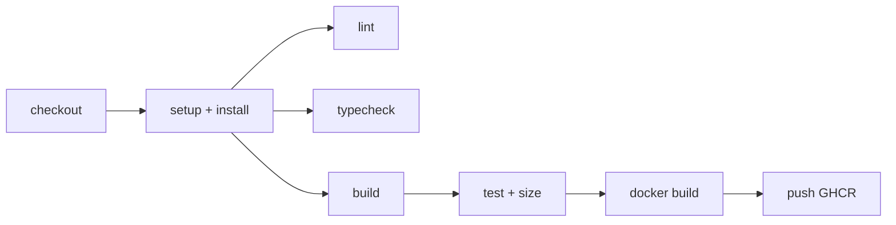

# C6 流水线性能与安全

> **目标层级**：L3 ｜ **前置**：C5 ｜ **预计**：5h
> **本章产物**：`reports/c6-ci.md`（耗时分解、三次中位数、安全自查）

## 0. 先看终点

```text
CI / verify
  Install        38s   (cache hit)
  Lint            6s
  Typecheck      14s
  Build          27s
  Test            3s
  Size budget     2s
  --------------------
  verify         90s

CI / publish
  Docker build   95s   (GHA cache hit)
  Push           18s
  --------------------
  publish       113s
```

这是格式示例，不是你的结果。本章要求你在自己的仓库跑三次，记录中位数，并回答：

1. 时间花在安装、构建、Docker 还是推送？
2. 缓存到底命中了没有？
3. 哪些步骤可以并行，哪些不能？
4. 哪些 action 还挂在 tag 上，没有 pin 到 SHA？
5. `GITHUB_TOKEN` 和 NAS 的 PAT 各自需要什么权限？

## 1. 知识讲解

### 1.1 5 分钟是目标，不是口号

先定义口径：

```text
CI 时间 = 从 job 开始执行到 job 结束
排队时间单独记，不混进来
```

GitHub Actions 的 run 页面会显示 job 和 step 的耗时；排队时间看 run 的 `Started` 与 `Queued`。不要把“排队 3 分钟”算成“构建 3 分钟”。

一个合理的拆分：

| 阶段 | 典型量级 | 主要成本 |
|---|---:|---|
| checkout | 几秒 | 仓库大小 |
| setup pnpm/Node | 10～20s | 下载工具 |
| install | 20～60s | 依赖数量、缓存命中 |
| lint/typecheck | 10～30s | 代码量、TS 项目数 |
| build | 20～60s | 模块数、压缩、sourcemap |
| Docker build | 60～150s | 基础镜像、层缓存 |
| push GHCR | 10～30s | 镜像大小、网络 |
| deploy（NAS） | 10～30s | pull、启动、健康检查 |

如果总时间超过 5 分钟，先找最大项，不要平均用力。

### 1.2 先测量，再并行



并行不是免费的：

- 每个 job 都要 checkout、setup、install；
- 缓存命中时安装仍然有成本；
- 多个 job 会增加排队和调度开销；
- required checks 变多，PR 等待的检查也变多。

所以默认用一个 `verify` job 顺序跑；只有某一项明显成为瓶颈，才拆 job。例如 typecheck 要 3 分钟、lint 只要 5 秒，可以把 typecheck 单独拆出去并行，但要接受重复安装。

### 1.3 缓存的三层

| 层 | 缓存什么 | 配置 | 命中看什么 |
|---|---|---|---|
| pnpm store | 依赖 tarball | `setup-node` 的 `cache: pnpm` | Setup Node 日志 |
| Docker layer | 基础镜像、install、build 层 | `cache-from/to: type=gha` | Buildx 日志 |
| Actions artifact | 本次产物 | 上传/下载 | 不是缓存，别混 |

不要缓存 `node_modules`。它跨平台、跨 Node 版本容易坏，而且解压不一定比安装快。

Docker 层缓存的关键仍然是顺序：

```dockerfile
COPY pnpm-lock.yaml pnpm-workspace.yaml package.json ./
COPY apps/admin/package.json apps/admin/package.json
# ...
RUN pnpm install --frozen-lockfile
COPY . .
RUN pnpm --filter "@lab/admin" build
```

如果 `COPY . .` 在 install 前，源码一改，install 层就失效，Docker 缓存等于没有。

### 1.4 缓存的命中率怎么读

pnpm：

```text
Cache restored from key: pnpm-store-...
```

或者：

```text
Cache not found for input keys: ...
```

Docker：

```text
CACHED [build 4/8] RUN pnpm install --frozen-lockfile
```

如果每次都显示 `CACHED`，但总时间还是很长，瓶颈可能在 pull 基础镜像、压缩、推送或 runner 本身。

### 1.5 pin action 到 SHA

tag 可以移动：

```yaml
uses: actions/checkout@v4
```

`v4` 背后可能被重新指向新的 commit。供应链安全要求固定到 40 位 commit SHA：

```yaml
uses: actions/checkout@11bd71901bbe5b1630ceea73d27597364c9af683 # v4.2.2
```

不要手抄网上的 SHA。用工具批量 pin：

```powershell
npx pin-github-action .github/workflows/ci.yml
```

团队如果使用 ratchet 之类的工具，也可以；关键是产物里每个 `uses` 都固定到 40 位 SHA，而不是 `v4`、`main`、`latest`。

```powershell
Select-String -Path .github/workflows/*.yml -Pattern "uses:.*@"
```

每个 `uses` 后面应该是 40 位十六进制，而不是 `v4`、`main`、`latest`。

然后配 Dependabot 定期更新：

```yaml
# .github/dependabot.yml
version: 2
updates:
  - package-ecosystem: github-actions
    directory: /
    schedule:
      interval: weekly
  - package-ecosystem: npm
    directory: /
    schedule:
      interval: weekly
```

Dependabot 的 PR 仍然要过 CI；不要自动合并 action 升级。

### 1.6 最小权限

顶层：

```yaml
permissions:
  contents: read
```

publish job：

```yaml
permissions:
  contents: read
  packages: write
```

不要：

```yaml
permissions: write-all
```

原因：

- verify 不需要写任何东西；
- `packages: write` 只给 publish；
- 令牌泄露时，影响面更小；
- fork PR 默认拿不到 secrets，这是安全设计，不要用 `pull_request_target` 绕过。

`persist-credentials: false` 也是同理：checkout 不把 token 留在 git 配置里，后续步骤即使被注入命令，也不容易直接 push。

### 1.7 secrets 的边界

| 秘密 | 放在哪 | 谁能看 |
|---|---|---|
| `GITHUB_TOKEN` | Actions 自动注入 | 当前 workflow，按 permissions |
| GHCR PAT | NAS 的 docker login | NAS 用户 |
| SSH 私钥 | 你的电脑 | 你 |
| `.env` | NAS，权限 600 | NAS 用户 |
| Vite 变量 | 构建产物 | 所有人（前端没有秘密） |

前端构建参数会进入镜像和 JS，**不要放 secret**。`VITE_API_KEY` 不是秘密，因为浏览器一定能看到。

Docker build args 也会出现在镜像历史和构建日志里；不要把 token、密码作为 build arg。

### 1.8 镜像安全

最低要求：

- 最终镜像不含源码、`.env`、`node_modules`；
- 基础镜像固定到 digest（至少固定 minor tag）；
- 运行用户尽量非 root；
- 不公开 sourcemap；
- 开启 SBOM / provenance（C4 已开）；
- 定期扫描漏洞，但不要因为一个低危误报就阻断所有发布。

固定 digest：

```powershell
docker buildx imagetools inspect nginx:1.27-alpine-slim
```

把输出的 `Digest: sha256:...` 写进 Dockerfile：

```dockerfile
FROM nginx:1.27-alpine-slim@sha256:<digest>
```

升级时改 digest，走 PR 和 CI，不要在生产 NAS 上直接 `docker pull` 一个浮动 tag。

非 root 运行可以用 `nginxinc/nginx-unprivileged`，但它监听 8080、路径和权限不同，需要重新验证健康检查和缓存头。C6 只要求你知道这个选项，不强制切换。

### 1.9 供应链检查

| 检查 | 工具 | 是否 required |
|---|---|---|
| lockfile 一致 | `pnpm install --frozen-lockfile` | 是 |
| action pin | `pin-github-action` / ratchet | 是（人工或脚本检查） |
| 镜像漏洞 | `docker scout` / Trivy | 先报告 |
| SBOM | build-push-action `sbom: true` | 是（生成即可） |
| provenance | build-push-action `provenance: true` | 是（生成即可） |
| 依赖漏洞 | `pnpm audit` | 先报告，人工判断 |

不要把所有扫描都设成 required；误报会让团队学会“点忽略”，反而失去意义。

### 1.10 5 分钟之外的指标

- PR 从 push 到 required check 完成的时间；
- main 从合并到镜像可用的时间；
- 部署从执行脚本到 healthy 的时间；
- 回滚从发现到恢复的时间；
- CI 失败率 / flaky 率。

只盯 CI 总时长，可能忽略“部署回滚很慢”这种更严重的问题。

## 2. Guided 实操

### 2.1 给关键步骤加计时

在 `ci.yml` 里把 Install 和 Build 改成可记录的形式：

```yaml
      - name: Install
        run: |
          start=$(date +%s)
          pnpm install --frozen-lockfile
          seconds=$(( $(date +%s) - start ))
          echo "install_seconds=$seconds" >> "$GITHUB_STEP_SUMMARY"

      - name: Build
        run: |
          start=$(date +%s)
          pnpm build
          seconds=$(( $(date +%s) - start ))
          echo "build_seconds=$seconds" >> "$GITHUB_STEP_SUMMARY"
```

Lint、Typecheck、Test、Size 也可以加；不要加太多，步骤会变碎。至少覆盖 install、build、docker。

Docker 的耗时看 Buildx step 的日志和 job 时间线；push 时间单独看。

### 2.2 跑三次并取中位数

同一分支连续触发三次（可以空提交，或 `workflow_dispatch`）：

```powershell
git commit --allow-empty -m "chore: measure ci 1"
git push
git commit --allow-empty -m "chore: measure ci 2"
git push
git commit --allow-empty -m "chore: measure ci 3"
git push
```

记录：

| 阶段 | 第 1 次 | 第 2 次 | 第 3 次 | 中位数 |
|---|---:|---:|---:|---:|
| install | | | | |
| lint | | | | |
| typecheck | | | | |
| build | | | | |
| docker build | | | | |
| push | | | | |
| **verify 总** | | | | |
| **publish 总** | | | | |

第一次通常没有缓存，单独标注“冷缓存”；中位数用三次都稳定后的值，或者分别给冷/热两组。不要混在一起。

### 2.3 检查缓存命中

Setup Node 日志找：

```text
Cache restored from key: ...
```

Buildx 日志找：

```text
CACHED [build 5/8] RUN pnpm install --frozen-lockfile
```

如果 install 命中但 Docker install 没命中：

- Dockerfile 的 COPY 顺序不对；
- lockfile 没复制；
- `cache-from/to` 没配；
- Buildx 没启用；
- 构建上下文里文件变化导致层失效。

### 2.4 拆一个并行 job

如果 typecheck 是明显瓶颈，可以拆：

```yaml
jobs:
  verify:
    # lint + build + test + size
  typecheck:
    runs-on: ubuntu-latest
    steps:
      - uses: actions/checkout@v4
      - uses: pnpm/action-setup@v4
        with:
          version: 12.15.0
      - uses: actions/setup-node@v4
        with:
          node-version: 24.14.1
          cache: pnpm
          cache-dependency-path: pnpm-lock.yaml
      - run: pnpm install --frozen-lockfile
      - run: pnpm typecheck
```

代价：多一次 checkout + install。记录拆前/拆后的总时长；如果只快 5 秒，拆了不值得。

`typecheck` 也要设为 required check；否则拆出去等于没门禁。

### 2.5 pin action

```powershell
npx pin-github-action .github/workflows/ci.yml
Select-String -Path .github/workflows/ci.yml -Pattern "uses:"
```

检查每个 `uses`：

```yaml
uses: actions/checkout@11bd71901bbe5b1630ceea73d27597364c9af683 # v4.2.2
```

注释里的版本号是给人看的，真正的锁定是 SHA。

如果工具改了格式，重新跑一次 CI，确认没有因为 action 版本变化而失败。

### 2.6 加 Dependabot

`.github/dependabot.yml`：

```yaml
version: 2
updates:
  - package-ecosystem: github-actions
    directory: /
    schedule:
      interval: weekly
  - package-ecosystem: npm
    directory: /
    schedule:
      interval: weekly
```

Dependabot 的 action PR 会同时改 SHA 和注释；先看 diff，再合并。

### 2.7 安全自查

`docs/security-checklist.md`：

```md
# CI/CD 安全自查

## Actions
- [ ] 所有 uses 固定到 40 位 SHA
- [ ] 顶层 permissions 只有 contents: read
- [ ] packages: write 只在 publish job
- [ ] 没有 pull_request_target
- [ ] checkout 设置 persist-credentials: false
- [ ] 没有把 secret 写进 run 日志
- [ ] PR 不发布镜像

## 镜像
- [ ] 最终镜像不含源码/.env/node_modules
- [ ] 基础镜像固定 tag 或 digest
- [ ] 非 root（或记录为什么没有）
- [ ] sourcemap 不公开
- [ ] SBOM/provenance 已生成
- [ ] 镜像扫描结果已人工看过

## NAS
- [ ] GHCR PAT 只有 read:packages
- [ ] PAT 有有效期，过期前轮换
- [ ] .env 权限 600
- [ ] SSH 只在局域网
- [ ] deploy.sh 不接受 latest
- [ ] 旧 sha tag 保留到不再需要回滚

## 分支
- [ ] main 必须 PR
- [ ] required check 是 CI / verify
- [ ] 不允许绕过（或记录例外）
```

### 2.8 生成 SBOM 并查看

C4 已经开了：

```yaml
provenance: true
sbom: true
```

构建后：

```powershell
docker buildx imagetools inspect ghcr.io/<owner>/fe-lab-admin:<sha>
```

确认能看到 attestation / SBOM 信息。它不是“跑分”，但能在供应链排查时回答“这个镜像里有什么”。

### 2.9 写 `reports/c6-ci.md`

```md
# C6 CI 性能与安全

## 环境
- runner: ubuntu-latest
- Node: 24.14.1
- pnpm: 12.15.0
- 缓存：pnpm + Docker GHA

## 三次运行
| 阶段 | 1 | 2 | 3 | 中位数 |
|---|---:|---:|---:|---:|
| install | | | | |
| lint | | | | |
| typecheck | | | | |
| build | | | | |
| docker build | | | | |
| push | | | | |
| verify 总 | | | | |
| publish 总 | | | | |

## 缓存
- pnpm 命中：是/否
- Docker 命中：是/否
- 冷缓存第一次：...

## 瓶颈
1. ...
2. ...
3. ...

## 改动
- 改了什么：
- 改前中位数：
- 改后中位数：
- 代价：
- 是否采纳：

## 安全
- pin 数量：
- 未 pin 的：
- permissions：
- 扫描结果：
```

## 3. 排障

| 现象 | 原因 | 验证 | 修复 |
|---|---|---|---|
| 总时长 > 5 分钟 | 安装/构建/Docker 某一项大 | 看 step 时间线 | 先优化最大项 |
| pnpm 缓存不命中 | lockfile 路径/键变化 | Setup Node 日志 | `cache-dependency-path` |
| Docker 层不命中 | COPY 顺序/上下文变化 | Buildx 日志 | 先复制 manifest，再 install |
| 并行后更慢 | 重复 install/排队 | 对比总时长 | 回到单 job |
| pin 后 CI 失败 | action 版本不兼容 | 看 diff | 回退或升级配置 |
| Dependabot PR 红 | 新版本 breaking | 日志 | 修配置，不要盲合并 |
| 权限不足 | `packages: write` 缺失 | publish 日志 | 只给 publish job |
| 权限过大 | `write-all` | `grep permissions` | 最小化 |
| secret 出现在日志 | `echo`/`set -x` | 搜日志 | 删除，轮换 secret |
| 镜像扫描一堆 CVE | 基础镜像旧 | 扫描报告 | 升级 digest，评估优先级 |
| 5 分钟达标但部署慢 | NAS pull/健康检查 | 部署计时 | 单独优化部署 |

### 3.1 不要用“跳过检查”换速度

可以优化的：

- 缓存；
- Docker layer；
- 构建范围；
- 并行；
- 减少 artifact 体积。

不能拿来换速度的：

- 跳过 lint/typecheck；
- 关闭 required check；
- 用 `latest`；
- 不跑 smoke；
- 把 `continue-on-error` 当通过。

### 3.2 5 分钟不是硬指标

如果项目就是需要 7 分钟，但稳定、可回滚，不要为了数字删检查。先记录、找瓶颈、优化；5 分钟是目标，不是 KPI。

## 4. 故障演练

### 4.1 让 Docker 缓存失效

临时在 `COPY pnpm-lock.yaml ...` 之前加：

```dockerfile
COPY . .
```

构建两次，观察 install 层不再 `CACHED`，时间上升。删掉这行，恢复缓存。

### 4.2 把 permissions 改成 write-all

临时改：

```yaml
permissions: write-all
```

在 PR 里观察权限变化，然后恢复最小权限。不要把这个改动合并。

### 4.3 取消 pin

把某个 `uses` 改回 `@v4`，跑一次；再 pin 回去。这个演练说明 tag 是可移动的，SHA 才是锁定。

## 5. 闭卷练习

合上教程，完成：

1. 给 install、build、docker build 加计时，跑三次，给出中位数。
2. 判断 pnpm 和 Docker 缓存是否命中，给出日志证据。
3. 找出最大瓶颈，做一个改动，给出改前/改后中位数；差异小于 10% 就写“不采纳”。
4. 把所有 action pin 到 SHA，并加 Dependabot。
5. 完成安全自查，指出至少一个仍需人工处理的风险。

验收标准：

- 有三次原始值，不是只写平均；
- 区分冷缓存和热缓存；
- 没有为了速度跳过门禁；
- 所有 `uses` 都是 SHA；
- 能说清 `GITHUB_TOKEN` 和 NAS PAT 的权限边界。

## 6. 验收清单

- [ ] `reports/c6-ci.md` 已提交
- [ ] install/build/docker 有三次数据
- [ ] pnpm 与 Docker 缓存命中情况有日志证据
- [ ] 一个优化有改前/改后中位数和代价
- [ ] 所有 action 固定到 40 位 SHA
- [ ] 顶层 `permissions` 最小，publish 单独授权
- [ ] 没有 `pull_request_target` / `write-all`
- [ ] SBOM/provenance 已生成
- [ ] `docs/security-checklist.md` 完成
- [ ] 5 分钟目标有结论（达标或说明原因）

## 7. 自测

**Q1：为什么不能把排队时间算进 CI 构建时间？**

<details>
<summary>答案</summary>

排队由平台调度和并发决定，不是代码或流水线配置的直接结果；混在一起会误判瓶颈。
</details>

**Q2：并行 job 一定更快吗？**

<details>
<summary>答案</summary>

不一定。每个 job 都要 checkout、setup、install，重复成本可能超过并行收益；要测总时长。
</details>

**Q3：pin 到 SHA 后还需要 Dependabot 吗？**

<details>
<summary>答案</summary>

需要。pin 保证不可变，Dependabot 负责定期提出升级 PR，避免永远停在旧版本。
</details>

**Q4：为什么不能把 secret 作为 Docker build arg？**

<details>
<summary>答案</summary>

build arg 会进入镜像历史/构建日志，可能被任何能拉镜像的人看到；前端构建产物本身也没有秘密。
</details>

**Q5：5 分钟目标没达到怎么办？**

<details>
<summary>答案</summary>

先测量并找最大项，优化缓存、层顺序、构建范围或并行；不要通过跳过检查、关闭门禁或使用 latest 来“达标”。
</details>

## 8. 延伸

- GitHub Actions cache 的 scope 与淘汰
- BuildKit cache mount
- SLSA / provenance
- Trivy / Docker Scout
- 附录 F：GitLab CI 的 cache、artifacts、protected variables 对照
