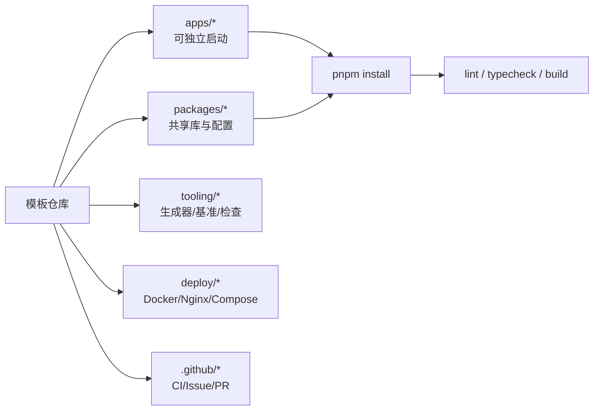

# P1 脚手架与配置预设

> **目标层级**：L3 ｜ **前置**：M5、C4、C5 ｜ **预计**：6h
> **本章产物**：一个可复用的仓库模板；`pnpm gen:pkg` / `pnpm gen:app`；新人 30 分钟上手说明

## 0. 先看终点

把前 11 周的做法固化成“新项目可以直接复制”的模板，而不是每次从零回忆：

```powershell
PS> pnpm gen:pkg @lab/logger
已创建 packages/logger
PS> pnpm install
PS> pnpm --filter "@lab/logger" typecheck

PS> pnpm gen:app reports
已创建 apps/reports
PS> pnpm install
PS> pnpm --filter "@lab/reports" build
```

新人的 30 分钟路径：

```text
0-5 min    clone，corepack enable，确认 node/pnpm 版本
5-15 min   pnpm install
15-20 min  pnpm dev:admin，看到页面
20-25 min  读 docs/architecture.md 和 docs/release.md
25-30 min  开分支，改一行文案，跑 lint，提 PR
```

本章不引入 Turborepo、Nx、Changesets 或“万能 CLI”。模板的价值是**少而确定**：目录、脚本、配置、部署文件各有一份，剩下的交给 pnpm。

## 1. 知识讲解

### 1.1 模板、生成器、框架的边界

| 方案 | 适合 | 不适合 |
|---|---|---|
| 仓库模板 | 新项目复制后自己改 | 需要复杂交互、频繁升级 |
| 小生成器 | 固定结构的包/应用 | 生成器本身变成新项目 |
| Nx / Turborepo | 大型多应用仓库、任务图与缓存 | 4 个包的小仓库 |
| CLI 框架 | 统一组织规范、多人协作 | 个人学习项目 |

本教程选前两个：**仓库模板 + 200 行以内的生成器**。生成器只做四件事：

1. 校验名字；
2. 复制/生成固定文件；
3. 替换包名；
4. 打印下一步命令。

它不安装依赖、不跑构建、不修改已有目录。这样出错时容易恢复，也不会把网络问题混进生成步骤。

### 1.2 目录契约

```text
fe-lab/
├─ apps/
│  ├─ admin/                 # 主应用
│  └─ h5/                    # 第二个应用
├─ packages/
│  ├─ ui/                    # React 组件
│  ├─ utils/                 # 纯 TS 工具
│  ├─ config-ts/             # TS base
│  └─ config-eslint/         # ESLint 共享配置
├─ tooling/
│  ├─ scripts/               # gen:pkg / gen:app
│  ├─ bench/                 # 基准与报告脚本
│  └─ checks/                # smoke / size budget
├─ deploy/
│  ├─ nginx/                 # nginx.conf
│  └─ qnap/                  # compose.yaml + deploy.sh
├─ docs/
│  ├─ architecture.md
│  ├─ pipeline.md
│  ├─ quality-gates.md
│  ├─ release.md
│  └─ newcomer.md
├─ reports/                  # 基线、体积、CI 记录
└─ .github/                  # workflows / issue / PR 模板
```



约定：

- `apps/*` 是能独立启动的应用；`packages/*` 是被引用的库；
- 新包不需要自己的 ESLint 配置，根目录一份；
- 新包不需要自己的 `packageManager`，根目录一份；
- 部署文件只有一份，放在 `deploy/`，不散落在各应用；
- 报告放 `reports/`，不要提交 `dist`。

### 1.3 配置所有权

| 配置 | 位置 | 新包要做什么 |
|---|---|---|
| TypeScript base | `packages/config-ts` | `extends`，加 workspace 依赖 |
| ESLint | 根 `eslint.config.mjs` | 什么都不做 |
| Prettier | 根配置 | 什么都不做 |
| pnpm 设置 | 根 `pnpm-workspace.yaml` | 什么都不做 |
| 版本 catalog | 根 `pnpm-workspace.yaml` | 用 `catalog:` |
| CI | `.github/workflows/ci.yml` | 不改，除非新增应用 |
| Docker | `Dockerfile` + `deploy/` | 复制并替换 app 名 |

“新包零配置”不是口号：如果每建一个包都要复制一份 ESLint/TS 配置，半年后一定会漂移。

### 1.4 两种包：源码直连与产物

M4 已经比较过。模板里要明确选一种：

| 类型 | 入口 | 适用 | 代价 |
|---|---|---|---|
| 源码直连 | `exports: "./src/index.ts"` | 仓库内部共享、应用由 Vite 构建 | 消费方必须能编译 TS |
| 产物 | `exports: "./dist/index.js"` | 要发布 npm、被外部消费 | 要先 build，类型/产物要同步 |

本模板的 `@lab/logger` 用**源码直连**。内部包不发布，没必要多一层 `dist`。如果以后要发 npm，再单独加 `tsconfig.build.json`，不要一开始就双入口。

### 1.5 生成器要“拒绝”的情况

好的生成器不是“什么都能生成”，而是知道什么时候停下：

- 目录已存在：拒绝，不覆盖；
- 名字不符合 `@lab/<lowercase>`：拒绝；
- 目标不在 `packages/` 或 `apps/`：拒绝；
- 没有 `pnpm-workspace.yaml`：提示先初始化仓库；
- 已经安装了依赖：仍然只生成文件，让用户自己跑 `pnpm install`；
- 生成失败：不要留下半个目录；先写临时目录再 rename，或者至少打印清理命令。

本教程的脚本先检查存在性，再创建；足够小，出错时手动删目录即可。

### 1.6 模板仓库不是“脏项目”

模板里只放：

- 可运行的骨架；
- 约定和文档；
- CI/部署模板；
- 一两个示例包/应用。

不要放：

- 真实业务数据、账号、内网地址；
- `.env`、PAT、SSH key；
- 已经构建的 `dist`、`node_modules`；
- 只有作者能理解的“祖传脚本”。

发布模板前先在空目录 clone 一次，按新人路径走一遍；这一步能发现 80% 的“我机器上能跑”。

### 1.7 模板版本与漂移

模板也会过期。给它一个明确的版本：

```text
template-v1   Node 24 / pnpm 12 / Vite 8 / ESLint 9
```

在 `docs/template-changelog.md` 记录：

- 基础版本变化；
- 新增/删除的脚本；
- 迁移动作；
- 不兼容点。

不要把模板做成自动升级框架。复制出去的项目要自己决定何时跟进；模板只负责“下一次新建时是对的”。

### 1.8 Docker/Compose 模板怎么复用

C4/C5 的文件是按 `admin` 写的。复制到新应用时只改这些：

| 位置 | 替换 |
|---|---|
| `COPY apps/admin/package.json` | 新应用路径 |
| `pnpm --filter "@lab/admin" build` | 新包名 |
| `/app/apps/admin/dist` | 新应用 dist |
| `fe-lab-admin` | 新镜像/容器名 |
| `.env` 的 `IMAGE_NAME` | 新镜像 |

不要做一个“同时构建所有应用”的 Dockerfile：镜像会变大，启动参数变复杂，回滚也不再是单 tag。一个应用一个镜像。

### 1.9 新人路径要可验证

“30 分钟能跑起来”不是感觉，要有检查点：

| 时间 | 检查点 | 失败时先看 |
|---:|---|---|
| 5 min | `node -v` / `pnpm -v` 正确 | corepack / PATH |
| 15 min | `pnpm install` 成功 | registry / lockfile |
| 20 min | `pnpm dev:admin` 打开页面 | 端口 / 环境变量 |
| 25 min | `pnpm lint` 通过 | ESLint 配置 |
| 30 min | 能开 PR | 分支保护 / 权限 |

把这张表放进 `docs/newcomer.md`，比写“欢迎加入”有用。

## 2. Guided 实操

### 2.1 写 `create-package.mjs`

`tooling/scripts/create-package.mjs`：

```js
import { access, mkdir, writeFile } from 'node:fs/promises'
import { join } from 'node:path'

const name = process.argv[2]

if (!name || !/^@lab\/[a-z][a-z0-9-]*$/.test(name)) {
  console.error('用法: pnpm gen:pkg @lab/<name>')
  process.exit(1)
}

const short = name.slice('@lab/'.length)
const dir = join('packages', short)

try {
  await access(dir)
  console.error(`目录已存在，拒绝覆盖: ${dir}`)
  process.exit(1)
} catch (error) {
  if (error.code !== 'ENOENT') throw error
}

await mkdir(join(dir, 'src'), { recursive: true })

const identifier = short.replace(/-([a-z0-9])/g, (_, char) => char.toUpperCase())

const manifest = {
  name,
  version: '0.0.0',
  private: true,
  type: 'module',
  main: './src/index.ts',
  types: './src/index.ts',
  exports: {
    '.': './src/index.ts',
  },
  scripts: {
    typecheck: 'tsc --noEmit',
  },
  devDependencies: {
    '@lab/config-ts': 'workspace:*',
  },
}

const tsconfig = {
  extends: '@lab/config-ts/base.json',
  compilerOptions: {
    noEmit: true,
  },
  include: ['src'],
}

await writeFile(
  join(dir, 'package.json'),
  `${JSON.stringify(manifest, null, 2)}\n`,
)
await writeFile(
  join(dir, 'tsconfig.json'),
  `${JSON.stringify(tsconfig, null, 2)}\n`,
)
await writeFile(
  join(dir, 'src/index.ts'),
  `export const ${identifier} = true\n`,
)
await writeFile(
  join(dir, 'README.md'),
  `# ${name}\n\n内部包。源码直连，不需要单独构建。\n`,
)

console.log(`已创建 ${dir}`)
console.log('下一步: pnpm install && pnpm --filter "' + name + '" typecheck')
```

关键点：

- `access` 检查目录；已存在直接拒绝；
- `identifier` 把 `build-info` 转成 `buildInfo`；
- `devDependencies` 加 `@lab/config-ts`，否则 `extends` 找不到；
- 只生成文件，不安装、不构建。

### 2.2 写 `create-app.mjs`

`tooling/scripts/create-app.mjs`：

```js
import { execSync } from 'node:child_process'
import { access, readFile, rm, writeFile } from 'node:fs/promises'
import { join } from 'node:path'

const short = process.argv[2]

if (!short || !/^[a-z][a-z0-9-]*$/.test(short)) {
  console.error('用法: pnpm gen:app <lowercase-name>')
  process.exit(1)
}

const dir = join('apps', short)

try {
  await access(dir)
  console.error(`目录已存在，拒绝覆盖: ${dir}`)
  process.exit(1)
} catch (error) {
  if (error.code !== 'ENOENT') throw error
}

execSync(`pnpm create vite "${dir}" --template react-ts`, {
  stdio: 'inherit',
})

const manifestPath = join(dir, 'package.json')
const manifest = JSON.parse(await readFile(manifestPath, 'utf8'))

manifest.name = `@lab/${short}`
manifest.version = '0.0.0'
manifest.private = true
manifest.scripts = {
  ...manifest.scripts,
  typecheck: 'tsc -b',
}

// 根目录一份 ESLint；新应用不再自带 lint 配置
delete manifest.scripts.lint
if (manifest.devDependencies) {
  delete manifest.devDependencies.oxlint
}

await writeFile(manifestPath, `${JSON.stringify(manifest, null, 2)}\n`)

for (const file of ['eslint.config.js', 'eslint.config.mjs', 'oxlint.json']) {
  await rm(join(dir, file), { force: true })
}

await writeFile(
  join(dir, 'README.md'),
  `# @lab/${short}\n\n开发: pnpm --filter "@lab/${short}" dev\n构建: pnpm --filter "@lab/${short}" build\n`,
)

console.log(`已创建 ${dir}`)
console.log('下一步: pnpm install && pnpm --filter "@lab/' + short + '" build')
```

说明：

- 应用交给 `create-vite` 生成，避免手写一套 Vite 模板；
- 生成后只改包名、`typecheck`、lint 归属；
- 不自动 `pnpm install`，让根目录统一安装；
- `--template react-ts` 是固定的；如果要 Vue，另写一个脚本，不要在一个脚本里塞分支。

### 2.3 加根脚本

根 `package.json`：

```json
{
  "scripts": {
    "gen:pkg": "node tooling/scripts/create-package.mjs",
    "gen:app": "node tooling/scripts/create-app.mjs"
  }
}
```

运行：

```powershell
pnpm gen:pkg @lab/logger
pnpm install
pnpm --filter "@lab/logger" typecheck
pnpm lint
```

预期：新包没有 `eslint.config.*`，根 `pnpm lint` 仍然通过。

再试应用：

```powershell
pnpm gen:app reports
pnpm install
pnpm --filter "@lab/reports" typecheck
pnpm --filter "@lab/reports" build
```

如果 `create-vite` 生成了额外的 lint 配置，脚本会删掉；如果它升级了模板结构，先看差异，不要盲目删文件。

### 2.4 写新人文档

`docs/newcomer.md`：

```md
# 新人 30 分钟

## 0-5 分钟：环境
- Node 24.14.1
- pnpm 12.15.0（corepack enable 后确认）
- git、gh（可选）

pnpm -v

## 5-15 分钟：安装
pnpm install --frozen-lockfile

## 15-20 分钟：跑起来
pnpm dev:admin
打开终端里的地址，确认首页。

## 20-25 分钟：读约定
- docs/architecture.md
- docs/release.md
- docs/pipeline.md

## 25-30 分钟：第一个 PR
git switch -c docs/first-pr
# 改一行文档
pnpm lint
git add .
git commit -m "docs: first pr"
git push -u origin docs/first-pr
# 在 GitHub 开 PR，等 CI / verify

## 卡住时
1. node/pnpm 版本
2. pnpm install --frozen-lockfile
3. 端口占用
4. 看 PR 的 CI 日志，不要只看本地
```

如果新人 30 分钟没跑通，先修模板，不要怪新人。

### 2.5 加 Issue / PR 模板

`.github/ISSUE_TEMPLATE/feature.md`：

```md
---
name: Feature
about: 一个可交付的小功能
---

## 背景
## 验收标准
- [ ] ...
## 影响范围
## 回滚方式
```

`.github/pull_request_template.md`：

```md
## 做了什么
## 为什么
## 怎么验证
- [ ] pnpm lint
- [ ] pnpm typecheck
- [ ] pnpm build
- [ ] pnpm test
- [ ] pnpm check:size

## 风险与回滚
```

P2 会直接用这两份模板做端到端演练。

### 2.6 把 Docker/Compose 收进模板

从 C4/C5 复制：

```text
Dockerfile
.dockerignore
deploy/nginx/nginx.conf
deploy/qnap/compose.yaml
deploy/qnap/deploy.sh
```

复制到新应用时，替换：

```text
apps/admin → apps/<new-app>
@lab/admin → @lab/<new-app>
fe-lab-admin → fe-lab-<new-app>
```

检查清单：

- [ ] Dockerfile 里所有 `admin` 都替换了
- [ ] `COPY` 的 package.json 列表包含新应用
- [ ] nginx 的 `root` 不需要改（仍复制到同一路径）
- [ ] Compose 的容器名、镜像名、端口不冲突
- [ ] `version.json` 仍由构建阶段写入
- [ ] `linux/amd64` 与 NAS 架构一致

不要为了复用把两个应用塞进一个镜像；镜像应该对应一个可独立回滚的部署单元。

### 2.7 做一次模板验收

在空目录或新分支：

```powershell
pnpm gen:pkg @lab/tmp-check
pnpm install
pnpm lint
pnpm typecheck
pnpm --filter "@lab/tmp-check" typecheck
pnpm gen:app tmp-app
pnpm install
pnpm --filter "@lab/tmp-app" build
```

通过后删除临时包/应用（或保留 `@lab/logger` 作为示例）。记录：

- 建包耗时；
- 建应用耗时；
- 新人路径实际耗时；
- 卡住的步骤。

### 2.8 发布模板仓库

1. GitHub 仓库 Settings → 勾选 Template repository；
2. README 顶部写清基线和 30 分钟路径；
3. 删除真实项目数据、PAT、内网地址；
4. 打 tag `template-v1`；
5. 用“Use this template”新建一个空仓库，按新人路径再走一遍。

模板仓库不是备份仓库；不要把它和真实业务仓库混在一起。

## 3. 排障

| 现象 | 原因 | 验证 | 修复 |
|---|---|---|---|
| `Cannot find package '@lab/config-ts'` | 新包没加 workspace 依赖 | 看 `package.json` | 加 `"@lab/config-ts": "workspace:*"` |
| `ERR_PNPM_NO_MATCHING_VERSION` | catalog 没有该版本 | 看 `pnpm-workspace.yaml` | 补 catalog 或改版本 |
| `gen:pkg` 说目录已存在 | 上次生成了一半 | `Get-ChildItem packages` | 手动确认后删除 |
| 新应用 lint 不跑 | 删了 package 的 lint，但根脚本没覆盖 apps | `pnpm lint` | 根 `eslint .`，不要只 lint packages |
| 新应用没有 typecheck | create-vite 模板没有该脚本 | 看 `package.json` | 脚本补 `tsc -b` |
| `create-vite` 交互卡住 | 模板参数不完整 | 终端输出 | 用 `--template react-ts` |
| Docker 构建找不到新应用 | Dockerfile 还在 copy admin | `Select-String admin Dockerfile` | 替换所有路径/包名 |
| 新应用端口冲突 | Vite 默认 5173 | 启动日志 | 用 `--port` 或 `.env` |
| 新人 30 分钟失败 | 文档缺步骤 | 让新人照做 | 修文档，不加“你应该懂” |
| 模板里有 secret | 从真实仓库复制 | `git grep -i token` | 删除并轮换 |

### 3.1 先验证“生成”而不是“构建”

生成失败时，先看：

- 目录是否存在；
- 包名是否合法；
- `packages/config-ts` 是否存在；
- `pnpm-workspace.yaml` 的 glob 是否包含新目录。

构建失败时，再看依赖、TS 配置和 Vite 配置。不要混在一起。

### 3.2 不要用生成器修已有包

生成器只负责“新建”。已有包缺配置时，直接改那个包或改共享配置；让生成器支持 `--force` 会带来覆盖风险。

## 4. 故障演练

### 4.1 生成一个重名包

```powershell
pnpm gen:pkg @lab/logger
pnpm gen:pkg @lab/logger
```

第二次应拒绝覆盖，且原文件不变。这个演练验证生成器有边界。

### 4.2 删掉 `@lab/config-ts` 依赖

临时从新包 `package.json` 删除 `@lab/config-ts`，重新 `pnpm install`，运行 `pnpm --filter ... typecheck`。应报找不到配置；加回依赖后恢复。这个演练说明“extends 不是魔法”。

### 4.3 让新应用自带一份 ESLint

临时把 `eslint.config.js` 放回新应用，运行根 `pnpm lint`，观察是否出现重复规则/解析错误。删除它，恢复“根一份”的约定。

## 5. 闭卷练习

合上教程，完成：

1. 写一个只生成 TS 包的脚本，要求目录已存在时拒绝。
2. 生成的应用自动改成 `@lab/<name>`，并补 `typecheck`。
3. 根目录只保留一份 ESLint；新包不需要配置文件。
4. 把 C4/C5 的 Docker/Compose 模板复制到一个新应用，改完包名和路径。
5. 写一份新人 30 分钟文档，并让一个没做过的人按文档走。

验收标准：

- `pnpm gen:pkg` 和 `pnpm gen:app` 都能重复使用；
- 新包 `pnpm lint` / `typecheck` 通过；
- 新应用能 `build`；
- 模板不含 secret、`node_modules`、`dist`；
- 新人能在 30 分钟内跑起来并提 PR。

## 6. 验收清单

- [ ] `tooling/scripts/create-package.mjs` 已提交
- [ ] `tooling/scripts/create-app.mjs` 已提交
- [ ] 根 `gen:pkg` / `gen:app` 脚本可运行
- [ ] 新包零 ESLint 配置，根 `pnpm lint` 通过
- [ ] 新应用 `typecheck` / `build` 通过
- [ ] Docker/Compose 模板已复制并替换占位
- [ ] `.github` issue/PR 模板已添加
- [ ] `docs/newcomer.md` 已提交
- [ ] 模板仓库无 secret、无构建产物
- [ ] 记录了一次真实的建包/建应用/新人耗时

## 7. 自测

**Q1：为什么生成器不自动 `pnpm install`？**

<details>
<summary>答案</summary>

安装涉及网络、registry、lockfile 和构建脚本，失败原因多；生成器只做确定性的文件创建，安装由用户显式执行，日志和责任更清楚。
</details>

**Q2：新包为什么不需要自己的 ESLint 配置？**

<details>
<summary>答案</summary>

根目录一份 flat config 覆盖整个仓库；新包只需被 `eslint .` 扫到，避免多份配置漂移。
</details>

**Q3：源码直连和产物入口怎么选？**

<details>
<summary>答案</summary>

仓库内部共享、由应用构建时编译，选源码直连；要发布 npm 或被外部消费，选产物，并维护 build 与类型声明。
</details>

**Q4：为什么要拒绝覆盖已有目录？**

<details>
<summary>答案</summary>

生成器不是迁移工具；覆盖可能毁掉用户改动。已有包应手动修改或走明确的重构流程。
</details>

**Q5：模板仓库里最不该放什么？**

<details>
<summary>答案</summary>

真实 secret、内网地址、业务数据、`node_modules`、`dist`，以及只有作者理解的脚本。
</details>\n\n## 8. 延伸\n\n- GitHub Template repository 与 `gh repo create --template`
- 生成器加 `--dry-run` 和 `--force` 的边界
- 用 `pnpm dlx` 分发模板 CLI
- 下一章：用这套模板走一遍真实的 issue → PR → 镜像 → NAS → 回滚
