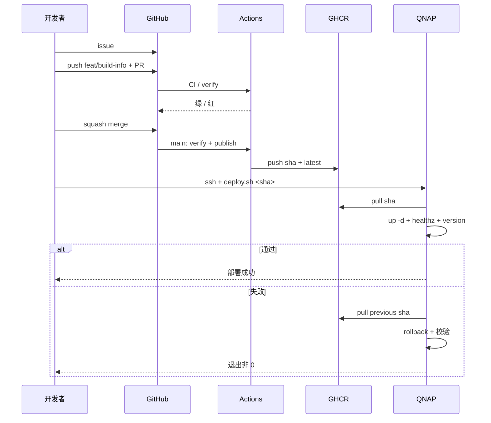

# P2 端到端演练

> **目标层级**：L3 ｜ **前置**：P1、C1～C6 ｜ **预计**：5h
> **本章产物**：`reports/p2-e2e.md`，一条从 issue 到 NAS 回滚的完整记录

## 0. 先看终点

选一个很小的功能，完整走一遍：

```text
issue #42
  → 分支 feat/build-info
  → 本地检查
  → PR + CI / verify
  → review + squash merge
  → main 发布镜像到 GHCR
  → NAS 手动部署指定 sha
  → /healthz 200 + /version.json 匹配
  → 页面页脚显示 build sha
  → ./deploy.sh --rollback
  → 校验上一版，再决定是否重新部署
  → 关闭 issue，写演练记录
```

演练的功能本身不重要，重要的是每一步都有**证据**：PR 链接、CI run、镜像 tag、部署时间、健康检查结果、回滚后的版本。

本章的记录必须来自你的仓库和 NAS，不能抄示例数字。示例只给格式。

## 1. 知识讲解

### 1.1 为什么用一个小功能演练

端到端演练不是“再做一个大项目”，而是验证流程：

- issue 的验收标准能不能被 PR 直接引用；
- CI 失败时是否真的挡住合并；
- 合并后的 sha 是否能对应到镜像；
- NAS 上部署的是不是 CI 产出的那个镜像；
- 回滚是否只需要一条命令。

功能越大，变量越多，越难判断问题出在流程还是业务。选一个 30 分钟内能写完的功能。

本教程选：**在 admin 页脚显示当前部署的 build sha**。它同时验证：

- 前端能读取 `/version.json`；
- 镜像里的版本文件正确；
- 部署后用户能看到版本；
- 回滚后页脚跟着变。

### 1.2 issue 是契约，不是备忘录

一个可执行的 issue 至少要有：

| 项 | 例子 |
|---|---|
| 背景 | 部署后无法快速确认线上是哪个 sha |
| 验收标准 | 页脚显示 7 位 sha；`/version.json` 可访问；失败时不显示 |
| 范围 | 只改 admin，不动 h5；不引入路由/状态库 |
| 验证方式 | lint、typecheck、build、smoke、size、NAS 页面 |
| 回滚 | 用上一个镜像 tag；无数据迁移 |

没有验收标准的 issue，PR 一定会变成“顺便重构一下”。

### 1.3 分支与提交

```text
main
 └─ feat/build-info
     └─ feat: add build info footer
```

- 分支从最新 main 切；
- 一个 PR 只做一件事；
- commit message 用 conventional commits；
- 不把格式化整个仓库、升级依赖、改业务混在一起；
- PR 标题和 issue 对应，例如 `feat: show build sha in admin footer`。

### 1.4 门禁要通过，不是“点过去”

PR 上应该看到：

```text
CI / verify
  ✓ Install
  ✓ Lint
  ✓ Typecheck
  ✓ Build
  ✓ Test
  ✓ Size budget
  ✓ Upload dist
```

如果失败：

- 不要用管理员权限绕过；
- 不要删掉失败的 step；
- 不要调大预算掩盖新增体积；
- 先在本地复现，再修代码或修流程。

P2 建议额外做一次“故意失败”的演练（独立分支），确认 required check 真的会拦住合并。

### 1.5 合并后的身份

squash merge 会生成一个新的 commit sha。这个 sha 才是：

- main 上的提交；
- CI publish 的镜像 tag；
- NAS 部署的目标；
- `/version.json` 里的 `sha`。

不要用 PR 分支最后一个 commit 的 sha 去部署；它可能不是 main 上的提交。合并后重新取：

```powershell
git switch main
git pull --ff-only
git rev-parse HEAD
```

### 1.6 镜像、部署、回滚是同一条链



每一步都要留下证据：

- PR 链接；
- CI run 链接；
- 镜像 tag / digest；
- NAS 上 `deploy.sh` 的输出；
- `/version.json` 的响应；
- 回滚后的 `/version.json`。

### 1.7 回滚也是验收项

只验证“能部署”不够。要在真实 NAS 上执行一次：

```bash
./deploy.sh --rollback
```

并确认：

- `/version.json` 回到上一版 sha；
- 页面页脚跟着变；
- `releases.log` 有记录；
- 回滚后服务仍然 healthy。

回滚成功后再决定是否重新部署目标版本。不要把环境留在“为了演练而回滚”的旧版本上，除非这就是你要的状态。

### 1.8 记录格式

`reports/p2-e2e.md` 至少包含：

| 字段 | 说明 |
|---|---|
| issue | 链接和验收标准 |
| branch / PR | 分支名、PR 链接 |
| commits | 关键 commit |
| CI run | verify 和 publish 的 run 链接 |
| artifact | `web-dist` 是否下载成功 |
| merge sha | main 上的完整 sha |
| image | sha tag + latest + digest（可选） |
| deploy | 部署时间、命令、输出摘要 |
| verify | `/healthz`、`/version.json`、页面 |
| rollback | 回滚时间、回滚后 sha |
| final | 最终线上版本 |
| findings | 流程问题、下次改进 |

“findings”比“一切顺利”有价值。比如：

- PR 模板缺少回滚项；
- CI 的 Test 在 Build 前，smoke 一直找不到 dist；
- NAS 的 8088 被占用；
- `deploy.sh` 没有校验 version，误报成功。

## 2. Guided 实操

### 2.1 准备一个干净的主线

```powershell
git switch main
git pull --ff-only
pnpm install --frozen-lockfile
pnpm lint
pnpm typecheck
pnpm build
pnpm test
pnpm check:size
```

全部通过后再开始。记录开始时间。

如果 main 本身是红的，先修 main；不要在一个红的主线上叠功能。

### 2.2 建 issue

`docs/p2-issue.md`：

```md
## 背景
部署后无法从页面快速确认线上是哪个 commit。

## 验收标准
- [ ] admin 页脚显示 7 位 build sha
- [ ] 数据来自 `/version.json`
- [ ] `/version.json` 不存在时页脚不显示，不报错
- [ ] 不改变现有报表按钮和布局
- [ ] CI / verify 通过

## 范围
只改 apps/admin；不引入路由、状态库、新依赖。

## 验证
- pnpm lint
- pnpm typecheck
- pnpm build
- pnpm test
- pnpm check:size
- NAS 页面与 /version.json

## 回滚
用上一个镜像 sha；无数据迁移。
```

创建：

```powershell
gh issue create `
  --title "feat: show deployed build sha in admin footer" `
  --body-file docs/p2-issue.md
```

记下 issue 编号，例如 `#42`。

### 2.3 开分支并实现

```powershell
git switch -c feat/build-info
```

`apps/admin/src/BuildInfo.tsx`：

```tsx
import { useEffect, useState } from 'react'

type VersionInfo = {
  sha: string
  builtAt?: string
}

export function BuildInfo() {
  const [info, setInfo] = useState<VersionInfo | null>(null)

  useEffect(() => {
    let cancelled = false

    fetch('/version.json', { cache: 'no-store' })
      .then((response) => {
        if (!response.ok) {
          throw new Error(`version.json ${response.status}`)
        }
        return response.json() as Promise<VersionInfo>
      })
      .then((data) => {
        if (!cancelled) setInfo(data)
      })
      .catch(() => {
        if (!cancelled) setInfo(null)
      })

    return () => {
      cancelled = true
    }
  }, [])

  if (!info) return null

  return (
    <footer className="build-info">
      build {info.sha.slice(0, 7)}
      {info.builtAt ? ` · ${info.builtAt}` : ''}
    </footer>
  )
}
```

在 `App.tsx` 引入并渲染：

```tsx
import { BuildInfo } from './BuildInfo'

// 在页面底部
<BuildInfo />
```

本地 `pnpm dev:admin` 时 `/version.json` 不存在，页脚不显示，这是预期的。不要为了本地显示去伪造版本文件。

### 2.4 本地验证

```powershell
pnpm lint
pnpm typecheck
pnpm build
pnpm test
pnpm check:size
```

预期：

- lint/typecheck 通过；
- build 产出 admin dist；
- smoke 通过；
- size 在预算内。

如果 size 失败，先看新增代码是否真的进入入口；这个组件很小，不应该造成明显增长。

### 2.5 提交并开 PR

```powershell
git add apps/admin/src/BuildInfo.tsx apps/admin/src/App.tsx
git commit -m "feat: show build sha in admin footer"
git push -u origin feat/build-info
gh pr create --fill
```

PR 描述补上：

```md
Closes #42

## 做了什么
- 新增 BuildInfo，读取 /version.json
- 页脚显示 7 位 sha 和构建时间

## 验证
- [x] pnpm lint
- [x] pnpm typecheck
- [x] pnpm build
- [x] pnpm test
- [x] pnpm check:size

## 风险与回滚
- 只影响 admin 页脚
- 回滚：部署上一个镜像 sha；无数据迁移
```

### 2.6 观察 CI

```powershell
gh pr checks --watch
```

或在 GitHub PR 页面看 `CI / verify`。

记录：

- 每一步耗时；
- Install 是否 cache hit；
- artifact 是否可下载；
- size 的实际值；
- 失败时是哪一步。

如果失败，按 C2/C3 的排障顺序处理，不要先重跑。

### 2.7 可选：用独立分支验证门禁

不要污染功能 PR。另开一个一次性分支：

```powershell
git switch main
git switch -c ci/gate-drill
```

在任意 `.tsx` 里加：

```ts
const unused = 1
```

提交、推送、开 PR：

```powershell
git add .
git commit -m "test: gate drill"
git push -u origin ci/gate-drill
gh pr create --fill
gh pr checks --watch
```

预期 `CI / verify` 红，合并按钮不可用。然后关闭 PR、删除分支：

```powershell
gh pr close --delete-branch
```

回到功能分支继续。这个演练证明 required check 不是装饰。

### 2.8 合并并按 sha 发布

功能 PR 绿灯后：

```powershell
gh pr merge --squash --delete-branch
git switch main
git pull --ff-only
git rev-parse HEAD
```

把输出的完整 40 位 sha 记下来。然后等 main 的 publish：

```powershell
gh run list --branch main --limit 3
gh run watch <run-id>
```

确认：

- `CI / verify` 成功；
- `CI / publish` 成功；
- GHCR 有 `<sha>` 和 `latest`；
- 镜像架构是 `linux/amd64`。

在 GitHub Packages 页面或：

```powershell
gh api "/users/<owner>/packages/container/fe-lab-admin/versions" `
  --jq ".[].metadata.container.tags"
```

确认 tag。组织仓库把 `/users/` 换成 `/orgs/<org>/`。

### 2.9 部署到 NAS

```powershell
ssh qnap "cd /share/Container/fe-lab-admin && ./deploy.sh <40位sha>"
```

记录输出。然后：

```powershell
curl.exe -i "http://<NAS-IP>:8088/healthz"
curl.exe -s "http://<NAS-IP>:8088/version.json"
```

预期：

- `/healthz` 200；
- `version.json.sha` 等于部署的 sha；
- 浏览器页脚显示 7 位 sha。

再打开页面点一下原有报表按钮，确认没有破坏 B3 的功能。

### 2.10 回滚并验证

```powershell
ssh qnap "cd /share/Container/fe-lab-admin && ./deploy.sh --rollback"
curl.exe -s "http://<NAS-IP>:8088/version.json"
```

预期：

- 版本回到上一个 sha；
- 页脚显示上一版；
- `releases.log` 有 rollback 记录；
- 服务仍然 healthy。

确认后，如果目标版本仍要上线：

```powershell
ssh qnap "cd /share/Container/fe-lab-admin && ./deploy.sh <目标sha>"
```

最终线上版本记入报告。

### 2.11 关闭 issue 并写记录

```powershell
gh issue close 42 --comment "Deployed <sha>; healthz/version verified; rollback verified."
```

`reports/p2-e2e.md`：

```md
# P2 端到端演练

## 结果
- issue: #42
- branch: feat/build-info
- PR: <link>
- merge sha: <40位>
- image: ghcr.io/<owner>/fe-lab-admin:<sha>
- 最终线上: <sha>

## 时间线
| 时间 | 动作 | 结果 |
|---|---|---|
| | 开 issue | |
| | 开 PR | |
| | CI verify | |
| | merge | |
| | publish | |
| | NAS deploy | |
| | health/version | |
| | rollback | |
| | 重新部署 | |

## 证据
- CI run: <link>
- artifact: web-dist 下载成功
- `/healthz`: 200
- `/version.json`: {"sha":"..."}
- 页面页脚: build xxxxxxx

## 门禁
- required check: CI / verify
- 是否做过失败演练: 是/否
- 失败时是否被拦住: 是/否

## 发现
1. ...
2. ...

## 下次改进
1. ...
```

## 3. 排障

| 现象 | 原因 | 验证 | 修复 |
|---|---|---|---|
| PR 一直等检查 | required check 名字不匹配 | PR Checks 列表 | 对齐 `CI / verify` |
| CI 绿但 PR 不能合并 | 还有 review/冲突 | PR 页面 | 解决冲突/请求 review |
| merge 后 publish 没跑 | 合并到了别的分支/工作流条件 | Actions run | 确认 main + `if` |
| GHCR 没有 sha | publish 失败/权限 | publish 日志 | `packages: write`、重跑 |
| NAS pull denied | PAT/包权限 | `docker login` | `read:packages` |
| version.json 404 | 镜像里没写文件 | `docker run` 检查 | Dockerfile 的 version 步骤 |
| 页脚不显示 | 本地无 version.json | Network 面板 | 正常；部署后验证 |
| 页脚 sha 不对 | 部署的不是目标 tag | `/version.json` | 用 sha，不用 latest |
| 回滚后还是新版本 | `.previous_tag` 错/缓存 | version.json | 修部署脚本/缓存头 |
| 回滚失败 | 旧 tag 被删/未登录 | `docker pull` 旧 tag | 保留 sha tag、修认证 |

### 3.1 先确认“哪一层错了”

顺序：

1. PR 的 CI 是否绿；
2. main 的 publish 是否绿；
3. GHCR 是否有目标 sha；
4. NAS 是否拉到目标 sha；
5. 容器是否 healthy；
6. `/version.json` 是否匹配；
7. 页面是否拿到新 HTML。

不要从第 7 步开始猜。

## 4. 故障演练

### 4.1 用错 sha

部署一个不存在的 sha，确认 `deploy.sh` 在 pull 阶段失败，旧容器不动。然后部署正确 sha。

### 4.2 只验证 healthz

临时把 `deploy.sh` 的 version 校验注释掉，部署一个 `version.json` 写错的镜像，脚本会误报成功。恢复校验。这个演练说明健康检查不等于版本正确。

### 4.3 回滚后不回部署

故意停在回滚后的旧版本，观察页脚和 `/version.json`；然后重新部署目标版本。记录“环境最终状态”这一项，避免演练把线上留在旧版。

## 5. 闭卷练习

合上教程，从 issue 开始完整走一遍：

1. 写一个有验收标准和回滚方式的 issue。
2. 从 main 开分支，做一个小功能。
3. 本地跑完整门禁。
4. 开 PR，等 required check。
5. squash merge，拿到 main sha。
6. 确认 GHCR 有 sha 镜像。
7. 在 NAS 上部署并校验 health/version/页面。
8. 执行一次回滚，确认版本回去。
9. 重新部署目标版本。
10. 写演练记录，包含失败/发现。

验收标准：

- 每一步有链接或命令输出；
- 没有绕过 required check；
- 镜像 tag 是 main 的完整 sha；
- `/version.json` 与部署目标一致；
- 回滚真实执行过；
- 报告没有编造数字。

## 6. 验收清单

- [ ] issue 有验收标准和回滚方式
- [ ] PR 只做一件事
- [ ] `CI / verify` 真实通过
- [ ] 做过一次 required check 拦截演练
- [ ] main 的 publish 成功
- [ ] GHCR 有 `<sha>` 和 `latest`
- [ ] NAS 部署的是目标 sha
- [ ] `/healthz` 200、`/version.json` 匹配
- [ ] 页面页脚显示正确
- [ ] 回滚成功并验证
- [ ] 最终线上版本明确
- [ ] `reports/p2-e2e.md` 已提交

## 7. 自测

**Q1：为什么部署要用 main 的 sha，而不是 PR 分支的最后一个 commit？**

<details>
<summary>答案</summary>

squash merge 会生成新的 main commit；PR 分支的 commit 不是最终合并结果，可能没有对应的发布镜像。
</details>

**Q2：healthz 200 为什么还不够？**

<details>
<summary>答案</summary>

旧容器也可能返回 200；必须校验 `/version.json` 的 sha 是本次目标，才能证明跑的是新版本。
</details>

**Q3：回滚后为什么还要决定是否重新部署？**

<details>
<summary>答案</summary>

回滚是恢复服务，不一定代表目标版本要放弃；如果修复后仍要上线，应重新部署目标 sha，并明确最终线上状态。
</details>

**Q4：required check 失败时能不能用管理员权限合并？**

<details>
<summary>答案</summary>

不能作为常规操作。先修代码或修门禁；只有明确的紧急流程才允许例外，且要记录原因和后续修复。
</details>

**Q5：演练记录里最重要的部分是什么？**

<details>
<summary>答案</summary>

可追溯的证据和发现的问题，而不是“顺利完成”。链接、sha、版本响应、回滚结果和下次改进才是可复用的。
</details>

## 8. 延伸

- GitHub Release 与部署记录关联
- 用 `gh run download` 下载 artifact 做本地 smoke
- 多应用分别发布镜像
- 下一章：把常见故障写成 10 个可重复的剧本
