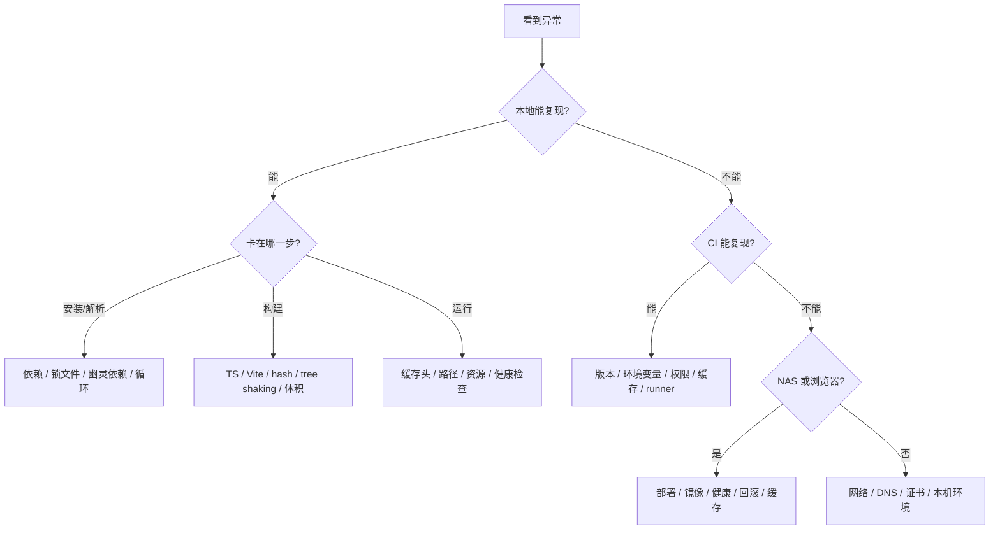

# P3 故障演练手册

> **目标层级**：L3 ｜ **前置**：M1～M6、B1～B6、C1～C6、P1、P2 ｜ **预计**：8h
> **本章产物**：`reports/p3-drills.md`；10 个可重复的故障剧本与修复记录

## 0. 先看终点

这不是“常见错误大全”，而是 10 个**可以故意制造、可以观察、可以修回**的故障。每个剧本都要求：

```text
现象（用户看到什么）
  → 10 分钟内定位（先查哪三层）
  → 根因（不是“缓存问题”这种空话）
  → 修复命令（可复制执行）
  → 防复发（门禁/脚本/约定）
  → 验收（怎么证明真的好了）
```

10 个剧本：

| # | 剧本 | 主要层 | 典型信号 |
|---:|---|---|---|
| 1 | 幽灵依赖 | 依赖 | 本地能跑，干净安装/CI 找不到模块 |
| 2 | 循环依赖 | 包边界 | 初始化顺序错误、构建顺序怪、madge 报环 |
| 3 | hash 失效/抖动 | 构建产物 | 没改代码 hash 变；改了代码 hash 不变 |
| 4 | 锁文件漂移 | 依赖 | `ERR_PNPM_OUTDATED_LOCKFILE` |
| 5 | 镜像过大 | 容器 | 镜像几百 MB～GB，拉取慢 |
| 6 | 缓存头错误 | 传输 | 发布后用户仍看旧页面 |
| 7 | 部署半成功 | 部署 | 脚本退出 0，但容器没换/旧版仍在 |
| 8 | 健康检查误判 | 运行时 | `/healthz` 200，但页面旧/空白 |
| 9 | 回滚失败 | 发布 | 上一版 tag 拉不到/架构不对/认证失败 |
| 10 | 权限不足 | 认证 | GHCR 403、NAS 401、SSH publickey |

> **安全边界**：部署类故障只在测试 Compose 或维护窗口演练；不要在真实生产上“试试看”。演练前确认 `.previous_tag` 可用，演练后把环境恢复到明确版本。

## 1. 知识讲解

### 1.1 先定界，再动手

看到报错，先问三个问题：

1. **本地能复现吗？** 能，优先查依赖/配置/代码；不能，查 CI 环境、缓存、权限。
2. **是构建前、构建中，还是构建后？** 构建前查安装/解析；构建中查 Vite/TS；构建后查产物/镜像/缓存。
3. **是“版本不对”还是“服务不可用”？** 版本不对查部署/缓存/健康；不可用查容器/端口/网络。



### 1.2 10 分钟定位法

| 分钟 | 动作 | 产出 |
|---:|---|---|
| 0～2 | 记录现象、时间、版本/sha、影响范围 | 一句话事实 |
| 2～4 | 判断本地/CI/NAS/浏览器哪一层 | 定界 |
| 4～7 | 只跑 2～3 个诊断命令 | 证据 |
| 7～9 | 提出一个根因假设 | 可验证的假设 |
| 9～10 | 做最小变更验证，或先回滚 | 恢复/下一步 |

不要把“删 `node_modules`、清缓存、重装、重启”当第一步。它们会改变现场，让你失去证据。

### 1.3 证据链

每个剧本至少留一种证据：

- 命令输出（`pnpm why`、`docker history`、`curl -I`）；
- 文件内容（`pnpm-lock.yaml` diff、`.env`、`.previous_tag`）；
- 版本响应（`/version.json`）；
- 日志片段（CI step、`docker compose logs`）；
- 时间线（部署开始/健康通过/回滚完成）。

报告里写“修复了”没有价值；写“修复前后 hash/体积/版本响应”才有。

### 1.4 修复的顺序

```text
先恢复服务（回滚/切回旧 tag）
  → 再定位根因
  → 再修代码/配置
  → 再走完整门禁
  → 最后补防复发
```

线上故障不要一边查根因一边改生产。先让用户可用，再慢慢查。

### 1.5 防复发的四个位置

| 位置 | 例子 |
|---|---|
| 依赖声明 | 应用自己的依赖写进自己的 `package.json` |
| 构建门禁 | hash 稳定性、体积预算、smoke |
| 部署脚本 | 失败即回滚、健康 + 版本双校验 |
| 运行手册 | 保留 sha tag、回滚演练、权限归属 |

故障修完只改代码、不补门禁，下一次还会再来。

## 2. Guided 实操：十个剧本

### 剧本 1：幽灵依赖

**现象**

本地 `pnpm dev` 正常，CI 或新同事干净安装后：

```text
Failed to resolve import "lodash-es" from "apps/admin/src/..."
Cannot find module 'lodash-es'
```

**10 分钟定位**

```powershell
# 1. 应用自己声明了吗？
Select-String -Path apps/admin/package.json -Pattern "lodash"

# 2. 谁把它带进来的？
pnpm --filter "@lab/admin" why lodash-es

# 3. 根目录/其他包是否声明了它？
pnpm why lodash-es -r
pnpm list -r --depth 0 | Select-String "lodash"
```

**根因**

`lodash-es` 只写在根 `package.json` 或另一个包里，应用代码直接 import。pnpm 默认隔离时通常立刻失败；如果使用 `nodeLinker: hoisted`、npm/yarn 提升，或 CI 的安装布局不同，就会被“幽灵”般地解析到。

**修复**

```powershell
# 给真正使用它的应用加依赖
pnpm --filter "@lab/admin" add lodash-es

# 如果根目录只是误加，移除
pnpm remove lodash-es -w

pnpm install
pnpm --filter "@lab/admin" build
```

**防复发**

- 运行时依赖一律 `pnpm --filter <app> add`；
- 根 `package.json` 只放仓库级工具，不放应用运行时依赖；
- CI 用 `--frozen-lockfile`，并在干净 clone 上验证；
- M3 的依赖体检表加入“应用直接 import 但未声明”。

**验收**

```powershell
git clean -xdf   # 仅在实验仓库；确认没有要保留的文件
pnpm install --frozen-lockfile
pnpm --filter "@lab/admin" build
pnpm --filter "@lab/admin" why lodash-es
```

干净安装可构建，`why` 能从应用侧看到依赖。

---

### 剧本 2：循环依赖

**现象**

- `Cannot access 'X' before initialization`
- 某个导出在运行时是 `undefined`
- `pnpm -r build` 顺序诡异，单独 build 又能过
- `madge` 报 circular

**10 分钟定位**

```powershell
pnpm --filter "@lab/ui" why @lab/utils
pnpm --filter "@lab/utils" why @lab/ui

pnpm dlx madge --circular --extensions ts,tsx apps packages
```

如果 `madge` 输出环，先看环上的**值导入**；只有 `import type` 的环不会造成运行时初始化问题，但仍然是架构问题。

**根因**

共享代码放错层：`ui` 依赖 `utils`，`utils` 又为了一个类型/常量反向依赖 `ui`；或者 barrel 文件把所有东西重新导出，形成隐式环。

**修复**

1. 把共享类型/常量抽到独立包（例如 `@lab/shared`），或移到依赖方向的下层；
2. 删除反向 import；
3. 如果只是类型，改成 `import type`，但不要把运行时值也当作类型绕过；
4. 重跑 madge 和干净构建。

```powershell
pnpm dlx madge --circular --extensions ts,tsx apps packages
pnpm -r build
```

**防复发**

- 依赖方向写进 `docs/architecture.md`：`app → feature → ui → utils`，禁止反向；
- 新包评审时看 `pnpm why`；
- 可选：CI 加 madge 检查，但先保证现有图为 0，否则会长期红。

**验收**

- madge 无环；
- 干净安装后 `pnpm -r build` 通过；
- 运行时不再出现初始化顺序错误。

---

### 剧本 3：hash 失效/抖动

**现象 A：没改代码，hash 每次变**

```text
dist/assets/index-a1b2c3.js
dist/assets/index-d4e5f6.js
```

**现象 B：改了代码，hash 不变**

浏览器/网关继续用旧文件，或 `index.html` 引用的还是旧 hash。

**10 分钟定位**

```powershell
pnpm --filter "@lab/admin" build
Get-ChildItem apps/admin/dist/assets | Select-Object Name,Length
pnpm --filter "@lab/admin" build
Get-ChildItem apps/admin/dist/assets | Select-Object Name,Length
```

再查配置里有没有动态值：

```powershell
Select-String -Path apps/admin/vite.config.* -Pattern "define|Date|random|BUILD_TIME"
```

> Vite 8 的 `vite.config.js` 优先于 `vite.config.ts`；配置不生效时先 `vite build --debug` 看实际加载了哪份。

**根因**

- 抖动：`define: { __BUILD_TIME__: JSON.stringify(new Date().toISOString()) }`、随机数、绝对路径、环境相关内容进入模块；
- 不变：内容没有进入 hash（例如只在 HTML/运行时注入），或 `index.html` 被长缓存，浏览器根本没请求新资源。

**修复**

```ts
// 不要这样：每次构建都变
define: {
  __BUILD_TIME__: JSON.stringify(new Date().toISOString()),
}
```

把构建时间放到部署阶段生成的 `version.json`，并用 `no-cache`（或更强的 `no-store`）提供；JS 里不要注入每次构建都变的值。

```powershell
pnpm --filter "@lab/admin" build
Get-ChildItem apps/admin/dist/assets/*.js | Get-FileHash
pnpm --filter "@lab/admin" build
Get-ChildItem apps/admin/dist/assets/*.js | Get-FileHash
```

两次应一致；改一行业务代码后，只有相关 chunk 的 hash 变化。

**防复发**

- 构建脚本禁止 `Date.now()`/`Math.random()` 进入 bundle；
- B3 的 hash 稳定性检查进 CI（同内容两次构建比较）；
- HTML 用 `no-cache`，带 hash 的资源用 `immutable`（见剧本 6）。

**验收**

- 同内容两次构建 hash 相同；
- 改业务代码后对应 chunk hash 变化；
- 部署后浏览器拿到新 `index.html`，不依赖硬刷新。

---

### 剧本 4：锁文件漂移

**现象**

```text
ERR_PNPM_OUTDATED_LOCKFILE  Cannot install with "frozen-lockfile"
because pnpm-lock.yaml is not up to date with package.json
```

本地 `pnpm install` 却正常。

**10 分钟定位**

```powershell
git status
pnpm install --frozen-lockfile
git diff -- pnpm-lock.yaml package.json pnpm-workspace.yaml
```

如果本地能装、CI 不能，通常是本地安装时悄悄改了 lockfile 但没提交。也可能是合并冲突时手改了 `package.json`，或 catalog 版本变了。

**修复**

```powershell
pnpm install
git diff -- pnpm-lock.yaml
git add pnpm-lock.yaml
git commit -m "chore: sync lockfile"
```

合并冲突时不要手写 lockfile：从 main 取一份，重新应用 `package.json` 变更，再 `pnpm install` 生成。

**防复发**

- CI 永远 `--frozen-lockfile`；
- PR 模板要求“lockfile 是否变更”；
- 依赖升级单独 PR，不和业务混；
- 不在本地用 `--no-frozen-lockfile` 后忘了提交。

**验收**

```powershell
pnpm install --frozen-lockfile
git diff --exit-code pnpm-lock.yaml
```

干净 clone 可安装，lockfile 无未提交差异。

---

### 剧本 5：镜像过大

**现象**

```text
fe-lab-admin   latest   ...   1.2GB
```

NAS 拉取慢、磁盘告警、部署超时。

**10 分钟定位**

```powershell
docker images fe-lab-admin
docker history --no-trunc fe-lab-admin:<sha>
docker run --rm --entrypoint sh fe-lab-admin:<sha> -c "du -sh /* 2>/dev/null | sort -h"
```

看最终阶段：

- 基础镜像是 `node` 还是 `nginx`；
- 是否把 `node_modules`、源码、`.git` 复制进去；
- 是否包含构建工具、缓存、sourcemap；
- 是否多层重复。

**根因**

单阶段构建、`COPY . .`、没有 `.dockerignore`、运行时镜像仍用 Node、把 devDependencies 带进生产。

**修复**

用 C4 的多阶段：

```dockerfile
FROM node:24.14.1-alpine AS build
# ... pnpm install / build
FROM nginx:1.27-alpine-slim
COPY --from=build /app/apps/admin/dist /usr/share/nginx/html
```

并检查 `.dockerignore` 包含：

```text
**/node_modules
**/dist
.git
reports
.tmp
```

**防复发**

- 镜像大小进发布记录，设预算（例如 < 150MB，按你的基础镜像定）；
- 禁止 `COPY . .` 进入最终阶段；
- 固定基础镜像 tag，不用 `latest`；
- 定期看 `docker history`，不只看总大小。

**验收**

- 最终阶段只有 nginx + 静态资源；
- `docker history` 没有大块 node_modules；
- 体积和拉取时间记录在 `reports/`；
- 健康检查仍通过。

---

### 剧本 6：缓存头错误

**现象**

新版本已部署，用户仍看到旧页面；强制刷新/无痕窗口才正常。或者每次访问都重新下载几百 KB 的带 hash 资源。

**10 分钟定位**

```powershell
curl.exe -I "http://<NAS-IP>:8088/"
curl.exe -I "http://<NAS-IP>:8088/index.html"
curl.exe -I "http://<NAS-IP>:8088/assets/<hash>.js"
curl.exe -I "http://<NAS-IP>:8088/version.json"
```

期望：

| 路径 | Cache-Control |
|---|---|
| `/`、`/index.html` | `no-cache` 或 `max-age=0, must-revalidate` |
| `/assets/*`（带 hash） | `public, max-age=31536000, immutable` |
| `/version.json` | `no-cache`（或更强的 `no-store`） |

**根因**

Nginx 的 `expires 1y` 或 `add_header Cache-Control` 写在了 `location /`，把 HTML 也长缓存了；或者 `index.html` 没有明确规则，继承了静态资源规则。

**修复**

C4 的 `nginx.conf` 用精确 location：

```nginx
location = /index.html {
    add_header Cache-Control "no-cache";
}

location = /version.json {
    add_header Cache-Control "no-cache";
}

location /assets/ {
    add_header Cache-Control "public, max-age=31536000, immutable";
}
```

注意 `add_header` 的继承规则：子 location 一旦有自己的 `add_header`，父级的其他头不会自动继承；安全头要一起补齐。

**防复发**

- smoke 检查三个 Cache-Control；
- 发布后用 `curl -I` 验证，不只看浏览器；
- `index.html` 永远不 fingerprint，必须短缓存；
- 带 hash 资源才用 immutable。

**验收**

- 新部署后普通刷新即可看到新版本；
- 带 hash 资源不重复下载；
- `/version.json` 不被缓存。

---

### 剧本 7：部署半成功

**现象**

`./deploy.sh <sha>` 退出码 0，但：

- 页面还是旧版本；
- `docker compose ps` 里容器没换；
- `.env` 写了新 tag，容器仍用旧镜像；
- 或者 pull 成功、up 失败，旧容器还在，脚本却报成功。

**10 分钟定位**

```bash
ssh qnap
cd /share/Container/fe-lab-admin

cat .env
cat .previous_tag
docker compose ps
docker compose config | grep -A2 image
docker inspect --format '{{.Config.Image}}' fe-lab-admin
docker compose logs --tail=100
curl -s http://127.0.0.1:8088/version.json
```

**根因**

常见三种：

1. `.env` 更新了，但 Compose 的 shell 环境里已有 `IMAGE_TAG`，环境变量优先级高于 `.env`；
2. `docker compose up -d` 失败，但脚本没 `set -e`，继续打印成功；
3. 健康检查打到了旧容器/旧端口，没校验版本。

**修复**

C5 的 `deploy.sh` 必须：

- `set -euo pipefail`；
- `write_env` 同时更新 `.env` 和当前 shell 的 `IMAGE_TAG`；
- `docker compose config` 先校验；
- `pull`、`up -d` 分步检查；
- 健康 + `/version.json` 双校验；
- 失败写回 `.previous_tag` 并回滚。

**防复发**

- 部署脚本用固定 sha，不用 `latest`；
- 每次部署记录 `docker inspect` 的镜像；
- 用错误 tag 演练一次，确认脚本非 0 且旧服务可用。

**验收**

- 错误 tag：脚本失败、旧版本仍健康；
- 正确 tag：容器镜像、`/version.json`、页面三者一致；
- `.env` 与当前运行版本一致。

---

### 剧本 8：健康检查误判

**现象**

- `/healthz` 返回 200，但页面空白/旧版本；
- 容器 healthy，实际请求 502；
- 健康检查失败，但手动访问正常。

**10 分钟定位**

```powershell
curl.exe -i "http://<NAS-IP>:8088/healthz"
curl.exe -i "http://<NAS-IP>:8088/version.json"
ssh qnap "docker inspect --format '{{json .State.Health}}' fe-lab-admin"
ssh qnap "docker compose -f /share/Container/fe-lab-admin/compose.yaml ps"
```

看健康检查实际命令、端口、路径；再确认 `/healthz` 返回的是 **精确的 ok 文本**，不是 SPA 的 `index.html`。

**根因**

- Nginx `try_files ... /index.html` 把不存在的 `/healthz` 也返回 200；
- 健康检查用 80，容器实际监听 8080；
- 健康检查只测 TCP，不测 HTTP；
- 旧容器仍占用端口/名称，检查打到旧容器。

**修复**

```nginx
location = /healthz {
    access_log off;
    add_header Content-Type text/plain;
    return 200 "ok\n";
}
```

Compose：

```yaml
healthcheck:
  test: ["CMD-SHELL", "wget -q -O - http://127.0.0.1:8080/healthz | grep -q '^ok$'"]
  interval: 10s
  timeout: 3s
  retries: 6
```

部署脚本还要校验 `version.json.sha`，健康只是第一层。

**防复发**

- 健康端点精确匹配，不落到 SPA fallback；
- 健康检查用容器内地址和真实端口；
- 发布验收必须同时看 health 和 version；
- 演练停掉容器，确认 health 真的变红。

**验收**

- 正常：health 200 且 body 精确为 `ok`；
- 异常：停容器/改端口后 health 失败；
- 旧版本：version 不匹配时部署脚本失败。

---

### 剧本 9：回滚失败

**现象**

```text
./deploy.sh --rollback
Error response from daemon: manifest unknown
```

或回滚后容器起不来、架构错误、认证失败。

**10 分钟定位**

```bash
cat .previous_tag
docker image inspect "$(cat .previous_tag)" >/dev/null 2>&1; echo $?
docker pull ghcr.io/<owner>/fe-lab-admin:$(cat .previous_tag)
docker manifest inspect ghcr.io/<owner>/fe-lab-admin:$(cat .previous_tag) | head
```

再看：

- 旧 tag 是否被清理；
- NAS 是否登录 GHCR；
- 镜像架构是否 `linux/amd64`；
- `.previous_tag` 是否在成功部署后才写入；
- 回滚脚本是否又用了 `latest`。

**根因**

- GHCR 包保留策略删了旧 sha；
- 只保留 `latest`，每次都覆盖；
- `.previous_tag` 被失败部署覆盖；
- NAS PAT 过期/权限不足；
- CI 构建了 `arm64`，NAS 是 x86_64。

**修复**

1. 保留最近 N 个 sha tag（至少覆盖一个发布周期）；
2. 只有部署成功才更新 `.previous_tag`；
3. 回滚使用完整 sha，不用 `latest`；
4. 固定 `linux/amd64`；
5. 为 NAS 使用只读 `read:packages` 凭据；
6. 如果 tag 已丢失，从对应 git sha 重跑 publish，生成同 sha 镜像（先确认可复现）。

**防复发**

- 每月做一次真实回滚演练；
- 记录回滚耗时；
- 包保留策略写进运行手册；
- 不在失败时覆盖 `.previous_tag`。

**验收**

- 已知上一版 sha 能被拉取并启动；
- `/version.json` 回到上一版；
- 回滚后服务健康；
- 再部署目标 sha 成功。

---

### 剧本 10：权限不足

**现象**

- Actions：`denied: permission_denied`、`Resource not accessible by integration`
- NAS：`unauthorized: authentication required`
- SSH：`Permission denied (publickey)`
- `docker push` 403

**10 分钟定位**

```powershell
gh run view <run-id> --log
gh api /user
docker login ghcr.io
ssh -vvv qnap
```

在 NAS 上：

```bash
docker info | head
docker pull ghcr.io/<owner>/fe-lab-admin:<sha>
```

**根因**

- workflow 缺 `permissions: packages: write`；
- PAT 没有 `read:packages`，或组织 SSO 未授权；
- 包是 private，NAS 未登录；
- SSH 公钥没加到 QNAP 用户，或用户不在 docker 组；
- 用了密码/宽权限 token，轮换后未更新 secret。

**修复**

Workflow：

```yaml
permissions:
  contents: read
  packages: write
```

NAS：

```bash
echo "$GHCR_TOKEN" | docker login ghcr.io -u <user> --password-stdin
```

只给 `read:packages`；SSH 用专用密钥；QNAP 用户加入所需组。修复后轮换曾经泄露的 token。

**防复发**

- 最小权限，禁止 `write-all`；
- secret 放 GitHub Environments，限制分支；
- 记录凭据归属和到期时间；
- 日志里不打印 token；
- 定期检查包可见性和 SSO。

**验收**

- CI 能推目标 sha；
- NAS 能用只读凭据拉取；
- SSH 可登录但不需要 root；
- 日志无 secret 泄露。

## 3. 排障索引

| 你看到 | 先看剧本 |
|---|---|
| `Cannot find module` / `Failed to resolve import` | 1 |
| `Cannot access ... before initialization` | 2 |
| hash 每次变/不变 | 3 |
| `ERR_PNPM_OUTDATED_LOCKFILE` | 4 |
| 镜像 1GB、拉取慢 | 5 |
| 发布后仍旧页面 | 3、6 |
| 脚本成功但版本没换 | 7、8 |
| healthy 但页面坏 | 8 |
| `manifest unknown` / 回滚起不来 | 9 |
| 401/403/permission denied | 10 |

## 4. 记录模板

`reports/p3-drills.md`：

```md
# P3 故障演练记录

## 环境
- 仓库 sha:
- Node/pnpm:
- NAS 镜像/Compose:
- 演练时间:

## 剧本 1：幽灵依赖
- 现象:
- 定界:
- 诊断命令/输出:
- 根因:
- 修复:
- 防复发:
- 验收:
- 耗时:

## 剧本 2：循环依赖
...

## 总结
- 最容易误判的:
- 最值得加门禁的:
- 下次演练要改的:
```

不要只写“已修复”。至少留一条命令输出和一个版本/体积/时间的前后对比。

## 5. 闭卷练习

合上教程，随机抽 3 个剧本：

1. 只根据现象，说出先查哪一层；
2. 写出 2 条诊断命令；
3. 给出最小修复；
4. 说出一个防复发措施；
5. 在实验环境真实复现并修回。

验收标准：

- 10 个剧本都能在 10 分钟内说出定位路径；
- 至少 5 个真实复现并修复；
- 部署类剧本有回滚/恢复记录；
- 没有通过关闭门禁、删 lockfile、使用 `latest` 来“修复”。

## 6. 验收清单

- [ ] 10 个剧本都已读并记录
- [ ] 至少 5 个在实验环境复现
- [ ] 每个复现有现象、诊断、根因、修复、验收
- [ ] 部署类故障没有在未经批准的生产环境演练
- [ ] 回滚剧本真实执行过
- [ ] 权限剧本确认了最小权限
- [ ] 记录了定位耗时
- [ ] `reports/p3-drills.md` 已提交

## 7. 自测

**Q1：为什么不能一上来就删 `node_modules`？**

<details>
<summary>答案</summary>

它改变现场，可能掩盖幽灵依赖/锁文件问题，也让你无法证明根因；先取证再清理。

</details>

**Q2：`/healthz` 返回 200 为什么还可能是误判？**

<details>
<summary>答案</summary>

Nginx 的 SPA fallback 可能把不存在的路径也返回 `index.html` 200；必须精确匹配健康端点，并校验版本。

</details>

**Q3：hash 抖动和缓存头错误有什么区别？**

<details>
<summary>答案</summary>

hash 抖动是构建产物内容/文件名不稳定；缓存头错误是文件正确但浏览器/网关缓存策略错。两者都可能表现为“发布后仍是旧页面”。

</details>

**Q4：回滚失败最常见的流程原因是什么？**

<details>
<summary>答案</summary>

只保留 `latest` 或过早清理旧 sha，导致上一版镜像不可得；其次是 `.previous_tag` 被失败部署覆盖、认证/架构问题。

</details>

**Q5：部署脚本为什么要同时校验 health 和 version？**

<details>
<summary>答案</summary>

旧容器也可能 healthy；只有版本匹配才能证明本次目标镜像真的在运行。

</details>

## 8. 延伸

- 把 10 个剧本做成 `tooling/drills/` 下的可重复脚本
- 用故障注入检查门禁是否真的会红
- 给每个剧本记录 MTTR（平均恢复时间）
- 把运行手册交给另一个人，按剧本独立演练
